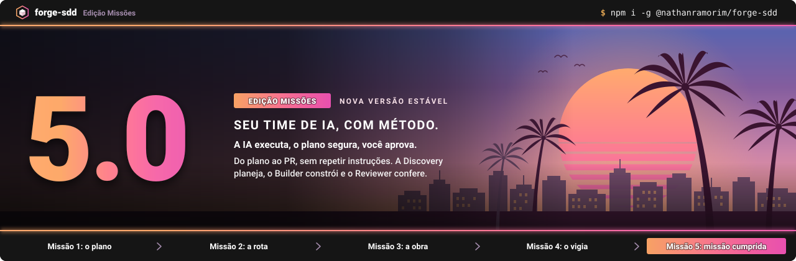
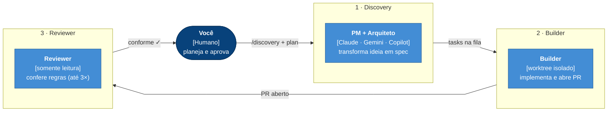
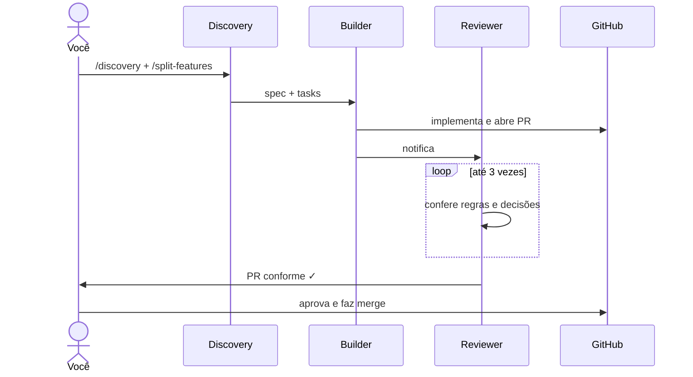

<!-- edicao:inicio -->
<p align="center">
  
</p>

<p align="center">
  <a href="https://www.npmjs.com/package/@nathanramorim/forge-sdd"></a>
  <a href="https://github.com/nathanramorim/forge-sdd/releases"></a>
  
  
</p>

<h3 align="center">Seu time de IA, com método.<br>Do plano ao PR, sem repetir instruções.</h3>

<p align="center"><strong>Versão atual: 5.0.0 (estável)</strong> · <a href="sdd/releases/history.md">veja as novidades</a> · <a href="docs/design/edicao-missoes/README.md">Edição Missões</a></p>

<p align="center"><strong>A IA executa, o plano segura, você aprova.</strong><br>
Missão 1: o plano · Missão 2: a rota · Missão 3: a obra · Missão 4: o vigia · Missão 5: missão cumprida</p>
<!-- edicao:fim -->

<p align="center">
  <a href="https://forge-sdd.org">Site oficial</a> ·
  <a href="docs/comandos.md">Comandos</a> ·
  <a href="docs/pipeline.md">Pipeline</a> ·
  <a href="docs/metodologia-sdd.md">Metodologia</a>
</p>

---

## O que é

Quando você trabalha com uma IA, precisa repetir as mesmas instruções a cada conversa: como o projeto é organizado, quais regras seguir, o que já foi decidido.

O **forge-sdd** resolve isso. Ele instala no seu projeto um conjunto de regras, comandos e agentes de IA que trabalham em etapas e lembram do que importa. Você conversa, planeja e aprova. A IA constrói e outra IA confere o resultado.

## Como funciona

Você usa três sessões de IA ao mesmo tempo:

| Sessão | O que faz |
|---|---|
| **1. Discovery** | É onde você conversa e planeja a ideia. |
| **2. Builder** | Constrói em paralelo e abre o PR. |
| **3. Reviewer** | Confere as regras e as decisões, e devolve com comentários (até 3 vezes). |

Quando o PR está conforme, você é avisado na sessão de Discovery e faz a aprovação final.



## Por que usar

| | |
|---|---|
| 🧠 **A IA lembra do projeto** | Regras e decisões ficam em arquivos do projeto, não na sua cabeça. |
| 🔍 **Revisão independente** | Quem confere não é quem construiu. |
| 🔁 **Uma fonte para vários agentes** | Claude, Gemini, Copilot e Codex leem as mesmas regras. |
| 🛡️ **Você decide** | Nada é entregue sem a sua aprovação final. |

## Antes de começar

- **Node.js** (para instalar pelo npm).
- Pelo menos um agente de IA: **Claude Code**, **Gemini**, **Copilot** ou **Codex**.
- Opcional: **tmux**, para ver as três sessões numa tela só.

## Instalação

```bash
npm install -g @nathanramorim/forge-sdd
forge init
```

Prefere não instalar? Use o `npx`:

```bash
npx @nathanramorim/forge-sdd@latest init
```

O pipeline de três sessões já vem na versão estável. Para já instalar a próxima prévia, use `@beta`.

## Como usar

**1. Comece o pipeline.** Rode `forge` e escolha *Pipeline multi-sessão → Iniciar as 3 sessões*. O menu pergunta qual agente roda em cada sessão e lembra da sua escolha.

**2. Alinhe o projeto.** Em projetos novos, comece com `/constitution`. Ele registra a missão, a stack e as decisões antes da primeira feature. Para saber se o projeto está pronto, rode `forge brief --check`; sem `--check`, `forge brief` imprime o resumo das decisões.

**3. Planeje e construa.** Na sessão Discovery:

| Comando | Para que serve |
|---|---|
| `/discovery <ideia>` | Planejar uma ideia |
| `/split-features` | Dividir o plano em tarefas para o Builder |
| `/implementar <feature>` | Construir uma feature |
| `/revisar` | Conferir o resultado |
| `/status` | Ver o andamento e o próximo passo |
| `/tutorial` | Aprender o ciclo com um exemplo |

Veja todos em [docs/comandos.md](docs/comandos.md).

**Como o ciclo de uma feature funciona, da ideia ao merge:**



> *Convenção: pipeline em flowchart LR com cores C4; ciclo em sequenceDiagram. Versões PNG em [docs/img/](docs/img/).*

## Guias

- [Pipeline multi-sessão](docs/pipeline.md)
- [Metodologia SDD](docs/metodologia-sdd.md)
- [Arquitetura e fluxo](docs/arquitetura-e-fluxo-forge-sdd.md)
- [Skills](docs/skills.md)
- [Telemetria e métricas](docs/telemetria.md)

## Privacidade

A telemetria é opcional e fica no seu projeto. No modo `forge worker --raw`, a saída aparece sem máscara de segredos; use com cuidado.

## Versões

| Versão | Novidades |
|---|---|
| **5.0.0** | Edição Missões: wiki Get Started com prompts prontos para IA e modo Hub, PR aberto sozinho quando a revisão dá conforme, limpeza de worktrees ociosos e revisão dos artefatos da spec sem sair da conversa. |
| **4.8.0** | Versão estável do painel interativo: stream de chat nos workers, fila com abas e drill-down, popup no tmux e fila que acompanha a aprovação do Reviewer. |
| **4.6.x** | Comando único `forge`, painel vivo executivo e tokens por janela com reset suave. |
| **4.2.0-beta** | Pipeline multi-sessão: Discovery, Builder e Reviewer trabalhando juntos. |
| **3.0.0-beta** | Esteira de 5 especialistas, portão de governança (A/B/C), regras por ID e auto-skills. |
| **2.2.0-beta** | Regras e comandos compartilhados em `.agents/`, uma fonte para vários agentes. |
| **2.0.0-beta** | Versão enxuta: telemetria confiável, `lessons.md` e um fluxo único em `sdd/FLOW.md`. |

Histórico completo: [sdd/releases/history.md](sdd/releases/history.md).

## Contribuir

Veja o [guia de contribuição](CONTRIBUTING.md).

## Licença

[MIT](LICENSE)
