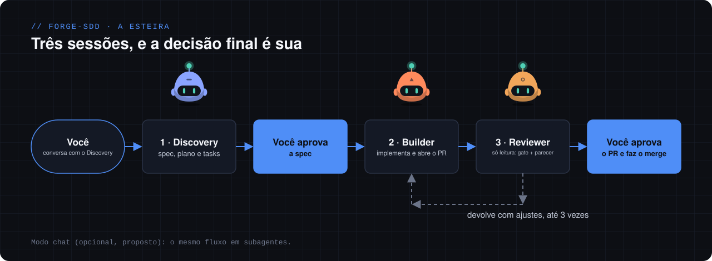
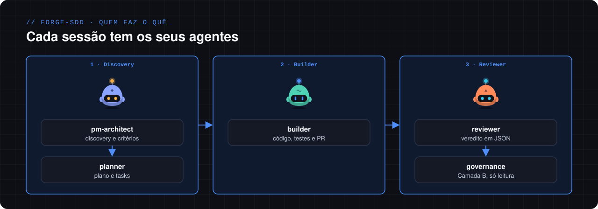
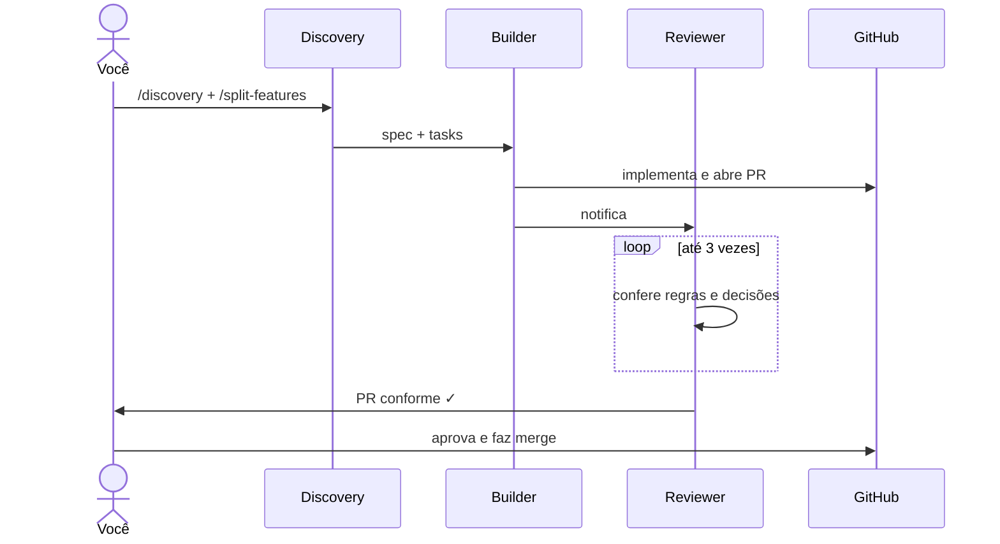

<p align="center">
  
</p>

<p align="center">
  <a href="https://www.npmjs.com/package/@nathanramorim/forge-sdd"></a>
  <a href="https://github.com/nathanramorim/forge-sdd/releases"></a>
  
  
</p>

<h3 align="center">Seu time de IA, com método.<br>Do plano ao PR, sem repetir instruções.</h3>

<p align="center"><strong>Versão atual: 5.0.0 (estável) · prévia: 5.2.3-beta (<code>@beta</code>)</strong> · <a href="sdd/releases/history.md">veja as novidades</a></p>

<p align="center">
  <a href="https://forge-sdd.org">Site oficial</a> ·
  <a href="docs/comandos.md">Comandos</a> ·
  <a href="docs/pipeline.md">Pipeline</a> ·
  <a href="docs/metodologia-sdd.md">Metodologia</a>
</p>

---

## O que é

Quando você trabalha com uma IA, precisa repetir as mesmas instruções a cada conversa: como o projeto é organizado, quais regras seguir, o que já foi decidido.

O **forge-sdd** resolve isso. Ele instala no seu projeto um conjunto de regras, comandos e agentes de IA que trabalham em etapas e lembram do que importa. Você conversa, planeja e aprova. A IA constrói e outra IA confere o resultado.

## Como a esteira funciona

<p align="center">
  
</p>

- **Você conversa com o Discovery** e aprova a spec. O Gate 1 é humano (no modo avançado, experimental, o Reviewer revisa a spec no seu lugar).
- **O Builder** pega as tasks, implementa (em paralelo, em worktree isolado) e abre o PR.
- **O Reviewer** confere em duas camadas: `forge gate` (regras checadas por código) e um parecer JSON de leitura apenas, que não edita nada.
- Se o parecer aponta violação, o PR volta ao Builder, até o teto de `max_rework_attempts` (padrão 3). Passou do teto, escala para você.
- **Você aprova o PR**. Quando o PR está conforme, você é avisado na sessão de Discovery e faz a aprovação final e o merge.
- Modo `sessions` (padrão): `forge pipeline init` e `forge up` abrem as 3 sessões. Modo `chat`: o mesmo fluxo em subagentes, no mesmo chat. É opt-in e está **proposto** na [ADR-0015](sdd/spec/adr/adr-0015-pipeline-em-subagentes-no-chat.md); ainda não existe na 5.0.0.

## Quem faz o quê

<p align="center">
  
</p>

| Agente | O que faz | Como acionar | Definição |
|---|---|---|---|
| `pm-architect` | Conversa a ideia e gera discovery e critérios | `/discovery` | `.claude/agents/pm-architect.md` |
| `planner` | Transforma a spec em plano e tasks | `/split-features` | `.claude/agents/planner.md` |
| `builder` | Implementa as tasks e abre o PR | `forge up`, `forge worker`, `/implementar` | `.claude/agents/builder.md` |
| `reviewer` | Confere o PR e emite o veredito JSON | `forge bus review`, `/revisar` | `.claude/agents/reviewer.md` |
| `governance` | Revisão semântica (Camada B), só leitura | `/revisar` | `.claude/agents/governance.md` |
| `archivist` | Mantém o `status.md` pequeno (até 1 KB) | `/archive` | `.claude/agents/archivist.md` |
| `migrator` | Aplica as mudanças de estrutura entre versões | `/upgrade-sdd` | `.claude/agents/migrator.md` |

Os arquivos de agente apontam para as skills em `.agents/skills/`, onde está o passo a passo de cada papel.

## O que é obsoleto (não use)

> **Obsoleto: não use.** Esta tabela é para você não se confundir com textos antigos.

| Item | Por que | Use no lugar |
|---|---|---|
| "5 estações" como fluxo | O produto virou 3 sessões (ADR-0004) | As 3 sessões e a sua aprovação |
| Agente `lider` | Descreve um orquestrador de 5 estações; quem orquestra é o código Go | `forge up` (ou o modo `chat`, quando existir) |
| `forge review` | O comando não existe | `forge bus review` |
| Nome `forge-sdd` como comando principal | O nome oficial é `forge` (ADR-0010); `forge-sdd` segue como alias no npm | `forge` |
| Versões `beta` e anteriores à 5.0.0 | Há uma versão estável | `npm install -g @nathanramorim/forge-sdd` |

**Legado que ainda funciona** (existe no binário, mas não é o caminho principal):

| Item | Situação |
|---|---|
| `forge queue stations` e as filas por estação | Seguem no `forge queue --help`; o caminho atual é o `queue.json` da iniciativa e o barramento de jobs |
| Skills `sdd-*` por estação (`.agents/skills/`) | Seguem como apoio das 3 sessões; os comandos ainda apontam para elas |
| `/implement` e `/proxima-feature` | Apelidos de `/implementar` |

## Por que usar

| | |
|---|---|
| 🧠 **A IA lembra do projeto** | Regras e decisões ficam em arquivos do projeto, não na sua cabeça. |
| 🔍 **Revisão independente** | Quem confere não é quem construiu. |
| 🔁 **Uma fonte para vários agentes** | Claude, Gemini, Copilot e Codex leem as mesmas regras. |
| 🛡️ **Você decide** | Nada é entregue sem a sua aprovação final. |

## Antes de começar

- **Node.js** (para instalar pelo npm).
- Pelo menos um agente de IA: **Claude Code**, **Gemini**, **Copilot** ou **Codex**.
- Opcional: **tmux**, para ver as três sessões numa tela só.

## Instalação

```bash
npm install -g @nathanramorim/forge-sdd
forge init
```

Prefere não instalar? Use o `npx`:

```bash
npx @nathanramorim/forge-sdd@latest init
```

O pipeline de três sessões já vem na versão estável. Para já instalar a próxima prévia, use `@beta`.

## Como usar

### Comece por aqui: cole isto na sua IA

Escolha a ferramenta e copie o bloco inteiro:

**Claude Code**

```text
Leia o CLAUDE.md deste projeto e o sdd/memory/constitution.md. Depois rode
`forge brief` e me diga em que estado o projeto está e qual é o próximo passo.
Não implemente nada ainda; só me diga o que fazer a seguir.
```

**Gemini CLI**

```text
Leia o GEMINI.md deste projeto e o sdd/memory/constitution.md. Depois rode
`forge brief` e me diga em que estado o projeto está e qual é o próximo passo.
Não implemente nada ainda; só me diga o que fazer a seguir.
```

**GitHub Copilot**

```text
Leia .github/copilot-instructions.md deste projeto e o sdd/memory/constitution.md.
Depois rode `forge brief` e me diga em que estado o projeto está e qual é o
próximo passo. Não implemente nada ainda.
```

**Codex / outros agentes**

```text
Leia o AGENTS.md deste projeto e o sdd/memory/constitution.md. Depois rode
`forge brief` e me diga em que estado o projeto está e qual é o próximo passo.
Não implemente nada ainda.
```

Depois de alinhar o contexto, siga com os passos abaixo.

**1. Comece o pipeline.** Rode `forge` e escolha *Pipeline multi-sessão → Iniciar as 3 sessões*. O menu pergunta qual agente roda em cada sessão e lembra da sua escolha.

**2. Alinhe o projeto.** Em projetos novos, comece com `/constitution`. Ele registra a missão, a stack e as decisões antes da primeira feature. Para saber se o projeto está pronto, rode `forge brief --check`; sem `--check`, `forge brief` imprime o resumo das decisões.

**3. Planeje e construa.** Na sessão Discovery:

| Comando | Para que serve |
|---|---|
| `/discovery <ideia>` | Planejar uma ideia |
| `/split-features` | Dividir o plano em tarefas para o Builder |
| `/implementar <feature>` | Construir uma feature |
| `/revisar` | Conferir o resultado |
| `/status` | Ver o andamento e o próximo passo |
| `/tutorial` | Aprender o ciclo com um exemplo |

Veja todos em [docs/comandos.md](docs/comandos.md).

**Como o ciclo de uma feature funciona, da ideia ao merge:**



> *Ciclo da feature em sequenceDiagram. Versões PNG em [docs/img/](docs/img/).*

## Guias

- [Pipeline multi-sessão](docs/pipeline.md)
- [Metodologia SDD](docs/metodologia-sdd.md)
- [Arquitetura e fluxo](docs/arquitetura-e-fluxo-forge-sdd.md)
- [Skills](docs/skills.md)
- [Telemetria e métricas](docs/telemetria.md)

## Privacidade

A telemetria é opcional e fica no seu projeto. No modo `forge worker --raw`, a saída aparece sem máscara de segredos; use com cuidado.

## Versões

| Versão | Novidades |
|---|---|
| **5.2.3-beta** | Prévia (`@beta`): projeto novo ou atualizado passa no diagnóstico do início de sessão do Claude Code; acabou o erro ao abrir. |
| **5.2.2-beta** | Prévia (`@beta`): o script da barreira de PR copiado à mão passa a ser atualizado pelo `forge update`, e o aviso ao abrir o Claude Code mostra o que está errado. |
| **5.2.1-beta** | Prévia (`@beta`): a atualização de projetos 5.0 passa a funcionar de ponta a ponta. `forge update --dry-run` mostra o plano, o que você editou é preservado (a versão nova vem num `.novo.md`) e a Constituição ganha os campos novos por acréscimo. |
| **5.2.0-beta** | Prévia (`@beta`, fora da `main`): o CI só roda quando o PR sai do draft, a revisão acontece em dois pontos (spec e feature), cada feature tem branch e PR em draft, e `gh pr ready`/`merge` exigem parecer do commit atual. `/upgrade-sdd` leva a política aos projetos existentes. |
| **5.0.0** | Edição Missões: wiki Get Started com prompts prontos para IA e modo Hub, PR aberto sozinho quando a revisão dá conforme, limpeza de worktrees ociosos e revisão dos artefatos da spec sem sair da conversa. |
| **4.8.0** | Versão estável do painel interativo: stream de chat nos workers, fila com abas e drill-down, popup no tmux e fila que acompanha a aprovação do Reviewer. |
| **4.6.x** | Comando único `forge`, painel vivo executivo e tokens por janela com reset suave. |
| **4.2.0-beta** | Pipeline multi-sessão: Discovery, Builder e Reviewer trabalhando juntos. |
| **3.0.0-beta** | *(histórico, obsoleto como fluxo)* Esteira de 5 especialistas, portão de governança (A/B/C), regras por ID e auto-skills. O fluxo atual são 3 sessões. |
| **2.2.0-beta** | Regras e comandos compartilhados em `.agents/`, uma fonte para vários agentes. |
| **2.0.0-beta** | Versão enxuta: telemetria confiável, `lessons.md` e um fluxo único em `sdd/FLOW.md`. |

Histórico completo: [sdd/releases/history.md](sdd/releases/history.md).

## Contribuir

Veja o [guia de contribuição](CONTRIBUTING.md).

## Licença

[MIT](LICENSE)
