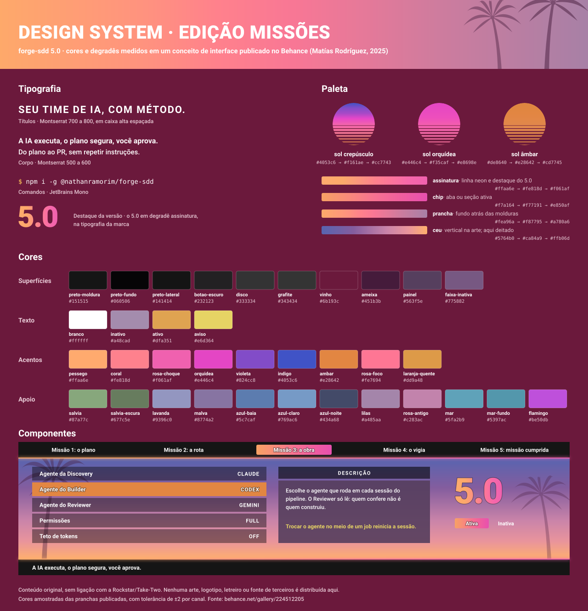

# Design system da Edição Missões

<p align="center">
  
</p>

Identidade visual da edição de lançamento do forge-sdd 5.0.0. É uma homenagem ao clima de pôr do sol, neon e palmeiras. A paleta e os degradês foram medidos em um conceito de interface publicado no Behance; a marca, a tipografia, as ilustrações e os textos são do próprio forge-sdd.

As regras de marca desta edição estão em `sdd/discovery/101-tema-missoes-v5/`.

## Origem e limites

| | |
|---|---|
| **Referência de cor** | [Conceito de interface de Matías Rodríguez no Behance](https://www.behance.net/gallery/224512205), publicado em 25/04/2025. Conteúdo original, sem ligação com a Rockstar/Take-Two. |
| **O que foi medido** | Cores e degradês, amostrados por script nas pranchas publicadas, em 19/11/2026. Tolerância de ±2 por canal. |
| **O que é nosso** | Marca, tipografia, ilustrações, textos e as missões. |
| **O que não entra** | Logotipos, letreiros, numerais, personagens, fontes e interface de jogos. |

## Princípios

1. **Pôr do sol sobre preto.** A cor vem da arte e dos degradês. A interface em si é preta e branca.
2. **Neon fino.** Uma linha de 2 px marca o limite das barras. Ela não vira borda grossa nem moldura de cartão.
3. **Branco para ler, cor para estado.** O texto é branco. Âmbar, rosa e degradê aparecem só em seleção, foco e seção ativa.
4. **Um sinal por estado.** Degradê `chip` é seção ativa, `ambar` é linha selecionada e `rosa-foco` é foco.

## As missões

| Missão | Sessão |
|---|---|
| Missão 1: o plano | Discovery |
| Missão 2: a obra | Builder |
| Missão 3: o vigia | Reviewer |
| Missão cumprida | Você aprova |

A promessa da edição: "A IA executa, o plano segura, você aprova."

O texto vem de [`missoes.json`](missoes.json), a fonte única. README, site e posts usam exatamente esse texto.

## Cores

### Superfícies

| Token | Cor | Uso |
|---|---|---|
| `preto-moldura` | `#151515` | Barras superior e inferior das molduras |
| `preto-fundo` | `#060506` | Fundo interno das molduras, atrás da arte |
| `preto-lateral` | `#141414` | Painel lateral escuro |
| `botao-escuro` | `#232123` | Botão escuro sobre a barra |
| `disco` | `#333334` | Disco de ícone |
| `grafite` | `#343434` | Contorno escuro de texto grande |
| `vinho` | `#6b193c` | Fundo de página de especificação |
| `ameixa` | `#451b3b` | Sombras e silhuetas sobre o pôr do sol |
| `painel` | `#563f5e` | Painel de descrição, translúcido sobre a arte |
| `faixa-inativa` | `#775882` | Item de menu inativo, em faixa translúcida |

### Texto

| Token | Cor | Uso |
|---|---|---|
| `branco` | `#ffffff` | Títulos e corpo sobre superfícies escuras |
| `inativo` | `#a48cad` | Rótulo de item inativo |
| `ativo` | `#dfa351` | Rótulo do item de navegação ativo |
| `aviso` | `#e6d364` | Linha de aviso no painel de descrição |

### Acentos

| Token | Cor | Uso |
|---|---|---|
| `pessego` | `#ffaa6e` | Início do degradê assinatura |
| `coral` | `#fe818d` | Meio do degradê assinatura |
| `rosa-choque` | `#f061af` | Fim do degradê assinatura |
| `orquidea` | `#e446c4` | Topo do sol orquídea |
| `violeta` | `#824cc8` | Transição do sol crepúsculo |
| `indigo` | `#4053c6` | Topo do sol crepúsculo |
| `ambar` | `#e28642` | Linha ativa das listas e sol âmbar |
| `rosa-foco` | `#fe7694` | Foco e contorno do item selecionado |
| `laranja-quente` | `#dd9a48` | Realce quente em ícones |

### Apoio

| Token | Cor | Uso |
|---|---|---|
| `salvia` | `#87a77c` | Formas orgânicas de fundo |
| `salvia-escura` | `#677c5e` | Bloco de apoio |
| `lavanda` | `#9396c0` | Formas claras de fundo |
| `malva` | `#8774a2` | Meio das formas de fundo |
| `azul-baia` | `#5c7caf` | Formas azuis de fundo |
| `azul-claro` | `#769ac6` | Realce azul |
| `azul-noite` | `#434a68` | Elemento apagado |
| `lilas` | `#a485aa` | Fundo lilás, topo |
| `rosa-antigo` | `#c283ac` | Fundo lilás, base |
| `mar` | `#5fa2b9` | Mar |
| `mar-fundo` | `#5397ac` | Mar profundo |
| `flamingo` | `#be50db` | Realce violeta vivo |

## Degradês

| Token | Direção | Paradas | Uso |
|---|---|---|---|
| `assinatura` | horizontal | `#ffaa6e` → `#fda96a` → `#fd967d` → `#fe818d` → `#fd749b` → `#f668aa` → `#f061af` | Linha neon das molduras e destaque do 5.0 |
| `chip` | horizontal | `#f7a164` → `#f88b7a` → `#f77191` → `#f05e9e` → `#e850af` | Aba ou seção ativa |
| `prancha` | horizontal | `#fea96a` → `#ff927f` → `#ff818c` → `#f87795` → `#e57999` → `#cd7c9e` → `#a780a6` | Fundo atrás das molduras e cabeçalhos |
| `ceu` | vertical | `#5764b0` → `#845d9e` → `#ca84a9` → `#e9949c` → `#ffb06d` | Céu do pôr do sol |
| `sol-crepusculo` | vertical | `#4053c6` → `#824cc8` → `#a849c7` → `#e747c9` → `#f161ae` → `#f66e9f` → `#f0798f` → `#d16f58` → `#cc7743` | Sol 1 da paleta |
| `sol-orquidea` | vertical | `#e446c4` → `#ee4fbc` → `#f35caf` → `#f269a5` → `#e8698e` | Sol 2 da paleta |
| `sol-ambar` | vertical | `#de8640` → `#e28642` → `#e1884e` → `#cd7745` | Sol 3 da paleta |

## Tipografia

| Papel | Uso | Pilha |
|---|---|---|
| `marca` | Marca, títulos, rótulos e corpo. Títulos em caixa alta espaçada, peso 700 a 800; corpo em peso 500 a 600 | `Montserrat, system-ui, -apple-system, 'Segoe UI', Roboto, sans-serif` |
| `mono` | Comandos de terminal | `'JetBrains Mono', ui-monospace, SFMono-Regular, Menlo, Consolas, monospace` |

A edição usa a tipografia da marca. O destaque da versão é o "5.0" em Montserrat 800, preenchido com o degradê `assinatura`.

## Componentes

| Componente | Anatomia | Tokens |
|---|---|---|
| **Moldura** | Barra superior e inferior em preto, cada uma com cerca de 9% a 11% da altura. | `preto-moldura`, `preto-fundo` |
| **Linha neon** | Colada na borda interna de cada barra, com 2 px e um brilho suave da mesma cor. | `assinatura` |
| **Abas** | Fila de rótulos na barra. A aba ativa é um chip em degradê com rótulo branco; as inativas são só o rótulo. | `chip` |
| **Destaque da versão** | O "5.0" em degradê, na tipografia da marca, à esquerda do bloco de título. | `assinatura` |
| **Bloco de título** | Selo da edição, título em caixa alta, a promessa e um parágrafo curto, sobre um véu preto. | `preto-fundo`, `branco` |
| **Lista de opções** | Linhas escuras translúcidas. A linha ativa é âmbar sólido, com o valor em caixa alta à direita. | `ambar`, `preto-fundo` |
| **Painel de descrição** | Barra de título escura com rótulo centralizado; corpo translúcido; aviso em amarelo. | `painel`, `aviso` |
| **Fundos** | Degradê horizontal atrás das molduras; pôr do sol com sol listrado, palmeiras e silhueta de cidade. | `prancha`, `ceu`, `sol-crepusculo`, `sol-orquidea`, `sol-ambar` |
| **Topo em tela cheia** | Pôr do sol com a largura da janela atrás do título da LP, gerado por `hero.py`; a base se funde com o fundo ameixa. | `ceu`, `ameixa` |
| **Placa de neon** | Última missão em caixa alta, tubo branco com brilho rosa e coral, levemente inclinada. | `branco`, `coral`, `rosa-choque` |
| **Cartão em mosaico** | Contorno de 3 px, cantos de 6 px e sombra dura deslocada na cor do degradê assinatura. | `coral`, `rosa-choque` |

## Contraste

Medido pela fórmula da WCAG 2. O mínimo recomendado é 4,5:1 para texto comum e 3:1 para texto grande.

| Combinação | Contraste | Leitura |
|---|---|---|
| `branco` sobre `preto-moldura` | 18,3:1 | Livre |
| `branco` sobre `vinho` | 11,5:1 | Livre |
| `branco` sobre `painel` | 9,3:1 | Livre |
| `ativo` sobre `preto-moldura` | 8,3:1 | Livre |
| `preto-moldura` sobre `ambar` | 6,7:1 | Livre |
| `aviso` sobre `painel` | 6,1:1 | Livre |
| `inativo` sobre `preto-moldura` | 6,0:1 | Livre |
| `branco` sobre `ambar` | 2,7:1 | Só em negrito e com contorno ou sombra escura |
| `branco` sobre `chip` | 2,1:1 a 3,4:1 | Só em negrito e com contorno ou sombra escura |
| `ativo` sobre `faixa-inativa` | 2,7:1 | Decorativo |
| `inativo` sobre `faixa-inativa` | 2,0:1 | Decorativo: não use para texto essencial |

As quatro últimas linhas ficam abaixo do recomendado. No banner e no espécime, os rótulos sobre chip e sobre âmbar levam contorno escuro.

## Arquivos

| Arquivo | Para que serve |
|---|---|
| [`tokens.json`](tokens.json) | Tokens de cor, degradê e tipografia, com uso e origem |
| [`tokens.css`](tokens.css) | Os mesmos tokens como variáveis CSS (`--missoes-*`) |
| [`missoes.json`](missoes.json) | As missões, o fecho e a promessa, em fonte única |
| [`identidade.json`](identidade.json) e `logo.svg.frag` | Identidade no formato do readme-studio, para gerar novos banners |
| [`especime.svg`](especime.svg) | Folha de espécime no topo desta página |
| [`../../img/banner-v5-missoes.svg`](../../img/banner-v5-missoes.svg) | Banner do README na edição (há uma cópia em PNG para o npm) |

Exemplo com as variáveis CSS:

```css
@import url("tokens.css");

.barra {
  background: var(--missoes-superficie-preto-moldura);
  border-bottom: 2px solid;
  border-image: var(--missoes-degrade-assinatura) 1;
}

.aba[aria-selected="true"] {
  background: var(--missoes-degrade-chip);
  color: var(--missoes-texto-branco);
  font-family: var(--missoes-fonte-marca);
}
```

## O que evitar

- Escrever nomes de jogos ou de empresas de terceiros em banner, README ou site.
- Imitar logotipos, letreiros ou numerais, ou usar personagens, fontes e interface de jogos.
- Engrossar a linha neon ou usá-la como borda de cartão.
- Colorir texto corrido: cor é para estado.
