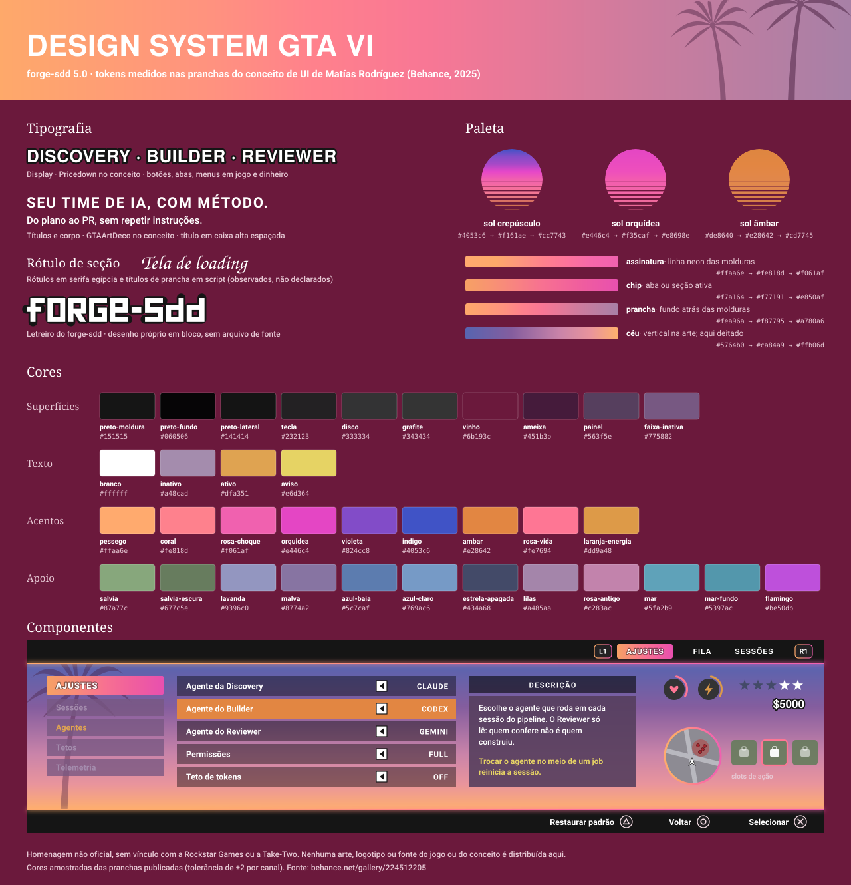

# Design system GTA VI

<p align="center">
  
</p>

Identidade visual da edição 5.0.0 do forge-sdd. É uma homenagem: as cores, os papéis tipográficos e a anatomia dos componentes foram medidos no conceito de interface **[Grand theft Auto VI | UI Concept](https://www.behance.net/gallery/224512205/Grand-theft-Auto-VI-UI-Concept)**, de Matías Rodríguez, e reaplicados com desenho próprio.

## Origem e limites

| | |
|---|---|
| **Fonte** | Projeto publicado no Behance em 25/04/2025, feito em Illustrator e Figma, com todos os direitos reservados ao autor. |
| **O que foi medido** | Sete pranchas: capa, especificação (tipografia e paleta), telas de loading, ajustes, HUD em jogo, menu de pausa, menus de seleção, componentes e encerramento. |
| **Como foi medido** | Cores amostradas por script nas pranchas publicadas, em 19/11/2026. Tolerância de ±2 por canal; cores de texto pequeno são aproximadas. |
| **O que entra aqui** | Valores de cor, degradês, papéis tipográficos e a estrutura dos componentes. |
| **O que não entra** | Artes, capturas, logotipos e arquivos de fonte do conceito ou do jogo. Todas as ilustrações deste repositório são desenho próprio. |

Projeto de fã, sem vínculo com a Rockstar Games nem com a Take-Two Interactive.

## Princípios

1. **Pôr do sol sobre preto.** A cor vem da arte e dos degradês. A interface em si é preta e branca.
2. **Neon fino.** Uma linha de 2 px marca o limite das barras. Ela não vira borda grossa nem moldura de cartão.
3. **Branco para ler, cor para estado.** O texto é branco. Âmbar, rosa e degradê aparecem só em seleção, foco e seção ativa.
4. **Um sinal por estado.** Degradê `chip` é seção ativa, `ambar` é linha selecionada e `rosa-vida` é foco.

## Cores

### Superfícies

| Token | Cor | Uso |
|---|---|---|
| `preto-moldura` | `#151515` | Barras superior e inferior das molduras de tela |
| `preto-fundo` | `#060506` | Fundo interno das molduras (atrás da arte) |
| `preto-lateral` | `#141414` | Lateral do menu de pausa |
| `tecla` | `#232123` | Teclas LB/RB e botões circulares |
| `disco` | `#333334` | Disco dos ícones de vida e energia |
| `grafite` | `#343434` | Contorno do letreiro de encerramento |
| `vinho` | `#6b193c` | Fundo da prancha de especificação |
| `ameixa` | `#451b3b` | Sombras e silhuetas sobre o pôr do sol |
| `painel` | `#563f5e` | Painel de descrição (translúcido sobre a arte) |
| `faixa-inativa` | `#775882` | Item de menu inativo (faixa translúcida) |

### Texto

| Token | Cor | Uso |
|---|---|---|
| `branco` | `#ffffff` | Títulos e corpo sobre superfícies escuras |
| `inativo` | `#a48cad` | Rótulo de item inativo |
| `ativo` | `#dfa351` | Rótulo do item de navegação ativo |
| `aviso` | `#e6d364` | Linha de aviso no painel de descrição |

### Acentos

| Token | Cor | Uso |
|---|---|---|
| `pessego` | `#ffaa6e` | Início do degradê assinatura |
| `coral` | `#fe818d` | Meio do degradê assinatura |
| `rosa-choque` | `#f061af` | Fim do degradê assinatura |
| `orquidea` | `#e446c4` | Topo do sol orquídea |
| `violeta` | `#824cc8` | Transição do sol crepúsculo |
| `indigo` | `#4053c6` | Topo do sol crepúsculo |
| `ambar` | `#e28642` | Linha ativa das listas e sol âmbar |
| `rosa-vida` | `#fe7694` | Vida, foco e contorno do item selecionado |
| `laranja-energia` | `#dd9a48` | Energia / estamina |

### Apoio

| Token | Cor | Uso |
|---|---|---|
| `salvia` | `#87a77c` | Ondas da prancha de componentes |
| `salvia-escura` | `#677c5e` | Slots de ação |
| `lavanda` | `#9396c0` | Ondas claras |
| `malva` | `#8774a2` | Meio das ondas |
| `azul-baia` | `#5c7caf` | Ondas azuis |
| `azul-claro` | `#769ac6` | Realce azul |
| `estrela-apagada` | `#434a68` | Estrela de procurado apagada |
| `lilas` | `#a485aa` | Fundo da prancha de encerramento (topo) |
| `rosa-antigo` | `#c283ac` | Fundo da prancha de encerramento (base) |
| `mar` | `#5fa2b9` | Mar |
| `mar-fundo` | `#5397ac` | Mar profundo |
| `flamingo` | `#be50db` | Flamingos |

## Degradês

| Token | Direção | Paradas | Uso |
|---|---|---|---|
| `assinatura` | horizontal | `#ffaa6e` → `#fda96a` → `#fd967d` → `#fe818d` → `#fd749b` → `#f668aa` → `#f061af` | Linha neon das molduras |
| `chip` | horizontal | `#f7a164` → `#f88b7a` → `#f77191` → `#f05e9e` → `#e850af` | Aba ou seção ativa |
| `prancha` | horizontal | `#fea96a` → `#ff927f` → `#ff818c` → `#f87795` → `#e57999` → `#cd7c9e` → `#a780a6` | Fundo atrás das molduras e cabeçalhos |
| `ceu` | vertical | `#5764b0` → `#845d9e` → `#ca84a9` → `#e9949c` → `#ffb06d` | Céu (capa no topo, tela de ajustes na base) |
| `sol-crepusculo` | vertical | `#4053c6` → `#824cc8` → `#a849c7` → `#e747c9` → `#f161ae` → `#f66e9f` → `#f0798f` → `#d16f58` → `#cc7743` | Sol 1 da paleta |
| `sol-orquidea` | vertical | `#e446c4` → `#ee4fbc` → `#f35caf` → `#f269a5` → `#e8698e` | Sol 2 da paleta |
| `sol-ambar` | vertical | `#de8640` → `#e28642` → `#e1884e` → `#cd7745` | Sol 3 da paleta |

O degradê `ceu` junta duas medições: o céu da capa (topo e meio) e a base da tela de ajustes.

## Tipografia

| Papel | No conceito | Uso | Pilha adotada |
|---|---|---|---|
| Display | Pricedown | Botões, abas, menus em jogo e dinheiro | `Pricedown, 'Arial Black', Impact, 'Helvetica Neue', sans-serif` |
| Títulos e corpo | GTAArtDeco | Títulos (caixa alta, espaçados) e corpo | `GTAArtDeco, 'Avenir Next', Avenir, Futura, 'Century Gothic', Montserrat, 'Segoe UI', system-ui, -apple-system, Roboto, sans-serif` |
| Rótulos | Serifa egípcia (observada na prancha, não declarada) | Rótulos das seções de especificação | `'Zilla Slab', Rockwell, 'Roboto Slab', Georgia, serif` |
| Script | Script de pincel (observado, não declarado) | Título de cada prancha, em branco sobre onda roxa | `SignPainter, 'Brush Script MT', 'Segoe Script', cursive` |
| Mono | Não existe no conceito; herdado do forge-sdd | Comandos de terminal | `'JetBrains Mono', ui-monospace, SFMono-Regular, Menlo, Consolas, monospace` |

O conceito declara duas fontes: **GTAArtDeco** (títulos e corpo) e **Pricedown** (botões e textos em jogo). Nenhuma das duas é distribuída aqui. Quem tiver as fontes instaladas vê o resultado fiel; os demais veem a pilha de fallback.

O letreiro `forge-sdd` do banner é desenho próprio: letras em bloco de altura única, brancas com contorno escuro, sobre o numeral romano V (versão 5) preenchido com o pôr do sol.

## Componentes

| Componente | Anatomia | Tokens |
|---|---|---|
| **Moldura de tela** | Proporção 16:9. Barra superior e inferior, cada uma com cerca de 8,5% da altura. | `preto-moldura`, `preto-fundo` |
| **Linha neon** | Colada na borda interna de cada barra, com cerca de 0,4% da altura (mínimo de 2 px) e um brilho suave da mesma cor. | `assinatura` |
| **Abas** | À direita da barra superior, entre as teclas L1 e R1. A aba ativa é um chip em degradê com rótulo branco; as inativas são só o rótulo. | `chip`, `tecla` |
| **Dicas de botão** | À direita da barra inferior: rótulo seguido da tecla. Teclas LB/RB em cápsula escura com contorno quente; botões △ ○ ✕ em círculo escuro com contorno claro. | `tecla`, `assinatura` |
| **Bloco de título** | Canto inferior esquerdo da arte, sobre um véu preto: selo à esquerda, título em caixa alta e um parágrafo curto. | `preto-fundo`, `branco` |
| **Navegação lateral** | Cabeçalho em chip. Itens em faixa translúcida; o item ativo muda só a cor do rótulo. | `chip`, `faixa-inativa`, `inativo`, `ativo` |
| **Lista de opções** | Linhas escuras translúcidas. A linha ativa é âmbar sólido. Botão quadrado branco com seta preta e valor em caixa alta à direita. | `ambar`, `preto-fundo` |
| **Painel de descrição** | Barra de título escura com rótulo centralizado; corpo translúcido; aviso em amarelo. | `painel`, `aviso` |
| **Discos de status** | Disco escuro com ícone e arco de progresso: rosa para vida, laranja para energia. | `disco`, `rosa-vida`, `laranja-energia` |
| **Estrelas e dinheiro** | Estrelas acesas em branco e apagadas em azul-acinzentado; dinheiro em display branco com contorno. | `estrela-apagada`, `preto-moldura` |
| **Radar** | Mapa circular com anel em degradê. | `assinatura` |
| **Roda de seleção** | Segmentos escuros translúcidos; o segmento ativo ganha um arco rosa; nome e barras de atributo no centro. | `rosa-vida` |
| **Slots de ação** | Quadrados arredondados; o selecionado ganha contorno rosa. | `salvia-escura`, `rosa-vida` |
| **Título de prancha** | Script branco sobre uma onda roxa. | `lavanda`, `malva` |
| **Fundos** | Degradê horizontal atrás das molduras; ondas orgânicas na prancha de componentes; cena tingida de magenta nos menus em jogo. | `prancha`, `salvia`, `lavanda`, `azul-baia` |

### Como o forge-sdd usa

| Elemento do conceito | No banner do forge-sdd |
|---|---|
| Abas da barra superior | As três sessões: Discovery, Builder e Reviewer |
| Dicas de botão | Planejar, Construir e Aprovar |
| Estrelas de procurado | Cinco estrelas acesas: versão 5 |
| Numeral do logotipo | V romano, de versão 5, com letreiro próprio |

## Contraste

Medido pela fórmula da WCAG 2. O mínimo recomendado é 4,5:1 para texto comum e 3:1 para texto grande.

| Combinação | Contraste | Leitura |
|---|---|---|
| `branco` sobre `preto-moldura` | 18,3:1 | Livre |
| `branco` sobre `vinho` | 11,5:1 | Livre |
| `branco` sobre `painel` | 9,3:1 | Livre |
| `ativo` sobre `preto-moldura` | 8,3:1 | Livre |
| `preto-moldura` sobre `ambar` | 6,7:1 | Livre |
| `aviso` sobre `painel` | 6,1:1 | Livre |
| `inativo` sobre `preto-moldura` | 6,0:1 | Livre |
| `branco` sobre `ambar` | 2,7:1 | Só em negrito e com contorno ou sombra escura |
| `branco` sobre `chip` | 2,1:1 a 3,4:1 | Só em display, com contorno ou sombra escura |
| `ativo` sobre `faixa-inativa` | 2,7:1 | Decorativo |
| `inativo` sobre `faixa-inativa` | 2,0:1 | Decorativo: não use para texto essencial |

As quatro últimas linhas são fiéis ao conceito, mas ficam abaixo do recomendado. No banner, os rótulos sobre chip levam contorno escuro.

## Arquivos

| Arquivo | Para que serve |
|---|---|
| [`tokens.json`](tokens.json) | Tokens de cor, degradê e tipografia, com uso e origem |
| [`tokens.css`](tokens.css) | Os mesmos tokens como variáveis CSS (`--gta-*`) |
| [`identidade.json`](identidade.json) e `logo.svg.frag` | Identidade no formato do readme-studio, para gerar novos banners |
| [`especime.svg`](especime.svg) | Folha de espécime no topo desta página |
| [`../../img/banner-v5-gta-vi.svg`](../../img/banner-v5-gta-vi.svg) | Banner do README na edição 5.0.0 (há uma cópia em PNG para o npm) |

Exemplo com as variáveis CSS:

```css
@import url("tokens.css");

.barra {
  background: var(--gta-superficie-preto-moldura);
  border-bottom: 2px solid;
  border-image: var(--gta-degrade-assinatura) 1;
}

.aba[aria-selected="true"] {
  background: var(--gta-degrade-chip);
  color: var(--gta-texto-branco);
  font-family: var(--gta-fonte-display);
}
```

## O que evitar

- Usar logotipos, nomes ou artes da Rockstar Games como marca do forge-sdd.
- Copiar as artes do conceito ou imagens do jogo.
- Incluir os arquivos de Pricedown ou GTAArtDeco no repositório.
- Engrossar a linha neon ou usá-la como borda de cartão.
- Colorir texto corrido: cor é para estado.
