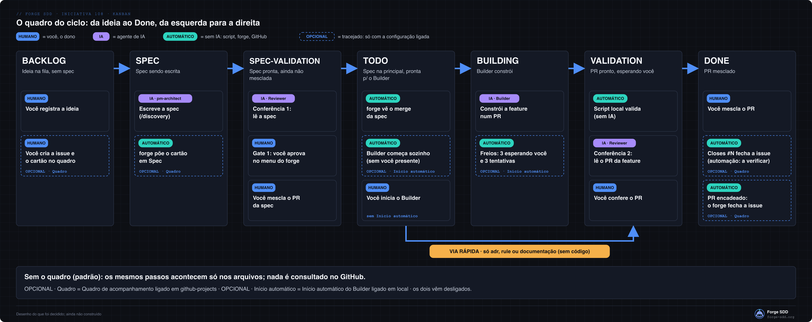

# Quadro do ciclo: guia de uso

> **Em construção:** esta funcionalidade está especificada e aprovada, mas ainda não foi construída. Hoje o quadro do forge-sdd é mantido à mão.

Este guia explica, em linguagem simples, como o quadro do GitHub vai acompanhar o trabalho do forge-sdd. Tudo aqui descreve o que foi decidido, não o que já funciona.

## O que é e para quem é

O quadro é um painel do GitHub Project, em colunas, que mostra em que etapa está cada trabalho. Ele é um **espelho**: a verdade continua nos arquivos do repositório.

> **OPCIONAL.** O quadro vem desligado por padrão.
> Se o seu projeto não usa GitHub, ou você não quer o quadro, não faça nada. Nada muda e nada custa.

Serve para quem quer ver tudo de uma vez, inclusive pelo celular.

## Visão geral: o quadro em colunas

Para computador:



Para celular (as mesmas 7 etapas, de cima para baixo):


Como ler:
- **HUMANO** (azul): é você quem faz.
- **IA** (roxo): um agente faz (pm-architect, Builder ou Reviewer).
- **AUTOMÁTICO** (verde): ninguém usa IA; é script, forge ou GitHub.
- **OPCIONAL** (tracejado): só acontece com a configuração ligada.

## Como ligar e desligar

São dois interruptores. Os dois vêm **desligados**.

| Interruptor | Valores | O que liga |
|---|---|---|
| Quadro de acompanhamento | `desligado` (padrão) ou `github-projects` | O espelho: o forge lê e move os cartões. |
| Início automático do Builder | `desligado` (padrão) ou `local` | O Builder começa sozinho quando a spec é mesclada. |

Onde ficam: serão campos da Constituição do projeto, lidos da branch base (não vale o que estiver só na sua branch de trabalho). O texto final dos campos, as notas e o espaço no orçamento da Constituição estão definidos num PR único da Constituição, ainda não feito; hoje os campos não existem.

Ainda em decisão:
- se o início automático depende do quadro ou é independente (a recomendação é que seja independente).

Ao ligar, o forge vai avisar o que passa a fazer e o que custa.

## O que custa ligar

| Interruptor | Custo |
|---|---|
| Quadro de acompanhamento | Chamadas ao GitHub a cada comando do forge. |
| Início automático do Builder | Um processo local que fica vivo enquanto a sessão está aberta. Gasta tokens do Builder sem você presente. |

Freios do início automático:
- no máximo 3 trabalhos esperando você;
- no máximo 3 tentativas.

Com tudo **desligado**, o custo é **zero**: o forge não chama o GitHub para o quadro.

## As 7 colunas

Ordem da jornada: Backlog > Spec > Spec-validation > Todo > Building > Validation > Done

| Coluna | O que significa | Quem age |
|---|---|---|
| Backlog | Ideia na fila, ainda sem spec. | HUMANO |
| Spec | A spec está sendo escrita. | IA (pm-architect) |
| Spec-validation | Spec aprovada, ainda não mesclada. | IA (Reviewer) e HUMANO |
| Todo | Spec já na principal e pronta para o Builder. | AUTOMÁTICO |
| Building | O Builder está construindo. | IA (Builder) |
| Validation | Trabalho pronto num PR aberto, esperando você conferir e mesclar. | AUTOMÁTICO, IA (Reviewer) e HUMANO |
| Done | PR mesclado. | HUMANO |

O campo do quadro se chama `Status`.

Dentro de cada coluna, a ordem dos cartões é a prioridade (ver "Ordem = prioridade").

## A jornada de um trabalho, passo a passo

1. **HUMANO:** você registra a ideia em Backlog. *(OPCIONAL, com o quadro: você cria a issue e o cartão.)*
2. **IA (pm-architect):** escreve a spec. *(OPCIONAL, com o quadro: o forge põe o cartão em Spec.)*
3. **IA (Reviewer):** faz a Conferência 1, lê a spec e comenta o resultado no PR da spec. O cartão fica em Spec-validation.
4. **HUMANO:** aprova no menu do forge (Gate 1).
5. **HUMANO:** mescla o PR da spec.
6. **AUTOMÁTICO:** o forge vê o merge. O cartão vai para Todo.
7. **Começar o Builder:**
   - *(OPCIONAL, com o início automático ligado)* **AUTOMÁTICO:** o Builder começa sozinho.
   - Com o interruptor desligado: **HUMANO** inicia o Builder.
8. **IA (Builder):** constrói num PR. Cartão em Building.
9. **AUTOMÁTICO:** um script local valida (sem IA).
10. **IA (Reviewer):** faz a Conferência 2, escreve o diagnóstico num comentário simples do PR e, se for `conforme`, tira o PR de rascunho. Cartão em Validation.
11. **HUMANO:** só mescla o PR (não precisa procurar o resultado em arquivos). Cartão em Done.

Sem o quadro, os mesmos passos acontecem só nos arquivos.

## Quem cuida de cada coluna

O diagnóstico do Reviewer é um **comentário simples no PR**: até 8 linhas, em português simples, para `conforme`, `violação` e `dúvida`. Quem escreve esse comentário e tira o PR de rascunho é a **esteira do core**, não este módulo. O módulo só **mostra** o comentário e o resultado no cartão e move as colunas.

| Coluna | Quem cuida | O que escreve ao sair da coluna |
|---|---|---|
| Backlog | HUMANO | A issue e o cartão. |
| Spec | IA (Discovery/pm-architect) | A spec e o PR da spec; o cartão vai a Spec-validation. |
| Spec-validation | IA (Reviewer); HUMANO decide | O Reviewer faz a Conferência 1 e comenta o diagnóstico no PR da spec. O HUMANO aprova o Gate 1 e mescla o PR da spec. |
| Todo | AUTOMÁTICO (forge) | Move o cartão ao ver a spec mesclada. |
| Building | IA (Builder) | O PR de entrega (em rascunho) e o cartão movido para Validation. |
| Validation | IA (Reviewer); HUMANO decide | O Reviewer faz a Conferência 2 e comenta o diagnóstico no PR. Se `conforme`, o PR sai de rascunho (pronto para mesclar). Se `violação`, o cartão volta a Building e o PR segue em rascunho. Se `dúvida`, escala ao dono. O HUMANO só mescla o PR de entrega. |
| Done | AUTOMÁTICO (forge) | A issue é fechada e o cartão vai a Done depois do merge. |

## Ordem = prioridade

Dentro de cada coluna, a ordem dos cartões **é a prioridade**: de cima para baixo, o do topo é o mais prioritário (o que se puxa primeiro) e o do fim o menos.
- **Fonte da verdade:** o arquivo do core (a fila). O quadro só espelha a posição.
- **Desempate (PROPOSTA, a confirmar pelo dono):** dentro de uma iniciativa vale a ordem do `queue.json`; entre iniciativas vale a prioridade que o dono definir.
- **Arrastar para cima ou para baixo na mesma coluna** é um **pedido** de reordenar a fila. O forge confirma num menu, como no arrastar entre colunas; nada muda sozinho.
- O GitHub Projects v2 guarda a posição do item e a mutação `updateProjectV2ItemPosition` reordena: **a verificar** na documentação e no uso real (não confirmado).

## O que acontece quando você arrasta um cartão

Arrastar é um **pedido**.
- O forge percebe o movimento.
- Abre um menu para você confirmar.
- Nada muda sozinho.

Vale também pelo celular. Mas só vira realidade depois da confirmação no forge. Arrastar nunca aprova o Gate 1 nem um merge.

A atualização é por consulta: o forge olha o quadro quando você roda um comando, não em tempo real.

## A via rápida

Item só de adr, rule e/ou documentação (sem código) vai de Todo direto a Validation. Pula o Building. Você continua conferindo o PR. Se aparecer código no PR, o cartão volta a Building e você é avisado.

## Como o trabalho fecha

- No PR que vai para a branch principal, o forge escreve `Closes #N`. Assim o GitHub fecha a issue ao mesclar.
- PR encadeado (que não vai direto à principal): o GitHub não fecha. Então o forge fecha a issue.
- As automações do Project (em Settings, Workflows) você liga à mão na interface. Se dá para fazer isso por API: **a verificar**. Os nomes exatos dos botões: **a verificar**.

## Etiquetas e título da issue

| Etiqueta | O que mostra |
|---|---|
| `código` | Muda código. |
| `adr` | Registro de decisão. |
| `rule` | Mexe em regra. |
| `documentação` | Muda texto ou documentação. |
| `spec` | Ainda é só especificação. |

O título da issue ganha um prefixo com as etiquetas, para você ver o tipo no celular. Exemplos:

| Título | Quer dizer |
|---|---|
| `[adr] ...` | Só decisão. |
| `[código+rule] ...` | Código e regra. |
| `[doc] ...` | Só documentação. |
| `[spec · código] ...` | Spec de algo com código. |

## Se algo parecer fora do lugar

Rode `forge doctor`. Ele mostra a diferença entre o arquivo e o quadro. Ele **nunca corrige em silêncio**. Em caso de conflito, o arquivo vale.

## Perguntas frequentes

**Preciso do quadro para usar o forge?**
Não. É opcional e vem desligado.

**Se eu desligar, perco algo?**
Não. Os mesmos passos acontecem nos arquivos.

**Posso mover o cartão pelo celular?**
Pode, como pedido. Só vale depois da confirmação no forge.

**Arrastar para Done conclui o trabalho?**
Não. Done só vale com o PR mesclado.

**O quadro atualiza na hora?**
Não. Atualiza quando você roda um comando do forge.

**Quanto custa ligar?**
Chamadas ao GitHub por comando, e o processo local do início automático. Desligado, custa zero.

**O Builder começa sem eu saber?**
Só se você ligou o início automático. Ele fica dentro dos freios: 3 esperando e 3 tentativas.

**E se o quadro e o arquivo discordarem?**
O arquivo vale. O `forge doctor` mostra a diferença.

**Onde ficam os interruptores?**
Na Constituição do projeto, pelo PR único da Constituição (ainda não feito; nada disso existe hoje).

**Já funciona?**
Não. Está especificado, não construído.

## Diagramas para consulta

- [Caminho de um trabalho](img/quadro-bpmn-ciclo.png)
- [Arquivo e quadro andando juntos](img/quadro-bpmn-sincronia.png)
- [Do PR mesclado ao Done](img/quadro-bpmn-fechamento.png)

## Prompt para colar na sua IA

Ainda **não funcionam**: só servirão quando a funcionalidade for construída.

Ligar o quadro num projeto novo:

```text
Quero ligar o quadro de acompanhamento do forge-sdd neste projeto.
Explique o que passa a custar, peça minha confirmação e depois
ligue "Quadro de acompanhamento" como github-projects.
Deixe o início automático do Builder desligado.
```

Conferir se está tudo certo:

```text
Rode forge doctor e me diga, em linguagem simples,
se o quadro está ligado, se o campo Status tem as 7 colunas
e se há divergência entre os arquivos e o quadro.
Não corrija nada sem me perguntar.
```
