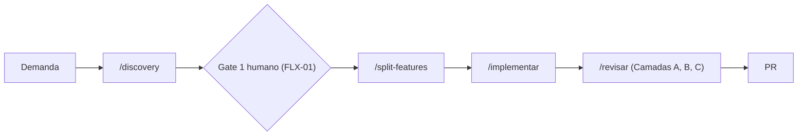

# Fluxo de Desenvolvimento (Forge-SDD)

Fonte única da verdade da sequência de comandos. `CLAUDE.md`, `GEMINI.md`, `copilot-instructions.md` e as skills citam este arquivo e não reescrevem o fluxo.

## Estações, comandos e skills
| Estágio | Skill (`.agents/skills/`) | Comando | Entrega |
|---|---|---|---|
| Concepção | `sdd-concepcao` | `/discovery`, `/nova-feature`, `/novo-fix`, `/c4-architecture`, `/constitution` | `discovery.md`, `criteria.md`, `plan.md`, `status.md` |
| Planejamento | `sdd-planejamento` | `/split-features` | tasks em `features/` e fila (`forge-sdd queue enqueue`) |
| Build | `sdd-build` | `/implementar [feature]` (alias `/proxima-feature`) | código, testes e `forge-sdd queue complete` |
| Governança | `sdd-governanca` | `/revisar` | parecer JSON (`forge-sdd queue review`) |
| Operação | `sdd-operacao` | `/status`, `/doctor`, `/archive`, `/upgrade-sdd`, `/tutorial` | painel, check-up, arquivamento |

O ciclo `READ-MIN → PLAN → ACT → WRITE → CLOSE` dos arquivos de instrução é o protocolo por comando. A tabela acima é o pipeline por feature.

## Estrutura por iniciativa
Tudo de uma demanda vive em `sdd/discovery/<id>-<nome>/`:
`discovery.md`, `criteria.md`, `plan.md`, `status.md` (até 1 KB), `queue.json`, `features/` e `fixes/`.
- Uma branch por iniciativa (`feat/<id>-<nome>`), criada **antes** da Spec (`FLX-02`, Regra 15). Pergunte a branch de partida e verifique se há branch a retomar.
- O estado é local à pasta; não há índice nem progresso globais. A visão geral é calculada: `forge-sdd status [--all-branches]`.
- O próximo ID vem de `forge-sdd next-id`, que consulta todas as branches.
- Estado de execução (atividade e filas por estação) fica em `sdd/.runtime/`, fora do git.

## Quebra (`/split-features`)
Fatie quando a feature cruzar mais de um contexto delimitado ou tiver mais de 7 tarefas. Sem dependência circular, cada task testável sozinha, ordem de baixo para cima (infraestrutura, domínio, aplicação, interface).

## Revisão (`/revisar`)
Antes do PR: critérios da spec atendidos, `go test ./...` e `go vet ./...` limpos, `forge-sdd gate` sem falhas e `status.md` atualizado.

## GitHub
Prefira o `gh`: `gh pr create --fill`, `gh pr status`, `gh pr merge --squash --delete-branch`. Sem `gh`, use git e informe o link da branch.

## Observabilidade
Comandos que mudam estado gravam telemetria (`forge-sdd session record`, se `telemetry.enabled`). `forge-sdd report` mostra tokens, modelos, sessões e duração por feature. Comandos de leitura (`/status`, `/doctor`, `/constitution`, `/c4-architecture`, `/upgrade-sdd`, `/tutorial`) não gravam.
