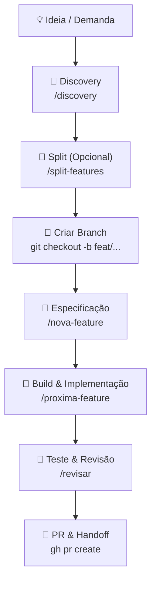

# Fluxo de Desenvolvimento e Ciclo de Vida do Projeto (Forge-SDD)

Este guia estabelece os padrões e o ciclo de vida do desenvolvimento no ecossistema do **Forge-SDD**, ensinando aos engenheiros e aos agentes de IA as regras de uso de cada ferramenta e o momento exato de acioná-los.

---

## 🔄 Visão Geral do Ciclo de Vida

O ciclo de vida de qualquer evolução no projeto segue as seguintes etapas lineares:



---

## 🗺️ Este é o documento fonte da verdade do fluxo (feat-01-06)

Este arquivo é a **única fonte da verdade** para a sequência macro de comandos do Forge-SDD. `CLAUDE.md`/`GEMINI.md`/`copilot-instructions.md` e os chatmodes Orquestrador **citam** os estágios abaixo — não reescrevem a sequência completa. Mapeamento entre a narrativa de produto (Problema → Proposta → Refinamento → Execução → Entrega) e os 7 passos técnicos deste documento:

| Estágio (narrativa) | Estação / Papel (`.agents/roles/`) | Passo(s) técnico(s) | Comando |
|---|---|---|---|
| Problema & Arquitetura | **Líder + PM + Arquiteto** (`lider`, `pm-architect`) | 1. Discovery + Reuse Check (`DUP-02`) + Gate 1 de Spec (`FLX-01`) | `/discovery` |
| Planejamento & Fila | **Planejador + Líder** (`planner`, `lider`) | 2. Plan (mapeando IDs da Constitution e `.agents/rules/`) + Split + Enfileiramento | `/split-features` (`forge-sdd queue enqueue`) |
| Refinamento | **PM/Arquiteto + Planejador** | 3. Branch Única (`Regra 15`) + Especificação Revisada | `/nova-feature` |
| Execução Independente | **Builder** (`builder`) | 4. Consumo da Fila em Contexto Isolado (`queue next` → `complete`) | `/proxima-feature` |
| Governança & Entrega | **Analista de Governança → Líder** (`governance`, `lider`) | 5. Portão Camada A (`forge-sdd gate`) + Camada B (JSON com evidência `queue review`) + Auto-Skills (`forge-sdd skills`) + 6. Painel Executivo (Camada C) / PR | `/revisar` → `/status` → `gh pr create` |

O ciclo `READ-MIN → PLAN → ACT → WRITE → CLOSE` descrito em `CLAUDE.md` é o protocolo **por comando** (o que qualquer agente faz dentro de uma única invocação); a tabela acima é o pipeline **por feature** (a sequência de comandos ao longo de uma sessão completa). São dois eixos complementares, não descrições concorrentes do mesmo fluxo.

---

## 🔎 1. Discovery (`/discovery`)

**Quando usar:**
* Sempre que surgir uma ideia vaga, um bug complexo sem causa raiz definida, ou uma nova funcionalidade que precise de refinamento de produto e engenharia.
* **Objetivo:** Explorar os impactos técnicos, as dependências, propor abordagens de design e mapear os riscos antes de escrever qualquer código ou especificação formal.

**Comportamento:**
* O agente assume papéis sênior (Product Manager e Lead Architect) para questionar o escopo, definir restrições técnicas, sugerir arquitetura e gerar um plano preliminar.
* **Clarify:** antes de produzir os três artefatos, o agente avalia a demanda recebida contra a heurística em `sdd/memory/clarify.md`. Só pergunta ao usuário se detectar lacuna real (critério de aceitação ausente, escopo ambíguo, dependência externa não mencionada) — descrições já claras seguem direto.

---

## 🔀 2. Split de Features (`/split-features`)

**Quando usar:**
* Quando o plano gerado no Discovery ou a feature planejada for grande demais.

**Critérios de quebra (Desacoplamento e Arquitetura Evolutiva):**
1. **Bounded Contexts:** Se a feature abranger mais de um contexto delimitado (ex: infraestrutura de banco de dados, API backend, e telas de interface no mesmo passo), ela **deve** ser fatiada.
2. **Limite de Tarefas (Rule of 7):** Se o escopo planejado contiver **mais de 7 tarefas**, a feature é considerada grande demais para uma única branch.
3. **Sem Dependência Circular:** Ao quebrar, garanta que as sub-features não criem bloqueios ou dependências circulares entre si.
4. **Entrega Incremental e Testável:** Cada sub-feature resultante deve ser independentemente testável e funcional por si só (mesmo que com mocks), permitindo integrações incrementais.
5. **Ordem de Camadas:** A implementação deve fluir preferencialmente de baixo para cima na stack:
   $$\text{Infraestrutura / Banco de Dados} \longrightarrow \text{Domínio / Regras} \longrightarrow \text{Aplicação / APIs} \longrightarrow \text{Interface / Apresentação}$$

---

## 🌿 3. Registro e Criação de Branch (`/nova-feature`)

**Clarify:** antes do passo de branch abaixo, o agente avalia a descrição recebida (de `/nova-feature` ou `/novo-fix`) contra a heurística em `sdd/memory/clarify.md`. Só pergunta ao usuário se detectar lacuna real — caso contrário, segue direto para o passo 1.

**Regra Crítica de Sequência:**
> [!IMPORTANT]
> **A Branch DEVE ser criada ANTES da criação do arquivo de especificação.**
> A ordem exata a ser seguida pelo Orquestrador/Specifier é:
> 1. Executar a criação da branch local: `git checkout -b feat/nome-da-feature`
> 2. Criar o arquivo `sdd/features/feat-XX-nome-da-feature.md` com a especificação e as tarefas.
> 3. Adicionar a entrada correspondente em `sdd/features/index.md` e `sdd/memory/progress.md`.

---

## 🔨 4. Implementação (`/proxima-feature`)

**Quando usar:**
* Ao iniciar o desenvolvimento de fato de uma feature marcada como `todo` em `sdd/memory/progress.md`.

**Comportamento:**
* O Orquestrador muda o status da feature para ativo, delega as tarefas para o Builder e coordena a execução incremental e focada.

---

## 🧪 5. Revisão (`/revisar`)

**Quando usar:**
* **Sempre** antes de finalizar uma feature e criar o Pull Request.

**Verificações Obrigatórias do Revisor:**
* [ ] Os critérios de conclusão e as tarefas definidos na especificação foram totalmente atendidos.
* [ ] Os testes locais estão passando (`go test ./...` ou comando equivalente da stack).
* [ ] Linters e validadores de código rodam limpos (`golangci-lint run`).
* [ ] Arquivos de progresso e índice (`progress.md` e `index.md`) foram devidamente atualizados refletindo o status `done`.

---

## 🚀 6. Operações no GitHub (Uso do `gh` CLI)

Sempre que a tarefa envolver interação com o repositório remoto (GitHub) para submissão de código e gerenciamento de Pull Requests, **prefira utilizar a ferramenta CLI `gh` oficial**, em vez de comandos git puros ou URLs web manuais.

**Comandos Recomendados:**
* **Criar Pull Request:**
  ```bash
  gh pr create --title "feat(nome): descricao curta" --body "Correcao/Implementacao de ..."
  ```
* **Visualizar status do PR:**
  ```bash
  gh pr status
  ```
* **Realizar Merge (após aprovação/revisão):**
  ```bash
  gh pr merge --squash --delete-branch
  ```
* Caso a ferramenta `gh` não esteja instalada no ambiente, caia para o git puro e instrua o usuário a abrir o PR de forma amigável através do link gerado no terminal.

---

## 📊 7. Observabilidade (`forge-sdd report`)

Os comandos que mudam estado do ciclo SDD (`/discovery`, `/split-features`,
`/nova-feature`, `/novo-fix`, `/proxima-feature`, `/revisar`, `/archive`)
gravam telemetria determinística (`forge-sdd session record`) sempre que
`telemetry.enabled` está ativo em `sdd/.sddrc`. A qualquer momento, rode:

```bash
forge-sdd report
```

para ver, por feature/fix/discovery: tokens de entrada+saída, modelos
usados, número de sessões, duração total, e a idade medida do projeto
(da métrica mais antiga à mais recente). Comandos de leitura/diagnóstico
(`/status`, `/doctor`, `/constitution`, `/c4-architecture`,
`/upgrade-sdd`, `/tutorial`) não gravam telemetria — não produzem
entrega, ficariam fora do escopo do relatório.

---

## 🎨 8. Forge Studio & Trilho de Handoff das Estações (`forge-sdd studio`)

A qualquer momento do ciclo de desenvolvimento, os engenheiros ou o Líder podem inicializar a interface visual embarcada do Forge Studio para inspecionar em tempo real o fluxo entre as 5 estações:

```bash
# Iniciar servidor local HTTP/SSE (estritamente read-only)
forge-sdd studio --port 4321

# Ou abrir automaticamente no navegador padrão
forge-sdd studio --open
```

**Capacidades:**
* **Visualização Viva das 5 Estações:** Acompanhe o status (`idle`, `working`, `thinking`, `finished`, `approval`, `error`) e os avatares dos personagens (`Líder`, `PM & Arquiteto`, `Planejador`, `Builder` e `Governança`) com fallback SVG 2D de alta fidelidade e zero dependências externas (`ARQ-03`).
* **Trilho de Handoff & Loop de Retrabalho:** Mostra o pacote em trânsito e contratos de I/O em tempo real via Server-Sent Events (SSE). Handoffs de transição ou devoluções de retrabalho (`05 ↺ 04`) podem ser auditados via:
  ```bash
  forge-sdd queue handoff --from builder --to governance --task feat-59-01 --gate "Testes Locais Conforme"
  ```
* **Filas Atômicas por Estação:** Inspecione `sdd/.queue/stations/<station>.json` com garantia de idempotência estrita via SHA-256 e escrita atômica contra race conditions (`forge-sdd queue stations`).
* **Segurança e Isolamento Total (`SEG-01` e `SEG-06`):** O servidor do Studio roda em `127.0.0.1` e rejeita qualquer mutação com `405 Method Not Allowed`, garantindo integridade absoluta do repositório.

