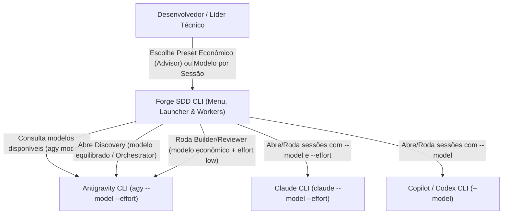
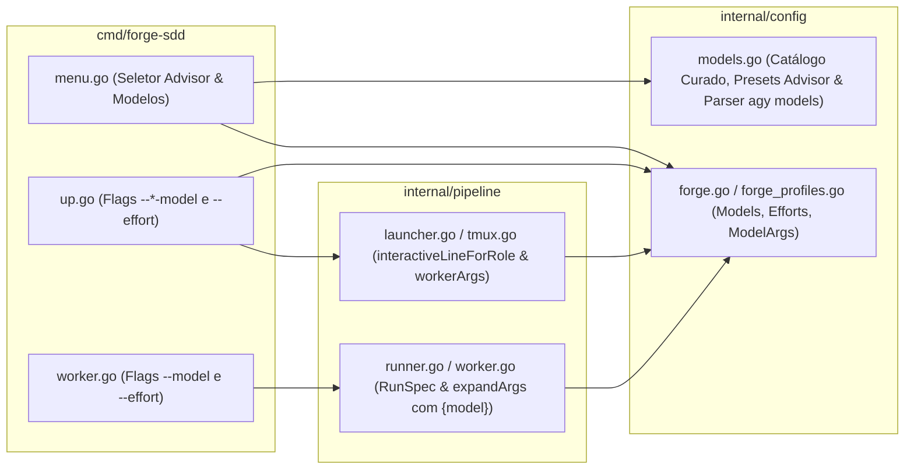
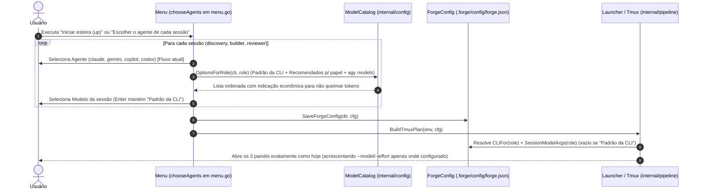

# Critérios de Aceitação e Arquitetura — Iniciativa 85

## Modelo do Módulo (ARQ-11)
- **Modelo:** `completo`.
- **Justificativa:** Introduz persistência e validação de novos campos estruturados em `.forge/config/forge.json` (`models` e `efforts` por sessão), expansão de argumentos de modelo/esforço no runner e no launcher (`{model}`), catálogo híbrido com descoberta dinâmica de modelos (`agy models`) e presets de roteamento econômico por papel (`ARQ-11`).

## Decisões do Projeto Aplicadas (GOV-01)
- `ADR-0004`: Pipeline Multi-Sessão (Discovery, Builder e Reviewer). Os modelos e níveis de esforço respeitam os 3 papéis isolados do pipeline.
- `ADR-0005`: Menu Navegável e Agente por Sessão do Pipeline. Estende `ForgeConfig.Sessions` com `Models` e `Efforts`, mantendo `internal/config` como único dono de `forge.json` (`DUP-01`) e o menu em `cmd/forge-sdd/menu.go` acionando os fluxos sem lógica duplicada.
- `ADR-0006` e `ADR-0008`: Visibilidade no Tmux e Modo Live vs. Headless. A expansão de modelo/esforço aplica-se tanto ao comando interativo do painel (`InteractiveArgs` na Discovery e no Modo Live) quanto ao comando por job (`Args` no `forge worker`).
- `ARQ-01`, `ARQ-02`, `ARQ-04`, `ARQ-06`, `ARQ-10`: Flags de CLI adaptadas em `cmd/forge-sdd/` (`up.go`, `worker.go`, `menu.go`); regras de validação, catálogo de modelos, presets Advisor e montagem de `argv` isoladas em `internal/config` e `internal/pipeline`, usando apenas a `stdlib` e `huh` já existente.
- `DUP-01`: Um conceito, uma casa — `internal/config` concentra a resolução de modelo/esforço (`ModelFor`, `EffortFor`, `ModelArgs`, `AdvisorPresets`) ao lado de `CLIFor` e `PermissionArgs`.
- `SEG-01`, `SEG-03`, `SEG-04`: Validação estrita por regex de IDs de modelo e níveis de esforço; passagem via `argv` explícito sem shell; `strictDecode` preservado em `forge.json`.

## Rules e IDs da Constituição Aplicáveis
- **IDs da Constituição:** `ARQ-01`, `ARQ-02`, `ARQ-04`, `ARQ-05`, `ARQ-06`, `ARQ-10`, `ARQ-11`, `COD-01`, `COD-02`, `COD-03`, `COD-04`, `COD-05`, `DUP-01`, `DUP-02`, `FLX-01`, `FLX-02`, `FLX-05`, `GOV-01`, `SEG-01`, `SEG-03`, `SEG-04`, `SEG-07`, `TST-01`, `TST-03`, `TST-05`.
- **Rules (`.agents/rules/`):**
  - `.agents/rules/sdd-arquitetura.md`
  - `.agents/rules/sdd-codigo-e-testes.md`
  - `.agents/rules/sdd-fluxo-e-portao.md`
  - `.agents/rules/sdd-seguranca.md`

## O Que Já Existe (DUP-02)

| Procurei | Onde | Achei | Decisão | Justificativa |
|---|---|---|---|---|
| Configuração de agentes por sessão e perfis de CLI | `internal/config/forge.go`, `internal/config/forge_profiles.go` | `ForgeConfig`, `CLIProfile`, `CLIFor(role)`, `PermissionArgs`, `MarkerPermissions` | estender | Adicionar `Models`, `Efforts`, `ModelFor(role)`, `EffortFor(role)`, `ModelArgs(cli, model, effort)`, `MarkerModel` (`{model}`) e presets Advisor no mesmo pacote dono (`DUP-01`). |
| Expansão de argumentos e execução de processos | `internal/pipeline/runner.go`, `internal/pipeline/launcher.go` | `RunSpec`, `expandArgs`, `interactiveLineForRole`, `SessionsFor` | estender | Expandir `{model}` (ou anexar `ModelArgs` quando o perfil legado não trouxer o marcador) em `expandArgs`, propagando `--model` e `--effort` para Discovery, Builder e Reviewer. |
| Abertura de sessões e workers no tmux | `internal/pipeline/tmux.go`, `internal/pipeline/worker.go`, `internal/pipeline/deliver.go` | `BuildTmuxPlan`, `RunWorker`, `RunDeliverWorker` | estender | Propagar as flags `--model` e `--effort` para o comando do worker no tmux e exibir o modelo ativo no log/cabeçalho do worker. |
| Menu interativo de configuração do pipeline | `cmd/forge-sdd/menu.go`, `internal/survey/survey.go` | `chooseAgents`, `configMenu`, `startSessions`, `prompter` | estender | Incluir seleção de Preset Advisor ("Econômico", "Orchestrator", "Manual por sessão") e catálogo híbrido de modelos no menu. |
| Flags de linha de comando de `up` e `worker` | `cmd/forge-sdd/up.go`, `cmd/forge-sdd/worker.go` | `applySessionFlags`, flags `--cli`, `--discovery`, `--builder`, `--reviewer` | estender | Adicionar `--model`, `--discovery-model`, `--builder-model`, `--reviewer-model` e `--effort` com precedência idêntica às flags de sessão. |

## Dependências Novas (SEG-07)
- **Nenhuma.** Toda a implementação utiliza a biblioteca padrão do Go (`os/exec`, `context`, `strings`, `regexp`, `time`) e `github.com/charmbracelet/huh` v0.3 já presente no `go.mod` (`ARQ-04`).

## Diagramas C4

### Nível 1: Diagrama de Contexto


### Nível 2: Diagrama de Contêineres


### Diagrama de Sequência: Agregação no `chooseAgents` Existente e Abertura da Esteira


## Critérios de Aceitação Executáveis

```bash
go test -v -race ./internal/config/... ./internal/pipeline/... ./cmd/forge-sdd/...
```

1. **TestForgeConfig_ModelsAndEffortsValidation:**
   - `ForgeConfig` carrega e salva `models` e `efforts` por papel (`discovery`, `builder`, `reviewer`) em `.forge/config/forge.json`.
   - Rejeita papéis desconhecidos, nomes de modelos com caracteres inválidos/metacaracteres (`SEG-01`) e níveis de `effort` fora de `low|medium|high|xhigh|max`.
   - Mantém compatibilidade retroativa com arquivos `forge.json` legados sem `models` ou `efforts`.
2. **TestAdvisorPresets_TokenEconomy:**
   - O preset `economic` configura modelos enxutos e `effort: low` para `builder` e `reviewer` e modelo equilibrado (`medium`) para `discovery` conforme o agente de cada sessão (`claude`, `gemini`/`agy`, `copilot`, `codex`), evitando modelos de custo extremo em loops autônomos.
   - O preset `orchestrator` aplica `gemini-pro-orchestrator-g1-pro` nas sessões `gemini`/`agy` com trava de `effort: medium` nos workers.
3. **TestModelCatalog_ParseAgyModelsAndFallback:**
   - `ParseAgyModelsOutput` filtra linhas de spinner ANSI (`⠋ Fetching available models...`) e extrai corretamente os pares `(ID, Label)` da saída de `agy models`.
   - Quando o comando externo falha ou expira o timeout, `AvailableModelsForCLI` retorna a lista curada estática sem erro bloqueante.
4. **TestRunnerAndLauncher_ModelArgsExpansion:**
   - `BuildArgv` e `SessionsFor` / `BuildTmuxPlan` expandem `--model <id>` e `--effort <level>` tanto nas sessões interativas (`Discovery` e modo `live`) quanto nos workers (`headless` e `forge-ctl`).
   - Quando nenhum modelo está configurado para o papel, nenhuma flag `--model` ou `--effort` extra é adicionada ao comando.
5. **TestMenuAndUpFlags_ModelSelection:**
   - As flags `--model`, `--discovery-model`, `--builder-model`, `--reviewer-model` e `--effort` em `forge up --dry-run` sobrepõem a configuração de `forge.json` na ordem de precedência correta.
   - O menu interativo permite aplicar o preset Advisor ou selecionar modelos por sessão e grava em `.forge/config/forge.json`.
6. **Compilação e Portão:**
   - `go build ./... && go vet ./... && forge gate`: saída 0, sem warnings ou violações.
