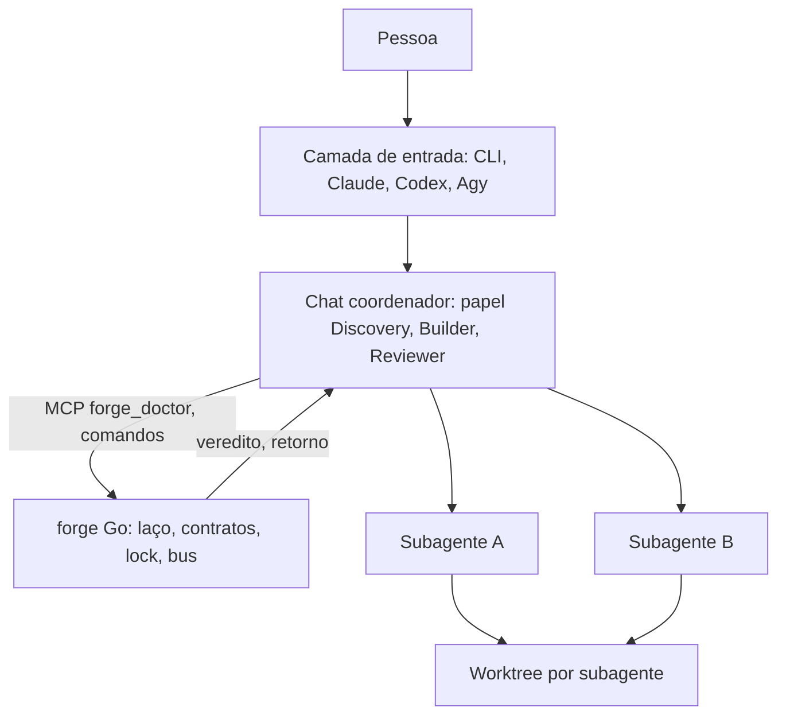
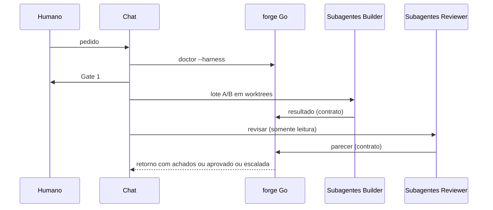

# Critérios — Iniciativa 104

## Restrições (Constitution)
`ARQ-01` (cmd só adapta flags; lógica em `internal/`), `ARQ-02`, `ARQ-04` (só stdlib em runtime; o servidor MCP é JSON-RPC à mão sobre `internal/acp`), `ARQ-05` (`--dry-run`/diagnóstico sem efeito), `ARQ-06` (subcomando novo `mcp` e flag `doctor --harness` entram na lista; texto de `ARQ-06` muda, coberto pela ADR-0015), `ARQ-11`, `COD-01`, `COD-03`, `COD-04`, `DUP-01`, `DUP-02`, `DUP-06`, `FLX-01` (Gate 1 humano), `FLX-05`, `FLX-06`, `FLX-08` (retorno é dado), `GOV-01`, `SEG-01`, `SEG-03`, `SEG-04`, `SEG-06` (Reviewer somente leitura), `SEG-07`, `TST-01` a `TST-05`.

## Modelo do módulo
**Completo** (`ARQ-11`): um pacote novo, `internal/harness` (contratos entre etapas, diagnóstico, lock, rastreio por nó), com dependência para dentro (`config`, `queue`, `bus`, `layout`); `internal/pipeline` ganha o laço do modo `chat`; `internal/acp` hospeda o transporte MCP; `cmd/forge-sdd` só adapta flags (`doctor --harness`, `mcp serve`). Justificativa: contratos e diagnóstico não têm dono hoje (`DUP-01`).

## Decisões do projeto aplicadas
- **ADR-0004:** o Go decide o fluxo; barramento em arquivos e `ApplyVerdict` seguem donos do retorno. **ADR-0015 estende** (não substitui) com o modo `chat`.
- **ADR-0008:** sessões vivas no tmux continuam no modo `sessions`; a ADR-0015 convive.
- **ADR-0005/0014:** `CLIFor`, modelo e esforço por papel (feat-90-07) são a base da feat-104-05.
- **ADR-0012:** o Go grava o veredito; o Reviewer fica somente leitura.
- **ADR-0013:** modo `advanced` mantém o Reviewer como aprovador da spec.
- **ADR-0003/P-24:** definições de agente até 420 bytes, skill até 2.048.
- **ADR-0011:** painel e fila; o rastreio por nó alimenta, sem reescrever.

## O que já existe
| Procurei | Onde | Achei | Decisão | Justificativa |
|---|---|---|---|---|
| Jobs, despachante, workers | `internal/pipeline`, `internal/bus` | Barramento, `Dispatch`, `RunWorker`, `ApplyVerdict`, `PlanWaves` | **Reusar**; o modo `chat` chama as mesmas funções | `DUP-01` |
| Papéis como agentes | `.claude/agents/*.md` | 8 papéis, ferramentas por papel, sem `Agent` | **Estender** (campo de modelo; subagentes A/B por papel) | `SEG-06` |
| Skills das estações | `.agents/skills/sdd-*` | Concepção, build, governança, operação | **Reusar** sem duplicar | `DUP-05` |
| Fila de revisão | `forge queue review`, `queue.Verdict` | Esquema estrito; já tem `RegraDescricao` na `main` | **Estender** com achado `arquivo`+`linha`; contrato único | Divergência skill/binário |
| Modo avançado | ADR-0013, `autonomy` | Reviewer aprova a spec | **Reusar** | Mesmo gate |
| Modelo e esforço | `internal/config/forge_profiles.go` (`Models`, `Efforts`), feat-90-07 | Por sessão, marcadores `{model}` | **Estender** para o cabeçalho dos agentes e `codex -m` | A 85 foi absorvida pela 90; a branch local `feat/85-...` é antiga (sem pasta de discovery), nada a aproveitar além do já em 90-07 |
| Diagnóstico | `forge doctor`, `doctor.md`, `cmd/forge-sdd/doctor.go` | Estrutura, orçamentos, telemetria; sem contrato, worktree, lock | **Estender** com `--harness --json` | `/doctor` único |
| Protocolo para agentes externos | `internal/acp` (stdio e HTTP, `gemini --acp`, `agy acp`) | JSON-RPC com Portão FLX-01 | **Reusar** o transporte para o MCP e como candidato de entrada | Sem dependência nova |
| Hooks do Claude | `internal/scaffold` (hook `UserPromptSubmit` do inbox) | Instalação em `.claude/settings.json` | **Estender** com `SessionStart` | Mesmo instalador |
| Telemetria | `forge session record`, `monitor.SessionMetrics` | Por sessão | **Estender** com nó (subagente) | Compatível |
| Worktrees | `internal/pipeline/worktree.go`, `worktree_gc.go` | Um worktree por tarefa e coleta | **Reusar** para um por subagente | `DUP-01` |
| Docs do pipeline | `docs/pipeline.md` | 3 sessões | **Atualizar** (feat-104-12) | Convivência |
| Reuso de catálogo | `sdd/spec/concepts.md` | Sem "contratos" nem "harness" | **Adicionar** linhas | `DUP-01` |

## Dependências novas
Nenhuma (`SEG-07`): MCP em stdlib sobre `internal/acp`; esquemas em structs Go com `DisallowUnknownFields`.

## Diagramas (C4, Mermaid)



## Critérios de Aceitação Executáveis (transversais)
```bash
go build ./... && go vet ./... && go test ./...
forge gate --dir . --mode bloqueio --branch feat/104-pipeline-em-subagentes --spec sdd/discovery/104-pipeline-em-subagentes/features/feat-104-01-contratos-entre-etapas.md
```
- Cada feature traz ao menos um teste negativo (caso que deve falhar e falha), checado por `forge criteria verify` (feat-104-02).
- Avaliação (feat-104-11): mesma suíte de referência nos dois modos, relatório com aprovação, retornos, tokens, tempo e intervenções.
