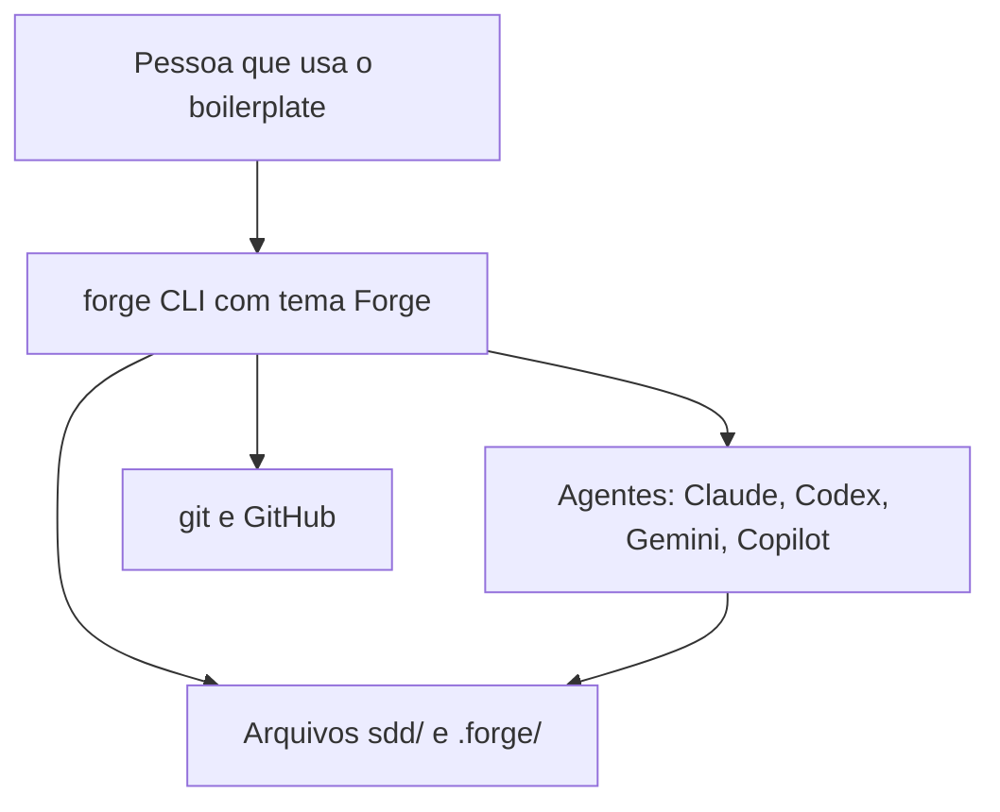
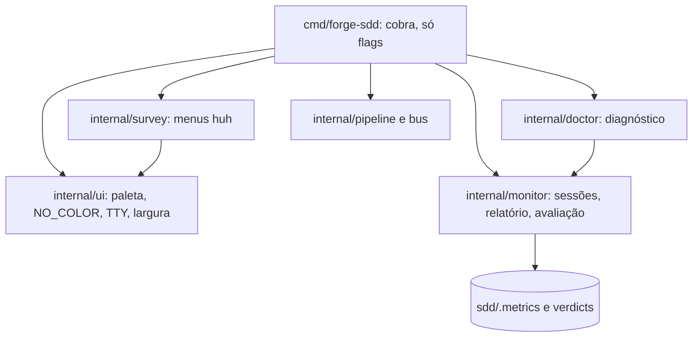
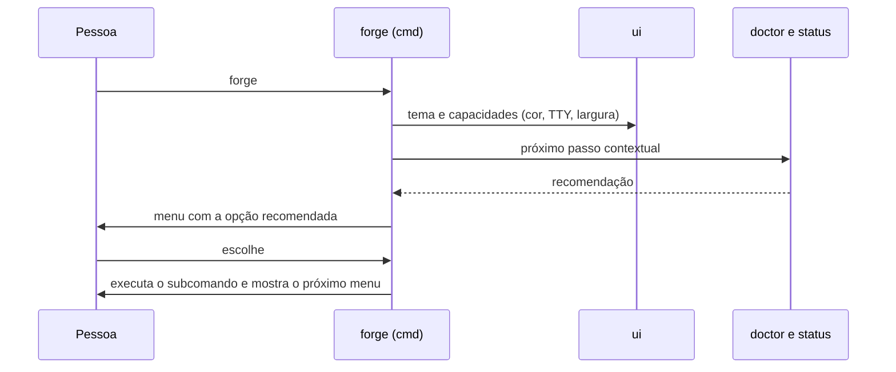

# Critérios — Iniciativa 105

## Restrições (Constitution)
`ARQ-01` (cmd só adapta flags; tema e regras ficam em `internal/`), `ARQ-02`, `ARQ-04` (só stdlib em runtime; `huh` e `lipgloss` já são compilados no binário), `ARQ-05` (`--dry-run` e diagnóstico sem efeito), `ARQ-06` (remover ou depreciar subcomando muda a lista: ADR obrigatória), `ARQ-10`, `ARQ-11`, `COD-01`, `COD-03`, `COD-04` (código morto sai na mesma entrega), `COD-05` (pt-BR), `DUP-01`, `DUP-02`, `DUP-03`, `DUP-04`, `DUP-06`, `FLX-01`, `FLX-02`, `FLX-05` (ADR), `FLX-06`, `FLX-08` (dado de arquivo é dado), `GOV-01`, `SEG-01` (validar na borda arquivo, git e ambiente), `SEG-03`, `SEG-05` (saída saneada com `notify.Sanitize`), `SEG-07` (`lipgloss` passa de indireta a direta), `TST-01` a `TST-05` (golden de saída: `TST-02`).

## Modelo do módulo
**Completo** (`ARQ-11`): um pacote novo, `internal/ui` (paleta do Forge, estilos de saída, detecção de `NO_COLOR`, TTY e largura), com dependência para dentro (só stdlib e `lipgloss`); `internal/survey` passa a pedir o tema a ele; `cmd/forge-sdd` só adapta flags e chama. A medição de proficiência (onda 3) estende `internal/monitor` e `internal/doctor` (da 104), sem pacote novo. Justificativa: hoje não existe dono para cor, tema e largura (`DUP-01`): a busca por `lipgloss` e `NO_COLOR` fora de testes não acha uso direto.

## Decisões do projeto aplicadas
Só valem ADRs com status `aprovado`/`aceito` e não substituídas.
- **ADR-0004 (aprovado):** pipeline multi-sessão; o Go decide o fluxo. Esta iniciativa não muda o fluxo, só a superfície.
- **ADR-0005 (aprovado):** `forge` sem argumentos abre o menu; cada ação roda o `RunE` do subcomando (D-7). O tema entra no menu sem duplicar lógica.
- **ADR-0002 (aprovado):** estado por iniciativa; o `status` passa a esconder iniciativa concluída por esse estado.
- **ADR-0003 (aprovado, parcialmente obsoleta):** "skills por estação". O produto virou 3 sessões; mexer nas estações exige ADR nova (task 1.1).
- **ADRs 0009 a 0014:** aceitas em 2026-11-20 (Gate 1 da 105; status atualizado no mesmo PR); valem como base.
- **ADR-0015 (`proposto`) e ADRs 0016 a 0020:** as 0016 a 0020 entram com o PR #119 (docs da Constituição, aberto): dependência de documentação, não bloqueio. Não tocadas aqui.
- **Edição Missões (ADR-0019, só na branch acima):** temporária, termina em 23/11/2026. O tema desta iniciativa é a paleta permanente; nada de `docs/design/edicao-missoes`.

## O que já existe
| Procurei | Onde | Achei | Decisão | Justificativa |
|---|---|---|---|---|
| Tema e cores do CLI | `cmd/`, `internal/` | Nenhum uso direto de `lipgloss`; só ANSI cru de tela alternativa em `cmd/forge-sdd/queue.go:276` e `internal/pipeline/status_live.go:411`; `NO_COLOR` não é lido em lugar nenhum | **Criar** `internal/ui` | `DUP-01`: sem dono hoje |
| Paleta oficial | `docs/index.html`, `docs/img/banner.svg`, `site/src/data/stations.ts` | Tokens `--bg #0d0f14`, `--accent #4f8ef7`, `--ok #3ecf8e`, `--warn #f5b04a`, `--bad #f2677a`, `--fg #e9ecf4` (`docs/index.html:14-25`) | **Reusar** como fonte; os 6 valores viram uma constante única | `DUP-04` |
| Menus interativos | `internal/survey/select.go`, `gesture.go`, `cmd/forge-sdd/menu.go` | `huh` v0.3.0 com `NewSelect` e `WithKeyMap`; sem `WithTheme` | **Estender** `survey` com tema | `DUP-03` |
| Teste de menu sem terminal | `cmd/forge-sdd/menu_test.go`, `menu_e2e_test.go` | `Prompter` com fake | **Reusar** | `TST-04` |
| TTY e saída curta | `cmd/forge-sdd/menu.go:52`, `status.go:60-77` (`go-isatty`) | Sem TTY: ajuda curta e status curto | **Reusar** a checagem dentro de `internal/ui` | `DUP-06` |
| Erro de subcomando desconhecido | `cmd/forge-sdd/bus.go`, `pipeline.go`, `queue.go` | `bus foo`, `queue claim` saem com 0 e imprimem ajuda (medido) | **Estender** com `Args` que falha | `COD-03` |
| Diagnóstico | `cmd/forge-sdd/doctor.go:90-96`; `internal/doctor/harness.go` e `doctor --harness` (só em `bbd26d6`) | `doctor` compara `.sddrc` com `.sdd-version`, não com o binário | **Estender** (onda 1); onda 3 usa o `--harness` da 104 | `/doctor` único |
| Medição de sessão | `internal/monitor/session_record.go`, `forge report` | `SessionMetrics` (tokens, turnos, `rework_lines`, `outcome`, `medicao`) | **Estender** com agregação de proficiência | `DUP-01` |
| Avaliação | `internal/monitor/eval.go`, `forge eval` (só em `bbd26d6`) | Só simulador (`origem: simulado`) | **Reusar** na onda 3; não chama modelo | Não inventar dado |
| Veredito e retrabalho | `internal/bus/job.go` (`Attempt`, `ReworkFeedback`), `sdd/discovery/*/verdicts/*.json` | 17 vereditos na árvore; 5 de 17 não decodificam (saída de `doctor --harness`, binário `bbd26d6`) | **Reusar** como fonte | `DUP-01` |
| Cobertura de rules por ID | `.agents/rules/*.md` (`regras:`), `sdd/memory/constitution.md` | 36 de 45 IDs citados; faltam `ARQ-10 DUP-03 DUP-04 DUP-06 FLX-04 SEG-03 SEG-06 TST-03 TST-04` (medido) | **Estender** `forge rules` ou `doctor` com a conta | Já é determinístico |
| Estações | `internal/queue/stations.go`, `queue stations`, `attach` | 5 estações canônicas ainda expostas | **Manter até ADR**; só avisar | `ARQ-06`, `FLX-05` |

## Dependências novas
Nenhuma dependência nova de módulo. Atenção ao `SEG-07` e ao P-14:
- `github.com/charmbracelet/lipgloss v0.9.1` hoje é `// indirect` em `go.mod:19`; usar direto o promove a requisito direto (muda `go.mod`, exige esta seção). `huh` v0.3.0 (`go.mod:7`) e `go-isatty` v0.0.20 (`go.mod:8`) já são diretos.
- Se o `huh` v0.3.0 aceita `WithTheme` e como `termenv`/`lipgloss` tratam `NO_COLOR`: **a verificar** com o context7 na versão exata antes da task 2.1 (`SEG-07`). Não afirmado aqui. Se não tratarem, `internal/ui` decide sozinho (lê `NO_COLOR` e devolve estilos vazios).

## Diagramas (C4, Mermaid)
Contexto:

Contêineres:

Sequência (primeiro uso):


## Critérios de Aceitação Executáveis
```bash
set -o pipefail
go build ./... && go vet ./...
go test ./...
go test -list 'TestTemaPaletaDoForge' ./internal/ui | grep -F 'TestTemaPaletaDoForge'
go test ./internal/ui -run 'TestTemaPaletaDoForge'
go test -list 'TestStatusEscondeIniciativaConcluida' ./cmd/forge-sdd | grep -F 'TestStatusEscondeIniciativaConcluida'
go test ./cmd/forge-sdd -run 'TestStatusEscondeIniciativaConcluida'
go test -list 'TestSaidaSemCorSemTTYELarguraEstreita' ./internal/ui | grep -F 'TestSaidaSemCorSemTTYELarguraEstreita'
go test ./internal/ui -run 'TestSaidaSemCorSemTTYELarguraEstreita'
go test -list 'TestProficienciaCalculaAPartirDeVereditos' ./internal/monitor | grep -F 'TestProficienciaCalculaAPartirDeVereditos'
go test ./internal/monitor -run 'TestProficienciaCalculaAPartirDeVereditos'
go test -list 'TestInitSemTTYExigeAgente' ./cmd/forge-sdd | grep -F 'TestInitSemTTYExigeAgente'
go test ./cmd/forge-sdd -run 'TestInitSemTTYExigeAgente'
# negativo: NO_COLOR não emite ANSI; subcomando desconhecido sai diferente de zero; `init` sem TTY e sem `--agent` falha; métrica sem dado vira "a medir", nunca 0
go test -list 'TestNoColorNaoEmiteANSI' ./internal/ui | grep -F 'TestNoColorNaoEmiteANSI'
go test ./internal/ui -run 'TestNoColorNaoEmiteANSI'
go test -list 'TestSubcomandoDesconhecidoSaiDiferenteDeZero' ./cmd/forge-sdd | grep -F 'TestSubcomandoDesconhecidoSaiDiferenteDeZero'
go test ./cmd/forge-sdd -run 'TestSubcomandoDesconhecidoSaiDiferenteDeZero'
go test -list 'TestProficienciaSemDadoEhAMedir' ./internal/monitor | grep -F 'TestProficienciaSemDadoEhAMedir'
go test ./internal/monitor -run 'TestProficienciaSemDadoEhAMedir'
```
- Cada task do `plan.md` traz o seu bloco na feature; o bloco acima é o transversal.
- Acessibilidade em todas as telas novas: com `NO_COLOR`, sem TTY e com largura de 40 colunas a saída é legível e sem ANSI (golden, `TST-02`).
- `--dry-run` de qualquer comando tocado continua sem escrever no disco (`ARQ-05`).
- Todo handoff para a pessoa é menu de opções (RN-9), com a recomendada marcada.
