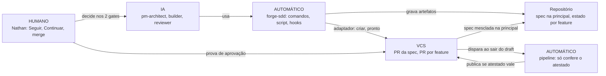
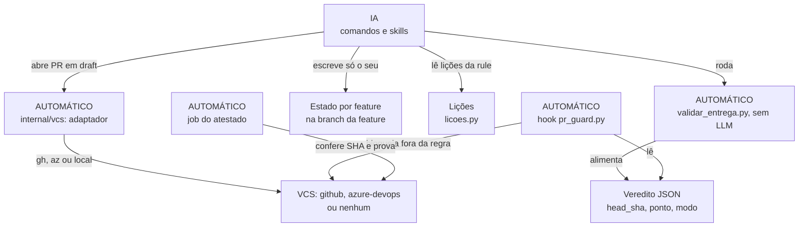
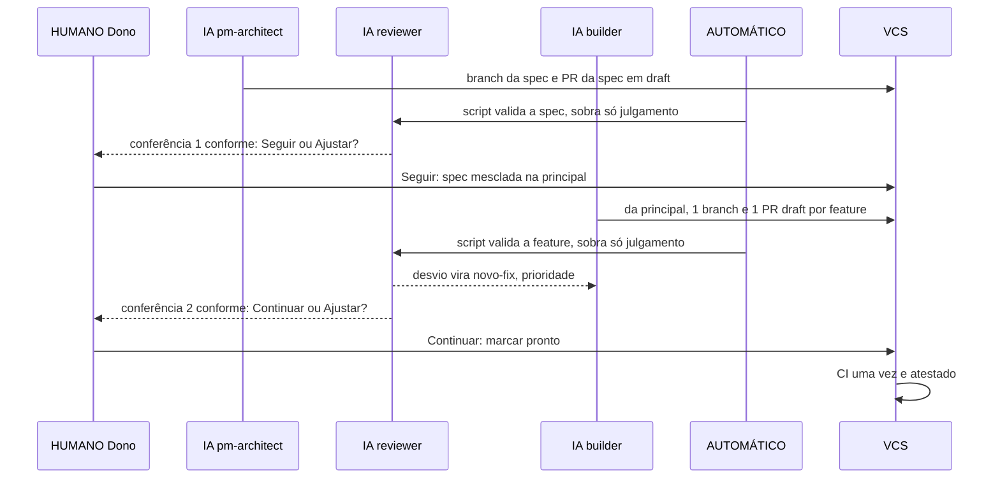

# Critérios — Iniciativa 106 (PR em draft, spec que volta à principal, branch por feature e CI)

Legenda dos diagramas (todos): **HUMANO** (decisões e aprovações do Nathan), **IA** (pm-architect, builder, reviewer) e **AUTOMÁTICO** sem LLM (script local, hooks, pipeline e adaptador de VCS).

## Restrições (Constitution)
- `FLX-01` (spec antes do código; o Gate 1 [Seguir]/[Ajustar] segue humano; a **segunda** aprovação, a do split, sai: a redação do `FLX-01` muda via ADR e `GOV-01`, ver `discovery.md`; o modo sem humano só vale se escolhido no início, com aviso de riscos e gravado), `FLX-02` (sem commit em `main`; hoje "uma branch única por iniciativa" e a Regra 15 diz "nunca por task": a branch por feature **contradiz** o texto e exige ADR e `GOV-01`, Decisão xvii), `FLX-03` (corpo do PR segue o template), `FLX-05` (a política é mudança de contrato de fluxo: exige ADR), `FLX-06` (portão em 3 camadas; o veredito é o contrato único), `FLX-08` (dados do PR são não confiáveis).
- `ARQ-01` e `ARQ-02` (lógica em `internal/`, `cmd/` só adapta flags), `ARQ-03` (scripts e workflows distribuídos via `embed`), `ARQ-04` (nenhuma dependência nova em runtime do binário), `ARQ-05` (`--dry-run` sem efeito), `ARQ-06` (nenhum comando novo no CLI: tudo cabe em comandos existentes e scripts), `ARQ-11`.
- `SEG-01` e `SEG-03` (comando do hook validado na borda; subprocessos com argumentos explícitos), `SEG-02` (hooks mesclados sem sobrescrever `.claude/settings.json`), `SEG-04` e `SEG-05` (token e gasto nunca no git, na saída nem na telemetria), `SEG-07`.
- `DUP-01`, `DUP-02`, `DUP-04` (prefixo e sinais definidos num só lugar), `DUP-06` (o contrato do veredito segue único, em `harness.Parecer`).
- `TST-01`, `TST-02` (goldens), `TST-03` (casos conformes e negativos), `TST-04`, `COD-05`, `GOV-01` (ajustar `GOV-03` e, se a Decisão i mudar, a regra 2 exige ADR).

## Modelo do módulo
**Completo** (`ARQ-11`; antes era enxuto, mudou com o escopo VCS agnóstico): um pacote novo, `internal/vcs` (interface `Adaptador` com criar PR em draft, procurar PR aberto, marcar pronto e mesclar; implementações `github`, `azure-devops` e `nenhum`; leitura do campo `VCS / Work Item System` da Constituição), com dependência para dentro (só stdlib, `ARQ-04`) e sem importar `cmd/` (`ARQ-01`, `ARQ-02`). O restante é distribuído em (a) um campo novo no contrato do veredito (`internal/harness`), (b) `internal/queue` e `internal/pipeline` passam a delegar ao adaptador, (c) scripts Python e workflows modelo entregues pelo scaffold e (d) texto dos comandos e skills. Cada parte tem um dono único: o veredito (`harness`), a abertura e o fechamento do PR (`queue`/`pipeline`), a barreira de `gh` (hook), a lição (`licoes.py`), o CI (workflow e `ci-politica.py`). Estado persistente novo: `head_sha`, `ponto` e `modo` no veredito, os arquivos de lição e, conforme a Decisão xvi (recomendo B), um arquivo de estado por feature na branch da feature (nenhum arquivo de estado compartilhado por todas as features, RN-23).

## Decisões do projeto aplicadas
- **ADR-0004:** o Go decide o fluxo; o revisor não aprova nem cria PR por conta própria. Esta iniciativa estende: o PR é criado antes, na concepção.
- **ADR-0012:** o Go grava o veredito; o Reviewer fica somente leitura. O `head_sha` é gravado pelo Go (`persistVerdict`), nunca pelo modelo.
- **ADR-0013:** modo `advanced` em que o Reviewer aprova a spec = a Revisão 1 desta política.
- **ADR-0015 (104):** modo `chat` e subagentes: os dois pontos de revisão valem nos dois modos; a 106 não altera o laço.
- **ADR-0003/P-24:** definições de agente até 420 bytes e skills até 2.048: o texto novo entra por referência, não por inchaço.
- **ADR-0002:** estado por iniciativa e execução fora do git (`sdd/.runtime/`); **estendida** com estado por feature. A frase "a branch aponta para essa pasta" deixa de valer para branches de feature.
- **Regra 15 e `FLX-02` da Constituição:** hoje "uma branch por iniciativa, nunca por task"; mudança **aprovada** por ADR e `GOV-01` na task 2.7 (redação exata no rascunho da ADR do `discovery.md`). **Conflito** com o pedido (uma branch por feature); a redação nova vai na ADR (Decisão xvii), sem editar a Constituição agora.
- **Memória do dono:** handoff é menu; PR automático após veredito conforme é **revertida** por esta política (ver `O que já existe`).

## O que já existe
| Procurei | Onde | Achei | Decisão | Justificativa |
|---|---|---|---|---|
| Revisão do PR e fila | `forge queue review`; `cmd/forge-sdd/queue.go:185-199` | Registra o parecer e, se `conforme` e sem `--no-pr`, chama `queue.OpenPR` | **Estender**: conforme não cria PR; oferece "fechar o PR?" | `DUP-03`; a flag `--no-pr` vira o padrão |
| Abstração de VCS | `*.go` (busca por "VCS"), `sdd/memory/constitution.md:28,30`, `.agents/skills/sdd-build/references/implementar.md:26`, `sdd-concepcao/references/constitution.md` passo 3 | Nenhuma no Go; nenhum código lê o campo da Constituição; só as skills tratam `github`, `azure-devops` e `nenhum`, em texto; `forge.go:185` lista `azure-devops` para o card (PM), outro conceito | **Criar** `internal/vcs`; o texto das skills passa a apontar para ele | `DUP-01`: um dono para PR; dois `OpenPR` duplicam hoje |
| Chamadas `gh` no Go | `internal/pipeline/pr.go:31,138,144,231,244`; `internal/queue/pr.go:19,41,60,101,108`; `cmd/forge-sdd/review.go:90`; `internal/config/forge.go:181` (`AllowCommands`) | `gh` fixo; lista de comandos permitidos só `git`/`gh` (`SEG-03`) | **Estender**: delegar ao adaptador; permitir `az` apenas no adaptador do Azure | `DUP-03`, `SEG-03` |
| Criação de PR (fila) | `internal/queue/pr.go:35,61,105` | `gh pr create` sem `--draft` | **Estender**: só `ready` se o PR existe; sem PR, erro orientando | Ordem invertida (RN-7) |
| Criação de PR (pipeline) | `internal/pipeline/pr.go:71,131` | `OpenPR` do Builder: gate A, push, `findOpenPR`, cria se não existir, corrige base | **Estender**: PR existente é o caso normal; se faltar, abre em draft | `findOpenPR` já trata o PR pré-existente |
| Reviewer da esteira | `internal/pipeline/review.go:60` (`ApplyVerdict`), `internal/pipeline/spec.go:72` (`ApplySpecVerdict`), `prompt.go:56-66` | Dois aplicadores: entrega e spec; checklist único `ReviewChecklist` | **Reusar**: já são os dois pontos | `DUP-01`; só falta o sinal e o SHA |
| Devolução e teto | `internal/bus/job.go:116-117,213-217`; `internal/config/forge.go:192,333`; `internal/pipeline/review.go:132-158`; `spec.go:31` | `Attempt`, `MaxReworkAttempts` (padrão 3, faixa 1 a 10); devolve só se `Attempt < Max` (3 passadas, 2 devoluções); `rework` já nasce `high` (`review.go:138`); no limite, `ActionEscalated` notifica o dono | **Reusar** o teto (coincide com "2 rodadas"); **estender**: cada desvio gera um novo-fix na mesma conta | `DUP-01`; evita contador novo (Decisão vii) |
| Split e despacho | `.agents/skills/sdd-planejamento/references/split-features.md` (passos 2, 8, 9); `internal/pipeline/dispatch.go:130` | O humano confirma o split e a fila; `forge dispatch` recusa iniciativa sem tasks | **Estender**: o Builder faz o split sem nova aprovação, dentro do `plan.md`; dispatch aceita job sem tasks | Muda `FLX-01` (ADR) |
| Paralelismo | `internal/pipeline/waves.go:26` (`PlanWaves(dir, maxParallel)`), `leque.go:91,265` (`PrepararLeque`, `Juntar`), `config.Builder.MaxParallelTasks` (padrão 3, `forge.go:191`); `goal.go:266` chama `PlanWaves(feats, 1)` | Ondas por dependência, worktree por task e junção na ordem do plano; o laço do goal usa paralelismo 1 | **Reusar** `PlanWaves` e o leque para features e fixes; **estender** o laço para `MaxParallelTasks` (ligação do leque ao laço do goal: **não verificada**) | `DUP-03`; sem lógica nova de paralelismo |
| Prioridade de fix | `internal/bus/job.go:42-43` (`PriorityHigh`), `review.go:138` | Prioridade por job, não por tipo de task | **Estender**: fix de código já entregue entra antes de feature na fila | RN-16 |
| Validação determinística | `forge gate` (`internal/gate`: P-01 a P-25), `forge doctor --harness` (104, só em `bbd26d6`) | Checagens por ID de rule, spec, orçamento; sem validação de ADR citada nem de lições | **Estender** com `scripts/validar_entrega.py` que reúne o checável e lista o resto para o LLM | RN-12; reusa `forge gate --json` como entrada |
| Verificação do atestado | `.github/workflows/*.yml` | Nenhum job de atestado | **Criar** um job ubuntu que lê veredito e prova | RN-13; escolha da prova na Decisão vi |
| Configuração do modo de atestado | `internal/config/forge.go:123,198-200` (esquema estrito do `forge.json`; a existência ativa o modo pipeline); `.gitignore` (`.forge/` ignorado); `sdd/memory/constitution.md:28` (campo versionado) | `forge.json` é local, não versionado e rejeita campo desconhecido; a Constituição é versionada e lida por todos | **Criar** o campo no lugar escolhido (Decisão xv, em aberto: recomendo a Constituição) | `SEG-01`, `GOV-01` |
| Modo da sessão | `status.md` (teto 1 KB, P-21), `forge.json` | Sem campo de modo humano | **Estender** com uma linha `Modo:` no `status.md` e `modo` no veredito | RN-14 |
| Veredito e SHA | `internal/harness/parecer.go:16-21`; `internal/pipeline/review.go:298-318` (`persistVerdict` em `sdd/discovery/<id>/verdicts/<job>.json`) | `Parecer` sem SHA; amostra `sdd/discovery/100-auto-pr-apos-review/verdicts/feat-100-01-veredito.json` | **Estender** `Parecer` com `head_sha` e `ponto`; o Go os preenche | Contrato único (`DUP-06`) |
| Auto-PR da 100 | `sdd/discovery/100-auto-pr-apos-review/` | Veredito conforme abre PR sem pedir | **Substituir a ordem** (não o código de PR) | Conflito declarado no discovery |
| Workflows | `.github/workflows/ci.yml` (jobs `test` e `lint`, só `ubuntu-latest`, `pull_request` e `push` em `main`), `deploy-lp.yml`, `encerrar-edicao.yml`, `npm-publish.yml`, `release.yml` | Sem `draft`, sem `concurrency`, sem matriz de SO (só `ubuntu-latest`) | **Estender** `ci.yml`; os demais não mudam | O CI daqui já só roda com base `main` |
| Hooks no scaffold | `internal/scaffold/hooks.go:21-35` (`UserPromptSubmit` do inbox, `SessionStart` do doctor), `mergeClaudeHook` | Mescla sem sobrescrever; JSON inválido não é tocado | **Estender** com `PreToolUse` (matcher `Bash`) | Mesmo instalador (`SEG-02`); suporte a matcher no `mergeClaudeHook`: **não verificado** |
| Hooks do repo | `.claude/settings.json` | Só `UserPromptSubmit` (inbox) | **Estender** | Dogfooding |
| Lições | `sdd/memory/lessons.md` (6 linhas, 2 entradas), `cmd/forge-sdd/lessons.go` (`lessons add`, 2 KB) | Arquivo único com poda automática | **Substituir** por `sdd/memory/licoes/<id>.md` + `licoes.py`; `lessons add` grava lá | Princípio do dono; depende da Decisão v |
| Branch e ID | `layout.InitiativeBranch` (`layout.go:340`), `branchPrefixes` (`:163`), `FromBranch` (`:304`), `NextID` e `idOfRef` (`scan.go:322,348`) | Só `feat` e `fix` | **Reusar** (Decisão i recomenda manter) | `DUP-04` |
| Gate P-01 | `internal/gate/gate.go:207-222` | Bloqueia `main` e `master` | **Reusar** | Sem mudança se `feat/` ficar |
| Comandos | `.claude/commands/{discovery,nova-feature,novo-fix,revisar,implementar}.md`; `.agents/skills/sdd-concepcao/references/*.md`; `sdd-build/references/implementar.md:26` (`gh pr create --fill`) | Branch e spec, sem PR; Builder cria PR com `--fill` | **Estender**; fonte única nas skills, comandos só apontam | `DUP-10` |
| Templates e goldens | `internal/scaffold/templates/`, `internal/scaffold/testdata/golden/` | Refletem o texto atual (ex.: `implementar.md`, `constitution.md`) | **Estender**; regenerar goldens | `TST-02` |
| `/upgrade-sdd` | `.claude/commands/upgrade-sdd.md` | Leva texto do Forge aos repositórios | **Reusar** como canal de entrega | RN-10 |
| Scripts Python | nenhum no forge-sdd (`git ls-files '*.py'` não verificado); hub tem `skills.py`, `requisitos.py` (insumo c9fb) | — | **Criar** `pr_guard.py`, `licoes.py`, `ci-politica.py` | Padrão do hub; `uv` e `pathlib` |
| Estado da fila | `internal/queue/taskstatus.go:40,60,102`; `internal/queue/queue.go:96-103,441,488`; `sdd/discovery/*/queue.json` | Mutadores regravam `updated_at` de topo; reproduzi conflito de merge numa cópia de `101-tema-missoes-v5/queue.json` com duas branches mexendo em itens diferentes | **Estender**: estado por feature na branch da feature (Decisão xvi, aprovada: B); `queue.json` vira plano | `RN-23`, `DUP-01` |
| Iniciativa ativa pela branch | `internal/layout/layout.go:222-248` (`ActiveInitiative`, `QueuePath`), `:304` (`FromBranch`) | Numa branch `feat/<id>-<nome>-<sid>` a pasta não existe e `QueuePath` cai em `sdd/.queue/queue.json` | **Estender** `Current` para o maior prefixo existente em `sdd/discovery/` | `DUP-04` |
| Marcador do Gate 1 | `internal/pipeline/goal.go:278-290` (`goalSpecApproved`: existência de `queue.json`) | Gate 1 humano cria `queue.json` | **Estender**: marcador no `status.md` da principal (`Gate 1: aprovado`) | A spec volta à principal antes do Builder |
| Arquivar | `internal/pipeline/archive.go:187-197` (`branchGuard`), `:78,241` | Exige estar na branch da iniciativa e lê `queue.json` | **Estender**: arquivar a partir da principal | A branch da iniciativa some após o merge da spec |
| Base do PR | `internal/queue/base.go:108` (`ResolveBase`), `internal/pipeline/pr.go:167` (`prBase`), `internal/config/forge.go:194` (`base_branch` padrão `main`) | Base: flag, `queue.json`, reflog da branch da iniciativa, `forge.json` | **Estender**: a base da feature é sempre `base_branch` | RN-22 |
| Branch por task | `internal/pipeline/goal.go:375` (`InitiativeBranch(initiative)+"-"+s.ID`); `leque.go:182-190` (branch local `forge/<iniciativa>-<task>`); `leque.go:262-300` (`Juntar`, `merge --no-ff` na branch da iniciativa); `leque.go:36` (`Base` em checkout) | Já há branch por task, mas a entrega é por junção local | **Estender** (recomendação da Decisão xxii, em aberto): `Base` = principal; branch publicável por feature; `Juntar` vira o merge local do VCS `nenhum` e dá lugar a `Publicar` nos demais. `PrepararLeque` e `Juntar` não têm chamador fora de `leque.go` e dos testes | `DUP-03` |
| Sobreposição com a 107 | `origin/feat/107-orquestrador-de-sessoes` (`discovery.md`: tabela de roteamento e verificador) | Linha `planner` quebra a spec em branch da iniciativa; linha do `builder` isola por worktree do leque; linha de arquivar usa branch da iniciativa; o verificador é compartilhado com o script da 106 | **Colide**: a 107 precisa (1) tirar o `planner` ou fundi-lo ao `builder` (split é do Builder), (2) trocar o isolamento do `builder` para branch e PR em draft por feature, (3) arquivar a partir da principal, (4) o verificador aceitar `--ponto spec|entrega` e `--feature`, (5) alinhar o WIP humano ao modo sem humano da 106. Não editei a 107 | Detalhe em `status.md` |
| Sobreposição com a 105 | `feat/105-experiencia-cli-e-harness` (`discovery.md`, `plan.md`) | Onda 1 troca "5 estações" nos mesmos templates e goldens; onda 2 cria menus e tema (RN-7 da 105 = handoff com menu: as perguntas [Seguir]/[Continuar] devem usar o mesmo componente); onda 3 mede proficiência (`doctor --harness`, `eval`) | **Independente**: lições, CI, atestado, `pr_guard`, `validar_entrega.py`, veredito. **Colide**: templates e goldens de comandos e skills (inclui `split-features.md`), `hooks.go`, texto do `doctor`, menus, numeração de ADR. Não editei a 105 | Detalhe em `status.md` |

## Dependências novas
**Nenhuma no binário nem no `go.mod`** (`ARQ-04`, `SEG-07`). Ferramentas já usadas ou do ambiente do dono, conforme o VCS da Constituição: `gh` (já usado pelo código, `internal/queue/pr.go`) no `github`; no `azure-devops`, o `az` (CLI do Azure, com a extensão `azure-devops`: a verificar) e/ou o MCP do Azure DevOps (autenticação interativa; ainda não está em `sdd/memory/mcps.md`, que lista só `context7` e `git`); `nenhum` não usa nenhuma. Também `git`, `uv` e Python 3 para os scripts distribuídos (não entram no binário; a task 1.4 consulta o `context7`/documentação do `uv` na versão exata antes de fixar o comando e o `doctor` passa a checar a presença). Nenhum token de CI ou de billing é guardado no repositório: `ci-politica.py` lê a autenticação do VCS do ambiente (`gh auth` ou `az login`). A consulta ao `context7`/documentação do `az repos` e do MCP do Azure DevOps (`SEG-07`) é pré-requisito da task 0.1.

## Diagramas
Diagramas do diagram-studio (versionados em `diagramas/`, cada um com `.json`, `.svg` e `.png`, legenda IA, HUMANO e AUTOMÁTICO): fluxo `diagramas/forge-106-fluxo.png`, atestado `diagramas/forge-106-atestado.png`, BPMN da especificação `diagramas/forge-106-bpmn-especificacao.png` e BPMN da construção `diagramas/forge-106-bpmn-construcao.png` (o BPMN único ficou denso e foi dividido em dois). Os três Mermaid abaixo (C4) refletem o fluxo final.

### Contexto


### Contêineres


### Sequência


## Critérios de Aceitação Executáveis
Os nomes de teste são os que as tasks devem criar; a verificação estática do portão (`--criterios`) confere forma, não execução.

```bash
set -o pipefail
go build ./... && go vet ./... && go test ./...
go test ./internal/harness/... -run 'TestParecerGravaHeadSHA'
go test ./internal/queue/... -run 'TestReviewConformeNaoCriaPR'
go test ./internal/scaffold/... -run 'TestMergePreToolUseHook'
go test ./internal/vcs/... -run 'TestGitHubCriaPRComDraft|TestAzureDevOpsCriaPRSemGitHub|TestNenhumDeixaABranchPronta|TestLeVCSDaConstituicao'
go test ./internal/pipeline/... -run 'TestDesvioAbreNovoFixComPrioridade|TestBuilderFazSplitSemSegundaAprovacao|TestFixesParalelosNaOnda'
go test ./internal/layout/... -run 'TestCurrentResolveIniciativaPorPrefixo|TestBranchDeFeatureLeAFilaDaPrincipal'
go test ./internal/pipeline/... -run 'TestClaimPelaExistenciaDaBranch|TestSpecMescladaPeloAdaptadorAposSeguir|TestNenhumMesclaLocal|TestContinuarAgrupadoPorOnda|TestGoalSpecApprovedPeloStatusDaPrincipal|TestArchiveRodaDaPrincipal|TestSpecVoltaAPrincipalAntesDoBuilder|TestBuilderParteDaPrincipal|TestUmaBranchEUmPRDraftPorFeature|TestEstadoDeFeaturesParalelasSemConflito|TestConferencia1AntesDoRetornoDaSpec|TestConferencia2PorFeature'
uv run --no-project python -m unittest discover -s scripts/tests -p 'test_*.py'
uv run scripts/validar_entrega.py --json --sem-llm
uv run scripts/atestado.py --verificar --sha HEAD --modo local
uv run scripts/atestado.py --verificar --sha HEAD --modo desligado
go test ./internal/vcs/... -run 'TestAtestadoDesligadoNaoExigeProva|TestAtestadoLocalConfereVeredito|TestProvaDoVCSIndisponivelCaiNoLocal|TestModoDeAtestadoNoStatus'
rc=0; uv run scripts/atestado.py --verificar --sha HEAD --modo vcs --simular-indisponivel || rc=$?; test "$rc" -eq 3
uv run scripts/pr_guard.py --check 'gh pr create --draft --fill'
uv run scripts/pr_guard.py --check 'az repos pr create --draft true --title x'
uv run scripts/licoes.py --rule COD-02 | grep -o 'COD-02' | wc -l
# negativo: cada caso abaixo deve falhar, e o teste existe de fato
go test ./internal/harness/... -list 'TestParecerSemHeadSHARecusado' | grep -F 'TestParecerSemHeadSHARecusado'
go test ./internal/harness/... -run 'TestParecerSemHeadSHARecusado'
go test ./internal/queue/... -list 'TestReadySemVereditoDoSHARecusado' | grep -F 'TestReadySemVereditoDoSHARecusado'
go test ./internal/queue/... -run 'TestReadySemVereditoDoSHARecusado'
go test ./internal/pipeline/... -list 'TestTerceiraRodadaPerguntaAoHumano' | grep -F 'TestTerceiraRodadaPerguntaAoHumano'
go test ./internal/pipeline/... -run 'TestTerceiraRodadaPerguntaAoHumano'
go test ./internal/vcs/... -list 'TestAzureDevOpsNaoChamaGh' | grep -F 'TestAzureDevOpsNaoChamaGh'
go test ./internal/vcs/... -run 'TestAzureDevOpsNaoChamaGh'
go test ./internal/vcs/... -list 'TestNenhumNaoExecutaComandoDeVCS' | grep -F 'TestNenhumNaoExecutaComandoDeVCS'
go test ./internal/vcs/... -run 'TestNenhumNaoExecutaComandoDeVCS'
go test ./internal/vcs/... -list 'TestVCSDesconhecidoRecusado' | grep -F 'TestVCSDesconhecidoRecusado'
go test ./internal/vcs/... -run 'TestVCSDesconhecidoRecusado'
if uv run scripts/pr_guard.py --check 'az repos pr create --title x'; then exit 1; fi
if uv run scripts/pr_guard.py --check 'az repos pr update --id 7 --draft false'; then exit 1; fi
go test ./internal/pipeline/... -list 'TestSegundoClaimDaMesmaFeatureFalha' | grep -F 'TestSegundoClaimDaMesmaFeatureFalha'
go test ./internal/pipeline/... -run 'TestSegundoClaimDaMesmaFeatureFalha'
go test ./internal/pipeline/... -list 'TestDependenteNaoComecaAntesDaPredecessoraMesclada' | grep -F 'TestDependenteNaoComecaAntesDaPredecessoraMesclada'
go test ./internal/pipeline/... -run 'TestDependenteNaoComecaAntesDaPredecessoraMesclada'
go test ./internal/pipeline/... -list 'TestSpecNaoMesclaSemSeguirNoModoComHumano' | grep -F 'TestSpecNaoMesclaSemSeguirNoModoComHumano'
go test ./internal/pipeline/... -run 'TestSpecNaoMesclaSemSeguirNoModoComHumano'
go test ./internal/pipeline/... -list 'TestBuilderNaoLeAFilaDaBranchDaIniciativa' | grep -F 'TestBuilderNaoLeAFilaDaBranchDaIniciativa'
go test ./internal/pipeline/... -run 'TestBuilderNaoLeAFilaDaBranchDaIniciativa'
go test ./internal/pipeline/... -list 'TestBuilderNaoComecaSemSpecNaPrincipal' | grep -F 'TestBuilderNaoComecaSemSpecNaPrincipal'
go test ./internal/pipeline/... -run 'TestBuilderNaoComecaSemSpecNaPrincipal'
go test ./internal/pipeline/... -list 'TestSpecNaoVoltaSemConferencia1' | grep -F 'TestSpecNaoVoltaSemConferencia1'
go test ./internal/pipeline/... -run 'TestSpecNaoVoltaSemConferencia1'
go test ./internal/pipeline/... -list 'TestFeatureSemPRDraftNaoAvanca' | grep -F 'TestFeatureSemPRDraftNaoAvanca'
go test ./internal/pipeline/... -run 'TestFeatureSemPRDraftNaoAvanca'
go test ./internal/pipeline/... -list 'TestDuasFeaturesNaoEscrevemNoMesmoArquivo' | grep -F 'TestDuasFeaturesNaoEscrevemNoMesmoArquivo'
go test ./internal/pipeline/... -run 'TestDuasFeaturesNaoEscrevemNoMesmoArquivo'
go test ./internal/pipeline/... -list 'TestConferencia2NaoRodaAntesDoSinal' | grep -F 'TestConferencia2NaoRodaAntesDoSinal'
go test ./internal/pipeline/... -run 'TestConferencia2NaoRodaAntesDoSinal'
go test ./internal/pipeline/... -list 'TestSplitForaDoPlanoRecusado' | grep -F 'TestSplitForaDoPlanoRecusado'
go test ./internal/pipeline/... -run 'TestSplitForaDoPlanoRecusado'
go test ./internal/pipeline/... -list 'TestModoSemHumanoExigeAvisoDeRiscos' | grep -F 'TestModoSemHumanoExigeAvisoDeRiscos'
go test ./internal/pipeline/... -run 'TestModoSemHumanoExigeAvisoDeRiscos'
go test ./internal/vcs/... -list 'TestFallbackNaoAprovaEmSilencio' | grep -F 'TestFallbackNaoAprovaEmSilencio'
go test ./internal/vcs/... -run 'TestFallbackNaoAprovaEmSilencio'
go test ./internal/vcs/... -list 'TestFallbackNaoBloqueiaParaSempre' | grep -F 'TestFallbackNaoBloqueiaParaSempre'
go test ./internal/vcs/... -run 'TestFallbackNaoBloqueiaParaSempre'
go test ./internal/vcs/... -list 'TestModoDeAtestadoInvalidoRecusado' | grep -F 'TestModoDeAtestadoInvalidoRecusado'
go test ./internal/vcs/... -run 'TestModoDeAtestadoInvalidoRecusado'
go test ./internal/vcs/... -list 'TestNenhumRecusaModoVCS' | grep -F 'TestNenhumRecusaModoVCS'
go test ./internal/vcs/... -run 'TestNenhumRecusaModoVCS'
if uv run scripts/atestado.py --verificar --sha 0000000 --modo local; then exit 1; fi
if uv run scripts/atestado.py --verificar --sha HEAD --modo inexistente; then exit 1; fi
if uv run scripts/validar_entrega.py --json --sem-llm --fixture scripts/tests/fixtures/rule_inexistente; then exit 1; fi
if uv run scripts/pr_guard.py --check 'gh pr create --fill'; then exit 1; fi
if uv run scripts/pr_guard.py --check 'gh pr merge 7'; then exit 1; fi
```
- Spec volta à principal (RN-21): após o [Seguir], `git log <base> -- sdd/discovery/<id>/discovery.md` mostra a spec na principal e a branch da spec não existe mais; o Builder só inicia com `Gate 1: aprovado` no `status.md` da principal (task 2.2).
- Uma branch e um PR em draft por feature (RN-22): com 3 features independentes, o VCS mostra 3 branches `feat/<id>-<nome>-<sid>` com base na principal e 3 PRs em draft; nenhum PR tem base em branch de iniciativa (task 2.4).
- Estado sem conflito (RN-23): duas branches de feature mescladas na principal sem conflito de estado; o teste reproduz o caso de `queue.json` com `updated_at` como falha de referência e prova que o arquivo por feature não conflita (task 0.7).
- Conferências (RN-3): `status.md` mostra `spec-para-revisao` antes de a spec voltar e `pronto-para-revisao` por feature; o teto vale por feature (task 1.6).
- Cada VCS suportado tem prova própria na task 3.5: `github` (abaixo), `azure-devops` (PR de teste em draft; se a build validation roda em draft e como marcar pronto: a verificar) e `nenhum` (branch pronta, sem comando de VCS).
- Draft real no GitHub: um PR de teste com `gh pr create --draft` mostra todos os jobs `skipped`; depois de `gh pr ready` os jobs rodam uma vez (task 3.5; evidência colada no PR).
- Modos do atestado (RN-18 a RN-20): `desligado` não confere nada; `local` confere veredito e SHA; `vcs` com a prova indisponível sai com código 3 (pergunta ao humano) e nunca com sucesso; o modo efetivo e o fallback aparecem no `status.md` e no atestado (task 0.5 e 0.6).
- Atestado real: no mesmo PR de teste, `gh pr ready` com SHA sem veredito conforme faz o job de atestado falhar e bloquear a publicação; com atestado válido ele passa (task 3.5).
- Duas conferências: com 3 commits na feature, o laço registra 0 revisões entre a abertura do PR de feature e `pronto-para-revisao` (task 1.6); os fixes abertos pelo revisor não disparam revisão até o sinal se repetir.
- `validar_entrega.py` nunca chama LLM nem rede, e não é referenciado em nenhum workflow (conferência na task 3.2).
- Goldens: `go test ./internal/scaffold/...` verde após regenerar (`TST-02`).
- Portão: `forge gate --mode bloqueio --criterios` verde nesta spec e em cada feature.
