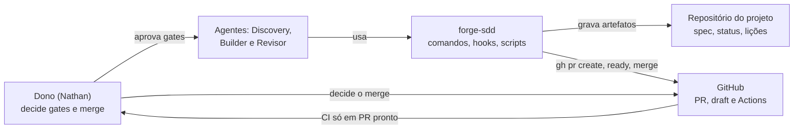
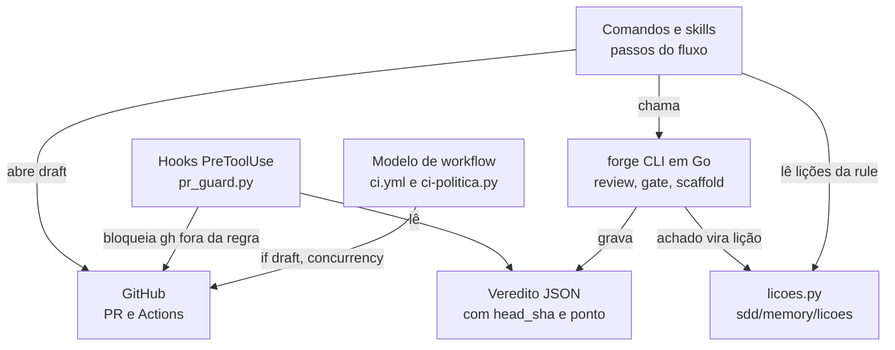
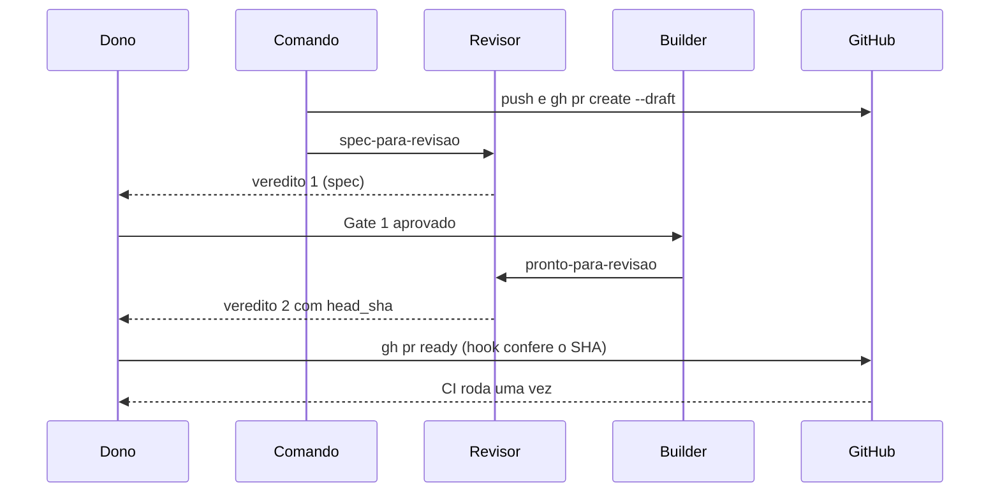

# Critérios — Iniciativa 106 (PR em draft, revisão em dois pontos e CI)

## Restrições (Constitution)
- `FLX-01` (spec antes do código; Gate 1 e aprovação humana nunca são automáticos), `FLX-02` (sem commit em `main`; branch por iniciativa), `FLX-03` (corpo do PR segue o template), `FLX-05` (a política é mudança de contrato de fluxo: exige ADR), `FLX-06` (portão em 3 camadas; o veredito é o contrato único), `FLX-08` (dados do PR são não confiáveis).
- `ARQ-01` e `ARQ-02` (lógica em `internal/`, `cmd/` só adapta flags), `ARQ-03` (scripts e workflows distribuídos via `embed`), `ARQ-04` (nenhuma dependência nova em runtime do binário), `ARQ-05` (`--dry-run` sem efeito), `ARQ-06` (nenhum comando novo no CLI: tudo cabe em comandos existentes e scripts), `ARQ-11`.
- `SEG-01` e `SEG-03` (comando do hook validado na borda; subprocessos com argumentos explícitos), `SEG-02` (hooks mesclados sem sobrescrever `.claude/settings.json`), `SEG-04` e `SEG-05` (token e gasto nunca no git, na saída nem na telemetria), `SEG-07`.
- `DUP-01`, `DUP-02`, `DUP-04` (prefixo e sinais definidos num só lugar), `DUP-06` (o contrato do veredito segue único, em `harness.Parecer`).
- `TST-01`, `TST-02` (goldens), `TST-03` (casos conformes e negativos), `TST-04`, `COD-05`, `GOV-01` (ajustar `GOV-03` e, se a Decisão i mudar, a regra 2 exige ADR).

## Modelo do módulo
**Enxuto**, com justificativa (`ARQ-11`): não há pacote de domínio novo. A política é distribuída em (a) um campo novo no contrato existente do veredito (`internal/harness`), (b) mudança de ordem em `internal/queue` e `internal/pipeline`, (c) scripts Python e workflow modelo entregues pelo scaffold e (d) texto dos comandos e skills. Cada parte tem um dono único: o veredito (`harness`), a abertura e o fechamento do PR (`queue`/`pipeline`), a barreira de `gh` (hook), a lição (`licoes.py`), o CI (workflow e `ci-politica.py`). Sem estado persistente novo além de `head_sha` no veredito e dos arquivos de lição.

## Decisões do projeto aplicadas
- **ADR-0004:** o Go decide o fluxo; o revisor não aprova nem cria PR por conta própria. Esta iniciativa estende: o PR é criado antes, na concepção.
- **ADR-0012:** o Go grava o veredito; o Reviewer fica somente leitura. O `head_sha` é gravado pelo Go (`persistVerdict`), nunca pelo modelo.
- **ADR-0013:** modo `advanced` em que o Reviewer aprova a spec = a Revisão 1 desta política.
- **ADR-0015 (104):** modo `chat` e subagentes: os dois pontos de revisão valem nos dois modos; a 106 não altera o laço.
- **ADR-0003/P-24:** definições de agente até 420 bytes e skills até 2.048: o texto novo entra por referência, não por inchaço.
- **Rule 15 da Constituição:** uma branch por iniciativa (`<prefixo>/<id>-<nome>`).
- **Memória do dono:** handoff é menu; PR automático após veredito conforme é **revertida** por esta política (ver `O que já existe`).

## O que já existe
| Procurei | Onde | Achei | Decisão | Justificativa |
|---|---|---|---|---|
| Revisão do PR e fila | `forge queue review`; `cmd/forge-sdd/queue.go:185-199` | Registra o parecer e, se `conforme` e sem `--no-pr`, chama `queue.OpenPR` | **Estender**: conforme não cria PR; oferece "fechar o PR?" | `DUP-03`; a flag `--no-pr` vira o padrão |
| Criação de PR (fila) | `internal/queue/pr.go:35,61,105` | `gh pr create` sem `--draft` | **Estender**: só `ready` se o PR existe; sem PR, erro orientando | Ordem invertida (RN-7) |
| Criação de PR (pipeline) | `internal/pipeline/pr.go:71,131` | `OpenPR` do Builder: gate A, push, `findOpenPR`, cria se não existir, corrige base | **Estender**: PR existente é o caso normal; se faltar, abre em draft | `findOpenPR` já trata o PR pré-existente |
| Reviewer da esteira | `internal/pipeline/review.go:60` (`ApplyVerdict`), `internal/pipeline/spec.go:72` (`ApplySpecVerdict`), `prompt.go:56-66` | Dois aplicadores: entrega e spec; checklist único `ReviewChecklist` | **Reusar**: já são os dois pontos | `DUP-01`; só falta o sinal e o SHA |
| Devolução e teto | `internal/bus/job.go:116-117,213-217`; `internal/config/forge.go:192,333` | `Attempt`, `MaxReworkAttempts` (padrão 3, faixa 1 a 10); `dispatch.go:257` calcula a tentativa da spec | **Estender**: padrão 2 por ponto; depois, pergunta ao humano | A política pede 2; mantém a faixa |
| Veredito e SHA | `internal/harness/parecer.go:16-21`; `internal/pipeline/review.go:298-318` (`persistVerdict` em `sdd/discovery/<id>/verdicts/<job>.json`) | `Parecer` sem SHA; amostra `sdd/discovery/100-auto-pr-apos-review/verdicts/feat-100-01-veredito.json` | **Estender** `Parecer` com `head_sha` e `ponto`; o Go os preenche | Contrato único (`DUP-06`) |
| Auto-PR da 100 | `sdd/discovery/100-auto-pr-apos-review/` | Veredito conforme abre PR sem pedir | **Substituir a ordem** (não o código de PR) | Conflito declarado no discovery |
| Workflows | `.github/workflows/ci.yml` (jobs `test` e `lint`, só `ubuntu-latest`, `pull_request` e `push` em `main`), `deploy-lp.yml`, `encerrar-edicao.yml`, `npm-publish.yml`, `release.yml` | Sem `draft`, sem `concurrency`, sem matriz de SO (só `ubuntu-latest`) | **Estender** `ci.yml`; os demais não mudam | O CI daqui já só roda com base `main` |
| Hooks no scaffold | `internal/scaffold/hooks.go:21-35` (`UserPromptSubmit` do inbox, `SessionStart` do doctor), `mergeClaudeHook` | Mescla sem sobrescrever; JSON inválido não é tocado | **Estender** com `PreToolUse` (matcher `Bash`) | Mesmo instalador (`SEG-02`); suporte a matcher no `mergeClaudeHook`: **não verificado** |
| Hooks do repo | `.claude/settings.json` | Só `UserPromptSubmit` (inbox) | **Estender** | Dogfooding |
| Lições | `sdd/memory/lessons.md` (6 linhas, 2 entradas), `cmd/forge-sdd/lessons.go` (`lessons add`, 2 KB) | Arquivo único com poda automática | **Substituir** por `sdd/memory/licoes/<id>.md` + `licoes.py`; `lessons add` grava lá | Princípio do dono; depende da Decisão v |
| Branch e ID | `layout.InitiativeBranch` (`layout.go:340`), `branchPrefixes` (`:163`), `FromBranch` (`:304`), `NextID` e `idOfRef` (`scan.go:322,348`) | Só `feat` e `fix` | **Reusar** (Decisão i recomenda manter) | `DUP-04` |
| Gate P-01 | `internal/gate/gate.go:207-222` | Bloqueia `main` e `master` | **Reusar** | Sem mudança se `feat/` ficar |
| Comandos | `.claude/commands/{discovery,nova-feature,novo-fix,revisar,implementar}.md`; `.agents/skills/sdd-concepcao/references/*.md`; `sdd-build/references/implementar.md:26` (`gh pr create --fill`) | Branch e spec, sem PR; Builder cria PR com `--fill` | **Estender**; fonte única nas skills, comandos só apontam | `DUP-10` |
| Templates e goldens | `internal/scaffold/templates/`, `internal/scaffold/testdata/golden/` | Refletem o texto atual (ex.: `implementar.md`, `constitution.md`) | **Estender**; regenerar goldens | `TST-02` |
| `/upgrade-sdd` | `.claude/commands/upgrade-sdd.md` | Leva texto do Forge aos repositórios | **Reusar** como canal de entrega | RN-10 |
| Scripts Python | nenhum no forge-sdd (`git ls-files '*.py'` não verificado); hub tem `skills.py`, `requisitos.py` (insumo c9fb) | — | **Criar** `pr_guard.py`, `licoes.py`, `ci-politica.py` | Padrão do hub; `uv` e `pathlib` |
| Sobreposição com a 105 | `feat/105-experiencia-cli-e-harness` (`discovery.md`, `plan.md`) | Onda 1 troca "5 estações" nos mesmos templates e goldens; onda 2 cria menus (RN-7 da 105 = handoff com menu); `status.md` da 105 pede aprovar ADRs | **Independente**: ADR (número), lições, CI, `pr_guard`, veredito. **Colide**: templates e goldens de comandos e skills; `hooks.go`; texto de `doctor`; numeração de ADR. Não editei a 105 | Detalhe em `status.md` |

## Dependências novas
**Nenhuma no binário nem no `go.mod`** (`ARQ-04`, `SEG-07`). Ferramentas já usadas ou do ambiente do dono: `gh` (já usado pelo código, `internal/queue/pr.go`), `git`, `uv` e Python 3 para os scripts distribuídos (não entram no binário; a task 1.3 consulta o `context7`/documentação do `uv` na versão exata antes de fixar o comando e o `doctor` passa a checar a presença). Nenhum token de CI ou de billing é guardado no repositório: `ci-politica.py` lê `gh auth` do ambiente.

## Diagramas

### Contexto


### Contêineres


### Sequência


## Critérios de Aceitação Executáveis
Os nomes de teste são os que as tasks devem criar; a verificação estática do portão (`--criterios`) confere forma, não execução.

```bash
set -o pipefail
go build ./... && go vet ./... && go test ./...
go test ./internal/harness/... -run 'TestParecerGravaHeadSHA'
go test ./internal/queue/... -run 'TestReviewConformeNaoCriaPR'
go test ./internal/scaffold/... -run 'TestMergePreToolUseHook'
uv run --no-project python -m unittest discover -s scripts/tests -p 'test_*.py'
uv run scripts/pr_guard.py --check 'gh pr create --draft --fill'
uv run scripts/licoes.py --rule COD-02 | grep -o 'COD-02' | wc -l
# negativo: cada caso abaixo deve falhar, e o teste existe de fato
go test ./internal/harness/... -list 'TestParecerSemHeadSHARecusado' | grep -F 'TestParecerSemHeadSHARecusado'
go test ./internal/harness/... -run 'TestParecerSemHeadSHARecusado'
go test ./internal/queue/... -list 'TestReadySemVereditoDoSHARecusado' | grep -F 'TestReadySemVereditoDoSHARecusado'
go test ./internal/queue/... -run 'TestReadySemVereditoDoSHARecusado'
go test ./internal/pipeline/... -list 'TestTerceiraRodadaPerguntaAoHumano' | grep -F 'TestTerceiraRodadaPerguntaAoHumano'
go test ./internal/pipeline/... -run 'TestTerceiraRodadaPerguntaAoHumano'
if uv run scripts/pr_guard.py --check 'gh pr create --fill'; then exit 1; fi
if uv run scripts/pr_guard.py --check 'gh pr merge 7'; then exit 1; fi
```
- Draft real: um PR de teste com `gh pr create --draft` mostra todos os jobs `skipped`; depois de `gh pr ready` os jobs rodam uma vez (task 2.6; evidência colada no PR).
- Dois pontos: com fila de 3 tasks entregues, o laço registra 0 revisões entre `spec-para-revisao` e `pronto-para-revisao` (task 1.5).
- Goldens: `go test ./internal/scaffold/...` verde após regenerar (`TST-02`).
- Portão: `forge gate --mode bloqueio --criterios` verde nesta spec e em cada feature.
