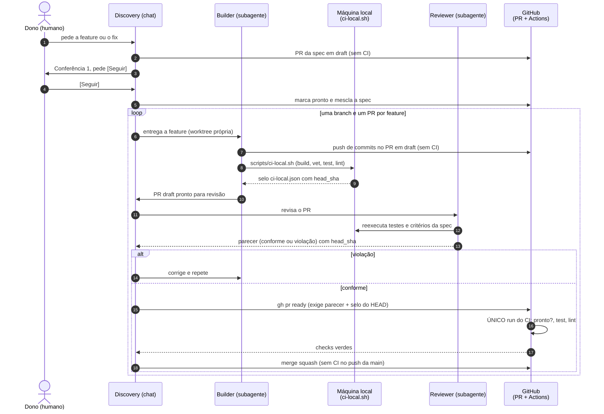

# Fluxo da entrega com CI local primeiro (fix-106-10)

Quem faz o quê, do chat até o merge, e o **único** ponto em que o GitHub Actions roda.

## Como ler

- Linhas até o `gh pr ready`: **zero** execução de Actions. Todo o trabalho e a validação rodam na máquina.
- `gh pr ready` só passa com parecer **e** selo local do mesmo `head_sha` do HEAD (`pr_guard.py`).
- O CI do GitHub dispara só em `ready_for_review` (ou `workflow_dispatch`) e confirma o que a máquina já provou.
- Precisa de nova rodada no GitHub? Volte o PR a draft e marque pronto de novo.

## Limites

- Selo local é auto-atestado: não prova que a máquina estava limpa. O CI único é a segunda opinião.
- Sem `push` na `main`: regressão por merge conflitante só aparece no PR seguinte.
