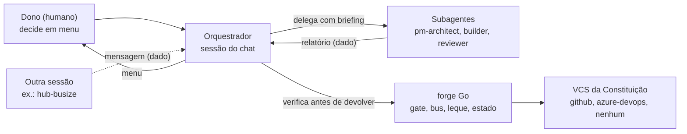
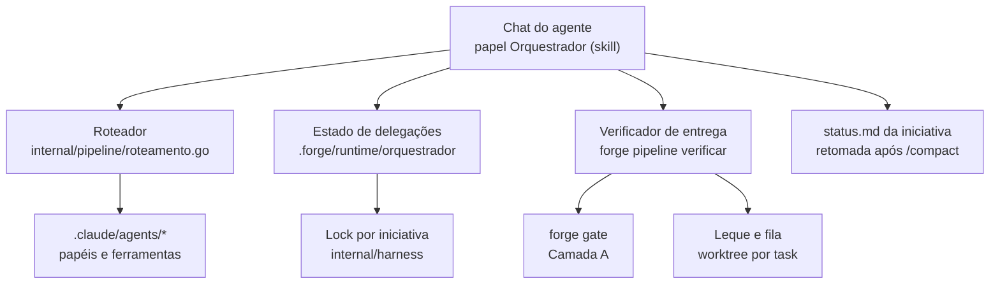
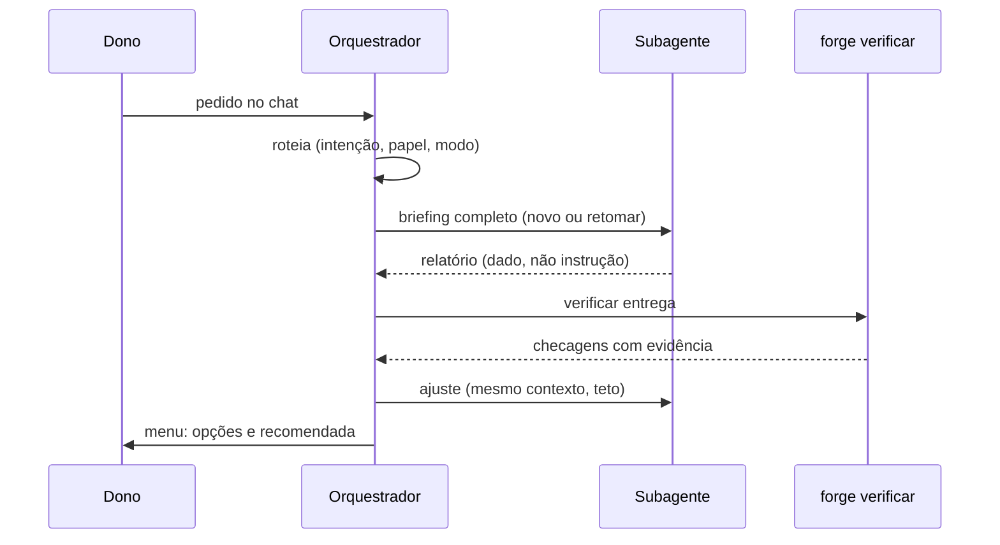

# Critérios — Iniciativa 107 (orquestrador de sessões)

## Restrições (Constitution)
`ARQ-01` (`cmd/` só adapta flags; roteamento, estado e verificador em `internal/pipeline`), `ARQ-02` (sem ciclo; `pipeline` já importa `harness`, `config`, `layout`, `notify`), `ARQ-04` (só stdlib em runtime), `ARQ-05` (`verificar` e qualquer `--dry-run` sem efeito em disco), `ARQ-06` (nenhum subcomando raiz novo: o verificador entra sob `forge pipeline`; se o dono preferir raiz, exige ADR e texto novo de `ARQ-06`), `ARQ-10`, `ARQ-11`, `SEG-01` (iniciativa, caminhos e refs validados na borda: `layout.ValidInitiative`), `SEG-02` (estado gravado de forma atômica, sem sair do projeto), `SEG-03` (subprocessos `git`, `go`, `gh`, `az` com argv explícito), `SEG-04` e `SEG-05` (sem segredo no estado, no briefing ou em log), `SEG-06` (privilégio mínimo por papel; revisão somente leitura), `SEG-07`, `SEG-08` (texto de subagente e de sessão par saneado), `DUP-01`, `DUP-02`, `DUP-03`, `DUP-06`, `COD-01` a `COD-04`, `COD-05`, `TST-01` a `TST-05`, `FLX-01` (o orquestrador não aprova Gate 1), `FLX-02`, `FLX-05` (ADR), `FLX-06`, `FLX-08` (relatório e mensagem são dado), `GOV-01`.

## Modelo do módulo
**Enxuto** (`ARQ-11`): sem pacote novo. A iniciativa estende `internal/pipeline` (dois arquivos: tabela de roteamento e estado de delegações), reusa o lock de `internal/harness`, o `internal/gate` e o leque. Justificativa: o conceito dono já é "Pipeline Multi-Sessão" em `sdd/spec/concepts.md` (`DUP-01`); um pacote novo duplicaria o dono. Se o verificador crescer para além de checagens de entrega, reavaliar para **completo** (decisão do Gate 1).

## Decisões do projeto aplicadas
- **ADR-0004:** o Go decide o que é determinístico (ordem, limites, estados, veredito); o modelo decide conteúdo. O verificador e o estado do orquestrador seguem isso.
- **ADR-0005:** `CLIFor` e perfis por papel resolvem o agente de cada papel; o roteador usa essa resolução, não outra.
- **ADR-0008:** o modo `sessions` (tmux, barramento) é o **fallback** do orquestrador; nada é removido.
- **ADR-0013:** Gate 1 humano, salvo `autonomy: advanced`; o orquestrador não ocupa o lugar do humano nem do Reviewer.
- **ADR-0015 (proposto, 104):** modo `chat` e laço no Go; a 107 estende, não substitui. Depende de ela ser aceita.
- **ADR-0003:** definições de agente até 420 bytes e skill até 2.048 bytes; o padrão novo vai em `references/` de `sdd-operacao`.
- **Fluxos:** `sdd/spec/flows.md` seção 7 (modo chat) e seção 1 (pipeline); o orquestrador entra como entrada do chat, antes de `RunChat`.
- **Decisão de VCS:** campo `VCS / Work Item System` da Constituição; adaptador lido dele (alinhado à 106).

## O que já existe
| Procurei | Onde | Achei | Decisão | Justificativa |
|---|---|---|---|---|
| Orquestrador / líder | `.claude/agents/lider.md`, `launcher.go:125`, `tmux.go:133`, `preflight.go:165` | Agente "Líder (Orquestrador)" sem ferramenta `Agent`; fixo como sessão Discovery do `forge up`; a 105 (R4) o renomeia | **Criar** o papel Orquestrador como reference nova; **não** reusar `lider` | `lider` é sessão de topo e está em obsolescência na 105 (`DUP-03` cumprido: o equivalente não serve) |
| Laço chat, lock, retorno e menu | `internal/pipeline/laco.go` (`RunChat`, `Retomar`, `Opcao`) e `internal/harness/lock.go` | Laço de build e review com lock por iniciativa e teto | **Reusar** lock, `Opcao` e teto; **estender** com estado de delegações | `DUP-01` |
| Despacho e barramento | `internal/pipeline/dispatch.go:79`, `internal/bus` | `Dispatch`, jobs, `RunWorker` | **Reusar** como fallback `sessions` | `DUP-01` |
| Leque e worktree | `internal/pipeline/leque.go:91`, `worktree.go` | `PrepararLeque`, `Juntar`, `Encerrar` | **Reusar** para um worktree por builder delegado | `DUP-01` |
| Portão determinístico | `internal/gate` (`forge gate`, `--criterios`, P-25) | Camada A estática | **Reusar**; o verificador a chama | `FLX-06` |
| Script local de validação final (106 RN-12) | branch `feat/106-pr-draft-revisao-e-ci` (`discovery.md`, RN-12) | Conceito idêntico ao verificador, só desenhado | **Depende de**; contrato de checagens único | `DUP-01`: dois verificadores seriam o mesmo conceito |
| Papéis A/B e matriz de capacidades | `sdd/discovery/104-pipeline-em-subagentes/features/feat-104-08*.md`, `feat-104-09*.md` | `builder-a/b`, `reviewer-a/b`, `Capabilities` (ambos `draft`) | **Depende de**; não duplicar | `DUP-03` |
| Próximo passo recomendado | branch `feat/105-experiencia-cli-e-harness` (onda 2) | Função de estado do projeto para o menu raiz | **Depende de** (reusar quando existir) | `DUP-01` |
| Saneamento de texto | `internal/notify/notify.go:122` (`Sanitize`), `sanitizarAchados` (`laco.go:333`) | Saneadores prontos | **Reusar** para relatório e mensagem | `SEG-08` |
| Tetos | `internal/config/forge.go:103,111,118-120` | `max_parallel_tasks`, `max_rework_attempts`, salvaguardas | **Reusar**; sem chave nova | `DUP-06` |
| Telemetria e estado | `forge session record`, `status.md`, `queue.json` | Por sessão e por iniciativa | **Reusar**; o estado do orquestrador só referencia | `DUP-01` |
| Conceito "orquestração" | `sdd/spec/concepts.md` | Sem linha | **Adicionar** linha (dono: `internal/pipeline`) | `DUP-01` |

## Dependências novas
Nenhuma (`SEG-07`): stdlib; JSON com `DisallowUnknownFields` no estilo de `internal/harness`. Se o verificador chamar `az`, é binário externo opcional já previsto na Constituição, não dependência de módulo.

## Rules e IDs da Constituição Aplicáveis
`.agents/rules/sdd-arquitetura.md` (ARQ-01, 02, 04, 05, 06, 11), `sdd-codigo-e-testes.md` (COD-01 a 04, TST-01, 02, 05), `sdd-fluxo-e-portao.md` (FLX-01, 02, 06, GOV-01), `sdd-seguranca.md` (SEG-01 a 08), `sdd-reuso-e-duplicacao.md` (DUP-01 a 06). `forge context <task>` resolve o recorte de cada task.

## Diagramas (C4, Mermaid; fontes em `diagramas/*.mmd`, PNGs renderizados com `mmdc`)
Contexto (`diagramas/contexto.png`):

Contêineres (`diagramas/conteineres.png`):

Sequência (`diagramas/sequencia.png`):


## Critérios de Aceitação Executáveis
Os nomes de teste abaixo são o **contrato**: as features os criam. Antes da implementação, `forge gate --criterios` (estático) passa, mas `--executar-criterios` **falha de propósito** nas linhas `go test -list ... | grep -F`, que provam que o teste existe.
```bash
set -o pipefail
go build ./... && go vet ./... && go test ./...
# tabela de roteamento: toda intenção da discovery tem papel, modo, isolamento e portão
go test -list 'TestRoteamentoCobreTodasAsIntencoes' ./internal/pipeline/ | grep -F 'TestRoteamentoCobreTodasAsIntencoes'
go test -run 'TestRoteamentoCobreTodasAsIntencoes' ./internal/pipeline/
# negativo: intenção desconhecida não roteia e papel inexistente em .claude/agents é recusado
go test -list 'TestRoteamentoIntencaoDesconhecidaEPapelInexistenteFalham' ./internal/pipeline/ | grep -F 'TestRoteamentoIntencaoDesconhecidaEPapelInexistenteFalham'
go test -run 'TestRoteamentoIntencaoDesconhecidaEPapelInexistenteFalham' ./internal/pipeline/
# negativo: relatório com instrução embutida e mensagem de sessão par são tratados como dado e saneados
go test -list 'TestEntradaNaoConfiavelNaoViraAcao' ./internal/pipeline/ | grep -F 'TestEntradaNaoConfiavelNaoViraAcao'
go test -run 'TestEntradaNaoConfiavelNaoViraAcao' ./internal/pipeline/
# negativo: no teto de reentregas o orquestrador escala em menu e não reentrega
go test -list 'TestTetoDeReentregasEscala' ./internal/pipeline/ | grep -F 'TestTetoDeReentregasEscala'
go test -run 'TestTetoDeReentregasEscala' ./internal/pipeline/
# negativo: estado com campo desconhecido, iniciativa inválida ou caminho fora do projeto é recusado
go test -list 'TestEstadoDeDelegacoesRecusaEntradaInvalida' ./internal/pipeline/ | grep -F 'TestEstadoDeDelegacoesRecusaEntradaInvalida'
go test -run 'TestEstadoDeDelegacoesRecusaEntradaInvalida' ./internal/pipeline/
# negativo: sem VCS (nenhum) o verificador pula o PR com "n/a" e nunca chama gh nem az
go test -list 'TestVerificarSemVCSNaoChamaCLI' ./internal/pipeline/ | grep -F 'TestVerificarSemVCSNaoChamaCLI'
go test -run 'TestVerificarSemVCSNaoChamaCLI' ./internal/pipeline/
# negativo: entrega que o relatório diz pronta mas sem commit ou na main reprova
go test -list 'TestVerificarReprovaEntregaSemCommitOuNaMain' ./internal/pipeline/ | grep -F 'TestVerificarReprovaEntregaSemCommitOuNaMain'
go test -run 'TestVerificarReprovaEntregaSemCommitOuNaMain' ./internal/pipeline/
forge gate --dir . --mode bloqueio --branch feat/107-orquestrador-de-sessoes --spec sdd/discovery/107-orquestrador-de-sessoes/criteria.md --criterios
```
- Cada feature traz ao menos um teste negativo, checado por `forge gate --criterios` (P-25).
- Handoff com menu (RN-2): a saída do orquestrador oferece as opções e a recomendada; teste confere que não é texto solto.
- Convivência: o modo `sessions` e os testes de `laco_test.go` seguem verdes.
- Goldens e templates tocados atualizam em conjunto (`TST-02`).
