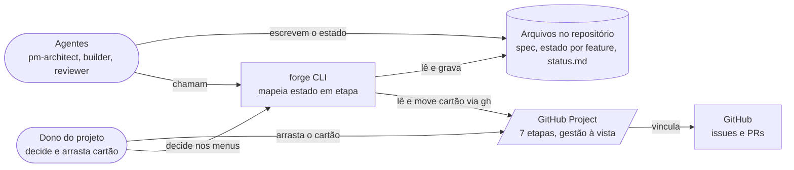
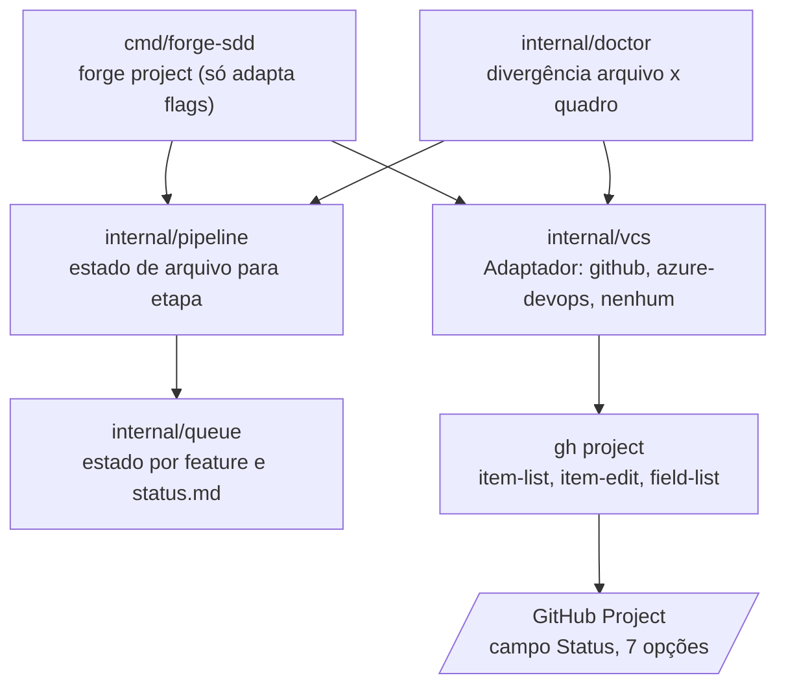
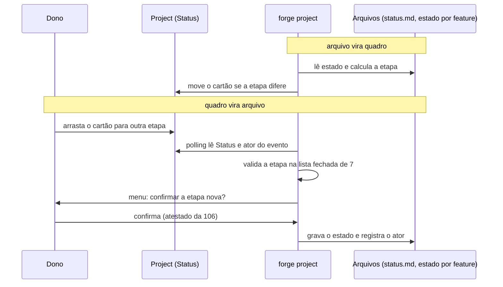

# Critérios — Iniciativa 108 (GitHub Project como espelho do ciclo)

## Restrições (Constitution)
`ARQ-01` (`cmd/` só adapta flags do `forge project`; o mapa e a regra ficam em `internal/pipeline`, a chamada ao `gh` em `internal/vcs`), `ARQ-02` (sem ciclo: `vcs` não importa `pipeline`; `pipeline` define a interface que consome), `ARQ-04` (só stdlib em runtime; `gh` é binário externo opcional já listado em `allow_commands`), `ARQ-05` (`--dry-run` e a leitura do quadro não têm efeito em disco nem chamam escrita no GitHub), `ARQ-06` (o comando raiz novo `forge project` **não está** na enumeração do `ARQ-06` em `sdd/memory/constitution.md:59`; a inclusão de `project` entra no PR único da Constituição, cerca de +11 bytes, e não é feita pela 108; subcomandos documentados em `--help`), `ARQ-11` (modelo do módulo declarado), `COD-01`, `COD-03`, `DUP-01` (um dono do mapa de estados), `DUP-03` (nenhum pacote paralelo ao `vcs` da 106), `FLX-01` (a Discovery só escreve spec; criar o Project é ato do dono), `FLX-06`, `GOV-01` (nenhuma regra nova sem ADR), `SEG-01` (validar entrada), `SEG-03` (só `gh` em `allow_commands`), `SEG-04` (token nunca em arquivo nem saída), `SEG-07` (sem dependência nova), `SEG-08` (saneamento de texto externo) e `TST-03` (teste negativo por regra de recusa).

## Modelo do módulo
**Enxuto** (`ARQ-11`): sem pacote novo além do que a 106 já prevê. (a) O **mapa estado do arquivo para etapa** e a **lista fechada de 7 etapas** vivem em `internal/pipeline` (já dona de `queue`, `status` e do despacho; `DUP-01`). (b) O **adaptador do quadro** (ler etapa, mover cartão, vincular PR) é uma interface mínima `Quadro` declarada no consumidor (`internal/pipeline`) e implementada em `internal/vcs` pelo adaptador `github` (`gh project`), junto da interface `Adaptador` da 106 task 0.2; `azure-devops` ganha o equivalente Azure Boards **a verificar**; `nenhum` devolve "sem quadro". (c) `forge project` (`cmd/forge-sdd/project.go`) só adapta flags. (d) O **prefixo do título** (`PrefixoDoTitulo`, função pura) mora junto de `ClassificaEtiquetas`. (e) A **classificação de etiquetas** (função pura caminho para etiquetas, lista fechada de 5) mora em `internal/pipeline`, ao lado do mapa de estados: é regra de domínio sem I/O, e o `internal/vcs` só aplica o resultado (`gh pr edit` e `gh issue edit --add-label`), sem decidir nada (`ARQ-10`). Fronteira: enquanto `internal/vcs` não existir em `main` (a 106 ainda não foi implementada), a task 1.x cria **só o necessário** do pacote (interface `Quadro` e o adaptador `github`) sem duplicar o que a 106 vai definir, e **sequencia com a 106 task 0.2** (a verificar quem entra primeiro). Justificativa: um pacote `internal/project` novo duplicaria o conceito de adaptador de VCS (`DUP-03`).

## Decisões do projeto aplicadas
- **ADR-0004:** o Go decide o que é determinístico (mapa de estados, validação da lista fechada, idempotência); o modelo não decide etapa.
- **ADR-0012:** a aprovação de um job atualiza a fila; o cartão é consequência da fila, nunca o contrário sem confirmação.
- **ADR-0013:** Gate 1 humano; arrastar o cartão não substitui o menu do Gate 1.
- **ADR-0015 e ADR-0016:** o chat é o coordenador; o estado em arquivo tem lock por iniciativa; o espelho lê o estado, não o disputa.
- **ADR-0017:** saída somente leitura e saneada; o `forge project` lê o quadro com saída saneada (texto de issue nunca vai ao agente).
- **ADR-0018:** gravação segura de arquivos do usuário (`status.md` só pelo caminho seguro).
- **ADR-0003:** skill até 2.048 bytes e agente até 420 bytes; a rotina nova vai numa `references/` de `sdd-operacao` e os comandos só a apontam.
- **Fluxos:** `sdd/spec/flows.md` (pipeline e modo chat); o espelho entra depois de cada transição de estado, sem mudar a transição.
- **Decisão de VCS (106):** campo `VCS / Work Item System` (`sdd/memory/constitution.md:25`); `github`, `azure-devops`, `nenhum`. O quadro é adaptador do mesmo campo.
- **106 (coordenação, sem editá-la):** sinais `spec-para-revisao` e `pronto-para-revisao`, veredito com `head_sha`, atestado `desligado|local|vcs`, split pelo Builder. A 108 lê esses sinais; não os redefine.
- **107 (coordenação, sem editá-la):** o orquestrador lê a etapa e conta os cartões em Validation para o WIP humano; entrada de sessão par é dado.
- **105 (coordenação, sem editá-la):** `forge status` e menus; a coluna do cartão entra no `status` só depois que a 105/2.6 sair.

## O que já existe
| Procurei | Onde | Achei | Decisão | Justificativa |
|---|---|---|---|---|
| Ligação com gerenciador de projeto | `internal/config/forge.go:91-98,183-190,337-346` (`PMConfig`, `pm_mcp`) | Provedores `clickup`, `github-projects`, `azure-devops`, `jira`; `RequireExistingCard`; `StatusOnImplement` "In Progress", `StatusOnPRApproved` "Ready for Review" | **Reusar** `provider` para escolher o quadro; **estender** com o nome do campo e as 7 etapas; **não** criar outra config | `DUP-06`: um dono de `forge.json`. Os dois status atuais não casam com as 7 etapas (a mapear na task 1.4) |
| Uso de card no despacho e no veredito | `internal/pipeline/dispatch.go:200-262,431-482`, `review.go:107` | Só evidência (`card-evidence.json`) e uma frase `CardInstruction`; nenhuma chamada de API, nenhuma leitura de coluna | **Reusar** a evidência (provider, id, url) como vínculo cartão-iniciativa; **criar** a leitura e o movimento reais | O código hoje delega ao agente via MCP, que não está registrado em `mcps.md` |
| Estados da fila | `internal/queue/queue.go:16-23`, `Complete` `:464`, `Review` `:488` | `queued`, `building`, `review_pending`, `approved`, `changes_requested`, `blocked`; sem `in_progress` nem `completed` | **Reusar**; o mapa lê esses nomes (a 106/0.7 não os renomeia; o esquema do arquivo de estado por feature não é definido na 106 em 38f12e5), mas lê o **estado por feature** (`sdd/discovery/<id>/state/<sid>.json`, 106/0.7), não o `queue.json` como fonte única | `DUP-01` |
| Jobs do barramento | `internal/bus/job.go:33-37` | `feature_build`, `pr_rework`, `pr_review`, `spec_review` | **Reusar** como evento: `pr_rework` volta o cartão a Building | `DUP-01` |
| Adaptador de VCS | 106 (`plan.md` task 0.2, `internal/vcs`) | Só desenhado; **não existe em `main`** | **Depende de**; declarar `Quadro` no consumidor e implementar junto do adaptador `github` | `DUP-03`: evitar pacote paralelo |
| Atestado, veredito com SHA, sinais no `status.md` | 106 (`discovery.md` RN-4, RN-6, RN-13, RN-18; `plan.md` 1.1, 1.6, 3.2) | Só desenhados | **Depende de**: o arrastar do humano só vale com o atestado conforme o modo | Evita um segundo canal de aprovação |
| Orquestrador e WIP humano | 107 (`discovery.md`, decisões do Gate 1) | Só desenhados | **Depende de** para contar Validation; a 108 só expõe o número | `DUP-01` |
| Menus e `forge status` | 105 (2.2, 2.6) | Só desenhados/PRs | **Sequenciar com**: a coluna em `status` só depois | Evita conflito no mesmo arquivo |
| Comando `gh project` | `gh project --help` (somente leitura) | `create`, `edit`, `field-create`, `field-list`, `item-add`, `item-edit`, `item-list`, `link` existem; **não** há `field-edit` (as opções do `Status` mudam por GraphQL `updateProjectV2Field`) | **Reusar** o `gh` (já em `allow_commands`); o campo da etapa é o `Status` (opções trocadas pela API GraphQL, verificado em 20/11/2026); não existe campo `Etapa` | `SEG-07`: nenhuma dependência nova |
| Saneamento de texto externo | `internal/notify/notify.go:122` (`Sanitize`), `internal/gate` (`MaskSecrets`) | Saneadores prontos | **Reusar** para título e corpo de issue lidos do quadro | `SEG-08` |
| Classificação do que o item contém (código, adr, rule, documentação, spec) | `gh label list` (somente leitura, 20/11/2026); `sdd/spec/adr/`, `.agents/rules/`, `sdd/memory/constitution.md` | 5 etiquetas já criadas à mão; nenhuma função no código | **Criar** função pura em `internal/pipeline`; **reusar** o adaptador `vcs` para aplicar | `DUP-01`: um dono da regra; heurística por caminho |
| Reference de rotina por agente | `.agents/skills/sdd-operacao/references/` (`archive`, `doctor`, `pipeline`, `status`...) | Sem `project.md` | **Criar** `project.md` (ponto único); `SKILL.md` de `sdd-concepcao` não muda (2045 de 2048 bytes) | `DUP-01`, P-24 |
| Conceito "quadro do ciclo" | `sdd/spec/concepts.md` | Sem linha | **Adicionar** linha (dono: `internal/pipeline`, adaptador em `internal/vcs`) | `DUP-01` |

## Dependências novas
Nenhuma (`SEG-07`). O `gh` (CLI do GitHub) já é usado e está em `allow_commands` (`internal/config/forge.go:181`); JSON do `gh` lido com a stdlib (`encoding/json`, `DisallowUnknownFields`). Para `azure-devops`, `az boards` seria binário externo opcional, **a verificar**.

## Dependências de outras iniciativas (DURA = exige o código; MOLE = só sequenciar)
| Task 108 | Exige (DURA) | Origem |
|---|---|---|
| 0.1 | leitor da tabela da Constituição (`DUP-01`) e os campos | 106/0.5; PR único da Constituição |
| 0.2 | PR único da Constituição | task nova da 106 |
| 1.1 | estado por feature, sinais `spec-para-revisao` e `pronto-para-revisao`, marcador `Gate 1: aprovado` | 106/0.7, 106/1.6, 106/2.2 |
| 1.2 | `internal/vcs`, interface `Adaptador` (a 108 não cria pacote paralelo) | 106/0.2 |
| 2.3 | estado por feature e marcador | 106/0.7, 106/2.2 |
| 2.6 | `gh pr edit` e `gh issue edit` pelo adaptador | 106/0.2 |
| 3.2 | atestado, só `local`; puxa 106/0.5, 0.6 e 0.3 (a 0.3 é Azure e fica fora: só `github` e `nenhum`) | 106/3.2 |
| 3.4 | WIP humano e interface `FonteDePendencias` | 107-12 |
| 3.7 | WIP humano, um PR por feature, leitor da tabela, sinais | 107-12, 106/2.4, 106/0.5, 106/1.6 |
| 4.1 | `OpenPR` delegando ao adaptador | 106/2.1 |
MOLE (sequenciar com, só colisão de ARQUIVO: `doctor.go`, `status.go`, `session.go`, references e goldens): 105/1.4, 105/1.5, 105/1.7, o verificador 107-05 e o fix-97-01. A 108 NÃO depende deles. Tarefas do dono (Project real e `gh` autenticado; `TST-04` proíbe rede nos testes): 2.5 e 3.6.

## Rules e IDs da Constituição Aplicáveis
`.agents/rules/sdd-arquitetura.md` (ARQ-01, 02, 04, 05, 06, 11), `sdd-codigo-e-testes.md` (COD-01, 03, TST-01 a 03), `sdd-fluxo-e-portao.md` (FLX-01, 06, GOV-01), `sdd-seguranca.md` (SEG-01, 03, 04, 07, 08), `sdd-reuso-e-duplicacao.md` (DUP-01, 03, 06). `forge context <task>` resolve o recorte de cada task.

## Configuração opcional (RN-16)
Campos propostos na Constituição (tabela Ferramentas e Integrações, lidos da branch base, ao lado de `VCS / Work Item System` e dos campos da 106): `Quadro de acompanhamento` = `desligado` (padrão) | `github-projects` | (`azure-boards`, a verificar) e `Início automático do Builder` = `desligado` (padrão) | `local`. **Não editados pela 108**: as linhas, as NOTAS e o ponteiro vivem no PR único da Constituição (task nova da 106; ADR 0022; rule `.agents/rules/sdd-modos-de-projeto.md`); o texto final dos campos e o espaço no orçamento (9189 de 9216 hoje) são definidos lá, cortando itens duplicados. A 108/0.2 fica só com a ADR da 108 e a linha em `concepts.md` e depende do PR único. `github-projects` só com VCS `github`; `nenhum` só admite `desligado`. Com o espelho desligado: nenhuma chamada ao `gh`, nenhum polling, nenhum cartão lido ou escrito, nenhuma etiqueta nem prefixo aplicados, `doctor` só informa "espelho do quadro: desligado"; com o início automático desligado o `observar` recusa com código diferente de zero. Ligar informa o custo e grava o modo no `status.md`.

## Tabela de mapeamento (estado do arquivo, coluna, evento)
| Coluna | Estado no arquivo | Evento que move o cartão | Quem move |
|---|---|---|---|
| Backlog | Ideia registrada sem pasta de spec (item de backlog da iniciativa ou issue) | Alguém registra a ideia | humano ou pm-architect |
| Spec | Pasta `sdd/discovery/<id>-<nome>/` existe; `status.md` sem `spec-para-revisao`; nenhum estado por feature (`state/<sid>.json`) | `/discovery`, `/nova-feature` ou `/novo-fix` abrem a spec | pm-architect (IA) |
| Spec-validation | Spec aprovada pelo Gate 1 (ou `status.md` com `spec-para-revisao`, 106 RN-4) e **ainda não mesclada** na principal; PR da spec aberto | Spec entregue e script local verde; menu do Gate 1 | pm-architect (IA); humano no Gate 1 |
| Todo | Spec já na principal e pronta para o Builder (marcador `Gate 1: aprovado`, 106 task 2.2, e PR da spec mesclado); estados por feature `queued` ou split ainda por fazer (a cargo do Builder, 106) | PR da spec mesclado na principal e Gate 1 aprovado | forge, depois do merge (HUMANO decide) |
| Building | Item `building` ou `changes_requested`; PR da feature em draft | Builder **começa sozinho** depois do merge da spec, só com spec na principal e dentro do WIP humano da 107 e do teto de 3 tentativas (`queue next`); reviewer devolve (`pr_rework`). Via rápida: item sem `código` pula esta coluna | forge, a partir da fila (IA) |
| Validation | Trabalho pronto num PR aberto aguardando o dono conferir e mesclar (código, ADR, rule ou documentação); item `review_pending` ou `approved`; `pronto-para-revisao` (106) | `queue complete`, ou veredito conforme | forge, a partir da fila (AUTOMÁTICO) |
| Done | PR da feature mesclado | Merge feito pelo dono ou pelo adaptador após [Continuar] | forge (HUMANO decide) |
| (campo `Bloqueado`) | Item `blocked` | `blocked_reason` preenchido | forge; cartão fica na etapa de origem |
Recusa: qualquer valor fora dos 7 nomes exatos é descartado e vira divergência. Sem `status.md` ou estado por feature legíveis o cartão não se move (falha fechada). Fonte do estado: arquivos `sdd/discovery/<id>/state/<sid>.json` (106/0.7) e o marcador `Gate 1: aprovado` do `status.md` (106/2.2); o `queue.json` é só o plano.

## Sinais da 106, 107 e 105 (como se relacionam)
- **106:** `spec-para-revisao` leva a Spec-validation; `Gate 1: aprovado` com o PR da spec mesclado leva a Todo (sem o merge, o cartão fica em Spec-validation; correção de 20/11/2026: a definição anterior de Todo contradizia a 106); `pronto-para-revisao` leva a Validation; veredito com `head_sha` diferente do HEAD volta o cartão a Building (commit novo invalida). O atestado (`desligado`, `local`, `vcs`) define se arrastar Validation para Done exige prova externa.
- **107** (203d98b; não menciona Project nem cartão): o orquestrador lê a etapa, nunca o texto do cartão. A contagem do WIP humano usa a interface `FonteDePendencias` da 107-12 (`Pendentes(ctx) (int, error)`; **proposta do coordenador, a confirmar pelo dono**), com implementação padrão por arquivo; a 108/3.4 acrescenta uma SEGUNDA fonte (cartões em Validation) só quando o espelho estiver ligado, sem a 107 depender da 108.
- **105:** `forge status` ganha a etapa depois da 2.6; a 2.7 (descrição de negócio) é a fonte do texto comercial das issues.

## Espelho em duas vias (fonte da verdade e conflito)
| Dado | Fonte da verdade | Como o outro lado acompanha |
|---|---|---|
| Estado da spec, da fila e do PR | Arquivo (`status.md`, estado por feature) e o PR | O forge move o cartão depois de cada transição (idempotente) |
| Etapa vista no quadro | O campo `Status` do Project (lido em `.status` no `item-list`) | O forge lê por polling (`gh project item-list --format json`) a cada comando e em `doctor`; o orquestrador lê o campo |
| Aprovação do Gate 1 e [Continuar] | O menu do forge e o atestado (106) | Arrastar o cartão **só gera o menu**; nunca grava aprovação |
| Conflito (quadro diz X, arquivo diz Y) | Arquivo vence para estado; o humano vence só pelo menu | `forge doctor` lista a divergência com o ator e a hora; nada é corrigido sem confirmação |
Percepção do arrastar: **polling** pelo CLI (sem webhook nem Action; o CI está bloqueado por cobrança e webhooks de Projects v2 de usuário são **a verificar**). Se `item-list` não expuser o ator do movimento (**a verificar**), o arrastar é só um pedido e o forge confirma por menu.

## Diagramas (C4, Mermaid; fontes em `diagramas/*.mmd`, PNGs renderizados com `mmdc`)
Contexto, contêineres e sequência abaixo; o ciclo das 7 colunas está em `diagramas/forge-108-ciclo.png` (diagram-studio, tema escuro, assinatura do projeto).

### Contexto


### Contêineres


### Sequência


### Kanban (visão principal) e documentação
`diagramas/forge-108-kanban` e `diagramas/forge-108-kanban-celular` (json, svg, png), guia `docs/quadro-do-ciclo.md` e seção na `docs/wiki.html`.

### BPMN (consulta; simplificados, diagram-studio, tema escuro, assinatura Forge SDD)
`diagramas/forge-108-bpmn-ciclo` (7 colunas e a via rápida), `diagramas/forge-108-bpmn-sincronia` (as duas vias e o `forge doctor`) e `diagramas/forge-108-bpmn-fechamento` (PR mesclado, issue fechada e os dois cartões), cada um em `.json`, `.svg` e `.png`, com legenda IA, HUMANO e AUTOMÁTICO e rodapé "Desenho do que foi decidido; ainda não construído".

## Critérios de Aceitação Executáveis
Os nomes de teste abaixo são o **contrato**: as features os criam. Antes da implementação, `forge gate --criterios` (estático) passa, mas `--executar-criterios` falha de propósito nas linhas `go test -list ... | grep -F`, que só passam quando o teste existe.
```bash
set -o pipefail
go build ./... && go vet ./... && go test ./...
# mapa: as 7 etapas cobrem todos os estados da fila e os sinais da 106
go test -list 'TestEtapaDoEstadoCobreAsSeteColunas' ./internal/pipeline/ | grep -F 'TestEtapaDoEstadoCobreAsSeteColunas'
go test -run 'TestEtapaDoEstadoCobreAsSeteColunas' ./internal/pipeline/
# negativo: valor fora da lista fechada de 7 (inclusive texto livre e instrução embutida) é recusado
go test -list 'TestEtapaRecusaValorForaDaListaFechada' ./internal/pipeline/ | grep -F 'TestEtapaRecusaValorForaDaListaFechada'
go test -run 'TestEtapaRecusaValorForaDaListaFechada' ./internal/pipeline/
# negativo: item blocked mantém a etapa de origem e marca Bloqueado, sem coluna nova
go test -list 'TestEtapaBloqueadoMantemEtapaDeOrigem' ./internal/pipeline/ | grep -F 'TestEtapaBloqueadoMantemEtapaDeOrigem'
go test -run 'TestEtapaBloqueadoMantemEtapaDeOrigem' ./internal/pipeline/
# negativo: título, corpo e comentário de issue nunca viram ordem nem saem sem saneamento
go test -list 'TestQuadroTextoDeIssueEhDadoENaoOrdem' ./internal/vcs/ | grep -F 'TestQuadroTextoDeIssueEhDadoENaoOrdem'
go test -run 'TestQuadroTextoDeIssueEhDadoENaoOrdem' ./internal/vcs/
# leitura somente leitura: lê só o campo Status e nunca chama escrita no GitHub
go test -list 'TestQuadroLeituraNaoChamaEscrita' ./internal/vcs/ | grep -F 'TestQuadroLeituraNaoChamaEscrita'
go test -run 'TestQuadroLeituraNaoChamaEscrita' ./internal/vcs/
# negativo: mover o mesmo cartão duas vezes não repete a chamada (idempotente)
go test -list 'TestMoverCartaoEhIdempotente' ./internal/vcs/ | grep -F 'TestMoverCartaoEhIdempotente'
go test -run 'TestMoverCartaoEhIdempotente' ./internal/vcs/
# negativo: --dry-run não chama escrita nem grava arquivo
go test -list 'TestMoverCartaoDryRunNaoEscreve' ./cmd/forge-sdd/ | grep -F 'TestMoverCartaoDryRunNaoEscreve'
go test -run 'TestMoverCartaoDryRunNaoEscreve' ./cmd/forge-sdd/
# negativo: sem VCS (nenhum) não há quadro e o gh nunca é chamado
go test -list 'TestQuadroSemVCSNaoChamaGh' ./internal/vcs/ | grep -F 'TestQuadroSemVCSNaoChamaGh'
go test -run 'TestQuadroSemVCSNaoChamaGh' ./internal/vcs/
# etiquetas: só ADR, Go mais documentação, Constituição como rule, só discovery como spec e sdd/.metrics ignorado
go test -list 'TestClassificaEtiquetas' ./internal/pipeline/ | grep -F 'TestClassificaEtiquetas'
go test -run 'TestClassificaEtiquetas' ./internal/pipeline/
# negativo: caminho com .., caractere de controle ou lista vazia é recusado e não gera etiqueta
go test -list 'TestClassificaEtiquetasRecusaEntradaInvalida' ./internal/pipeline/ | grep -F 'TestClassificaEtiquetasRecusaEntradaInvalida'
go test -run 'TestClassificaEtiquetasRecusaEntradaInvalida' ./internal/pipeline/
# negativo: caminho fora das regras fica sem etiqueta e gera aviso (nunca vira documentação em silêncio)
go test -list 'TestClassificaEtiquetasCaminhoDesconhecidoSemEtiqueta' ./internal/pipeline/ | grep -F 'TestClassificaEtiquetasCaminhoDesconhecidoSemEtiqueta'
go test -run 'TestClassificaEtiquetasCaminhoDesconhecidoSemEtiqueta' ./internal/pipeline/
# negativo: ao mesclar remove spec se há código e nunca remove etiqueta posta à mão
go test -list 'TestEtiquetasAoMesclarRemoveSpecComCodigo' ./internal/pipeline/ | grep -F 'TestEtiquetasAoMesclarRemoveSpecComCodigo'
go test -run 'TestEtiquetasAoMesclarRemoveSpecComCodigo' ./internal/pipeline/
# prefixo do título: só adr; código mais documentação; spec com código, adr e rule; sem etiqueta sem prefixo
go test -list 'TestPrefixoDoTituloCasos' ./internal/pipeline/ | grep -F 'TestPrefixoDoTituloCasos'
go test -run 'TestPrefixoDoTituloCasos' ./internal/pipeline/
# negativo: etiqueta desconhecida é recusada e nunca vira prefixo
go test -list 'TestPrefixoDoTituloRecusaEtiquetaDesconhecida' ./internal/pipeline/ | grep -F 'TestPrefixoDoTituloRecusaEtiquetaDesconhecida'
go test -run 'TestPrefixoDoTituloRecusaEtiquetaDesconhecida' ./internal/pipeline/
# negativo: achar a issue pelo título base ou prefixado renomeia e nunca cria duplicata
go test -list 'TestPrefixoDoTituloRenomeiaSemDuplicar' ./internal/pipeline/ | grep -F 'TestPrefixoDoTituloRenomeiaSemDuplicar'
go test -run 'TestPrefixoDoTituloRenomeiaSemDuplicar' ./internal/pipeline/
# configuração: com o espelho desligado o runner falso conta zero chamadas ao gh
go test -list 'TestEspelhoDesligadoNaoChamaGh' ./internal/pipeline/ | grep -F 'TestEspelhoDesligadoNaoChamaGh'
go test -run 'TestEspelhoDesligadoNaoChamaGh' ./internal/pipeline/
# negativo: com o espelho desligado não há polling, nem leitura, nem escrita de cartão, nem etiqueta
go test -list 'TestEspelhoDesligadoSemPolling' ./internal/pipeline/ | grep -F 'TestEspelhoDesligadoSemPolling'
go test -run 'TestEspelhoDesligadoSemPolling' ./internal/pipeline/
# negativo: o doctor só informa espelho desligado e não verifica divergência
go test -list 'TestDoctorInformaEspelhoDesligado' ./internal/doctor/ | grep -F 'TestDoctorInformaEspelhoDesligado'
go test -run 'TestDoctorInformaEspelhoDesligado' ./internal/doctor/
# negativo: o observador recusa iniciar com o início automático desligado, com mensagem e código diferente de zero
go test -list 'TestObservadorRecusaComEspelhoDesligado' ./cmd/forge-sdd/ | grep -F 'TestObservadorRecusaComEspelhoDesligado'
go test -run 'TestObservadorRecusaComEspelhoDesligado' ./cmd/forge-sdd/
# negativo: valor de configuração fora da lista fechada, ou incoerente com o VCS, é recusado
go test -list 'TestValorDeConfigInvalidoRecusado' ./internal/config/ | grep -F 'TestValorDeConfigInvalidoRecusado'
go test -run 'TestValorDeConfigInvalidoRecusado' ./internal/config/
# negativo: a configuração é lida da branch base e o valor na branch da feature não a sobrepõe
go test -list 'TestConfigLidaDaBranchBase' ./internal/config/ | grep -F 'TestConfigLidaDaBranchBase'
go test -run 'TestConfigLidaDaBranchBase' ./internal/config/
# negativo: espelho ligado sem o gh falha com mensagem clara e nunca em silêncio
go test -list 'TestEspelhoLigadoSemGhFalhaComMensagem' ./internal/pipeline/ | grep -F 'TestEspelhoLigadoSemGhFalhaComMensagem'
go test -run 'TestEspelhoLigadoSemGhFalhaComMensagem' ./internal/pipeline/
# BPMN: os três existem em json, svg e png
test -f sdd/discovery/108-project-github-espelho-do-ciclo/diagramas/forge-108-bpmn-ciclo.json
test -f sdd/discovery/108-project-github-espelho-do-ciclo/diagramas/forge-108-bpmn-ciclo.png
test -f sdd/discovery/108-project-github-espelho-do-ciclo/diagramas/forge-108-bpmn-ciclo.svg
test -f sdd/discovery/108-project-github-espelho-do-ciclo/diagramas/forge-108-bpmn-sincronia.png
test -f sdd/discovery/108-project-github-espelho-do-ciclo/diagramas/forge-108-bpmn-fechamento.png
# BPMN: o ciclo traz as 7 colunas, e os três trazem a decisão e a legenda IA, HUMANO e AUTOMÁTICO
grep -F 'BACKLOG' sdd/discovery/108-project-github-espelho-do-ciclo/diagramas/forge-108-bpmn-ciclo.json
grep -F 'SPEC-VALIDATION' sdd/discovery/108-project-github-espelho-do-ciclo/diagramas/forge-108-bpmn-ciclo.json
grep -F 'VALIDATION' sdd/discovery/108-project-github-espelho-do-ciclo/diagramas/forge-108-bpmn-ciclo.json
grep -F 'DONE' sdd/discovery/108-project-github-espelho-do-ciclo/diagramas/forge-108-bpmn-ciclo.json
grep -F '◇' sdd/discovery/108-project-github-espelho-do-ciclo/diagramas/forge-108-bpmn-ciclo.json
grep -F '◇' sdd/discovery/108-project-github-espelho-do-ciclo/diagramas/forge-108-bpmn-sincronia.json
grep -F '◇' sdd/discovery/108-project-github-espelho-do-ciclo/diagramas/forge-108-bpmn-fechamento.json
grep -F 'IA = agentes' sdd/discovery/108-project-github-espelho-do-ciclo/diagramas/forge-108-bpmn-ciclo.json
grep -F 'AUTOMÁTICO = sem LLM' sdd/discovery/108-project-github-espelho-do-ciclo/diagramas/forge-108-bpmn-sincronia.json
grep -F 'HUMANO = o dono' sdd/discovery/108-project-github-espelho-do-ciclo/diagramas/forge-108-bpmn-fechamento.json
# negativo: nenhum BPMN cita Etapa como campo
if grep -F 'Etapa' sdd/discovery/108-project-github-espelho-do-ciclo/diagramas/forge-108-bpmn-ciclo.json sdd/discovery/108-project-github-espelho-do-ciclo/diagramas/forge-108-bpmn-sincronia.json sdd/discovery/108-project-github-espelho-do-ciclo/diagramas/forge-108-bpmn-fechamento.json; then exit 1; fi
# negativo: nenhum BPMN mostra Done sem a condição de PR mesclado
if grep -F '"sub": "Done"' sdd/discovery/108-project-github-espelho-do-ciclo/diagramas/forge-108-bpmn-ciclo.json sdd/discovery/108-project-github-espelho-do-ciclo/diagramas/forge-108-bpmn-sincronia.json sdd/discovery/108-project-github-espelho-do-ciclo/diagramas/forge-108-bpmn-fechamento.json; then exit 1; fi
# via rápida: PR só de adr, rule e documentação (pela etiqueta, sem código) vai de Todo direto para Validation
go test -list 'TestViaRapidaSemCodigoPulaBuilding' ./internal/pipeline/ | grep -F 'TestViaRapidaSemCodigoPulaBuilding'
go test -run 'TestViaRapidaSemCodigoPulaBuilding' ./internal/pipeline/
# negativo: PR de via rápida que passa a conter código volta a Building e avisa o dono
go test -list 'TestViaRapidaComCodigoVoltaParaBuilding' ./internal/pipeline/ | grep -F 'TestViaRapidaComCodigoVoltaParaBuilding'
go test -run 'TestViaRapidaComCodigoVoltaParaBuilding' ./internal/pipeline/
# negativo: a via rápida decide pelos arquivos do PR e nunca pelo texto do cartão
go test -list 'TestViaRapidaDecidePorArquivosNaoPorTexto' ./internal/pipeline/ | grep -F 'TestViaRapidaDecidePorArquivosNaoPorTexto'
go test -run 'TestViaRapidaDecidePorArquivosNaoPorTexto' ./internal/pipeline/
# negativo: Todo para Building só com spec na principal e dentro do WIP humano; no limite não inicia o Builder
go test -list 'TestTodoParaBuildingExigeSpecNaPrincipalEWIP' ./internal/pipeline/ | grep -F 'TestTodoParaBuildingExigeSpecNaPrincipalEWIP'
go test -run 'TestTodoParaBuildingExigeSpecNaPrincipalEWIP' ./internal/pipeline/
# observar: o comando de observação respeita o intervalo mínimo, só lê estado e merge verificado, e encerra limpo
go test -list 'TestObservarRespeitaIntervaloMinimoEEncerraLimpo' ./cmd/forge-sdd/ | grep -F 'TestObservarRespeitaIntervaloMinimoEEncerraLimpo'
go test -run 'TestObservarRespeitaIntervaloMinimoEEncerraLimpo' ./cmd/forge-sdd/
# negativo: intervalo abaixo do mínimo é recusado e o observar não grava aprovação sem o menu
go test -list 'TestObservarRecusaIntervaloAbaixoDoMinimoENaoAprovaSemMenu' ./cmd/forge-sdd/ | grep -F 'TestObservarRecusaIntervaloAbaixoDoMinimoENaoAprovaSemMenu'
go test -run 'TestObservarRecusaIntervaloAbaixoDoMinimoENaoAprovaSemMenu' ./cmd/forge-sdd/
# negativo: PR que mira a main leva a palavra de fechamento só da issue dele; PR de spec compartilhado, PR com várias issues e PR encadeado nunca levam
go test -list 'TestCorpoDoPRFechamentoSoNaMainEDaIssueDele' ./internal/pipeline/ | grep -F 'TestCorpoDoPRFechamentoSoNaMainEDaIssueDele'
go test -run 'TestCorpoDoPRFechamentoSoNaMainEDaIssueDele' ./internal/pipeline/
# negativo: o número da issue vem do vínculo cartão-iniciativa e nunca do texto da issue ou do comentário
go test -list 'TestCorpoDoPRNumeroDaIssueNaoVemDeTextoLivre' ./internal/pipeline/ | grep -F 'TestCorpoDoPRNumeroDaIssueNaoVemDeTextoLivre'
go test -run 'TestCorpoDoPRNumeroDaIssueNaoVemDeTextoLivre' ./internal/pipeline/
# negativo: PR encadeado mesclado faz o forge fechar a issue e mover o cartão (fallback) uma única vez
go test -list 'TestFallbackPREncadeadoFechaIssueUmaVez' ./internal/pipeline/ | grep -F 'TestFallbackPREncadeadoFechaIssueUmaVez'
go test -run 'TestFallbackPREncadeadoFechaIssueUmaVez' ./internal/pipeline/
# negativo: o início automático nunca é disparado por texto de issue ou de comentário e respeita o teto de 3 tentativas
go test -list 'TestInicioAutomaticoGatilhoEhEstadoEMergeVerificado' ./internal/pipeline/ | grep -F 'TestInicioAutomaticoGatilhoEhEstadoEMergeVerificado'
go test -run 'TestInicioAutomaticoGatilhoEhEstadoEMergeVerificado' ./internal/pipeline/
# negativo: issue aberta com PR mesclado (cartão da issue fora de Done) é listada pelo doctor como divergência
go test -list 'TestDoctorListaIssueAbertaComPRMesclado' ./internal/doctor/ | grep -F 'TestDoctorListaIssueAbertaComPRMesclado'
go test -run 'TestDoctorListaIssueAbertaComPRMesclado' ./internal/doctor/
# negativo: arrastar Spec-validation para Todo sem Gate 1 aprovado e sem o PR da spec mesclado é recusado e só abre o menu
go test -list 'TestArrastarNaoAprovaGate1SemMenu' ./internal/pipeline/ | grep -F 'TestArrastarNaoAprovaGate1SemMenu'
go test -run 'TestArrastarNaoAprovaGate1SemMenu' ./internal/pipeline/
# negativo: arrastar Validation para Done sem PR mesclado ou sem atestado conforme é recusado
go test -list 'TestArrastarNaoFechaDoneSemPRMescladoEAtestado' ./internal/pipeline/ | grep -F 'TestArrastarNaoFechaDoneSemPRMescladoEAtestado'
go test -run 'TestArrastarNaoFechaDoneSemPRMescladoEAtestado' ./internal/pipeline/
# negativo: movimento feito por ator desconhecido ou sem permissão de escrita nunca vale como aprovação
go test -list 'TestAtorDesconhecidoNaoAprova' ./internal/pipeline/ | grep -F 'TestAtorDesconhecidoNaoAprova'
go test -run 'TestAtorDesconhecidoNaoAprova' ./internal/pipeline/
# doctor: divergência arquivo versus quadro é listada e nunca corrigida em silêncio
go test -list 'TestDoctorDetectaDivergenciaQuadroArquivo' ./internal/doctor/ | grep -F 'TestDoctorDetectaDivergenciaQuadroArquivo'
go test -run 'TestDoctorDetectaDivergenciaQuadroArquivo' ./internal/doctor/
# negativo: a saída do forge project nunca imprime token nem valor de variável de ambiente
go test -list 'TestProjectSaidaNaoVazaToken' ./cmd/forge-sdd/ | grep -F 'TestProjectSaidaNaoVazaToken'
go test -run 'TestProjectSaidaNaoVazaToken' ./cmd/forge-sdd/
# documentação: Kanban, guia e imagens existem
test -f sdd/discovery/108-project-github-espelho-do-ciclo/diagramas/forge-108-kanban.json
test -f sdd/discovery/108-project-github-espelho-do-ciclo/diagramas/forge-108-kanban.png
test -f sdd/discovery/108-project-github-espelho-do-ciclo/diagramas/forge-108-kanban-celular.png
test -f docs/quadro-do-ciclo.md
test -f docs/img/quadro-kanban.png
test -f docs/img/quadro-kanban-celular.png
# documentação: aviso, 7 colunas na ordem e opcional desligado por padrão
grep -F 'Em construção' docs/quadro-do-ciclo.md
grep -F 'Backlog > Spec > Spec-validation > Todo > Building > Validation > Done' docs/quadro-do-ciclo.md
grep -F 'OPCIONAL' docs/quadro-do-ciclo.md
grep -F 'desligado por padrão' docs/quadro-do-ciclo.md
grep -F 'Prompt para colar na sua IA' docs/quadro-do-ciclo.md
grep -F 'quadro-acompanhamento' docs/wiki.html
grep -F 'Quadro de acompanhamento (opcional)' docs/wiki.html
grep -F 'forge-108-kanban' sdd/discovery/108-project-github-espelho-do-ciclo/discovery.md
# negativo: guia e wiki nunca afirmam que o forge já move cartão
if grep -F 'forge já move' docs/quadro-do-ciclo.md docs/wiki.html; then exit 1; fi
if grep -F 'já move o cartão' docs/quadro-do-ciclo.md docs/wiki.html; then exit 1; fi
# negativo: o guia não cita Etapa como campo
if grep -F 'Etapa' docs/quadro-do-ciclo.md; then exit 1; fi
# script de criação (rascunho): sintaxe válida e dry-run sem escrita
bash -n sdd/discovery/108-project-github-espelho-do-ciclo/criar-project.sh
bash sdd/discovery/108-project-github-espelho-do-ciclo/criar-project.sh --dry-run | grep -F 'DRY-RUN'
# negativo: flag desconhecida é recusada e nada é criado
if bash sdd/discovery/108-project-github-espelho-do-ciclo/criar-project.sh --inventada; then exit 1; fi
# fecho (prioridade 0): plano com ondas, ordem de merge e caminho crítico
grep -F '## Fecho (prioridade 0): ondas, ordem de merge e base dos Builders' sdd/discovery/108-project-github-espelho-do-ciclo/plan.md
grep -F 'Caminho crítico' sdd/discovery/108-project-github-espelho-do-ciclo/plan.md
grep -F 'PR único da Constituição' sdd/discovery/108-project-github-espelho-do-ciclo/plan.md
# negativo: a spec não cita a task 2.8 inexistente nem diz que a Constituição não muda
if grep -F '108/2.8' sdd/discovery/108-project-github-espelho-do-ciclo/plan.md; then exit 1; fi
if grep -F 'a Constituição não muda' sdd/discovery/108-project-github-espelho-do-ciclo/plan.md sdd/discovery/108-project-github-espelho-do-ciclo/discovery.md; then exit 1; fi
# negativo: o estado vem do estado por feature, não do queue.json como fonte única
grep -F 'estado por feature' sdd/discovery/108-project-github-espelho-do-ciclo/criteria.md
if grep -F 'só lê** o estado em arquivo (`status.md`, `queue.json`)' sdd/discovery/108-project-github-espelho-do-ciclo/discovery.md; then exit 1; fi
# dependências duras declaradas e FonteDePendencias como proposta
grep -F 'FonteDePendencias' sdd/discovery/108-project-github-espelho-do-ciclo/plan.md
grep -F 'proposta do coordenador' sdd/discovery/108-project-github-espelho-do-ciclo/plan.md
# negativo: guia e wiki não afirmam que os campos já existem na Constituição
if grep -F 'já existem na Constituição' docs/quadro-do-ciclo.md docs/wiki.html; then exit 1; fi
# P-25 (RN-17): o guia tem a tabela "Quem cuida de cada coluna" e a frase do comentário simples
grep -F '## Quem cuida de cada coluna' docs/quadro-do-ciclo.md
grep -F 'comentário simples no PR' docs/quadro-do-ciclo.md
grep -F 'não este módulo' docs/quadro-do-ciclo.md
# negativo: o guia não manda o humano procurar o resultado em arquivo nem diz que o módulo escreve o comentário
if grep -F 'o módulo escreve o comentário' docs/quadro-do-ciclo.md; then exit 1; fi
# negativo: a spec não põe a rotina de comentar no escopo do módulo
if grep -F 'o módulo comenta no PR' sdd/discovery/108-project-github-espelho-do-ciclo/discovery.md; then exit 1; fi
# P-26 (RN-18): o guia afirma que a ordem é a prioridade
grep -F '## Ordem = prioridade' docs/quadro-do-ciclo.md
grep -F 'o do topo é o mais prioritário' docs/quadro-do-ciclo.md
# código do módulo (contrato): o espelho preserva a posição relativa vinda da fila
go test -list 'TestEspelhoPreservaPosicaoRelativaDaFila' ./internal/pipeline/ | grep -F 'TestEspelhoPreservaPosicaoRelativaDaFila'
# código do módulo (contrato): arrastar na mesma coluna é pedido de reordenar, confirmado em menu
go test -list 'TestReordenarNaMesmaColunaEPedidoComMenu' ./internal/pipeline/ | grep -F 'TestReordenarNaMesmaColunaEPedidoComMenu'
# negativo: o guia não diz que o quadro é a fonte da prioridade
if grep -F 'o quadro é a fonte da prioridade' docs/quadro-do-ciclo.md; then exit 1; fi
```
