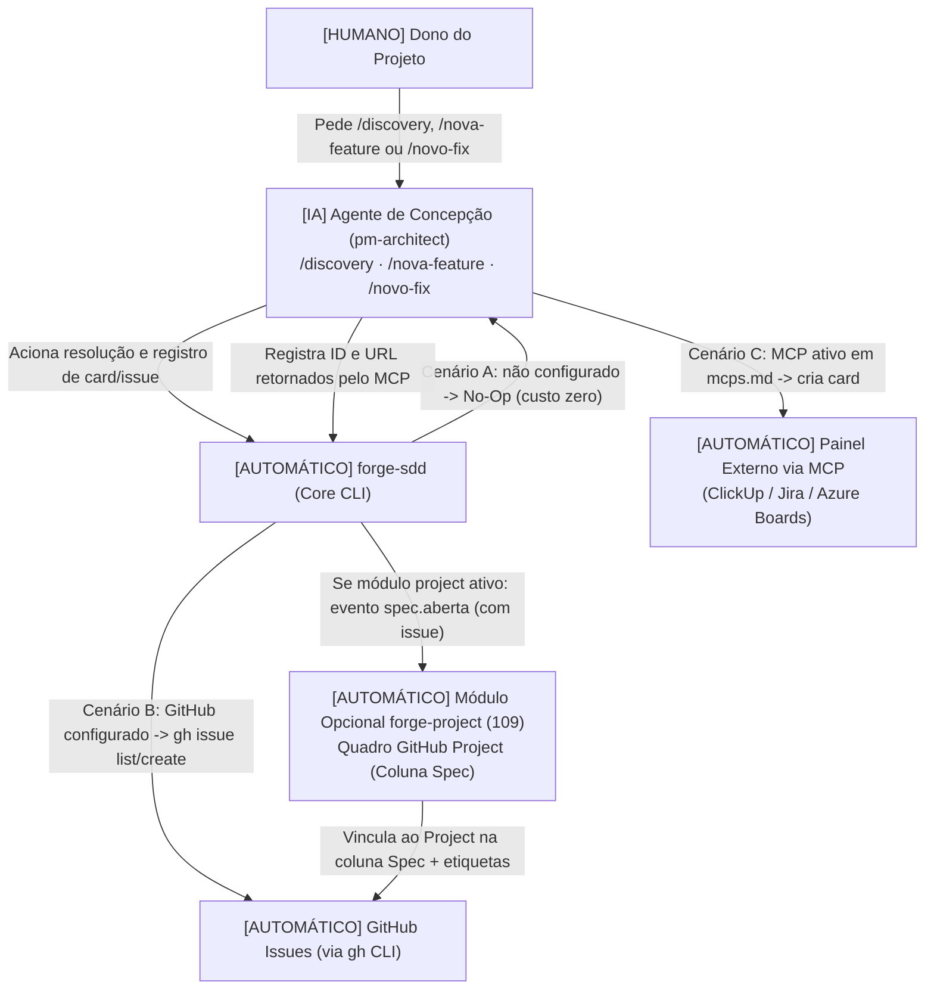
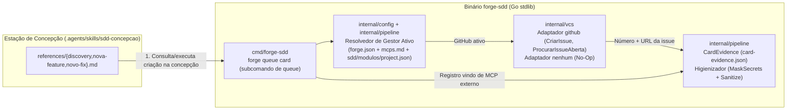
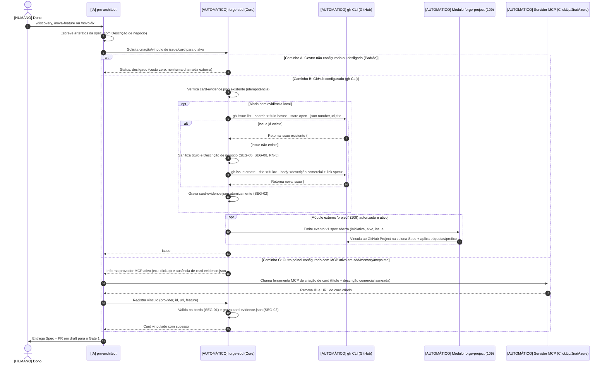

# Critérios — Iniciativa 113 (criação automática de issue/card na concepção)

Legenda dos diagramas: **HUMANO** (decisões e aprovações do dono), **IA** (agente de Concepção: PM + Arquiteto) e **AUTOMÁTICO** (código determinístico do `forge-sdd`, sem LLM).

## Restrições (Constitution)
- `ARQ-01`, `ARQ-02` (regras de resolução do gestor, sanitização do corpo da issue e gravação de evidência em `internal/`; `cmd/forge-sdd` apenas adapta flags; sem ciclos entre pacotes), `ARQ-04` (apenas biblioteca padrão do Go em runtime; zero SDK de terceiros para ClickUp/Jira/Azure), `ARQ-05` (`--dry-run` não cria issue no GitHub nem grava `card-evidence.json` no disco), `ARQ-10`, `ARQ-11`.
- `SEG-01` (validação na borda de `provider`, `id`, `url`, `feature` e saída JSON do `gh`), `SEG-02` (gravação atômica e confinada ao diretório do projeto com `WriteFileSafe` / `WriteJSONAtomic`, sem path traversal nem symlink para fora), `SEG-03` (execução de `gh issue` via `vcs.RunGitOrGh` com argv explícito e `Dir` fixo, nunca shell), `SEG-04`, `SEG-05` (nenhum token, segredo ou caminho absoluto local no corpo da issue ou nos logs; uso de `gate.MaskSecrets`), `SEG-08` (título e descrição saneados contra caracteres de controle e sequências ANSI antes de enviar ao `gh` ou ao MCP e ao ler retorno externo).
- `DUP-01` (`internal/vcs` continua dono das chamadas ao `gh`; `internal/config` continua dono de `PMConfig`; `internal/pipeline` continua dono de `CardEvidence`), `DUP-02`, `DUP-03`, `DUP-04`, `DUP-06`, `DUP-10` (instruções nos comandos de concepção entram nas references de `.agents/skills/sdd-concepcao/references/`, respeitando o teto P-24).
- `FLX-01`, `FLX-02`, `FLX-04`, `FLX-06`, `GOV-04`.
- `TST-01`, `TST-02`, `TST-03` (casos conformes e negativos obrigatórios), `TST-04` (testes 100% determinísticos com `t.TempDir()` e `vcs.Runner` falso injetado, zero chamada de rede real), `TST-05`, `COD-01`, `COD-02`, `COD-03`, `COD-05`.

## Modelo do módulo
**Enxuto** (`ARQ-11`), compondo extensões incrementais nos pacotes existentes (`internal/vcs`, `internal/config`, `internal/pipeline`) sem criar daemon nem banco de estado paralelo. Justificativa: os conceitos centrais já possuem pacote dono em `sdd/spec/concepts.md` (`internal/vcs` para operações `gh`, `internal/config` para `pm_mcp`, `internal/pipeline` para `CardEvidence` e despacho). A funcionalidade adiciona apenas a operação de issue no adaptador VCS, o resolvedor de gestor ativo (custo zero vs `gh` vs MCP) e o registro idempotente de `card-evidence.json` na abertura da spec.

## Decisões do projeto aplicadas
- **ADR-0002 (Layout e Estado por Iniciativa):** a evidência do card/issue vive dentro da pasta da iniciativa (`sdd/discovery/<id>-<nome>/card-evidence.json` ou por alvo da iniciativa), mantendo o isolamento por iniciativa.
- **ADR-0003 (Skills por Estação e Orçamento de Contexto / P-24):** `sdd-concepcao/SKILL.md` está a 3 bytes do limite (2.045/2.048 bytes) e não é inflado; a rotina de criação de issue/card fica nas references de comando (`discovery.md`, `nova-feature.md`, `novo-fix.md`).
- **ADR-0004 (Pipeline Multi-Sessão):** o `job.Card` do barramento (`internal/bus/job.go:63-67`) já transporta `Provider`, `ID` e `URL` da Discovery para o Builder e o Reviewer; gravar `card-evidence.json` na concepção alimenta automaticamente o `Dispatch`.
- **ADR-0017 (MCP Somente Leitura com Saída Saneada) e `SEG-08`:** qualquer dado vindo de `gh` ou de ferramenta MCP externa é tratado como entrada não confiável, validado e saneado antes de ir para `card-evidence.json` ou para o terminal.
- **ADR-0018 (Gravação Segura de Arquivos do Usuário):** toda escrita de `card-evidence.json` verifica confinamento no diretório do projeto e usa escrita atômica (temporário + rename).
- **Iniciativas 106, 108 e 109 (Compatibilidade total):** usa `internal/vcs.Runner` (`106-02`), respeita a descrição comercial higienizada (`RN-8` da 108) e convive com o módulo externo `forge-sdd-project` (`109`) de forma aditiva (se o módulo estiver ativo, recebe o vínculo sem duplicar issue; se não estiver instalado, o core segue sem erro).

## O que já existe
| Procurei | Onde | Achei | Decisão | Justificativa |
|---|---|---|---|---|
| Configuração de gestor de projeto (`pm_mcp`) | `internal/config/forge.go:91-99,183-190,336-347` | `PMConfig` com `Provider`, `Supported` (`clickup`, `github-projects`, `azure-devops`, `jira`), `RequireExistingCard`, `StatusOnImplement`, `StatusOnPRApproved` | **Estender** | Adicionar helper de resolução do gestor ativo na concepção e opção incremental `CreateOnConception` (opcional, mantendo retrocompatibilidade estrita com `forge.json`) |
| Evidência de card/issue (`card-evidence.json`) | `internal/pipeline/dispatch.go:28,42-49,200-212,431-497` | `CardEvidence` e `loadEvidence`, hoje lidos apenas no `Dispatch` quando `RequireExistingCard` é `true` | **Estender** | Reusar `CardEvidence` para gravar o vínculo logo na concepção (`/discovery`, `/nova-feature`, `/novo-fix`) e carregá-lo no `Dispatch` sempre que o arquivo existir |
| Execução segura do `gh` CLI | `internal/vcs/vcs.go:19,99-115` e `internal/vcs/github.go:10-75` | `Runner` injetável e `RunGitOrGh` (só `git` e `gh`, argv explícito, sem shell, `SEG-03`), hoje focado em `gh pr` | **Estender** | Acrescentar `CriarIssue` e `ProcurarIssueAberta` no adaptador `github` de `internal/vcs` usando o mesmo `Runner` injetável (`DUP-01`) |
| Catálogo de MCPs do projeto | `sdd/memory/mcps.md` e `sdd/memory/constitution.md:27` | Tabela markdown com `MCP | Status | Usado por` (`ativo` / `indisponível`) | **Reusar** | Ler `sdd/memory/mcps.md` para saber se o MCP do painel configurado (`clickup`, `jira`, `azure-devops`) está `ativo` antes de instruir o agente a criar o card via MCP |
| Sanitização e mascaramento de segredos | `internal/gate/gate.go:58` (`MaskSecrets`), `internal/notify/notify.go` (`Sanitize`) | Funções que mascaram tokens/chaves e removem caracteres de controle | **Reusar** | Higienizar título, descrição comercial e URLs antes de enviar ao `gh` ou gravar em `card-evidence.json` (`SEG-05`, `SEG-08`) |
| Gravação atômica e segura no workspace | `internal/scaffold/hooks.go:235` (`WriteFileSafe`), `internal/queue/atomic.go` (`WriteJSONAtomic`), `internal/gate/confine.go` (`ConfineToDir`) | Escrita atômica com verificação de symlink e confinamento ao diretório do projeto | **Reusar** | Gravar `card-evidence.json` com segurança (`SEG-02`, ADR-0018) |
| Contrato de módulos externos (GitHub Project) | `sdd/discovery/109-modulos-externos/discovery.md:42-76` | Módulo opcional `forge-project` acionado por eventos semânticos v1 (`internal/modulo`) | **Reusar / Estender aditivamente** | Emitir evento aditivo `spec.aberta` (com número e URL da issue quando já criada) quando houver módulo ativo; custo zero quando `Módulos permitidos` for `nenhum` |
| Passos dos comandos de concepção | `.agents/skills/sdd-concepcao/references/{discovery,nova-feature,novo-fix}.md` | Roteiros enxutos de `/discovery`, `/nova-feature` e `/novo-fix` | **Estender** | Incluir o passo condicional de criação/vinculação da issue ou card (via `gh` ou MCP) antes do Gate 1, respeitando o orçamento `P-24` |

## Dependências novas
Nenhuma (`SEG-07`, `ARQ-04`). Toda a implementação no core utiliza exclusivamente a biblioteca padrão do Go, o `gh` CLI já previsto em `AllowCommands` (`internal/config/forge.go:181`) para GitHub e servidores MCP externos já configurados pelo usuário para os demais painéis.

## Rules e IDs da Constituição Aplicáveis
- **Arquitetura:** `ARQ-01`, `ARQ-02`, `ARQ-04`, `ARQ-05`, `ARQ-10`, `ARQ-11` (`.agents/rules/sdd-arquitetura.md`).
- **Segurança:** `SEG-01`, `SEG-02`, `SEG-03`, `SEG-04`, `SEG-05`, `SEG-08` (`.agents/rules/sdd-seguranca.md`).
- **Reúso e Anti-Duplicação:** `DUP-01`, `DUP-02`, `DUP-03`, `DUP-04`, `DUP-06`, `DUP-10` (`.agents/rules/sdd-reuso-e-duplicacao.md`).
- **Código, Testes e Fluxo:** `COD-01`, `COD-02`, `COD-03`, `COD-05`, `TST-01`, `TST-02`, `TST-03`, `TST-04`, `TST-05`, `FLX-01`, `FLX-02`, `FLX-06`, `GOV-04` (`.agents/rules/sdd-codigo-e-testes.md`, `.agents/rules/sdd-fluxo-e-portao.md`).

## Diagramas C4 em Mermaid

### 1. Diagrama de Contexto (C4 Nível 1)


### 2. Diagrama de Contêineres / Componentes do Core (C4 Nível 2)


### 3. Diagrama de Sequência (Os 3 Caminhos na Concepção)


## Critérios de Aceitação Executáveis
Esta discovery é apenas de especificação (`FLX-01`). O bloco abaixo valida imediatamente a integridade dos artefatos desta iniciativa, o orçamento de contexto (`P-21`, `P-24`) e os testes existentes do adaptador VCS, do portão e da evidência de card no `dispatch`; os comentários documentam os nomes de testes das tasks planejadas em `plan.md`.

```bash
set -o pipefail
D=sdd/discovery/113-criacao-automatica-issue-concepcao

# 1. Artefatos obrigatórios da Discovery 113 e orçamento do status.md (P-21 <= 1024 bytes)
test -s "$D/discovery.md"
test -s "$D/criteria.md"
test -s "$D/plan.md"
test -s "$D/status.md"
test "$(wc -c < "$D/status.md")" -le 1024

# 2. Seções obrigatórias em discovery.md e criteria.md
grep -F '## Descrição de negócio' "$D/discovery.md"
grep -F '## Decisões para o Gate 1' "$D/discovery.md"
grep -F '## Modelo do módulo' "$D/criteria.md"
grep -F '## Decisões do projeto aplicadas' "$D/criteria.md"
grep -F '## O que já existe' "$D/criteria.md"
grep -F '## Dependências novas' "$D/criteria.md"
grep -F '## Rules e IDs da Constituição Aplicáveis' "$D/criteria.md"

# 3. Cobertura explícita dos 3 comandos, custo zero, gh CLI, MCP e compatibilidade com a 108/109
grep -F '/discovery' "$D/discovery.md"
grep -F '/nova-feature' "$D/discovery.md"
grep -F '/novo-fix' "$D/discovery.md"
grep -F 'card-evidence.json' "$D/discovery.md"
grep -F 'forge-sdd-project' "$D/discovery.md"
grep -F 'sdd/memory/mcps.md' "$D/discovery.md"

# 4. Build, vet e testes existentes dos pacotes que serão estendidos (internal/vcs, internal/config, internal/pipeline, internal/gate)
go build ./... && go vet ./...
go test ./internal/vcs/... -run 'TestLeVCS|TestNovo|TestGitHub'
go test ./internal/config/... -run 'TestDefaultForgeConfig|TestLoadForgeConfig'
go test ./internal/pipeline/... -run 'TestDispatch'
go test ./internal/gate/... -run 'TestCheckP24'

# 5. Testes que as tasks da 113 adicionarão (documentados para o /split-features):
# go test ./internal/vcs/... -run 'TestGitHubCriarIssueComDescricaoComercial|TestGitHubProcurarIssueAbertaIdempotente|TestNenhumCriarIssueRetornaSemPR'
# go test ./internal/config/... -run 'TestResolverGestorConcepcaoDesligadoPorPadrao|TestResolverGestorConcepcaoGitHubQuandoConfigurado|TestResolverGestorConcepcaoMCPAtivo'
# go test ./internal/pipeline/... -run 'TestConcepcaoCustoZeroQuandoGestorNaoConfigurado|TestConcepcaoCriaIssueEGravaCardEvidence|TestConcepcaoFalhaExternaViraAvisoSemBloquearSpec|TestDispatchCarregaCardEvidenceOpcionalQuandoPresente'

# negativo: casos de rejeição na borda (VCS desconhecido, comando fora da lista e critérios sem negativo) existem e passam
go test ./internal/vcs/... -list 'TestVCSDesconhecidoRecusado|TestExecutorRecusaComandoForaDaLista' | grep -F 'TestVCSDesconhecidoRecusado'
go test ./internal/vcs/... -list 'TestExecutorRecusaComandoForaDaLista' | grep -F 'TestExecutorRecusaComandoForaDaLista'
go test ./internal/gate/... -list 'TestCriteriaVerifyExigeNegativo' | grep -F 'TestCriteriaVerifyExigeNegativo'
go test ./internal/vcs/... -run 'TestVCSDesconhecidoRecusado|TestExecutorRecusaComandoForaDaLista'
go test ./internal/gate/... -run 'TestCriteriaVerifyExigeNegativo'
```
