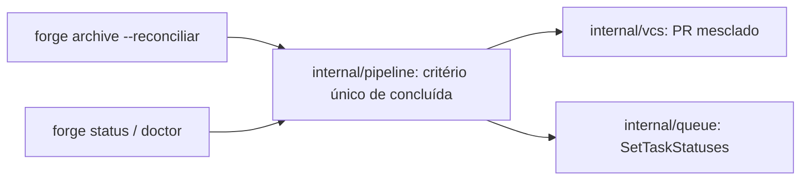

# 119 — Critérios e arquitetura

## Restrições (IDs da Constituição)

`DUP-01` um conceito, uma casa (critério único de "concluída"); `DUP-02` Reuse Check; `ARQ-01` `cmd/` só adapta a CLI; `ARQ-05` `--dry-run` sem efeito colateral; `ARQ-10` domínio fora dos handlers; `COD-01` responsabilidade única; `SEG-07` sem dependência nova; `TST-02` e `TST-03` testes executáveis.

## Modelo do módulo

**Completo** (`ARQ-11`): regra nova em `internal/pipeline` (função pura, testável), adaptador em `cmd/forge-sdd`, texto nas skills e no template do `status.md`. Justificativa: a regra de "concluída" é compartilhada por três comandos, então precisa de um dono único.

## Decisões do projeto aplicadas

- Reconciliar é proposta por padrão; só grava com `--aplicar`. Nunca mescla, nunca arquiva sozinho.
- Sem rede ou sem `gh`: degrada em silêncio para o comportamento atual.
- Um critério único de "concluída", usado por `status`, `archive` e `doctor`.

## O que já existe

| Procurei | Onde | Achei | Decisão | Justificativa |
|---|---|---|---|---|
| Esconder concluída | feat-105-05, `layout.buildInitiative` | só olha a fila (`completed`/`approved`) | estender | mesma função, critério unificado |
| Arquivar concluídas | `forge archive --concluidas`, `pipeline.ListArchiveCandidates` | exige fila não vazia e itens `approved` | estender | aceitar `completed` e iniciativa sem fila marcada no `status.md` |
| Mudar status de tarefa | `queue.SetTaskStatuses` | já grava de forma atômica | reusar | fecha as tarefas sem código novo |
| PR por branch | `internal/vcs` (`ProcurarPRAberto`) | acha só PR aberto | estender | novo `ProcurarPRMesclado(branch)` no mesmo adaptador |
| Higiene no doctor | `internal/doctor` | sem checagem de iniciativa velha | estender | aviso `iniciativa-entregue-nao-encerrada` |
| Fechamento no CLOSE | skills `sdd-build`, `sdd-governanca`, `sdd-operacao` | mandam atualizar `status.md`, sem fechar a fila | estender | texto do CLOSE propõe o passo manual |

## Dependências novas

Nenhuma (`SEG-07`). A consulta de PR mesclado usa o adaptador `internal/vcs`.

## Critérios de aceitação executáveis (iniciativa)

```bash
set -o pipefail
go build ./... && go vet ./...
go test ./internal/pipeline ./internal/queue ./internal/vcs ./internal/layout ./internal/doctor -count=1
go test ./cmd/forge-sdd -run 'Archive|Status|Reconcil' -count=1
go test ./... -count=1
```

Cada comportamento do fix ganha ao menos um teste nomeado (`TestReconciliar*`, `TestConcluidaCriterioUnico`). Detalhe em `fixes/fix-119-01-encerramento-de-entrega-concluida.md`.

## Diagramas


