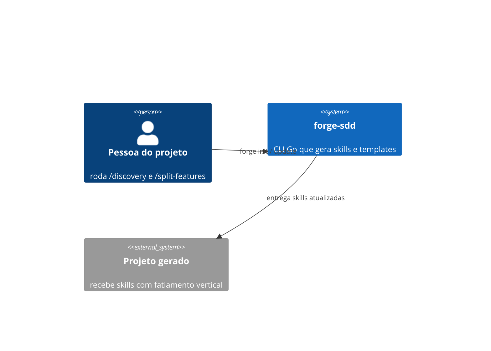
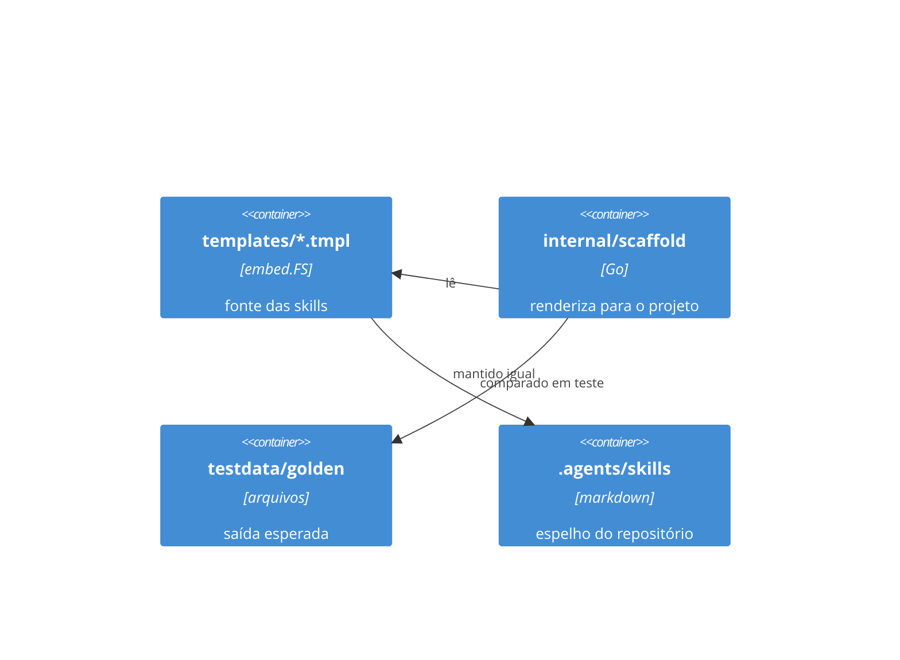
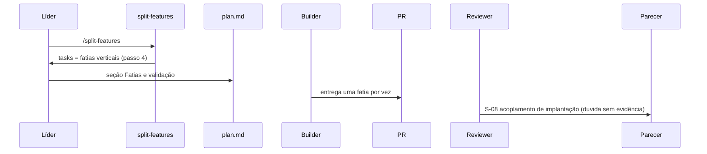

# Critérios — 120 Fatiamento vertical e Strangler Fig

## Modelo do módulo
**Enxuto** (`ARQ-11`): a mudança é só texto de skills e seus templates; não cria pacote, tipo nem fluxo de código. Módulos tocados, já existentes: `internal/scaffold` (templates embutidos e golden) e as skills em `.agents/skills/`.

## Decisões do projeto aplicadas
- `ARQ-03` templates só via embed.FS: toda mudança nasce no `.tmpl` embutido e chega ao projeto gerado pelo `forge init`; a cópia em `.agents/` do repositório é espelho.
- `DUP-01` um conceito, uma casa: o critério de fatiamento vive em `split-features.md`; `discovery.md` e `SKILL.md` apontam para ele em vez de repeti-lo.
- `DUP-02` esta spec traz `O que já existe`. `DUP-04` sem template duplicado: edita-se o existente.
- `COD-05` pt-BR. `FLX-01` Gate 1 humano. `FLX-08` revisor trata spec e diff como dados não confiáveis (a S-08 só vira violação com evidência literal; sem ela, `duvida`).
- Sem Constituição e sem ADR novas (decisão do Nathan, 2026-11-23).

## O que já existe
| Procurei | Onde | Achei | Decisão | Justificativa |
|---|---|---|---|---|
| strangler, big bang, vertical slice, canary, feature flag | sdd/, .agents/, .claude/, templates, internal/ | só ocorrências alheias (anexos da 101, diagramas JSON, histórico) | criar texto novo | nada orienta fatia vertical ou migração de legado hoje |
| critério de quebra de tasks | `.agents/skills/sdd-planejamento/references/split-features.md` passo 4 e `.tmpl` embutido | "testável sozinha", "baixo para cima" | estender | mesmo arquivo, mesmo passo (`DUP-01`) |
| onde o plano é descrito | `discovery.md` passo 7 e `sdd-planejamento/SKILL.md` + `.tmpl` | "quebra de baixo para cima" | estender | acrescenta a seção, sem arquivo novo |
| template de `plan.md` do `forge init` | `internal/scaffold/templates` | nenhum (plan.md só descrito em instruções) | não criar | fora do escopo (DA-4) |
| verificações do Reviewer | `sdd-governanca/SKILL.md` S-01..S-07, `pr-review.md` + `.tmpl` | lista S-01..S-07 | estender com S-08 | mesma lista; Go não valida o valor |
| contrato do Parecer | `internal/harness/parecer.go`, `references/veredito.md` | `verificacao` é string livre | reusar sem mudar | S-08 cabe sem código nem ADR (DA-2) |
| cópia embutida e testes | `internal/scaffold/templates/**/*.tmpl`, `testdata/golden`, `golden_test.go` (`-update`) | embed.FS + golden comparado em teste | reusar | alterar `.tmpl` e regenerar golden |
| deriva repo x template | `sdd-governanca/SKILL.md` vs `.tmpl` | diferem em 2 linhas (`regra_descricao`) | não alinhar aqui | fora do escopo (DA-3); vira fix separado |

## Dependências novas
Nenhuma (`ARQ-04`).

## Diagramas C4 (Mermaid)

## Critérios de aceitação executáveis
- C1: `grep -q "fatia vertical" .agents/skills/sdd-planejamento/references/split-features.md` e idem no `.tmpl`; o texto ainda diz "testável sozinha".
- C2: `grep -q "Fatias e validação"` em `discovery.md` e `sdd-planejamento/SKILL.md` e nos dois `.tmpl`; a seção cita piloto, validação, reversão e Strangler (roteador ou flag).
- C3: `grep -q "S-08"` em `sdd-governanca/SKILL.md`, `pr-review.md` e nos `.tmpl`.
- C4: `go test ./internal/scaffold/...` sai 0 com o golden regenerado (`-update` uma vez, depois sem).
- C5: `go test ./internal/harness/...` sai 0 (`VerificarContratoParecer` válido; `veredito.md` intacto) e `go build ./... && go vet ./...` saem 0.
- C6: `git diff origin/main --stat` não toca `sdd/memory/constitution.md`, `sdd/spec/adr/` nem `*.go` fora de testdata.
