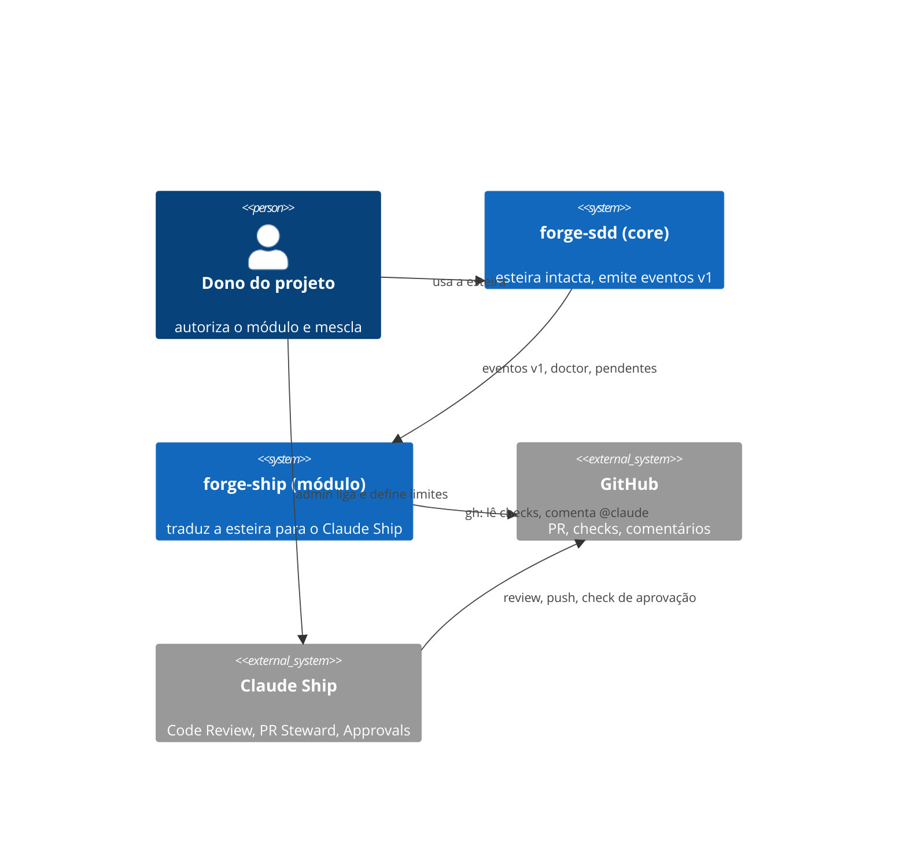
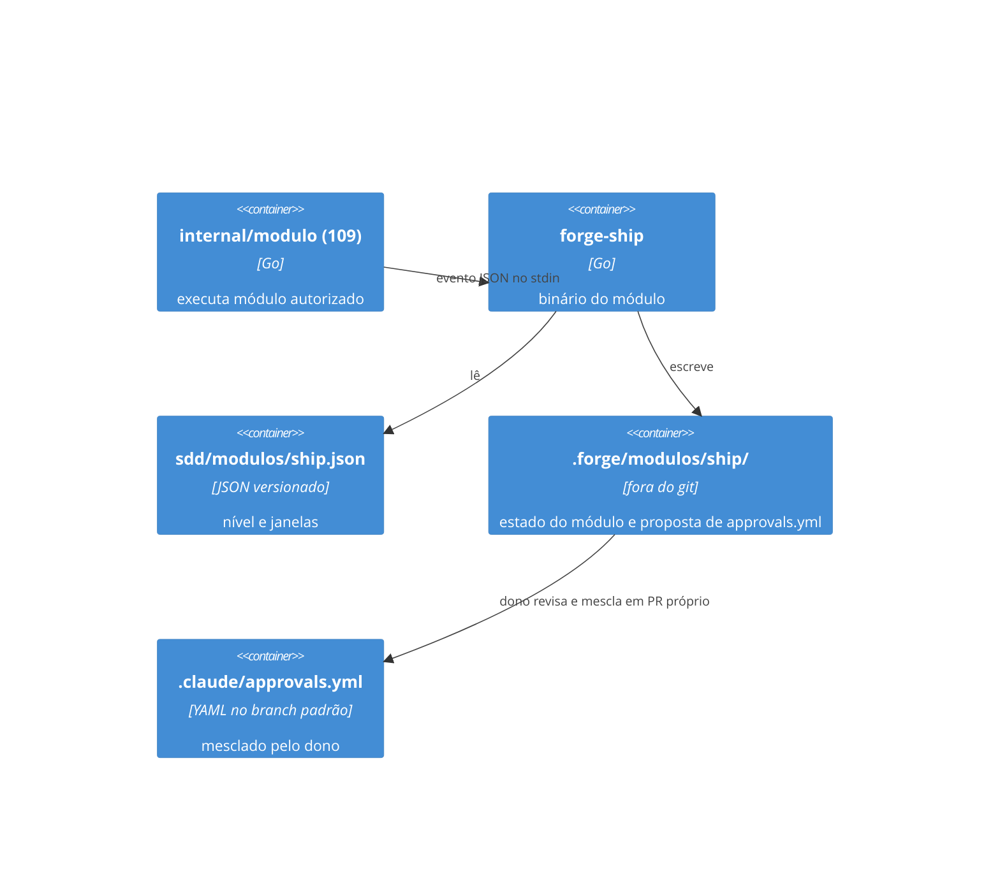
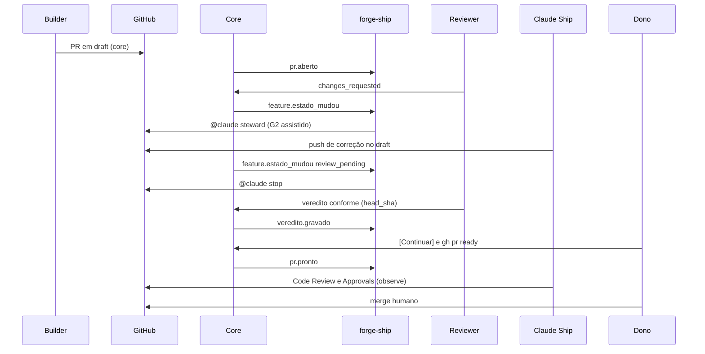

# Critérios: 121 Claude Ship como módulo opcional

## Modelo do módulo
**Enxuto no core, completo no módulo** (`ARQ-11`). O core não ganha pacote, tipo nem fluxo: consome só o contrato v1 da 109. O módulo `forge-sdd-ship` é um binário Go próprio, com domínio `politica`, `janela` (quando o Steward pode agir) e `evento`.

## Decisões do projeto aplicadas
- **109 (Gate 1 aprovado em 20/11/2026):** descoberta pela pasta do usuário, `Módulos permitidos`, hash autorizado por versão, `forge modulo` oculto, instalação só `--de --sha256`, sem canal de volta, repositório privado por convite.
- **ADR-0022 e ADR-0023:** PR em draft até a Conferência 2; `gh pr ready` e `gh pr merge` exigem parecer `conforme` com `head_sha` igual ao HEAD. O módulo **depende** dessa barreira e não a reimplementa.
- **ADR-0027:** hook pr-guard fail-open; o `/ship` local fica fora da esteira (G3).
- `FLX-06` (Camada C humana), `GOV-01` (Constituição exige ADR), `SEG-03` (subprocesso com argumentos explícitos), `SEG-04`/`SEG-05` (nenhum segredo no módulo nem em log), `SEG-08` (texto do Ship saneado antes do terminal), `TST-03`/`TST-04`.
- Sem ADR nova no core: nenhuma mudança arquitetural no forge-sdd. A ADR da execução de módulos é a 109-12.

## O que já existe
| Procurei | Onde | Achei | Decisão | Justificativa |
|---|---|---|---|---|
| mecanismo de extensão | `sdd/discovery/109-modulos-externos/` | contrato v1 (manifesto, eventos, `doctor`, `pendentes`, instantâneo) aprovado, não implementado | **reusar** | nada específico de Ship precisa de contrato novo |
| pacote de módulo no core | `ls internal` | não existe `internal/modulo` | **esperar a 109** | dependência dura |
| campo da Constituição | `sdd/memory/constitution.md:29` | `Módulos permitidos: nenhum` | **reusar** | ativar é trocar o valor para `ship` |
| barreira de pronto e merge | ADR-0023 §4, hook pr-guard (ADR-0027), job `pronto?` | parecer `conforme` com `head_sha` | **reusar** | protege contra push do Steward sem código novo |
| eventos de PR | 109, eventos v1 | `pr.aberto`, `pr.pronto`, `pr.mesclado`, `veredito.gravado`, `feature.estado_mudou` | **reusar** | cobrem todas as janelas; push pós-pronto por polling (G4) |
| tentativas de retrabalho | `internal/config/forge.go:113` `max_rework_attempts` | limite 1 a 10 | **não mexer** | o Steward atua dentro da mesma tentativa do Builder |
| repositórios de módulo irmãos | `forge-sdd-project`, `forge-sdd-estimar`, `forge-sdd-metricas` | `CLAUDE.md`, `LICENSE` proprietária, `README.md`, `docs/`, `sdd/`, selo "privado" | **copiar o padrão** | mesma convenção, mesma esteira (RN-10 da 109) |
| instalação de plugins/skills | ADR-0025 | só dentro do projeto, nunca `~/.claude/` | **não usar** | Ship não é skill do forge; é serviço configurado pelo admin |

## Dependências novas
Core: **nenhuma**. Módulo: só a stdlib e o `gh` do usuário em runtime (`SEG-07` aplicado no repositório do módulo). Serviço externo: Claude Ship (comercial, Team/Enterprise, GitHub), ligado pelo admin fora do forge.

## Repositório proposto (não criado; G5)
- **Nome:** `nathanramorim/forge-sdd-ship`, **privado**, instalação por convite, licença proprietária (igual aos irmãos).
- **Binário:** `forge-ship`. **Comando:** `forge ship <sub>`.
- **Layout:**
```
forge-sdd-ship/
  modulo.json
  cmd/forge-ship/            # adapta CLI (ARQ-01 no módulo)
  internal/contrato/         # envelope v1, códigos de saída 0,2,3,4,5
  internal/evento/           # roteia pr.*, veredito.*, feature.*
  internal/janela/           # regra: quando o Steward pode agir
  internal/politica/         # Constituição -> approvals.yml (observe)
  internal/ghcli/            # gh com argumentos explícitos (SEG-03)
  testdata/gh-falso/         # respostas JSON do gh
  docs/migracao.md           # casos M0 a M5
  docs/governanca.md         # licença, custo, dados, ZDR/HIPAA/CMEK
  sdd/                       # esteira SDD própria
  CLAUDE.md  LICENSE  README.md  .github/workflows/release.yml
```
- **Manifesto:**
```json
{"contrato": {"min": 1, "max": 1}, "nome": "ship", "versao": "0.1.0",
 "binario": "forge-ship",
 "comandos": [{"nome": "ship", "resumo": "Opera o Claude Ship nas janelas da esteira"}],
 "eventos": ["pr.aberto", "pr.pronto", "pr.mesclado", "veredito.gravado", "feature.estado_mudou"],
 "capacidades": ["doctor", "pendentes"],
 "permissoes": {"rede": true, "executa": ["gh"], "escreve": [".forge/modulos/ship/"]}}
```
- **Configuração opaca ao core:** `sdd/modulos/ship.json`
```json
{"nivel": "observar", "code_review": "pos-pronto", "steward": "assistido",
 "approvals": "observe", "limite_de_gasto_confirmado": false}
```
`nivel`: `observar` (só lê e mostra) ou `atuar` (comenta `@claude steward`, `@claude stop`, `@claude review`).

## Diagramas C4 (Mermaid)




## Critérios de aceitação executáveis
No core (rodam neste repositório):
```bash
set -o pipefail
# o core não ganha código nesta iniciativa
test -z "$(git diff --name-only origin/main -- '*.go')"
# a Constituição e as ADRs não mudam
test -z "$(git diff --name-only origin/main -- sdd/memory/constitution.md sdd/spec/adr/)"
# a esteira continua verde
go build ./... && go vet ./... && go test ./...
```
No módulo (rodam em `forge-sdd-ship`, depois que o dono criar o repositório):
```bash
set -o pipefail
go test ./internal/janela/... -run 'TestStopAntesDoContinuar'
go test ./internal/janela/... -run 'TestStewardSoNoRetrabalhoEmDraft'
go test ./internal/politica/... -run 'TestPoliticaNasceEmObserve'
go test ./internal/politica/... -run 'TestConstituicaoEAdrExigemHumano'
go test ./internal/evento/... -run 'TestNuncaChamaPrReadyNemMerge'
go test ./internal/evento/... -run 'TestVcsDiferenteDeGithubNaoChamaGh'
go test ./internal/contrato/... -run 'TestCodigoDeSaidaContratoIncompativel'
# negativo: módulo nunca escreve fora de .forge/modulos/ship/
go test ./internal/politica/... -run 'TestRecusaGravarNaRaizDoProjeto'
```
- C1: com `Módulos permitidos: nenhum`, as suítes de byte-identidade da 109 passam sem alteração.
- C2: proposta de política gerada para este repositório contém `mode: observe` e regras com `seats` humano para `sdd/memory/constitution.md` e `sdd/spec/adr/**`.
- C3: `forge ship doctor` com Steward ligado e `limite_de_gasto_confirmado: false` emite aviso, nunca falha.
- C4: `docs/migracao.md` do módulo cobre M0 a M5 com passos e rollback.
