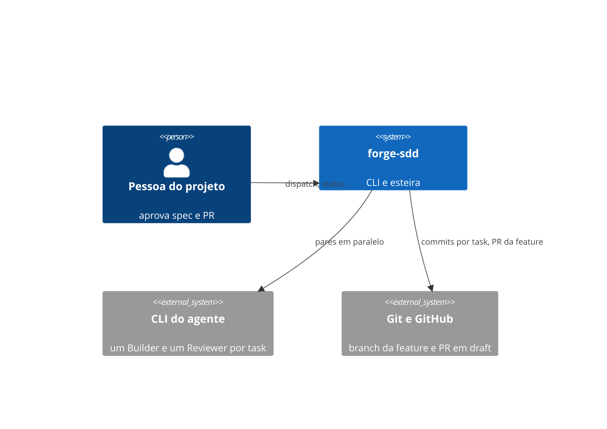
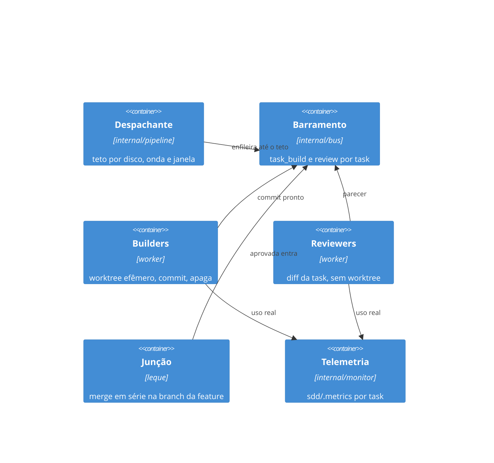

# Critérios — 122 Builder por task e esteira adaptativa

## Modelo do módulo
**Completo** (`ARQ-11`): muda o contrato do job no barramento, o laço do worker, o ciclo de vida do worktree e a política de despacho. Módulos tocados, todos existentes: `internal/bus` (tipo de job), `internal/pipeline` (despachante, worker, leque, onda, worktree), `internal/monitor` (telemetria por task), `internal/config` (chaves novas), `cmd/forge-sdd` (flags de `dispatch` e `worker`). Nenhum pacote novo.

## Decisões do projeto aplicadas
- **ADR-0004** pipeline multi-sessão: Discovery, Builder e Reviewer continuam papéis distintos; muda a granularidade e o número de instâncias.
- **ADR-0009** tokens por janela: o reset suave deixa de ser necessário para o Builder, porque cada task nasce limpa.
- **ADR-0022 e ADR-0023** branch por feature e PR em draft: um PR por feature; as branches de task são internas e apagadas após a junção.
- **ADR-0024** orquestração por iniciativa e tier: os workers atendem só a iniciativa deles e resolvem o modelo pelo tier da task.
- **ADR-0015** modo chat: convive; o despachante fica em `internal/pipeline` para a 104 reusar.
- `ARQ-04`: medição de disco só com a biblioteca padrão (`syscall`, com implementação por sistema). `SEG-02` e `SEG-03`: worktrees só dentro de `layout.Worktrees`, git com argumentos explícitos. `DUP-01` e `DUP-03`: leque, onda, `PlanWaves` e `worktree_gc` reusados. `FLX-05`: o contrato novo exige ADR (ADR-0029, proposta nesta iniciativa). `FLX-06`: Camada A por task, parecer por task no par.

## O que já existe
| Procurei | Onde | Achei | Decisão | Justificativa |
|---|---|---|---|---|
| Job do Builder | `internal/bus/job.go` | `feature_build` e `pr_rework`, um por feature | estender | novo tipo `task_build` com `task_id` e `feature_job` pai |
| Laço do worker | `internal/pipeline/worker.go` `processJob` | um `Runner.Run` por job | reusar | com job por task, o mesmo laço roda um Builder novo por task |
| Ondas | `internal/pipeline/waves.go` `PlanWaves` | ondas por "Depende de" | reusar | ordem e largura da onda |
| Worktree e branch por task | `internal/pipeline/worktree.go`, `leque.go` `prepararTask` | branch `forge/<ini>-<task>`, worktree em `layout.Worktrees` | reusar | mesmo local e mesmas proteções |
| Junção | `leque.go` `Juntar`, `juntarTask` | merge `--no-ff` na base, sob lock, remove o worktree; só no fim da onda | estender | junção por task assim que aprovada; worktree sai antes, no commit |
| Órfãos | `leque.go` `ErroOrfao`, `worktree_gc.go` | menu retomar, preservar, abortar; varredura de worktrees velhos | reusar | RN-4 |
| Continuação por onda | `onda.go` `PodeComecar` | dependência integrada libera | reusar | RN-3 |
| Estados por task | `laco.go` | estados gravados pelo Go | reusar | mesma máquina de estados nos dois modos (`DUP-04`) |
| Pacote mínimo | `forge context` | contexto por task | reusar | RN-2 |
| Uso real | `internal/monitor/usage.go` | evento `result` do stream-json | reusar | telemetria por task |
| Limite de uso | `usagelimit.go`, `OutcomeDeferred` | adia sem gastar tentativa | estender | entra no teto (RN-10) |
| Teto fixo | `config` `max_parallel_tasks` (1 a 8) | número fixo | estender | vira teto máximo; o efetivo vem do disco e da janela |
| Medição de disco | `internal/` | nenhuma | criar | função pequena em `internal/pipeline`, só stdlib |
| Card de handoff | `internal/pipeline/handoff.go` `BuildHandoffCard` | card com moldura e marcadores, feito para leitura humana, vai no prompt | estender | versão compacta para agente; a versão em tópicos fica para o humano |
| Prompt do job | `internal/pipeline/prompt.go` `BuildPrompt` | frases completas por papel | estender | cabeçalho chave e valor (RN-14) |
| Parecer do Reviewer | `internal/harness/parecer.go` | JSON com `explicacao` e `correcao` livres | reusar com teto | já é estruturado; só limita tamanho dos campos de texto |
| Avaliação de prompts | `cmd/forge-sdd/eval.go` (`forge eval run`, `compare`) | comparação de execuções | reusar | decide o formato da entrada com dado próprio |
| Dica de paralelo no prompt | `prompt.go` `BuilderHints` | texto sobre worktree e subagentes | remover no modo por task | o Go decide (`COD-04`) |

## Dependências novas
Nenhuma (`ARQ-04`).

## Diagramas C4 (Mermaid)


```mermaid
sequenceDiagram
participant D as Despachante
participant B as Builder (novo)
participant R as Reviewer (par)
participant J as Junção
D->>D: vagas = (80% do disco - uso) / tamanho do worktree
D->>B: task 1..N (até o teto)
B->>B: worktree, implementa, Camada A, commit
B->>B: apaga worktree
B-->>D: vaga livre
D->>D: recalcula e puxa a próxima
B->>R: commit da task
alt ajuste
  R->>B: parecer; worktree novo da branch da task
else aprovado
  R->>J: merge na branch da feature (lock, ordem do plano)
  J->>J: apaga branch da task
end
```

## Critérios de aceitação executáveis
- **CA-01** `go test ./internal/bus/...`: job `task_build` valida `task_id` e `feature_job`; recusa task fora do plano (conforme e negativo, `TST-03`).
- **CA-02** `go test ./internal/pipeline/ -run Teto`: disco em 50% de 100 GB, worktree de 5 GB e limite 80% dão 6 vagas; em 79%, 0; memória com 8 GB disponíveis, reserva de 2 GB e 1,5 GB por par dá 4 e limita antes do disco; sem teto fixo, recurso sobrando e onda de 12 sobem 12 pares; janela em 90% com limite 85% dá 1.
- **CA-03** `go test ./internal/pipeline/ -run Efemero`: depois do commit da task o diretório do worktree não existe e a branch da task continua com o commit.
- **CA-04** `go test ./internal/pipeline/ -run PorTask`: dois jobs de tasks diferentes geram dois `Runner.Run` cujos prompts não contêm o id nem a spec da outra task.
- **CA-05** `go test ./internal/pipeline/ -run Par`: cada commit de task gera um job de review com só o diff daquela task; com 3 Builders ativos existem até 3 Reviewers ativos.
- **CA-06** `go test ./internal/pipeline/ -run Juncao`: tasks aprovadas entram na branch da feature em série na ordem do plano; conflito deixa a task bloqueada, aborta o merge e preserva a branch.
- **CA-07** `go test ./internal/pipeline/ -run Liberacao`: liberar 4 vagas de uma vez faz 4 tasks elegíveis começarem na mesma rodada.
- **CA-08** `go test ./internal/monitor/...`: um registro por task e papel com `feature`, `task` e `medicao: real` quando há evento `result`.
- **CA-09** `go test ./internal/config/...`: `builder.granularidade` aceita `feature` e `task` (padrão `feature`); `builder.limite_disco` entre 50 e 95 (padrão 80); `builder.reserva_memoria_mb` (padrão 2048); `max_parallel_tasks` aceita 0 (sem teto fixo) até 64.
- **CA-10** `GOOS=windows go build ./... && GOOS=darwin go build ./... && go build ./... && go vet ./... && go test ./...` saem 0; ADR-0029 em `sdd/spec/adr/`.
- **CA-11** `go test ./internal/pipeline/ -run Compacto`: o prompt e o handoff entre agentes usam seções em tags XML, chave e valor e listas em tabela de cabeçalho único, sem moldura nem emoji, abaixo do teto de bytes; o retorno JSON do Builder sem campo obrigatório é recusado. `forge eval compare` registra tokens e acerto do formato atual contra o compacto.
- **CA-12** `go test ./internal/pipeline/ -run Humano`: a mensagem para o humano é gerada a partir do retorno estruturado, em tópicos, sem trecho cru da saída do agente (`SEG-08`).
- **CA-13** Medição: uma iniciativa real nos dois modos, com tokens por task, duração total e pico de disco no `status.md`.
