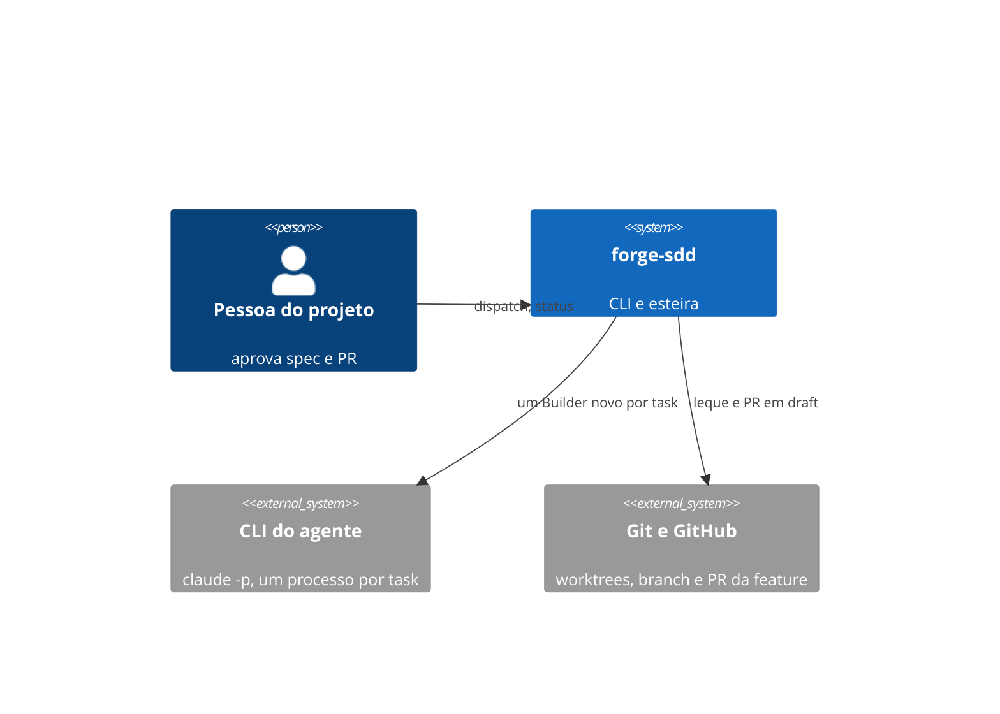
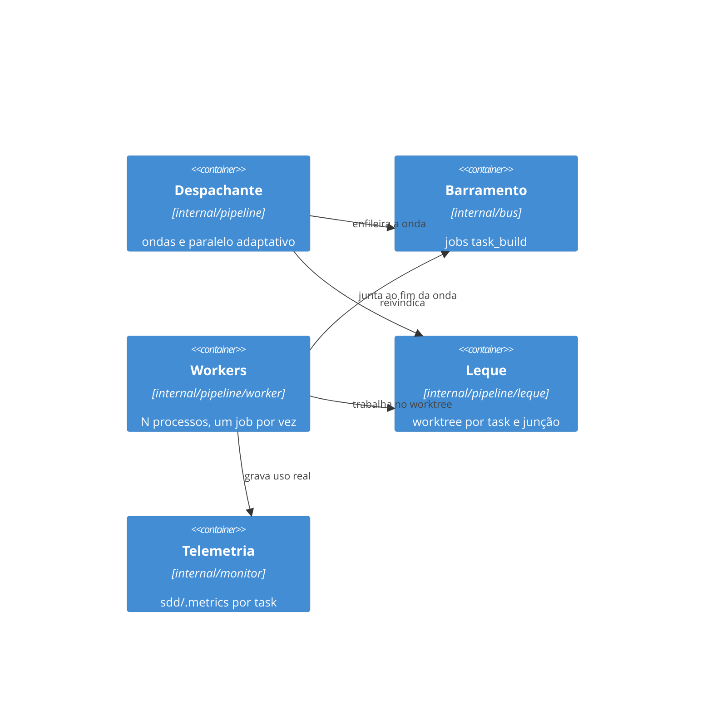
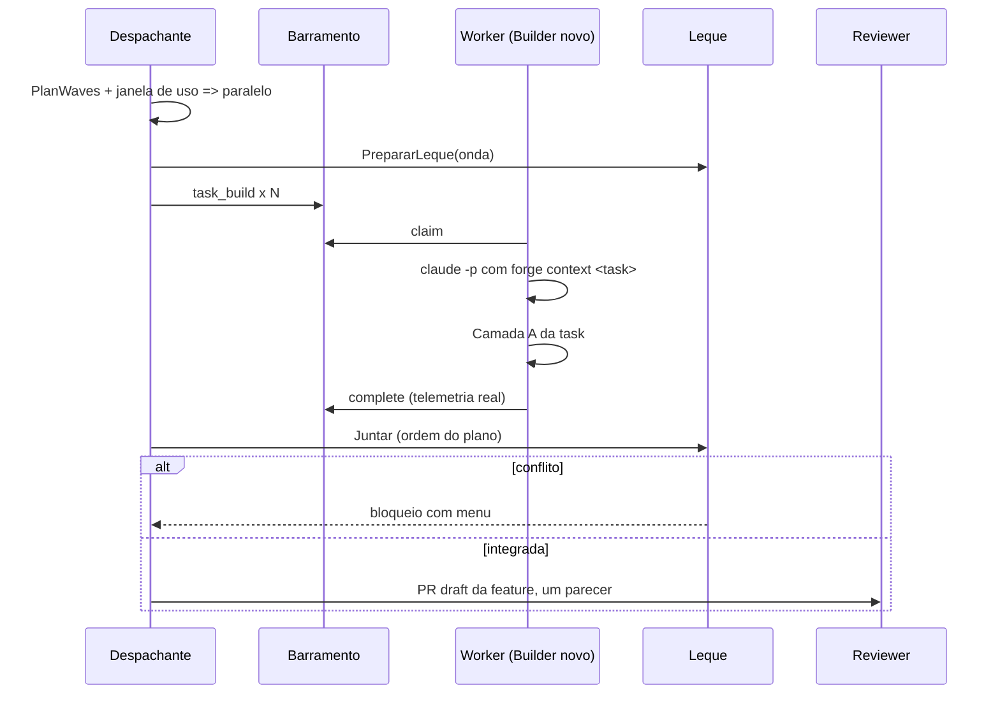

# Critérios — 122 Builder por task e esteira adaptativa

## Modelo do módulo
**Completo** (`ARQ-11`): muda o contrato do job no barramento, o laço do worker e a política de despacho. Módulos tocados, todos existentes: `internal/bus` (tipo de job), `internal/pipeline` (despachante, worker, leque, onda), `internal/monitor` (telemetria por task), `internal/config` (chaves novas), `cmd/forge-sdd` (flags de `dispatch` e `worker`). Nenhum pacote novo.

## Decisões do projeto aplicadas
- **ADR-0004** pipeline multi-sessão: Discovery, Builder e Reviewer continuam sessões distintas; muda só a granularidade do job do Builder.
- **ADR-0009** tokens por janela: o reset suave deixa de ser necessário para o Builder, porque cada task nasce limpa.
- **ADR-0022 e ADR-0023** PR em draft, branch por feature, estado isolado: um PR por feature, não por task; as branches de task vivem só no worktree.
- **ADR-0024** orquestração por iniciativa e tier: o worker atende só a iniciativa dele e resolve o modelo pelo tier da task.
- **ADR-0015** modo chat: convive; o despachante fica em `internal/pipeline` para a 104 reusar.
- `DUP-01` e `DUP-03`: leque, onda e `PlanWaves` são reusados, não reescritos. `FLX-05`: o contrato novo do job exige ADR (ADR-0029, proposta nesta iniciativa). `FLX-06`: Camada A por task, B por feature.

## O que já existe
| Procurei | Onde | Achei | Decisão | Justificativa |
|---|---|---|---|---|
| Job do Builder | `internal/bus/job.go` | `feature_build` e `pr_rework`, um por feature | estender | novo tipo `task_build` com `task_id` e `feature_job` pai |
| Laço do worker | `internal/pipeline/worker.go` `processJob` | um `Runner.Run` por job | reusar | com job por task, o mesmo laço já roda um Builder novo por task |
| Ondas | `internal/pipeline/waves.go` `PlanWaves` | ondas por "Depende de" e teto | reusar | entra no despachante em vez de virar dica |
| Worktree por task e junção | `internal/pipeline/leque.go` | `PrepararLeque`, `Juntar`, bloqueio por conflito; sem chamador | reusar | é exatamente a junção que a RN-7 pede |
| Continuação por onda | `internal/pipeline/onda.go` | `PodeComecar`, `FimDaOnda`, `ContinuarPorOnda`; sem chamador | reusar | implementa RN-3 |
| Laço por task do modo chat | `internal/pipeline/laco.go` | estados por task gravados pelo Go | reusar os estados | mesma máquina de estados para os dois modos (`DUP-04`) |
| Pacote mínimo de contexto | `cmd/forge-sdd/context.go` (`forge context`) | contexto por task ou spec | reusar | RN-2 |
| Uso real do agente | `internal/monitor/usage.go` | lê o evento `result` do stream-json | reusar | telemetria por task com `medicao: real` |
| Limite de uso | `internal/pipeline/usagelimit.go`, `OutcomeDeferred` | adia sem gastar tentativa | estender | entra no cálculo do paralelo (RN-5) |
| Tier por task | 115-03 (pendente), ADR-0024 | contrato de tier no job | depender | RN-9; fallback para modelo do papel |
| Dica de paralelo no prompt | `internal/pipeline/prompt.go` `BuilderHints` | texto sobre worktree e subagentes | remover no modo por task | o Go passa a decidir (`COD-04`) |

## Dependências novas
Nenhuma (`ARQ-04`).

## Diagramas C4 (Mermaid)

## Critérios de aceitação executáveis
- **CA-01** `go test ./internal/bus/...`: job `task_build` valida `task_id` e `feature_job`; recusa task fora do plano (casos conforme e negativo, `TST-03`).
- **CA-02** `go test ./internal/pipeline/ -run Despachante`: com 1 task `fast` o paralelo é 1; com onda de 5 e teto 3 é 3; com janela em 90% e limite 85% é 1.
- **CA-03** `go test ./internal/pipeline/ -run PorTask`: dois jobs de tasks diferentes geram dois `Runner.Run` com prompts que não contêm o id nem a spec da outra task.
- **CA-04** `go test ./internal/pipeline/ -run Leque`: o despachante chama `PrepararLeque` e `Juntar`; conflito resulta em estado bloqueado e nenhum PR.
- **CA-05** `go test ./internal/pipeline/ -run Revisao`: falha da Camada A devolve a task sem criar job de review; o review nasce uma vez por feature.
- **CA-06** `go test ./internal/monitor/...`: um registro de telemetria por task com `feature`, `task` e `medicao: real` quando há evento `result`.
- **CA-07** `go test ./internal/config/...`: `builder.granularidade` aceita `feature` e `task`; padrão `feature` até a medição (RN-8); limite de janela entre 50 e 100.
- **CA-08** `go build ./... && go vet ./... && go test ./...` saem 0; ADR-0029 em `sdd/spec/adr/`.
- **CA-09** Medição: `forge report` de uma iniciativa real nos dois modos, com tokens relidos por task e duração total registrados no `status.md`.
