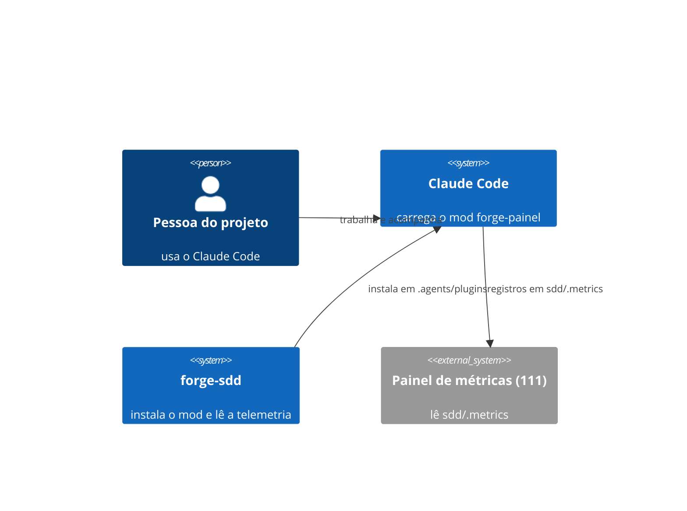
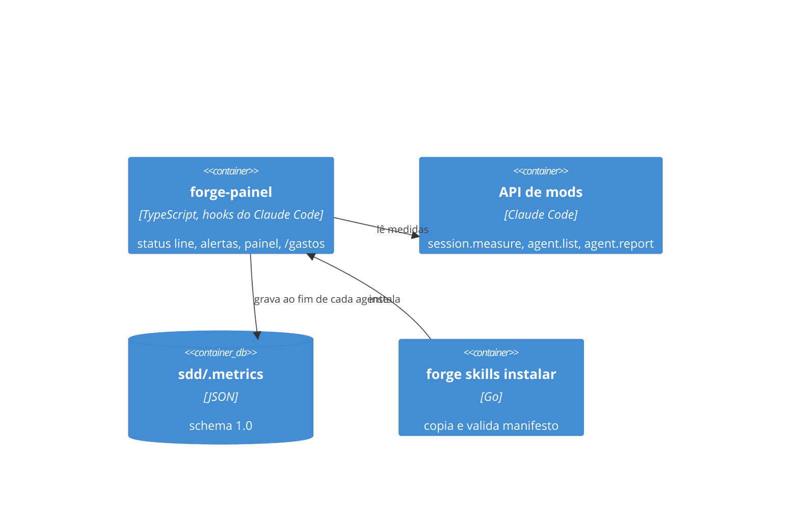

# Critérios — 123 Painel de execução no Claude Code (mods)

## Modelo do módulo
**Enxuto** (`ARQ-11`): nenhum pacote Go novo. O mod é um artefato de agente em `.agents/plugins/forge-painel/` (TypeScript executado pelo Claude Code, fora do binário). No Go muda só o que a instalação já faz (`internal/skills`, `internal/scaffold`) e a validação do manifesto.

## Decisões do projeto aplicadas
- **ADR-0025** instalação limitada ao projeto: o mod mora em `.agents/plugins/<slug>/` e entra por `forge skills instalar plugin`; `/plugin install` não é usado.
- **ADR-0003 e `DUP-10`** fonte única dos artefatos de agente em `.agents/`.
- **ADR-0009** tokens por janela: a status line substitui o rótulo de tokens por painel do tmux quando o mod está ativo.
- **ADR-0017** saída saneada: texto de agente que aparece no painel passa por saneamento (`SEG-08`).
- `ARQ-04`: o binário continua sem dependência de runtime; o mod não entra nele. `FLX-04`: telemetria ao fim de cada sessão, agora automática. `FLX-05`: o contrato de mod exige ADR (ADR-0030, proposta nesta iniciativa). `SEG-07`: a API de mods é consultada na versão exata do Claude Code.

## O que já existe
| Procurei | Onde | Achei | Decisão | Justificativa |
|---|---|---|---|---|
| Schema da telemetria | `internal/monitor/session_record.go`, `sdd/.metrics/schema.json` | `forge-sdd/metrics/1.0` com `medicao`, cache e `cost_usd_tabela` | reusar | RN-3; nenhum campo novo |
| Uso real por evento | `internal/monitor/usage.go` | leitura do `result` do stream-json | reusar como referência | mesmos campos e nomes de `medicao` |
| Instalação de plugin | `cmd/forge-sdd/skills_instalar.go`, ADR-0025 | `instalar <skill\|plugin> <slug> --de` | reusar | é o caminho oficial |
| Gancho do Claude no projeto | `.claude/settings.json` | `UserPromptSubmit` chama `forge-sdd inbox` | manter | a faixa do inbox via mod fica para depois |
| Sessões do `forge up` | `cmd/forge-sdd/up.go`, `internal/pipeline/launcher.go` | forge-discovery interativa; builder e reviewer como `forge worker` com `claude -p` | reusar sem mudar | o mod carrega só na interativa |
| Telemetria dos workers | `cmd/forge-sdd/worker.go` `recordJobTelemetry` | grava um registro por job | reusar | dono dos registros de job (RN-11) |
| Marca de processo de worker | `internal/pipeline/runner.go` | `FORGE_WORKER` no ambiente do agente | reusar | mod fica mudo dentro de worker |
| Estado da esteira | `.forge/runtime/<papel>/<estado>/`, `internal/bus` | jobs por estado e lease | reusar só leitura | fonte do painel (RN-10) |
| Painel de métricas | 111 (módulo) | painel HTML que lê `sdd/.metrics` | depender | o mod produz, a 111 consome |
| Tokens por painel | 81, ADR-0009 | rótulo de tokens no tmux | estender | status line é o equivalente no Claude Code |
| Contrato de módulos | 109 | manifesto e autorização para binários externos | alinhar | mesmo vocabulário de manifesto e permissões; mod não é binário |
| Mod existente | `.agents/plugins/` | nenhum | criar | primeiro mod de referência |

## Dependências novas
Nenhuma de runtime. O mod usa só a API que o Claude Code injeta (`claude-code`). Para desenvolvimento, `tsc` e `claude plugin validate|test`, que já vêm com o Claude Code; consultar a documentação da versão mínima (`SEG-07`).

## Diagramas C4 (Mermaid)


```mermaid
sequenceDiagram
participant CC as Claude Code
participant M as forge-painel
participant FS as sdd/.metrics
CC->>M: session.measure (janelas, contexto)
M->>CC: ui.status; toast em 70% e 90%
CC->>M: agent.spawn
M-->>CC: aviso se janela > limite
CC->>M: agent.report (uso do subagente)
M->>FS: registro medicao real
CC->>M: /gastos
M->>FS: lê e resume
```

## Critérios de aceitação executáveis
- **CA-01** `claude plugin validate .agents/plugins/forge-painel` sai sem erro e declara só os ganchos e permissões do manifesto.
- **CA-02** `claude plugin test .agents/plugins/forge-painel`: status line formata janelas e contexto; sem janelas mostra só contexto.
- **CA-03** Mesmo teste: alerta dispara uma vez ao cruzar 70% e uma vez ao cruzar 90% por janela.
- **CA-04** Mesmo teste: `agent.report` grava um JSON válido contra `sdd/.metrics/schema.json` (`forge-sdd/metrics/1.0`) com `medicao: real`.
- **CA-05** Mesmo teste: aviso de orçamento em `agent.spawn` acima do limite não bloqueia.
- **CA-06** `go test ./internal/skills/...`: instalar o plugin grava só em `.agents/plugins/forge-painel/` e recusa manifesto sem permissões ou versão mínima.
- **CA-07** `grep` no código do mod não encontra `fetch`, chamadas de `$.model` nem escrita fora de `sdd/.metrics` e `.forge/runtime/painel`.
- **CA-09** Mesmo teste do mod: com `FORGE_WORKER` definido o mod não grava em `sdd/.metrics` nem abre painel; sem ele, um job de worker já registrado não é gravado de novo.
- **CA-10** Mesmo teste: com o barramento simulado (um job em `claimed` e um em `done`), o painel mostra os dois com papel, task e estado, sem escrever em `.forge/runtime/<papel>/`.
- **CA-08** `go build ./... && go vet ./... && go test ./...` saem 0; ADR-0030 em `sdd/spec/adr/`.
