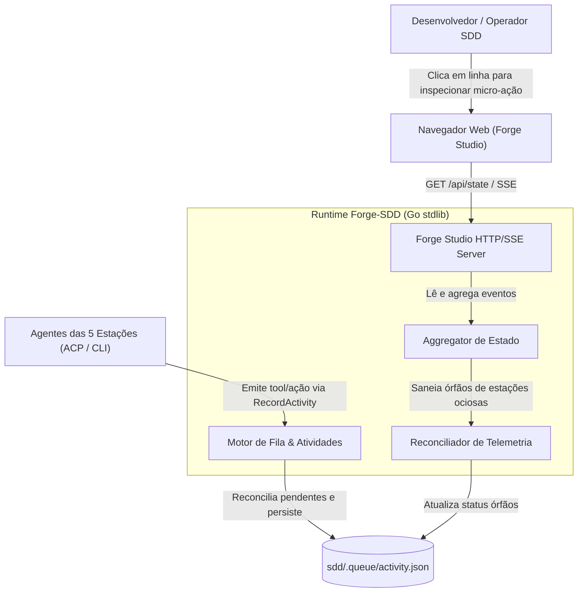
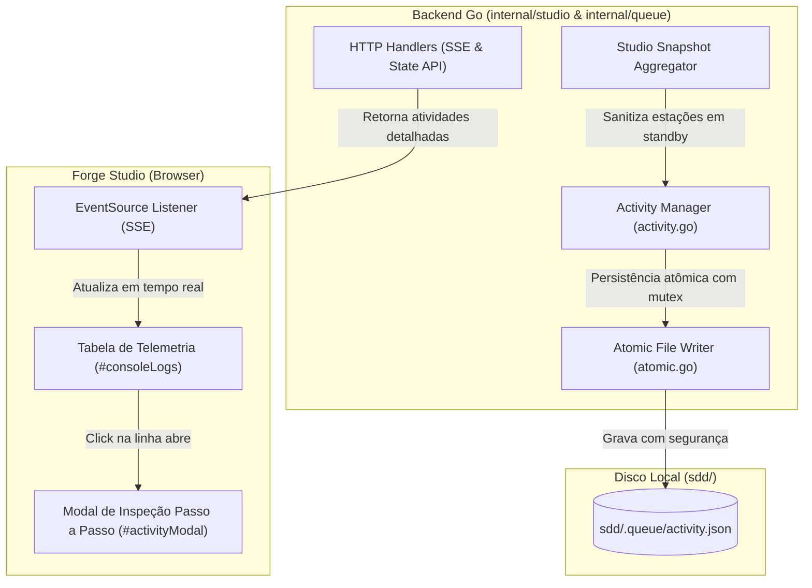
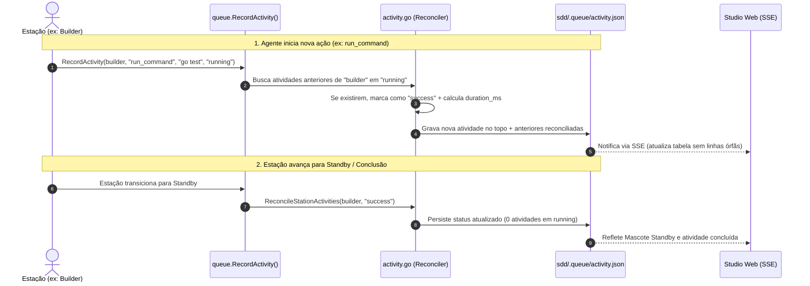

# Critérios Técnicos 66 — Telemetria Detalhada, Inspeção Passo a Passo e Reconciliação de Atividades Órfãs

Especificação técnica, decisões de engenharia, arquitetura C4 e critérios de aceitação executáveis (Gherkin) da iniciativa `feat-66-telemetria-detalhada-inspecao-e-reconciliacao`, em estrita conformidade com a Constituição (`sdd/memory/constitution.md`) e os papéis canônicos de agentes (`.agents/roles/`).

---

## 1. Governança de Arquitetura (`ARQ-11`, `DUP-02`, `SEG-07`)

### 1.1 Modelo do módulo (`ARQ-11`)
- **Modelo:** `enxuto`.
- **Justificativa:** A extensão de telemetria e o reconciliador de atividades aprimoram os pacotes existentes `internal/queue` (gerenciamento e persistência de atividades) e `internal/studio` (apresentação visual e inspeção de micro-ações). Não adiciona serviços externos, processos em segundo plano desacoplados ou novas linguagens. Opera inteiramente sobre o ciclo de leitura/escrita atômica do filesystem local (`sdd/.queue/activity.json`) e renderização web leve (HTML/CSS/JS nativo) (`ARQ-03`, `ARQ-04`). Preserva a separação estrita de fronteiras arquiteturais (`ARQ-01`, `ARQ-06`).

---

## O que já existe (Reuse Check — `DUP-02`)

| Procurei | Onde | Achei | Decisão (`reusar`, `estender`, `criar`) | Justificativa |
|---|---|---|---|---|
| Modelo e Persistência de Atividades | `internal/queue/activity.go` | `ActivityItem` struct, `RecordActivity()`, `LoadActivities()` com persistência em `sdd/.queue/activity.json` | `estender` | Estender `ActivityItem` com campos enriquecidos (`ID`, `Command`, `Args`, `FilePath`, `Output`, `Error`, `DurationMs`, `CompletedAt`, `MascotState`) mantendo 100% de retrocompatibilidade com campos existentes via tags JSON `omitempty`. |
| Escrita Atômica em Disco | `internal/queue/atomic.go` | `WriteJSONAtomic()` com gravação em `.tmp` e renomeação atômica | `reusar` | Todas as gravações da telemetria e reconciliação utilizam `WriteJSONAtomic` para evitar arquivos corrompidos por encerramentos abruptos. |
| Agregador de Estado do Studio | `internal/studio/state.go` | `Aggregator`, `StudioSnapshot`, vinculação de atividades às 5 estações | `estender` | Integrar a sanitização de órfãos no `GetSnapshot()` e quando uma estação estiver em `standby`/`idle`, eliminando status `running` fantasmas. |
| Console de Telemetria no Forge Studio | `internal/studio/assets/index.html`, `studio.js`, `studio.css` | Tabela `#consoleLogs`, abas de filtro `#consoleFilterTabs`, `renderConsoleLogs()` | `estender` | Tornar as linhas clicáveis, adicionar modal moderno de inspeção passo a passo com suporte a teclado (`ESC`, setas) e visualizador de output tipo terminal. |
| Pool de Sessões ACP e Standby | `internal/acp/pool.go`, `types.go`, `attach.go` | `SessionPool`, `SessionStateStandby`, `AttachBridge` | `estender` | Vincular a transição de estado da sessão ACP para `standby` à reconciliação de atividades pendentes em `running` da respectiva estação. |
| CLI de Consulta de Fila e Atividades | `cmd/forge-sdd/queue.go` | Subcomando `forge-sdd queue activity` | `estender` | Exibir campos detalhados (duração, comando, output resumido) e permitir flag `--sanitize` para limpeza manual via CLI. |
| Reconciliador de Atividades Órfãs | Não existia isoladamente | Inexistente no forge-sdd | `criar` | Criar as funções canônicas `ReconcileStationActivities` e `SanitizeOrphanActivities` em `internal/queue/activity.go`. |

---

## Dependências novas (`SEG-07`)

- **Nenhuma dependência externa.**
- O módulo é implementado com **100% Go standard library** (`encoding/json`, `sync`, `time`, `os`, `path/filepath`, `fmt`, `strings`, `crypto/rand` ou nanos para IDs) e JavaScript/CSS nativo moderno no navegador (sem frameworks adicionais, sem compilações externas) (`ARQ-03`, `ARQ-04`).

---

## 2. Visão Técnica & Arquitetura C4 Model

### 2.1 C4 Nível 1 — Diagrama de Contexto de Sistema
Visão geral de como o operador, o Forge Studio e os agentes interagem com a telemetria e o reconciliador.



---

### 2.2 C4 Nível 2 — Diagrama de Contêineres
Detalhamento dos componentes do Forge Studio e do backend Go.



---

### 2.3 C4 Nível 3 — Diagrama de Sequência de Reconciliação
Fluxo determinístico eliminando status `running` órfãos.



---

## 3. Contratos de Dados & Estruturas Go

### 3.1 Modelo de Dados Estendido (`internal/queue/activity.go`)

```go
package queue

// ActivityItem representa uma ferramenta ou micro-ação executada por uma estação em tempo real.
type ActivityItem struct {
	ID          string   `json:"id,omitempty"`           // Identificador determinístico único (ex: act-builder-1730460000)
	Timestamp   string   `json:"timestamp"`              // ISO-8601 UTC de início da ação
	CompletedAt string   `json:"completed_at,omitempty"` // ISO-8601 UTC de conclusão da ação
	Station     string   `json:"station"`                // lider, pm-architect, planner, builder, governance
	Tool        string   `json:"tool"`                   // run_command, read_file, edit_file, gate, git, context7, audit, etc.
	Action      string   `json:"action"`                 // Argumento principal, comando resumido ou caminho do arquivo
	Details     string   `json:"details"`                // Descrição legível e objetivo da ação
	Status      string   `json:"status"`                 // running, success, error, done, timeout
	Command     string   `json:"command,omitempty"`      // Comando exato completo executado (se aplicável)
	Args        []string `json:"args,omitempty"`         // Lista de argumentos ou flags passadas à ferramenta
	FilePath    string   `json:"file_path,omitempty"`    // Caminho relativo do arquivo manipulado
	Output      string   `json:"output,omitempty"`       // Stdout, diff ou resultado resumido (máx 8KB)
	Error       string   `json:"error,omitempty"`        // Stderr ou mensagem detalhada de erro
	DurationMs  int64    `json:"duration_ms,omitempty"`  // Duração da execução em milissegundos
	MascotState string   `json:"mascot_state,omitempty"` // working, thinking, approval, error, standby
}
```

### 3.2 Funções Canônicas de Reconciliação & Registro

1. **`RecordActivity(dir, station, tool, action, details, status string) error`:**
   - Mantida com a mesma assinatura para total compatibilidade regressiva.
   - Antes de adicionar o novo item, invoca `reconcileStationLocked(station, "success", now)` para fechar eventuais itens em `running` da mesma estação.
   - Gera automaticamente `ID` único baseado na estação e timestamp unix nano.

2. **`RecordActivityDetailed(dir string, item ActivityItem) error`:**
   - Permite registro com payload completo (`Command`, `Args`, `FilePath`, `Output`, `Error`, `DurationMs`, `MascotState`).
   - Aplica truncamento seguro em `Output` (máx. 8192 bytes) para respeitar limites de armazenamento.

3. **`ReconcileStationActivities(dir, station, newStatus string) error`:**
   - Percorre a lista de atividades em `sdd/.queue/activity.json`.
   - Para qualquer item da estação informada cujo status seja `"running"` ou `"working"`, atualiza para `newStatus` (default `"success"` ou `"done"`), preenchendo `CompletedAt` e calculando `DurationMs`.
   - Se nenhuma atividade precisar de reconciliação, não realiza escrita no disco (economia de I/O).

4. **`SanitizeOrphanActivities(dir string, maxAge time.Duration) (int, error)`:**
   - Executada no boot do Forge Studio ou via CLI (`forge-sdd queue activity --sanitize`).
   - Identifica atividades em `running` com timestamp anterior ao limiar de `maxAge` (padrão: 60 segundos).
   - Converte o status para `"done"`, anexando a observação `"[saneado no bootstrap: agente inativo]"` em `Details`.
   - Retorna a quantidade de itens saneados.

---

## 4. Especificação da Interface do Usuário (Forge Studio)

### 4.1 Linhas de Telemetria Clicáveis (`#consoleLogs`)
- Cada elemento `.log-row` recebe as classes e atributos:
  - `class="log-row log-row-clickable"`
  - `tabindex="0"` (focável por teclado)
  - `role="button"`
  - `aria-label="Inspecionar micro-ação de {station}: {action}"`
  - `onclick="openActivityModal('{act.id}')"`
- Estilos visuais adicionais em `studio.css`:
  - `cursor: pointer; transition: background 0.15s ease, transform 0.1s ease;`
  - Efeito hover com highlight sutil (`background: var(--bg2); border-left: 3px solid var(--accent);`)
  - Ícone ou badge de inspeção sutil no final da linha indicando disponibilidade de detalhes (`🔍 Inspecionar`).

### 4.2 Modal / Drawer de Inspeção Passo a Passo (`#activityModal`)
Um modal moderno centralizado (ou drawer lateral) renderizado no DOM do Forge Studio:
- **Cabeçalho:**
  - Badge colorido da estação executora (ex: `04. BUILDER` em verde água `#4fd1b5`).
  - Mascote da estação com estado correspondente (`working`, `thinking`, `approval`).
  - Nome da ferramenta em chip com sua cor semântica (`run_command`, `read_file`, `audit`, etc.).
  - Badge de status com pulso suave (`running` amarelo, `success`/`done` verde, `error` vermelho).
  - Botão de fechar `✕` com suporte a tecla `ESC`.
- **Painel de Parâmetros e Contexto:**
  - **Ação:** Título da ação em negrito.
  - **Comando Executado:** Campo monoespaçado com botão "Copiar Comando".
  - **Caminho do Arquivo:** Exibição com link/cópia fácil do arquivo afetado.
  - **Argumentos / Flags:** Lista de parâmetros passados.
- **Painel de Output / Log da Execução:**
  - Container estilizado escuro tipo terminal com barra de rolagem e quebra de linha.
  - Exibição de stdout/resultado formatado.
  - Se houver `Error`, bloco destacado com fundo avermelhado exibindo o stderr ou motivo de reprovação.
- **Rodapé e Navegação:**
  - Timestamp de início, timestamp de fim e duração total formatada (ex: `124ms`, `1.45s`).
  - Botões de navegação: `← Ação Anterior` e `Próxima Ação →`.
  - Atalhos de teclado habilitados: `ArrowLeft`, `ArrowRight` e `Escape`.

---

## 5. Critérios de Aceitação Executáveis em Formato Gherkin (`TST-01`)

### Cenário 1: Inspeção Detalhada de Micro-Ação no Forge Studio
```gherkin
Cenário: Operador clica em uma linha da tabela de telemetria para inspecionar
  Dado que o Forge Studio está aberto no navegador
  E a tabela "Telemetria das Estações & Uso de Tools em Tempo Real" possui uma atividade do builder "run_command" com status "success"
  Quando o operador clica sobre a linha correspondente ou pressiona Enter com a linha focada
  Então o modal de inspeção de telemetria deve ser aberto na tela
  E o modal deve exibir o nome da estação "04. Fila de Builders" com seu badge colorido
  E deve exibir a ferramenta "run_command", o comando executado e a duração em milissegundos
  E deve exibir o bloco de output da execução com o texto retornado
  E o operador deve poder fechar o modal pressionando a tecla ESC
```

### Cenário 2: Reconciliação Automática ao Iniciar Nova Ação
```gherkin
Cenário: Estação inicia nova atividade enquanto possuía atividade anterior em running
  Dado que o arquivo "sdd/.queue/activity.json" contém uma atividade da estação "builder" com status "running"
  Quando a função RecordActivity for invocada para a estação "builder" com a ferramenta "portao_a"
  Então a atividade anterior do "builder" que estava "running" deve ser automaticamente atualizada para "success"
  E a nova atividade "portao_a" deve ser inserida no topo da lista
  E nenhuma atividade anterior da estação "builder" deve permanecer com status "running"
```

### Cenário 3: Reconciliação ao Transicionar Estação para Standby
```gherkin
Cenário: Estação conclui o trabalho e transiciona para o estado Standby
  Dado que a estação "governance" possui uma atividade "audit" com status "running"
  Quando a estação "governance" transicionar seu estado operacional para "standby" ou "idle"
  Então o reconciliador deve atualizar a atividade "audit" para status "success"
  E deve registrar o timestamp de conclusão "completed_at" e a duração decorrida "duration_ms"
  E a tabela de telemetria não deve mais exibir o status "running" para a estação "governance"
```

### Cenário 4: Sanitização no Bootstrap de Atividades Órfãs Legadas
```gherkin
Cenário: Forge Studio inicializa com atividades órfãs em running de sessões anteriores
  Dado que o arquivo "sdd/.queue/activity.json" contém 3 atividades históricas com status "running" criadas há mais de 60 segundos
  Quando o servidor do Forge Studio for inicializado via NewServer ou NewAggregator
  Então a função SanitizeOrphanActivities deve ser executada
  E as 3 atividades devem ter seu status alterado de "running" para "done"
  E o campo "details" de cada uma deve conter a anotação de saneamento no boot
  E a persistência em disco deve ser realizada atomicamente
```

### Cenário 5: Prevenção de Estouro de Armazenamento e Truncamento de Output
```gherkin
Cenário: Registro de atividade com output muito extenso
  Dado que uma ferramenta de teste gera um output de 50 KB no terminal
  Quando a ferramenta registrar a atividade via RecordActivityDetailed
  Então o campo "output" persistido em "sdd/.queue/activity.json" deve ser truncado para no máximo 8192 bytes
  E deve incluir no final o sufixo "... [output truncado pelo Forge-SDD]"
  E o arquivo "activity.json" deve manter seu orçamento de tamanho seguro
```

### Cenário 6: Navegação Sequencial no Modal de Inspeção
```gherkin
Cenário: Navegação entre atividades consecutivas no modal de inspeção
  Dado que o modal de inspeção está aberto exibindo a atividade de índice 2
  Quando o operador clica no botão "Próxima Ação" ou pressiona a seta para a direita "ArrowRight"
  Então o modal deve transicionar e exibir os dados completos da atividade de índice 3
  E quando o operador clica em "Ação Anterior" ou pressiona a seta para a esquerda "ArrowLeft"
  Então o modal deve retornar e exibir os dados da atividade de índice 2
```

---

## 6. Critérios de Aceitação de Código & Testes (`COD-*`, `TST-*`)

1. **`COD-01` & `COD-02`:** Código limpo com responsabilidade única; `go vet ./...` deve passar sem nenhum alerta.
2. **`COD-03`:** Tratamento estrito de erros em Go sem descarte silencioso; erros no unmarshal ou gravação atômica são enriquecidos com contexto claro.
3. **`TST-01` & `TST-04`:** Testes automatizados unitários e de concorrência com `-race`:
   ```bash
   go test -v -race -run "TestActivity" ./internal/queue/...
   go test -v -race -run "TestStudio" ./internal/studio/...
   ```
4. **`TST-05`:** Passes em 100% dos testes da suíte completa:
   ```bash
   go test -v -race ./... && go vet ./...
   ```
5. **DOM e Frontend:** Sem erros de console no navegador (`ReferenceError`, `TypeError`), sem seletores quebrados e com manipulação segura de strings (`escapeHtml`).

---

## 7. Portão FLX-01 — Declaração e Validação Humana Obrigatória

> [!IMPORTANT]
> **PORTÃO FLX-01 (Validação Humana da Especificação Técnica):**
> Em cumprimento à regra constitucional `FLX-01` e ao fluxo SDD, a presente especificação técnica da Feature 66 foi concebida pela Estação 02 (PM & Arquiteto).
> **Nenhuma linha de código de produção será implementada ou enfileirada no Builder até que o usuário humano valide e aprove esta especificação.**
