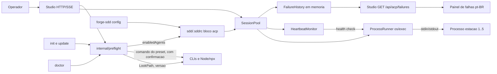

# Critérios Técnicos — Discovery 68 (Sessões ACP Físicas Multi-Agente)

## Modelo do módulo
- **Modelo:** `enxuto`, dentro de `internal/acp` (processo) e `internal/config` (adaptadores).
- **Justificativa:** apenas stdlib (`os/exec`, `io`, `context`, `sync`). Sem novo pacote de domínio; fronteira `cmd/` (flags) x `internal/` (regra) preservada (`ARQ-01`, `ARQ-11`).

## O que já existe

| Procurei | Onde | Achei | Decisão | Justificativa |
|---|---|---|---|---|
| Pool e Warmup | `internal/acp/pool.go` | `SessionPool.Warmup` só cria `PooledSession` em memória; `CanonicalPoolSessions`; `Status()`; listeners de estado | estender | Warmup passa a iniciar processos; reaproveita estados (`standby`, `error`, `offline`) e `TransitionState` |
| Estado e tipos | `internal/acp/types.go` | `PooledSession`, `SessionState`, `PoolStatusResult` | estender | Adicionar `Pid`, `Agent`, `Connected` e contagem conectadas (`omitempty`) |
| Heartbeat | `internal/acp/heartbeat.go` | `HeartbeatMonitor.Tick` detecta stall por timestamps | estender | Tick consulta liveness/health do processo, além de timestamps |
| Stdio | `internal/acp/transport_stdio.go` | Transporte stdio do servidor (io.Reader/Writer) | reusar | Mesma moldura de linhas JSON-RPC para falar com o filho |
| Attach/log | `internal/acp/attach.go` | `AttachBridge.BroadcastLog` | reusar | stdout/stderr do filho alimentam o log da estação |
| Estações | `internal/queue/stations.go` | `CanonicalStations()` | reusar | Única fonte das 5 estações (`DUP-01`) |
| Workspace seguro | `internal/acp/session.go` | `ValidateWorkspace` | reusar | `cwd` do filho confinado (`SEG-01`, `SEG-02`) |
| Configuração | `internal/config/config.go` | `Sddrc` (project, version, lang, agents, telemetry, naming_convention), `ReadSddrc` | estender | Novo bloco `acp`; JSON retrocompatível |
| Subcomando `config` | `cmd/forge-sdd/*.go`, `main.go` | Inexistente (nenhum `config`) | criar | Seguir skill `novo-subcomando-cli-sdd` (`DUP-05`); `ARQ-06` lista subcomandos determinísticos de suporte |
| Boot do Studio | `internal/studio/server.go` (l.70-105, 300-320) | Chama `pool.Warmup` com timeout e `StartHeartbeat`, ignorando erro | estender | Tratar resultado parcial sem bloquear boot |
| Histórico de falhas / endpoint de leitura | `internal/studio/server.go`, `state.go`, `sse.go` | Endpoints de leitura e SSE | estender | Novo endpoint GET de falhas por estação (68-05) |
| Backoff/restart | `internal/acp` | Inexistente | criar | Política de restart no `ProcessRunner`/pool (68-03), stdlib `time`, `math/rand` |
| Prompts e fluxo init/update | `internal/survey/survey.go`, `cmd/forge-sdd/main.go` | `RunConfirm`, `--yes`, `--dry-run` | estender | Multisseleção de agentes ACP e confirmação de instalação (68-06) |
| Checagem de requisitos | `internal/` e `cmd/forge-sdd/doctor.go` | Inexistente | criar | `internal/preflight` único, usado por init/update/doctor/Studio (`DUP-03`) |
| Chip na UI | `internal/studio/assets/index.html:29`, `studio.js` | `sessionPoolCount` fixo em "5" + texto "SESSÕES PRONTAS" | estender | Valor vindo de `pool/status`; texto "x de 5 conectadas" |
| Agentes ativos | `sdd/.sddrc` (`agents`) | Lista `claude`, `gemini` (agentes de scaffold) | reusar como referência | Nomes de adaptador alinhados; não confundir com adaptador ACP |

## Dependências novas
- **Nenhuma dependência externa.** Apenas stdlib Go (`SEG-07`, `ARQ-04`).

## Diagrama C4 (Container)


## Contrato de configuração (`acp.*`)
```json
"acp": {
  "defaultAdapter": "gemini",
  "adapters": {
    "gemini": { "command": "gemini", "args": ["--experimental-acp"], "env": [], "healthCheck": { "method": "initialize", "timeoutMs": 5000, "intervalMs": 10000 } }
  },
  "enabledAgents": ["gemini", "claude"],
  "stations": { "builder": "claude" },
  "warmupTimeoutMs": 0,
  "restart": { "maxAttempts": 5, "initialBackoffMs": 1000, "maxBackoffMs": 30000, "multiplier": 2, "jitter": 0.2, "stableResetMs": 60000 }
}
```
Defaults: `warmupTimeoutMs` e `healthCheck.timeoutMs` herdam o timeout de warmup atual do Studio (`internal/studio/server.go`) quando omitidos. `0` significa "usar default herdado".

### Modos de `healthCheck.method`
| Método | Comportamento | Quando usar |
|---|---|---|
| `initialize` | Envia `initialize` JSON-RPC e exige resposta válida dentro do timeout | Agente fala ACP via stdio |
| `liveness` | Fallback aprovado: processo vivo (não saiu) e stdin aberto (escrita não retorna erro); sem troca de mensagens | Agente sem ACP via stdio ou ACP "a confirmar" |
Em `liveness` o chip conta a estação como conectada, mas o painel indica o modo "somente processo vivo".

### Máquina de estados do restart
`standby` -> (queda) -> `restarting` ("reiniciando") -> `standby` se health check ok; após `maxAttempts` consecutivas falhas -> `error`. Backoff = `min(initial * multiplier^n, max)` com jitter; contador zera após `stableResetMs` em `standby`. Estado `restarting` é novo valor de `SessionState` (extensão de `ValidSessionStates`).

### Subcomando `forge-sdd config` (somente chaves `acp.*`)
- `list`: imprime todas as chaves `acp.*` com valor efetivo (inclui defaults e origem: usuário ou preset).
- `get <chave>`: imprime o valor de uma chave `acp.*`.
- `set <chave> <valor>`: valida e grava a chave em `sdd/.sddrc` (suporta `--dry-run`).
- `unset <chave>`: remove a chave do usuário, voltando ao preset/default.
Chaves fora de `acp.*` são rejeitadas. Evolução possível: estender a outras chaves do `.sddrc`.

### Presets de adaptadores (pesquisa em 2026-11-01)
Presets vivem em template embutido (`embed.FS`), editáveis. Fontes: documentação/repositórios públicos (resultados de busca web); URLs diretas devem ser reconferidas pelo Builder via context7/doc oficial antes de fixar (`SEG-07` não se aplica: nenhuma dependência é adicionada).
| Adaptador | command | args | healthCheck | Fonte | Situação |
|---|---|---|---|---|---|
| gemini | `gemini` | `--experimental-acp` (versões novas podem aceitar `--acp`) | `initialize` | geminicli.com, jetbrains.com | confirmado; flag a reconferir por versão |
| copilot | `copilot` | `--acp` (stdio é o default; `--stdio` explícito opcional) | `initialize` | docs.github.com (GitHub Copilot CLI), github.blog | confirmado |
| claude | `npx` | `-y @agentclientprotocol/claude-agent-acp` (pacote antigo `@zed-industries/claude-code-acp` descontinuado); env opcional `ACP_PERMISSION_MODE` | `initialize` | npmjs.com, repositório do adaptador | confirmado (adaptador de terceiros para o Claude Code, requer Node) |
| codex | `npx` | `-y @agentclientprotocol/codex-acp` (ou binário `codex-acp`; `CODEX_PATH` opcional) | `initialize` | repositório codex-acp, openai.com | confirmado (adaptador de terceiros) |
| agy | `agy` | **a confirmar** (não há flag `--acp` oficial confirmada; adaptadores comunitários como `antigravity-acp` existem) | `liveness` | issues/repositórios no GitHub, google.dev | a confirmar |
Cada preset também declara `requires` (ex.: `["npx"]`), `versionArgs` e `install` (`command` + `args`), usados pelo preflight (68-06). Comandos de instalação por agente (ex.: `npm install -g ...`) são **a confirmar** na pesquisa do Builder; enquanto vazios, o preflight apenas informa o requisito ausente sem executar nada.
Pontos "a confirmar": flags nativas do `agy` para ACP/stdio; se o Claude Code tem modo ACP nativo (hoje via adaptador npm); nomes de pacote e flags por versão instalada; variáveis de autenticação (nunca gravadas no `.sddrc`, `SEG-04`).

## Restrições e segurança
- `SEG-03`: argv explícito, nunca `sh -c`; `exec.LookPath` na borda.
- `SEG-01`: validar `command`, `args`, `env` e nomes de adaptador na leitura da config.
- `SEG-05`: `env` e argumentos nunca em logs/telemetria; log mostra só nome do adaptador e PID.
- `COD-03`: erros de spawn enriquecidos; `TST-04`: testes com processo falso (helper `TestMain`/`os.Args[0]`), sem rede.
- Preflight: executa comando externo só de `install` do preset/config, com argv explícito, confirmação explícita (default não) ou `--yes`; nunca em `--dry-run` nem em modo não interativo sem `--yes` (`SEG-03`, `SEG-01`).
- Restart: tentativas e backoff limitados por config; sem loop infinito; o histórico de falhas guarda causa/exit code sem args nem env (`SEG-05`).
- Encerramento: `Pool.Close` mata e coleta (`Wait`) todos os filhos; sem zumbis.

## Critérios de Aceitação (iniciativa)
```bash
go build ./... && go vet ./... && go test -race ./...
```

## Fatiamento aprovado (FLX-01)
68-03 = warmup físico + status; 68-03b = restart/backoff + `FailureHistory`; 68-06 = detecção reutilizável (`internal/preflight`); 68-06b = seleção interativa + instalação confirmada. Ver `plan.md`.
