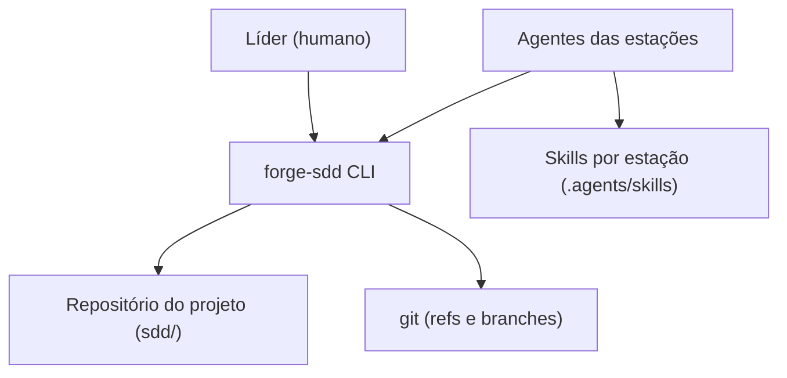
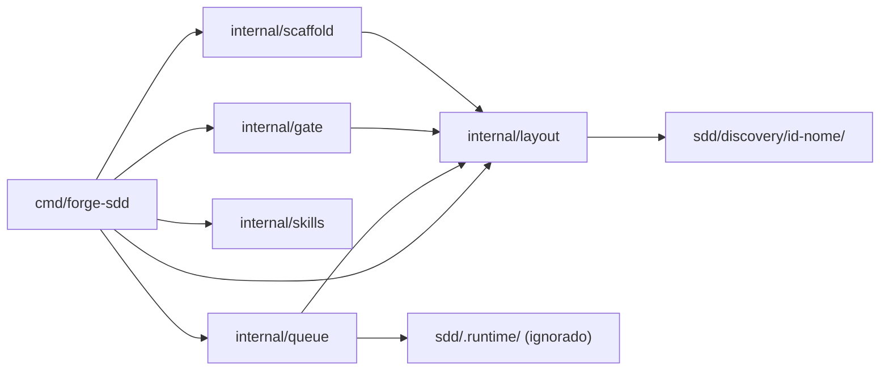
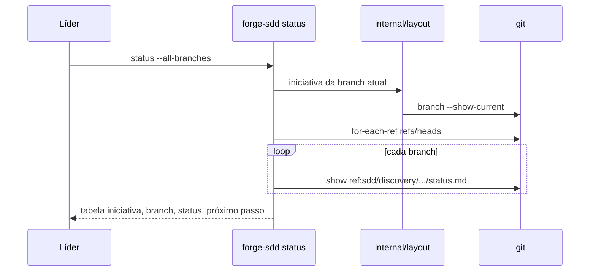

# Critérios Técnicos — Discovery 69 (Estrutura, Tokens e Paralelismo)

## Modelo do módulo
- **Modelo:** `enxuto`. Um pacote novo, `internal/layout`, dono único dos caminhos de uma iniciativa; o restante é remoção e extensão de pacotes existentes.
- **Justificativa:** só stdlib (`path/filepath`, `os`, `os/exec` para `git`). Hoje o caminho `sdd/...` é montado à mão em 15 arquivos não-teste (14 sem o Studio); centralizar é o que permite trocar o layout sem caçar literais (`DUP-04`, `ARQ-01`, `ARQ-11`).

## Linha de base medida (2026-11-13)
| Item | Hoje |
|---|---|
| `sdd/features/index.md` | 27.150 bytes, 211 linhas, 131 commits |
| `sdd/memory/progress.md` | 604 bytes, 154 commits |
| `sdd/.queue/` versionado | 7 arquivos, 96.070 bytes |
| `sdd/memory/constitution.md` | 14.023 bytes (regras 0 a 15 repetem o conteúdo dos IDs) |
| `CLAUDE.md` (sempre carregado) | 4.548 bytes |
| Comandos + papéis + rules em `.agents/` | 26 arquivos, cerca de 65 KB |
| Adaptadores em `.claude`, `.gemini`, `.github` | 63 arquivos |
| `internal/studio` | 5.262 linhas Go, mais assets |
| Discoveries fora do padrão de pasta | 14 (42 arquivos); `sdd/features/` com 115 arquivos |

Conjunto de leitura obrigatório, somando os arquivos que cada comando manda ler:

| Comando | Hoje | Orçamento alvo |
|---|---|---|
| `/discovery` | cerca de 65 KB (index 27, constitution 14, papéis 9, CLAUDE 4,5, comando 3, clarify e naming 3, concepts 3) | ≤ 22 KB |
| Builder por task | cerca de 35 KB (constitution 14, CLAUDE 4,5, comando 3,9, papel 2,3, rules e task típicas 8,6) | ≤ 15 KB |

Os alvos são orçamentos propostos, não medições; a conversão para tokens depende do modelo.

## O que já existe

| Procurei | Onde | Achei | Decisão | Justificativa |
|---|---|---|---|---|
| Resolução de caminhos `sdd/` | `cmd/`, `internal/` | `filepath.Join(dir, "sdd", ...)` literal em 15 arquivos não-teste | criar `internal/layout` | Nome canônico com definição única (`DUP-04`) |
| Fila do Builder | `internal/queue/queue.go:77` | Caminho fixo `sdd/.queue/queue.json` | estender | Passa a receber o caminho da iniciativa |
| Filas por estação e atividade | `internal/queue/stations.go`, `activity.go` | Usadas por `internal/acp` e `cmd/.../queue.go`, além do Studio | reusar | Permanecem; viram estado de execução fora do git |
| Visão geral | `cmd/forge-sdd/queue.go` (`queue panel`) | `status` consta em `ARQ-06` mas não está registrado no CLI | criar `status` | Substitui `index.md` e `progress.md` |
| Próximo ID | `sdd/memory/naming-convention.md` | Regra em prosa, olha só a árvore local | criar `next-id` | Precisa consultar todas as refs para não colidir |
| Distribuição de skills | `internal/skills` (`Propose`, `Approve`, `Sync`) | Já sincroniza `.agents/skills/` para cada agente | reusar | Mesmo mecanismo serve às skills de estação |
| Índice de skills | `sdd/skills/index.md` | Tabela com 1 entrada | estender | Recebe as 5 skills de estação |
| Rules de domínio | `.agents/rules/*.md`, gate `P-23` | Gate valida frontmatter nesse caminho | reusar | Não mover; skills apenas citam |
| Orçamento de `progress.md` | `internal/gate/gate.go` (`P-21`) | Checa 1.024 bytes em caminho fixo | estender | Passa a checar o `status.md` da iniciativa |
| Migração preservando domínio | `internal/scaffold` (`shouldPreserve`, `UpdateSddrc`) | Mecanismo de `update` | estender | Movimento do legado no mesmo fluxo |
| Backup | `.gitignore` (`sdd/backups/`) | Pasta já ignorada | reusar | Destino do backup da migração |
| Clarify e nomenclatura | `sdd/memory/clarify.md`, `naming-convention.md` | Lógica única referenciada por 3 comandos | reusar | Viram referências da skill de concepção |
| Medição de tokens | `forge-sdd session record`, `forge-sdd report` | Tokens por feature em `sdd/.metrics/` | reusar | Compara antes e depois sem ferramenta nova |
| Subcomando novo | `.agents/skills/novo-subcomando-cli-sdd` | Procedimento aprovado | reusar | `DUP-05` |
| Studio | `internal/studio`, `cmd/forge-sdd/studio.go`, `docs/manual-forge-studio.md` | Único importador é `studio.go` | remover | Decisão do usuário; `COD-04` |

Divergências encontradas no levantamento, a corrigir na mesma entrega:
- `sdd/spec/concepts.md` cita `acp.HTTPTransport`, `internal/doctor`, `internal/telemetry` e `internal/lessons`; nenhum existe como pacote ou tipo em código não-teste.
- `ARQ-06` não lista `acp`, `attach`, `autopilot`, `governance` e `destroy`, que estão registrados no CLI.
- O Mapa de Roteamento da Constitution lista 5 rules; `sdd-acp.md` é a sexta e não aparece.
- `pm-architect.md` proíbe o nome `discovery.md`; o comando `/discovery` exige exatamente esse nome.

## Dependências novas
- **Nenhuma.** Apenas stdlib Go (`SEG-07`, `ARQ-04`).

## Layout alvo
```
sdd/
  discovery/<id>-<nome>/
    discovery.md  criteria.md  plan.md
    status.md            # estado e próximo passo, ≤ 1 KB
    queue.json           # fila da iniciativa
    features/feat-<id>-<nn>-<nome>.md
    fixes/fix-<id>-<nn>-<nome>.md
  archive/               # legado movido, fora de qualquer conjunto de leitura
  memory/                # constitution, lessons, mcps
  spec/  releases/  .metrics/
  .runtime/              # atividade e filas por estação, no .gitignore
```
Regra de resolução: a branch `<prefixo>/<id>-<nome>` aponta para a pasta `sdd/discovery/<id>-<nome>/`.

## Diagramas C4

Contexto:


Contêineres:


Sequência de `forge-sdd status --all-branches`:


## Critérios de aceitação executáveis
Todos exigem `go build ./... && go vet ./... && go test ./...` com saída 0 (`TST-05`).

**A. Remoção do Studio**
- `test ! -d internal/studio && test ! -f cmd/forge-sdd/studio.go`
- `forge-sdd studio` termina com erro de comando desconhecido.
- `grep -rli "forge-sdd studio\|Forge Studio" internal/scaffold/templates sdd/FLOW.md README.md docs .agents` não retorna arquivo.
- A spec da feat 68 é revisada e revalidada sem as tasks 68-04 e 68-05 (`FLX-01`).

**B. Layout por iniciativa**
- `go test ./internal/layout/...` cobre resolução por branch, caminho inválido e path traversal (`SEG-01`, `TST-03`).
- Nenhum `filepath.Join(dir, "sdd"` fora de `internal/layout` em código não-teste.
- `forge-sdd update --dry-run` sobre um fixture v3 imprime os movimentos e não cria nem move nada (`ARQ-05`).
- `forge-sdd update` move o legado para `sdd/archive/`, faz backup em `sdd/backups/` e é idempotente na segunda execução.

**C. Estado por iniciativa**
- Teste com repositório git em `t.TempDir()`: duas branches criam iniciativas, enfileiram tasks e atualizam status; o merge das duas termina sem conflito (`TST-04`).
- `forge-sdd next-id` devolve um ID maior que o de uma pasta existente apenas em outra branch.
- `forge-sdd status` lista as iniciativas; `--all-branches` inclui as de branches não mescladas.
- `git ls-files sdd/.queue sdd/features/index.md sdd/memory/progress.md` não retorna arquivo; `sdd/.runtime/` consta no `.gitignore`.
- O check `P-21` passa a validar `status.md` da iniciativa ativa em 1.024 bytes, com casos conforme e violação.

**D. Skills por estação**
- `.agents/skills/` contém `sdd-concepcao`, `sdd-planejamento`, `sdd-build`, `sdd-governanca` e `sdd-operacao`; `.agents/commands/` e `.agents/roles/` não existem.
- Cada `SKILL.md` de estação tem no máximo 2.048 bytes; o detalhe fica em `references/`.
- Cada adaptador de ferramenta tem no máximo 300 bytes e não repete o corpo da skill (`DUP-10`).
- `forge-sdd skills sync` executado duas vezes não altera arquivos; golden files atualizados (`TST-02`).

**E. Orçamento de contexto**
- `go test ./internal/scaffold -run TestContextBudget` soma os arquivos do conjunto de leitura de cada skill nos templates e falha acima do orçamento da tabela.
- `CLAUDE.md`, `GEMINI.md` e `copilot-instructions.md` gerados têm no máximo 1.536 bytes.
- `constitution.md` tem cada regra escrita uma única vez, por ID, e no máximo 9 KB.
- `forge-sdd context <task>` imprime a spec da task, as linhas dos IDs citados e os caminhos das rules e skills aplicáveis.
- `forge-sdd gate` ganha checks de orçamento em modo `observacao`.

## Impacto na Constitution e ADRs (`GOV-01`, `FLX-05`)
| ADR | Altera |
|---|---|
| `adr-0001-remocao-do-studio` | Catálogo de conceitos, rule `sdd-acp.md` |
| `adr-0002-layout-e-estado-por-iniciativa` | Regras 13 e 15, texto de `FLX-02`, check `P-21` |
| `adr-0003-skills-por-estacao-e-orcamento` | `DUP-10`, `ARQ-06` (inclui `status`, `next-id`, `context` e os já existentes), seção de regras 0 a 15 |
