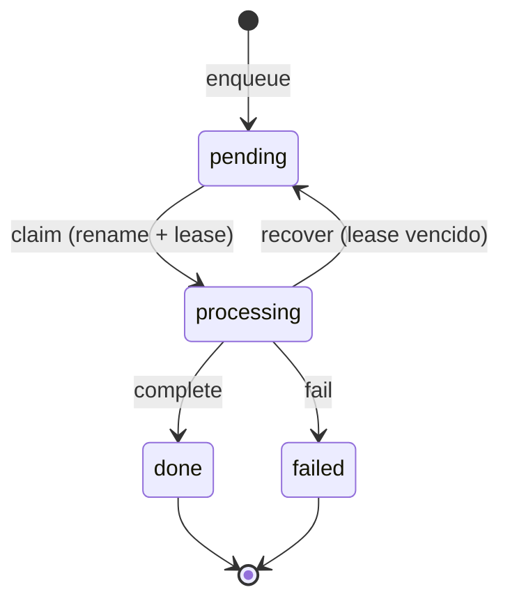
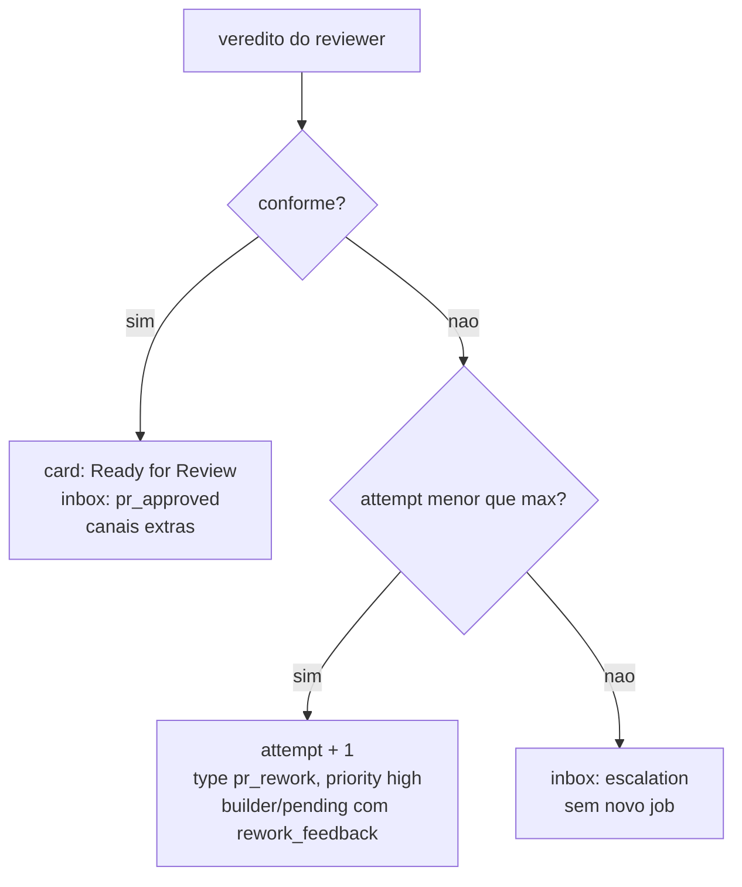
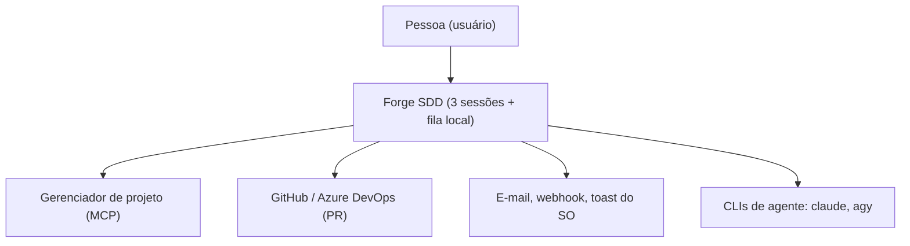
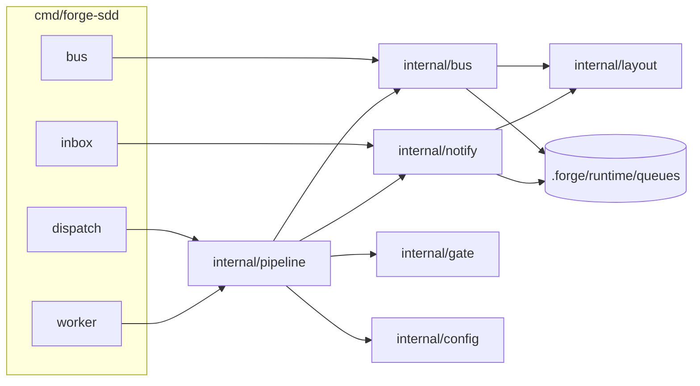

# Critérios Técnicos — Discovery 70 (Pipeline Multi-Sessão Orquestrada)

## Modelo do módulo
- **Modelo:** `completo`.
- **Justificativa:** são três pacotes novos com fronteiras próprias (`internal/bus`, `internal/pipeline`, `internal/notify`), concorrência entre processos (reivindicação de job por `rename`), efeitos no sistema operacional (toast, terminais) e integração com e-mail e webhook. O risco de corrida, de loop infinito e de vazamento de segredo exige contratos e testes por camada (`ARQ-11`, `COD-01`).

## O que já existe

| Procurei | Onde | Achei | Decisão | Justificativa |
|---|---|---|---|---|
| Fila de tasks do Builder | `internal/queue/queue.go` (`queue.json` por iniciativa) | Tasks com status (`queued`, `building`, `review_pending`, `approved`) e parecer da Camada B | reusar | Continua sendo o estado das tasks de uma iniciativa; o job aponta para ela. Não é o barramento entre sessões. |
| Filas e handoff por estação | `internal/queue/stations.go`, `forge-sdd queue handoff` | Um JSON por estação, com chave de idempotência SHA-256, em `sdd/.runtime/` | reusar o padrão | O barramento precisa de **um arquivo por job** para reivindicar com `rename` atômico; reaproveita a idempotência e as estações canônicas (`lider`, `pm-architect`, `planner`, `builder`, `governance`). |
| Escrita atômica | `internal/queue/atomic.go` (`WriteJSONAtomic`) | Arquivo temporário e `os.Rename` | reusar | Todo job é gravado por ela. |
| Barramento de jobs entre sessões | — | Inexistente | criar `internal/bus` | Conceito novo: job, estados por diretório, reivindicação com lease, prioridade e recuperação. Será registrado em `sdd/spec/concepts.md` (`DUP-01`). |
| Caminhos do projeto | `internal/layout` | Dono de todos os caminhos de `sdd/` | estender | Passa a expor `.forge/`, `config/`, `runtime/queues/<papel>/<estado>` e `inbox` (`DUP-04`). |
| Configuração | `internal/config` (`.sddrc`) | Dono de `sdd/.sddrc` | estender | `ForgeConfig` e `NotificationsConfig` com defaults e validação; um dono para toda configuração. |
| Gate determinístico de spec | `internal/gate` (`ValidateFLX01`, P-02, P-03) e `gate.BuildContext` | Existência da spec, tabela `O que já existe`, IDs, rules e skills aplicáveis | reusar e estender | O gate pré-build chama os dois e acrescenta a checagem das refs de ADR e rules e a do card. |
| Acesso ao gerenciador de projeto (MCP) | `sdd/memory/mcps.md`, skills | O MCP só é alcançável pelo agente, não pelo Go | criar contrato de evidência | O agente consulta o card e grava `card-evidence.json`; o Go valida o esquema e a frescura. Ver D-2. |
| Telemetria | `forge-sdd session record` | Gravação determinística por sessão | reusar | Cada job registra uma sessão com `--agent-path`. |
| Comando `/implementar` | `.agents/skills/sdd-build/references/implementar.md` e adaptadores | Executa a fila na própria sessão (4.0.0-beta) | estender | Ganha o modo pipeline quando existe `.forge/config/forge.json`; senão mantém o comportamento atual. |
| Revisão semântica | `sdd-governanca`, `.claude/agents/governance.md` | `S-01` a `S-07`, `FLX-08`, ferramentas somente leitura | reusar o contrato | O `reviewer` herda as verificações e acrescenta ADRs e rules; definição própria para PR. |
| Contexto mínimo por task | `forge-sdd context` | Spec, IDs citados, rules e skills | reusar | Cada job carrega só isso, o que controla o custo de tokens. |
| Lançamento de terminais | — | Nada. `forge-sdd attach` conecta terminal a sessão ACP, outro mecanismo | criar | `forge-up.sh` e `forge-up.ps1` entregues como templates do scaffold (`ARQ-03`). |
| Hooks de agente | `.claude/settings.local.json` (local, não versionado) | O scaffold não gera `settings.json` | criar template com mesclagem segura | Hook de inbox adicionado sem sobrescrever configuração do usuário (`SEG-02`). |
| Notificações | — | Inexistente | criar `internal/notify` | Canais `discovery_session`, toast, e-mail, webhook; `pm_comment` é executado pelo agente via MCP. |
| Execução de CLIs de agente | `internal/acp` (`ProcessRunner` só na feat 68, não mesclada) | Sem executor reutilizável hoje | criar mínimo em `internal/pipeline` | `os/exec` com argv explícito; revisitar quando a 68 entrar. |
| Estado de execução fora do git | `sdd/.runtime/.gitignore` (scaffold) | Diretório que ignora tudo menos o próprio `.gitignore` | reusar o padrão | `.forge/runtime/.gitignore` idêntico. |
| Worktrees e paralelismo | — | `git worktree` não é usado no código | criar | Planejador de ondas lê `**Depende de:**` das specs; worktrees por tarefa sob `.forge/runtime/worktrees/`. |

## Dependências novas
- **Nenhuma.** Apenas stdlib Go: `os/exec`, `net/smtp`, `net/http`, `encoding/json`, `time`, `sync` (`SEG-07`, `ARQ-04`). Sem biblioteca de notificação nem de fila.

## Decisões de arquitetura
- **D-1 Worker em Go, agente headless por job.** `forge-sdd worker --role builder|reviewer` é um laço em Go que reivindica um job e, para cada um, invoca o agente de forma não interativa com argv montado do perfil da CLI em `forge.json` (`cli_profiles.claude`, `cli_profiles.agy`). Uma sessão interativa de CLI não consegue esperar uma fila; o laço em Go sim, e mostra `[forge-builder] Aguardando jobs na fila...`. `claude` é a referência; os flags de `agy` ficam como perfil configurável, marcados "a confirmar" e cobertos por teste de montagem de comando.
- **D-2 Gate em duas metades.** O Go faz o que é determinístico: spec pronta (`ValidateFLX01`), quebra de tasks, refs de ADR e rules existentes, `forge.json` válido. O agente, que tem acesso ao MCP, consulta o card e grava `card-evidence.json` (`provider`, `id`, `url`, `status`, `checked_at`, `feature`). `forge-sdd dispatch` só enfileira se a evidência for válida e recente (`evidence_max_age_minutes`). Sem MCP, não há como forjar o gate: a ausência da evidência bloqueia.
- **D-3 Máquina de estados do Reviewer no Go.** O agente `reviewer` emite um veredito JSON; `forge-sdd bus review <job> --verdict-file` aplica a regra: conforme aprova e notifica; não conforme incrementa `attempt`, define `pr_rework` e `high` e devolve; no limite, escala. O modelo julga, o Go decide o fluxo. Por isso os seis cenários de aceitação rodam sem modelo.
- **D-4 Reivindicação por `rename` com lease.** Um job é um arquivo em `<papel>/<estado>/`. Reivindicar é `rename` de `pending/` para `processing/`; só um worker vence. O nome do arquivo é `<prio>-<timestamp>-<id>.json` (`0-` para `high`, `1-` para `normal`), então a ordenação lexicográfica dá prioridade e FIFO. `processing/` guarda o lease (`worker`, `expires_at`); `bus recover` devolve ao `pending/` o job com lease vencido.
- **D-5 Contrato do job.** Os campos da especificação são mantidos exatamente e acrescenta-se `schema_version`, `initiative`, `task_ids`, `lease` e `events[]` (histórico de transições). Tipos: `feature_build` e `pr_rework` (fila do Builder), `pr_review` (fila do Reviewer). Notificações no `inbox` têm tipos `pr_approved`, `escalation` e `info`.
- **D-6 Dois modos.** Sem `.forge/config/forge.json` nada muda na 4.0.0-beta. Com ele, `/implementar` faz gate e despacho.
- **D-7 Dados não confiáveis (`FLX-08`).** Diff do PR, corpo do PR e `rework_feedback` são dados. O Builder só aplica ajuste que mapeia para uma regra ou ADR citada no feedback e que esteja no escopo da spec.

## Contratos

Estados do job:


Decisão do Reviewer (aplicada pelo Go):


## Diagramas C4

Contexto:


Contêineres:


Sequência do despacho e da revisão:
```mermaid
sequenceDiagram
    actor U as Pessoa
    participant D as forge-discovery (agente)
    participant G as forge-sdd dispatch
    participant B as forge-sdd worker (builder)
    participant R as forge-sdd worker (reviewer)
    U->>D: /implementar auth-oauth
    D->>D: consulta o card via MCP
    D->>G: dispatch auth-oauth --card-evidence card-evidence.json
    G->>G: gate: spec, tasks, ADRs, rules, evidência
    G-->>D: bloqueado, com pendências (ou job criado)
    B->>B: claim, ondas em paralelo, build, lint, testes
    B->>R: pr_review (PR aberto e ligado ao card)
    R->>R: agente julga; bus review aplica a regra
    R-->>U: inbox: link do PR pronto (ou rework / escalonamento)
```

## Critérios de aceitação executáveis
Todos exigem `go build ./... && go vet ./... && go test -race ./...` com saída 0 (`TST-05`). Os seis cenários da especificação viram testes com MCP e agente simulados (`TST-04`: sem rede e sem modelo):

1. **Bloqueio no gate:** `go test ./internal/pipeline -run TestDispatch_SemCardBloqueia` (sem evidência de card, evidência vencida, spec sem `O que já existe`, ADR ou rule inexistente): nada é criado em `builder/pending/` e a mensagem lista as pendências.
2. **Despacho válido:** `go test ./internal/pipeline -run TestDispatch_ComCardCriaJob`: job criado, `status_on_implement` registrado como instrução ao agente e a saída confirma o job.
3. **Prioridade:** `go test ./internal/bus -run TestClaim_PrioridadeHighAntesDeNormalEFIFO`.
4. **Loop de reprovação:** `go test ./internal/pipeline -run TestReview_NaoConformeDevolveComTentativaIncrementada`: `attempt` +1, `type: pr_rework`, `priority: high`, `rework_feedback` preenchido.
5. **Anti-loop:** `go test ./internal/pipeline -run TestReview_LimiteDeTentativasEscalaParaInbox`: nenhum job novo; `escalation` no inbox.
6. **Aprovação e notificação:** `go test ./internal/pipeline -run TestReview_AprovadoGravaInboxENotifica`: inbox com o link do PR, canais habilitados disparados (servidor HTTP e SMTP de teste), toast acionado por executor falso.

Critérios adicionais:
- **Concorrência:** dois workers reivindicando o mesmo job, só um vence (`go test -race ./internal/bus -run TestClaim_Concorrente`); lease vencido volta ao `pending/` (`TestRecover_LeaseVencido`).
- **Injeção e segredos (`FLX-08`, `SEG-04`, `SEG-05`):** `forge.json` e `notifications.json` com segredo literal são recusados; URL de webhook e credenciais só por variável de ambiente; texto do inbox e do toast é sanitizado (sem caracteres de controle); nenhum segredo aparece em log nem em arquivo de job.
- **Launcher:** `go test ./internal/pipeline -run TestLauncher` valida os comandos gerados por SO (macOS, Linux, Windows) e por CLI (`claude`, `agy`) e o título ANSI; `bash -n forge-up.sh` passa e o `.ps1` é validado por teste de conteúdo.
- **Modos:** sem `forge.json`, `/implementar` mantém o fluxo da 4.0.0-beta (teste de scaffold e do comando).
- **Orçamento de contexto:** `forge-sdd gate` continua com `P-24` ✓; skills e adaptadores novos dentro dos limites.
- **Scaffold e migração:** goldens atualizados (`TST-02`); `forge-sdd update` instala `.forge/` sem sobrescrever configuração do usuário e mescla o hook sem apagar o existente (`SEG-02`).
- **Ponta a ponta simulado:** `go test ./internal/pipeline -run TestE2E_PipelineCompleto` percorre dispatch, builder, reviewer (uma reprovação e uma aprovação) e inbox com agente falso.

## ADRs e Constitution (`GOV-01`, `FLX-05`)
| ADR | Registra |
|---|---|
| `adr-0004-pipeline-multi-sessao` | D-1 a D-7, `.forge/` ao lado de `sdd/`, novos pacotes, modo por `forge.json` e o contrato do job |

Nenhum ID da Constitution muda. `ARQ-06` passa a listar os subcomandos `dispatch`, `worker`, `bus` e `inbox` (ajuste de texto coberto pelo ADR).
