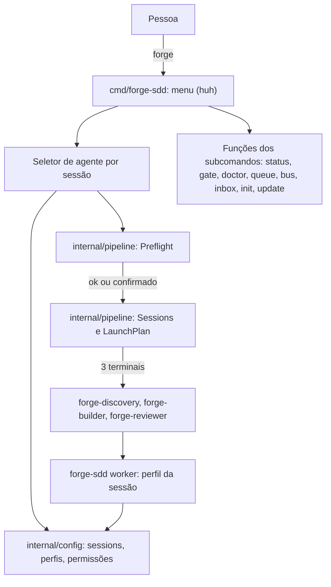

# Critérios Técnicos — Discovery 71 (Menu Navegável e Agente por Sessão)

## Modelo do módulo
- **Modelo:** `completo`.
- **Justificativa:** mexe em três fronteiras (`internal/config` com perfis e `sessions`, `internal/pipeline` com launcher e worker, e `cmd/forge-sdd` com o menu), executa processos externos de quatro CLIs diferentes e concentra o risco de segurança do pipeline (permissões do worker, argv sem shell). Contratos e testes por camada (`ARQ-11`, `COD-01`).

## O que já existe

| Procurei | Onde | Achei | Decisão | Justificativa |
|---|---|---|---|---|
| Menu e prompts interativos | `internal/survey` (`huh` v0.3.0, já em `go.mod`) | `Run`, `RunUpdate`, `RunConfirm`, `RunSmartUpgradePrompt` | reusar e estender | O menu e o seletor usam o `huh` já presente; nenhuma dependência nova (`SEG-07`). |
| `forge` sem argumentos | `cmd/forge-sdd/main.go` (`rootCmd.RunE`) | Chama `runUpdateFlow` ou `runInitFlow` conforme `config.DetectProject` | estender | O menu passa a ser a porta de entrada; `init`/`update` viram opções (a mesma função), e `forge init`/`forge update` explícitos não mudam. |
| Subcomandos como funções | `cmd/forge-sdd/*.go` (`status`, `gate`, `doctor`, `queue`, `bus`, `inbox`, `up`) | Lógica nos `RunE` e em `internal/` | extrair o mínimo | O menu chama as mesmas funções; onde a lógica está só no `RunE`, ela sobe para função nomeada (`DUP-01`), sem reexecutar o binário. |
| Perfil de CLI | `internal/config/forge.go` (`CLIProfile`, `DefaultForgeConfig`) | `claude` e `agy`, só modo não interativo, uma CLI para tudo (`ForgeConfig.CLI`) | estender | Perfis novos e `sessions`; `CLI` continua como padrão quando `sessions` falta (compatível com a 4.1). |
| Montagem de comando do worker | `internal/pipeline/runner.go` (`BuildArgv`) | Substitui `{agent}`, `{name}`, `{prompt}`, sem shell, prompt não vira opção | reusar | O perfil novo usa os mesmos marcadores e as mesmas recusas. |
| Launcher | `internal/pipeline/launcher.go` (`Sessions`, `LaunchPlan`) | Uma CLI para as três sessões; comando da Discovery fixo por CLI | estender | `Sessions` recebe o agente de cada sessão e usa o comando interativo do perfil. |
| Worker | `internal/pipeline/worker.go`, `cmd/forge-sdd/worker.go` | Usa `cfg.CLI` | estender | Passa a usar o perfil da sessão (`--name forge-builder` → `sessions.builder`). |
| Agentes por CLI no scaffold | `internal/scaffold/templates/agents/{claude,gemini,openai}`, `.github/` | `CLAUDE.md`, `GEMINI.md`, `OPENAI.md`, `copilot-instructions.md` | estender com cuidado | **Achado:** o Codex lê `AGENTS.md`, não `OPENAI.md`. A checagem prévia detecta isso e a task `71-03` decide entre gerar `AGENTS.md` ou configurar o fallback do Codex. |
| Diagnóstico | `forge-sdd doctor` | Check-up do projeto (Camada de saúde) | reusar o padrão | A checagem de agentes devolve itens `ok`, `aviso` e `bloqueio` no mesmo formato. |
| Configuração `forge.json` | `internal/config/forge.go` | Dono do arquivo, leitura estrita, validação, sem segredos | estender | `sessions` e `permissions` entram na validação estrita e na escrita atômica (`queue.WriteJSONAtomic`). |
| Detecção de TTY | `github.com/mattn/go-isatty` (indireta via `huh`) | Disponível | reusar | O menu só abre com TTY; sem ele imprime ajuda curta e sai. |

## Dependências novas
- **Nenhuma.** `huh` e `cobra` já estão em `go.mod`; `go-isatty` já vem por dependência indireta e passa a ser direta, sem mudar versão (`SEG-07`, `ARQ-04`).

## Decisões de arquitetura
- **D-1 Perfil com dois modos.** `CLIProfile` ganha `interactive_args` (sessão da Discovery, com `{prompt}`) ao lado de `args` (worker não interativo). Os marcadores continuam `{agent}`, `{name}`, `{prompt}`; argv explícito, nunca shell (`SEG-03`).
- **D-2 `sessions` por papel.** `forge.json` ganha `"sessions": {"discovery": "claude", "builder": "codex", "reviewer": "gemini"}`; cada valor precisa ter perfil em `cli_profiles`. Sem `sessions`, vale `cli` para as três (compatível com a 4.1). `CLIFor(papel)` é o único ponto de resolução.
- **D-3 Perfis pesquisados na documentação oficial** (tabela abaixo). O que a documentação não confirma fica `a confirmar` no ADR e editável em `forge.json`; o teste cobre a **montagem** do comando, não a execução.
- **D-4 Permissões em níveis.** `forge.json` ganha `"permissions": "project"` (padrão) ou `"full"`. `project` libera edição e os comandos do fluxo (build, lint, testes, git, `forge-sdd`) por allowlist onde a CLI permite, e o menu mostra o que foi liberado antes de abrir; `full` usa o bypass documentado de cada CLI e só é oferecido com aviso de ambiente isolado. A tradução nível para flags vive numa tabela única em `internal/config` (`DUP-01`).
- **D-5 Escolha lembrada.** O seletor grava `sessions` em `forge.json` por escrita atômica, preservando os demais campos e a ordem; uma escolha nova só é gravada depois da confirmação.
- **D-6 Menu é função, não processo.** Cada ação do menu chama a função que o subcomando já usa, e um teste confere que menu e subcomando produzem o mesmo efeito. O menu roda, executa e sai; não é painel ao vivo.
- **D-7 Sem TTY, sem menu.** Sem terminal interativo o `forge` imprime a ajuda curta e sai com código 0, e nenhuma pergunta é feita (CI e scripts nunca travam). `forge-sdd up` aceita `--discovery`, `--builder`, `--reviewer` e `--cli` sem menu.
- **D-8 Checagem antes de abrir.** `internal/pipeline` expõe `Preflight(dir, sessions)` com itens `ok`, `aviso` e `bloqueio`: CLI no PATH (`exec.LookPath`), arquivos de instrução do agente presentes (`CLAUDE.md`, `GEMINI.md`, `AGENTS.md` ou `.github/copilot-instructions.md`), `forge.json` válido. Bloqueio impede abrir; aviso pede confirmação.

### Perfis por CLI (resultado da pesquisa na documentação oficial)

| CLI | Worker (não interativo) | Discovery (interativo) | Agente nomeado | Nome da sessão | Instruções lidas |
|---|---|---|---|---|---|
| `claude` | `claude -p {prompt} --agent {agent} -n {name}` + permissão | `claude -n {name} --agent lider` | `--agent` | `-n` | `CLAUDE.md` |
| `gemini` | `gemini -p {prompt}` + `--approval-mode` | `gemini -i {prompt}` | não confirmado: o papel vai no prompt | sem flag (só título ANSI) | `GEMINI.md` |
| `copilot` | `copilot -p {prompt} --agent {agent} -n {name} --no-ask-user` + permissão | `copilot -i {prompt} -n {name}` | `--agent` (pastas não confirmadas) | `-n` | `.github/copilot-instructions.md`, `AGENTS.md`, `CLAUDE.md`, `GEMINI.md` |
| `codex` | `codex exec --sandbox workspace-write {prompt}` | `codex {prompt}` | sem flag equivalente: o papel vai no prompt | sem flag na criação | `AGENTS.md` |

Cuidado de montagem: `-p` é o prompt em `claude`, `gemini` e `copilot`, mas é **perfil** no Codex (headless é `codex exec`); por isso cada perfil é escrito por inteiro e testado, e a validação recusa um prompt que comece com `-`. Níveis de permissão por CLI (`project` e `full`): `claude` (`--permission-mode acceptEdits` e allowlist de ferramentas; `--dangerously-skip-permissions`), `gemini` (`--approval-mode auto_edit`; `yolo`, com `--sandbox`), `copilot` (`--allow-tool` granular; `--allow-all-tools`), `codex` (`--sandbox workspace-write`; `--dangerously-bypass-approvals-and-sandbox`). Flags de permissão para comandos de shell no modo `project` de `gemini` e `codex` não foram confirmadas: ficam `a confirmar`.

## Contratos

`forge.json` (acréscimos; 4.1 sem `sessions` continua válido):
```json
{
  "cli": "claude",
  "sessions": { "discovery": "claude", "builder": "codex", "reviewer": "gemini" },
  "permissions": "project",
  "cli_profiles": {
    "codex": { "command": "codex", "args": ["exec", "--sandbox", "workspace-write", "{prompt}"], "interactive_args": ["{prompt}"] }
  }
}
```

Menu (`forge` com TTY):
```text
Forge SDD 4.2
> Pipeline multi-sessão
    Iniciar as 3 sessões        (escolher o agente de cada uma)
    Ver os comandos de abertura (dry-run)
    Ativar ou reconfigurar      (pipeline init, sessions, permissions)
    Fila e inbox
    Recuperar jobs presos
    Diagnóstico                 (CLI instalada, arquivos do agente)
    Abrir o guia
> Estrutura padrão (sessão única)
    Status das iniciativas · Painel da fila · Gate · Doctor
    Instalar ou atualizar a estrutura · Ver todos os comandos
> Sair          (Esc volta um nível)
```

## Diagramas C4


## Critérios de aceitação executáveis
Todos exigem `go build ./... && go vet ./... && go test -race ./...` com saída 0 (`TST-05`):

1. **Perfis por agente:** `go test ./internal/config -run TestForgeProfiles` valida os quatro perfis, `sessions`, a compatibilidade de uma `forge.json` da 4.1 e a recusa de comando ou marcador inválido.
2. **Agente por sessão no launcher:** `go test ./internal/pipeline -run TestSessions_AgentePorSessao`: `discovery=claude`, `builder=codex`, `reviewer=gemini` geram os três comandos certos, por SO (macOS, Linux, Windows), sem shell e com o título ANSI.
3. **Worker usa o perfil da sua sessão:** `go test ./internal/pipeline -run TestWorker_PerfilDaSessao` (runner falso confere o argv do `builder` e do `reviewer`).
4. **Checagem prévia:** `go test ./internal/pipeline -run TestPreflight` cobre CLI ausente (bloqueio), arquivo de instrução ausente (aviso), `forge.json` inválido (bloqueio) e tudo certo.
5. **Menu e seletor:** `go test ./cmd/forge-sdd -run TestMenu` com entrada simulada: escolher Pipeline, um agente por sessão, confirmar, e conferir os três comandos e a gravação de `sessions`; Esc volta; sem TTY imprime a ajuda e sai com 0.
6. **Menu igual ao subcomando:** testes de equivalência para as ações que chamam `status`, `gate`, `doctor`, `bus list` e `inbox`.
7. **Lembrar a escolha:** `sessions` é gravado só após confirmar, preserva os outros campos de `forge.json` e a próxima abertura já vem com a escolha marcada.
8. **Sem regressão:** `forge init`, `forge update` e `forge-sdd up --cli claude` (4.1) continuam iguais; goldens do scaffold atualizados (`TST-02`); `forge-sdd gate` com `P-24` ✓.

## ADRs e Constitution (`GOV-01`, `FLX-05`)
| ADR | Registra |
|---|---|
| `adr-0005-menu-e-agente-por-sessao` | D-1 a D-8, tabela de perfis por CLI com o que está confirmado e a confirmar, níveis de permissão e o menu como função |

ADRs aplicáveis: `adr-0004-pipeline-multi-sessao` (pipeline, worker, `forge.json`) e `adr-0003-skills-por-estacao-e-orcamento` (orçamento de contexto). Nenhum ID da Constitution muda. `ARQ-06` já lista `up`, `worker` e `pipeline`; o menu não é subcomando novo.
