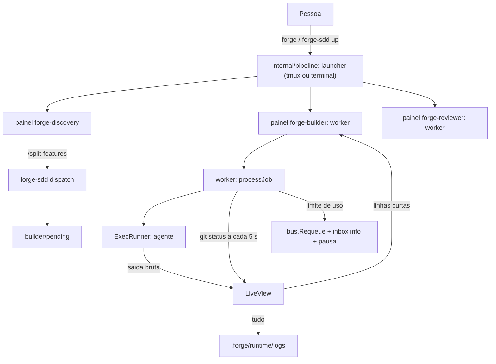

# Critérios Técnicos — Discovery 72 (Visibilidade, tmux e Entrega ao Builder)

## Modelo do módulo
- **Modelo:** `completo`.
- **Justificativa:** processos externos (tmux e quatro CLIs de agente), interpretação de saída não confiável de agentes, pausa e retomada com relógio, e mudança de segurança (máscara de segredos, quoting de comandos de shell do tmux, guarda de modo). Contratos e testes por camada (`ARQ-11`, `COD-01`).

## O que já existe

| Procurei | Onde | Achei | Decisão | Justificativa |
|---|---|---|---|---|
| Laço do worker e log do job | `internal/pipeline/worker.go` (`processJob`, `MultiWriter` do log) | A saída do agente vai inteira para o terminal e para `.forge/runtime/logs/`; com agy não há saída | estender | A saída bruta continua no log; o terminal passa por um `LiveView`. |
| Execução do agente | `internal/pipeline/runner.go` (`ExecRunner`, `RunSpec`) | `cmd.Stdout = out`, argv sem shell, `FORGE_WORKER` no ambiente | reusar | O `out` entregue ao runner passa a ser o `LiveView`; nada muda no argv. |
| Padrões de segredo | `internal/gate/gate.go` (`secretPatterns`, P-13) | Regexes de tokens e chaves | reusar | A máscara do `LiveView` usa os mesmos padrões (`DUP-01`), exportados do gate. |
| Falha do job | `internal/bus/store.go` (`Fail`, `Recover`) | Mover para `failed` ou devolver por lease vencido | estender | Nova `Requeue`: `processing` → `pending`, sem mexer em `attempt`, com evento. |
| Aviso à pessoa | `internal/notify` (`TypeInfo`, inbox) | Notificação `info` já existe | reusar | A pausa por limite de uso grava um `info` no inbox. |
| Abertura de terminais | `internal/pipeline/launcher.go` (`SessionsFor`, `LaunchPlanFor`, `quoteArg`) | Terminal por SO; linha de comando de cada sessão já montada | estender | `tmux` vira mais um destino do mesmo plano; o comando de cada painel é o mesmo `Inner`. |
| Comando `up` | `cmd/forge-sdd/up.go` | `--cli`, `--discovery`, `--builder`, `--reviewer`, `--dry-run` | estender | `--terminal tmux\|native\|auto`. |
| Configuração | `internal/config/forge.go`, `forge_profiles.go` | Dono de `forge.json`, perfis e permissões | estender | `terminal` e as flags de saída estruturada nos perfis. |
| Gate de despacho | `internal/pipeline/dispatch.go` (`loadEvidence`) | Exige o arquivo de evidência sempre; só o id/url dependem de `require_existing_card` | corrigir | Com `require_existing_card: false` pula a evidência e cria o job sem card. |
| Comandos de fila | `cmd/forge-sdd/queue.go` (`next`, `complete`) | Funcionam em qualquer sessão | estender | Guarda de modo pipeline (`FORGE_WORKER` ou `--local`). |
| Skills do split e do implementar | `.agents/skills/sdd-planejamento/references/split-features.md`, `sdd-build/references/implementar.md` | Split termina em `queue enqueue`; `implementar` já diz que não constrói em modo pipeline | estender | Passo de `dispatch` no split e a regra "a Discovery não executa". |
| Hook global ruidoso | `~/.claude/settings.json` (Dockia, porta 47600) | Configuração global do usuário, fora do Forge | não mexer | `SEG-02`: o Forge não edita configuração global; o `LiveView` colapsa a linha de erro. |
| Teste de comando de longa duração | `internal/pipeline/worker_test.go` (`fakeRunner`) | Runner falso | reusar | Eventos e saídas gravadas de cada CLI viram fixtures. |

## Dependências novas
- **Nenhuma.** Stdlib Go (`os/exec`, `bufio`, `encoding/json`, `regexp`, `time`). O `tmux` é programa externo opcional detectado por `LookPath` (`SEG-07`, `ARQ-04`).

## Decisões de arquitetura
- **D-1 `LiveView` como `io.Writer`.** O worker entrega ao runner um escritor que (a) grava tudo, bruto, no log; (b) interpreta linhas JSON de eventos por CLI e imprime resumos; (c) mascara segredos; (d) colapsa ruído conhecido. Sem terminal ou com `--raw`, a saída é a bruta de hoje.
- **D-2 Acompanhamento por git, independente da CLI.** A cada 5 s (consulta com teto de 3 s) o worker compara `git status --porcelain` no diretório do job e imprime só o que mudou; sem mudança e sem evento por 30 s, um batimento com o tempo decorrido. É o que dá visibilidade ao agy e ao Copilot.
- **D-3 Eventos estruturados nos perfis.** `claude ... --output-format stream-json --verbose`, `gemini ... -o stream-json`, `codex exec --json ...` entram nos perfis padrão (a confirmar); evento desconhecido é ignorado, nunca impresso como JSON.
- **D-4 `bus.Requeue`.** Devolve o job de `processing` a `pending` pelo dono do lease, sem alterar `attempt`, registrando o motivo no evento; o nome do arquivo (prioridade e data) não muda, então a ordem da fila é preservada.
- **D-5 Pausa por limite de uso.** Só com saída diferente de zero, só nas últimas linhas da saída e por padrões por CLI; horário extraído da mensagem (com fuso quando houver); teto de 6 h; horário não entendido vira 30 min. Durante a pausa o worker mostra o tempo restante e responde a `Ctrl+C`; ao fim, volta ao laço normal.
- **D-6 tmux por argv.** `tmux new-session -d -s <nome> -n forge -c <dir> <comando>`, `split-window -h`, `split-window -v`, `select-pane -T <título>` e `attach-session` (ou `switch-client` quando `TMUX` está definido). O nome da sessão é `forge-<projeto>` saneado (`[A-Za-z0-9_-]`, até 40 caracteres); o comando de cada painel é o `Inner` já quotado pelo `quoteArg`. Sessão existente: só conecta.
- **D-7 Entrega no split e guarda.** O passo de `dispatch` vive na skill (o modelo executa); a garantia vive no Go: `queue next` e `queue complete` recusam fora de um worker em modo pipeline. `dispatch` ignora a evidência quando o card está desligado.

## Contratos

Saída do worker (`LiveView`):
```text
▶ job d15b-core-platform · tentativa 1 · agy · permissões project
  ✎ backend/src/domain/unit.entity.ts
  $ npm test
  ✓ comando terminou (0)
  … trabalhando há 2m10s · 14 arquivos alterados
⏸ limite de uso do claude: retomo às 22:40 (faltam 1h12m)
■ concluído em 4m12s · 14 arquivos
✗ falhou em 1m03s: <última linha útil, até 200 caracteres>
```

`bus.Requeue(dir, role, id, worker, reason, now)`: exige dono do lease; `processing` → `pending`; `attempt` intacto; evento `adiado` com o motivo.

tmux (`forge-sdd up --dry-run` imprime exatamente isto):
```text
tmux new-session -d -s forge-meuapp -n forge -c <dir> '<comando discovery>'
tmux split-window -h -t forge-meuapp:forge -c <dir> '<comando builder>'
tmux split-window -v -t forge-meuapp:forge.1 -c <dir> '<comando reviewer>'
tmux select-pane -t forge-meuapp:forge.0 -T forge-discovery   (e .1, .2)
tmux attach-session -t forge-meuapp          # switch-client dentro do tmux
```

## Diagramas C4


## Critérios de aceitação executáveis
Todos exigem `go build ./... && go vet ./... && go test -race ./...` com saída 0 (`TST-05`):

1. **Dispatch sem card:** `go test ./internal/pipeline -run TestDispatch_SemCardObrigatorio`: com `require_existing_card: false`, nenhum arquivo de evidência é exigido e o job nasce sem card; com `true` o comportamento atual se mantém.
2. **Guarda de modo:** `go test ./cmd/forge-sdd -run TestQueue_GuardaModoPipeline`: `queue next` e `queue complete` recusam sem `FORGE_WORKER` quando há `forge.json`; `--local` libera; sem `forge.json` nada muda.
3. **Visão limpa:** `go test ./internal/pipeline -run TestLiveView`: eventos gravados de claude, gemini e codex viram as linhas do contrato; JSON desconhecido não aparece; segredo mascarado; ruído de hook colapsado; `--raw` devolve a saída bruta; o log recebe sempre a saída completa.
4. **Acompanhamento por git:** `go test ./internal/pipeline -run TestGitWatch`: arquivo novo e arquivo alterado viram linhas; sem mudança, batimento a cada 30 s (relógio injetado); repositório sem git não quebra.
5. **Falha legível:** `go test ./internal/pipeline -run TestWorker_MotivoLegivel`: a razão da falha inclui a última linha útil, saneada e truncada.
6. **Pausa por limite de uso:** `go test ./internal/pipeline ./internal/bus -run "TestWorker_LimiteDeUso|TestRequeue"`: mensagens reais do Claude e de genéricas devolvem o job (`attempt` igual), gravam `info` no inbox e pausam até o horário (relógio injetado); sem match o job falha como hoje; teto de 6 h; exige dono do lease.
7. **tmux:** `go test ./internal/pipeline -run TestTmux`: plano de comandos exato (painéis, títulos, attach ou switch-client), nome de sessão saneado, sessão existente só conecta, injeção em nome de projeto recusada; `--terminal native` e a ausência de tmux mantêm o terminal do sistema.
8. **Sem regressão:** testes da 71 passam sem edição; `forge-sdd gate` com `P-24` ✓; goldens atualizados (`TST-02`).

## ADRs e Constitution (`GOV-01`, `FLX-05`)
| ADR | Registra |
|---|---|
| `adr-0006-visibilidade-tmux-e-entrega-ao-builder` | D-1 a D-7, a guarda de modo, a pausa por limite de uso e o que está a confirmar (formatos de evento por CLI) |

ADRs aplicáveis: `adr-0004-pipeline-multi-sessao` (worker, bus, notificações) e `adr-0005-menu-e-agente-por-sessao` (perfis, launcher). Nenhum ID da Constitution muda. `ARQ-06` não ganha subcomando (`up` e `queue` ganham flags).
