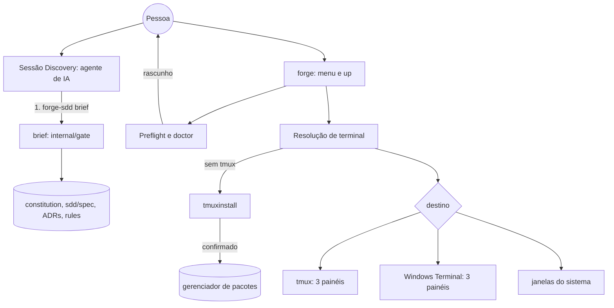

# Critérios Técnicos — Discovery 75 (Contexto do Projeto e Contingência do tmux)

## Modelo do módulo
- **Modelo:** `completo`.
- **Justificativa:** mistura leitura determinística de artefatos (`brief`) com processo externo e escrita no sistema da pessoa (instalação de pacote), mais um segundo destino de terminal no Windows. Contratos, injeção de ambiente e testes por camada (`ARQ-11`, `COD-01`, `SEG-01`).

## O que já existe

| Procurei | Onde | Achei | Decisão | Justificativa |
|---|---|---|---|---|
| Leitura dos IDs da Constitution | `internal/gate/context.go` (`ConstitutionIDLines`, `BuildContext`) | Regex de linhas `- **ID:** texto`; contexto por task | reusar | O `brief` usa as mesmas linhas de ID (`DUP-01`); `BuildContext` continua para tasks. |
| Frontmatter das rules | `internal/gate/context.go` (`parseRuleFrontmatterRegras`) | Lê `regras:` de `.agents/rules/*.md` | reusar | O `brief` lista cada rule com `description` e IDs cobertos. |
| ADRs | `sdd/spec/adr/`, template `adr-0000-modelo.md.tmpl` (campo `Status`) | Nenhum código lê ADRs; só o texto das skills manda ler | criar (pequeno) | `brief` extrai título, status e a linha de decisão; ignora `substituido`. |
| Módulos, fluxos, decisões | `sdd/spec/{modules,flows,decisions,stack,overview}.md.tmpl` | Existem no scaffold, vazios; nada manda ler | reusar | `brief` resume (tabelas e títulos) e aponta o arquivo. |
| Comando de contexto | `cmd/forge-sdd/context.go` | `context <task>` para o Builder | estender | `brief` é um comando irmão (`DUP-05`, skill `novo-subcomando-cli-sdd`); `context` não muda. |
| Prompt da sessão Discovery | `internal/pipeline/launcher.go` (`DiscoveryPrompt`) | Pede ADRs e rules "antes de quebrar tarefas" | estender | Passa a mandar rodar `forge-sdd brief` no início e citar as decisões na spec. |
| Skill da Concepção | `.agents/skills/sdd-concepcao/SKILL.md` e `references/*.md` | "Leitura mínima: só os IDs que a tarefa cita" | estender | Concepção e split abrem com o `brief`; spec ganha seção `Decisões do projeto aplicadas`. |
| Instruções por agente | `internal/scaffold/templates/agents/{claude,gemini,openai}/` | "Leia só os IDs da tarefa" | estender | READ-MIN da Discovery: `brief` primeiro. |
| Comando `/constitution` | `.agents/commands/constitution.md`, `.agents/skills/sdd-concepcao/references/constitution.md` | Pergunta idioma, nível e ferramentas; escaneia; preenche `constitution.md` e `stack.md` | estender | Passa a povoar módulos, fluxos, decisões e segurança e a terminar com `brief --check`. |
| Dica pós-instalação | `cmd/forge-sdd/main.go` (`printPipelineHint`, `printCheatSheet`) | Fala do pipeline, não da Constitution | estender | `/constitution` sai como primeiro passo, antes do pipeline. |
| Diagnóstico | `cmd/forge-sdd/doctor.go` | Checagens de estrutura | estender | Item `Constituição: rascunho ou pronta`. |
| Checagem antes de abrir | `internal/pipeline/preflight.go` (`Preflight`, `Item`, `LevelWarn`) | CLIs e arquivos de instrução | estender | Itens `Constituição em rascunho` e `tmux ausente`, ambos avisos. |
| Resolução de terminal | `internal/pipeline/tmux.go` (`ResolveTerminal`, `LaunchTmux`, `DefaultTmuxRunner`) | `auto` sem tmux vira nativo em silêncio; `tmux` explícito dá erro | estender | Aviso com motivo; queda do tmux para o nativo em `auto`; oferta de instalação. |
| Terminais por SO | `internal/pipeline/launcher.go` (`terminalArgv`, `LaunchPlanFor`) | Windows: um `wt.exe new-tab` por sessão ou `cmd /c start` | estender | Com `wt.exe`, uma janela com 3 painéis (`split-pane`). |
| Confirmação e menu | `internal/survey/select.go` (`ConfirmYesNo`), `cmd/forge-sdd/menu.go` | Pergunta sim/não; menu navegável | reusar | A pergunta de instalar o tmux usa o mesmo componente. |
| `forge.json` | `internal/config/forge.go` (`Terminal`, `ValidTerminal`, `SaveForgeConfig`) | `terminal: auto\|tmux\|native` | reusar | Recusar a instalação grava `terminal: native`; sem campo novo. |
| Execução de comandos externos | `internal/pipeline/runner.go`, `tmux.go` (`TmuxRunner`) | Runner por argv, injetável nos testes | reusar | Instalador usa o mesmo padrão: argv sem shell, runner falso nos testes. |

## Dependências novas
- **Nenhuma.** Stdlib Go (`os/exec`, `runtime`, `os`, `strings`, `regexp`). Gerenciadores de pacotes e `wt.exe` são programas externos opcionais detectados por `LookPath` (`SEG-07`, `ARQ-04`).

## Decisões de arquitetura
- **D-1 `brief` como visão curta e determinística.** `internal/gate/brief.go` monta `Brief` a partir de `constitution.md`, `sdd/spec/*.md`, `sdd/spec/adr/*.md` e `.agents/rules/*.md`; só leitura. Seções em ordem de prioridade: Estado do contexto, Missão e Stack, Regras do projeto, IDs canônicos (ID + 1ª frase), ADRs vigentes, Módulos, Fluxos, Decisões, Segurança, Rules. Orçamento padrão de 6 KB (`--max-bytes`); o corte é por seção, nunca no meio de uma linha, e termina com `… N itens omitidos; leia <arquivo>`.
- **D-2 Estado do contexto por heurística, sem campo novo.** `rascunho` quando a Constitution mantém a missão-modelo (`[Uma frase`), não tem nenhuma decisão resolvida ou `modules.md` e `flows.md` seguem com o texto-modelo; `pronta` caso contrário. `brief --check` sai com código 0 (`pronta`) ou 3 (`rascunho`) e lista o que falta. Não bloqueia nada sozinho.
- **D-3 Protocolo de abertura da Discovery.** Primeira ação de toda sessão de Concepção: `forge-sdd brief`; se `rascunho`, propor `/constitution` antes de qualquer spec. A spec ganha a seção obrigatória `## Decisões do projeto aplicadas` (ADR/ID/módulo/fluxo e como a spec os respeita); conflito sem ADR não passa pelo Gate 1 (`GOV-01`).
- **D-4 `/constitution` completo e primeiro.** Além de idioma, nível e ferramentas: escanear, preencher `constitution.md`, `stack.md`, `overview.md` (C4), `modules.md`, `flows.md`, `decisions.md`, uma ADR por decisão estrutural e a seção de segurança (segredos, entradas, dependências); fechar com `forge-sdd brief --check`.
- **D-5 Avisos, não bloqueios.** `Preflight` e `doctor` listam `Constituição em rascunho` com a ação `/constitution`; o `init` e o menu mostram `/constitution` como passo 1.
- **D-6 Instalador do tmux por tabela.** `internal/pipeline/tmuxinstall.go`: `InstallPlan(env) (argv, desc, ok)` escolhe pelo SO e pelos programas no PATH, na ordem: `brew install tmux`, `apt-get install -y tmux`, `dnf install -y tmux`, `pacman -S --noconfirm tmux`, `apk add tmux`, `zypper --non-interactive install tmux`, com `sudo` quando não é root e o gerenciador pede. Windows nativo e sistemas sem gerenciador conhecido: `ok=false` (sem tmux possível). `Install` roda o argv herdando stdin/stdout/stderr (a senha do `sudo` é pedida no terminal da pessoa); não usa shell.
- **D-7 Fluxo de decisão do terminal.** `auto` sem tmux em terminal interativo: mostra o comando, pergunta; se instala e `tmux -V` responde, segue com tmux; se recusa, pergunta se lembra a escolha (`terminal: native`); se não há instalador ou a instalação falha, segue pela contingência com uma linha explicando. Sem terminal interativo: imprime o comando e segue pela contingência. `--terminal tmux` explícito: nunca instala sozinho; erro com o comando.
- **D-8 Queda do tmux.** Em `auto`, `LaunchTmux` falhando (versão antiga, `new-session` recusado) fecha o que criou, avisa o motivo e abre pela contingência; `tmux` explícito mantém o erro.
- **D-9 Windows Terminal com painéis.** Com `wt.exe` no PATH em Windows nativo, uma única chamada: `wt.exe -w new new-tab --title forge-discovery cmd.exe /k <inner> ; split-pane -V --title forge-builder cmd.exe /k <inner> ; split-pane -H --title forge-reviewer cmd.exe /k <inner>`. Sem `wt.exe`, `cmd /c start` por sessão, como hoje. Dentro do WSL vale o caminho Linux (tmux).

## Contratos

`forge-sdd brief` (trecho):
```text
# Contexto do projeto — meuapp   (pronta · 4,8 KB)
Missão: API de agendamento para barbearias.
Stack: Go 1.22, Postgres, chi
Regras: 0 Idioma pt-BR · 1 Sem commit na main · 4 Segredos só em .env …
IDs: ARQ-01 Fronteira cmd/internal · SEG-04 Sem segredo no repo · TST-01 Todo código com teste …
ADRs vigentes: ADR-0002 Layout por iniciativa (aprovado) · ADR-0003 Skills por estação (aprovado)
Módulos: agendamento (domínio) · notificacao (adaptador) · pagamento (adaptador)
Fluxos: criar agendamento → confirmar pagamento → notificar
Segurança: entrada validada na borda; sem segredo em log; dependência nova só com SEG-07
Rules: .agents/rules/sdd-seguranca.md (SEG-01,02,04,05,07) …
… 3 itens omitidos; leia sdd/spec/modules.md
```

`forge-sdd brief --check` em projeto novo:
```text
Contexto: rascunho. Faltam: missão (constitution.md), módulos (sdd/spec/modules.md), fluxos (sdd/spec/flows.md)
Rode /constitution na sua sessão do agente.            (código de saída 3)
```

Pergunta de instalação:
```text
tmux não encontrado. Com ele as 3 sessões abrem lado a lado numa tela só.
Comando para instalar (macOS): brew install tmux
Instalar agora? [S/n]
```

## Critérios de Aceitação Executáveis
- **CA-01** `go test ./internal/gate -run Brief` passa: projeto completo gera todas as seções na ordem, dentro do orçamento, com truncamento por seção e linha `… N itens omitidos`; ADR `substituido` não aparece como vigente.
- **CA-02** `go test ./internal/gate -run BriefEstado` passa: scaffold recém-gerado é `rascunho` e lista o que falta; após preencher missão, decisões, módulos e fluxos é `pronta`.
- **CA-03** `go test ./cmd/forge-sdd -run Brief` passa: `brief` imprime o resumo; `brief --check` sai com 3 em rascunho e 0 em pronta; nunca escreve em disco (árvore idêntica antes e depois).
- **CA-04** `go test ./internal/pipeline ./internal/scaffold` passa: `DiscoveryPrompt`, a skill `sdd-concepcao` (e a cópia em `.agents/skills`), os `references` de discovery, nova-feature, novo-fix e split-features, e os `CLAUDE.md`/`GEMINI.md`/`AGENTS.md` do scaffold mandam rodar `forge-sdd brief` primeiro e exigem a seção `Decisões do projeto aplicadas`; goldens atualizados.
- **CA-05** `go test ./internal/scaffold ./cmd/forge-sdd -run Constitution` passa: o comando `/constitution` (nos três agentes) cita módulos, fluxos, decisões, ADRs, segurança e `brief --check`; `init` e o menu imprimem `/constitution` como passo 1.
- **CA-06** `go test ./internal/pipeline -run Preflight` e `./cmd/forge-sdd -run Doctor` passam: Constituição em rascunho vira aviso (não bloqueio) com a ação `/constitution`; tmux ausente vira aviso com o comando do sistema.
- **CA-07** `go test ./internal/pipeline -run TmuxInstall` passa: tabela de instaladores por SO e PATH (macOS, Debian, Fedora, Arch, Alpine, openSUSE, root e não root), Windows nativo sem opção, argv sem shell, runner falso confirma a ordem e que nada roda sem confirmação.
- **CA-08** `go test ./internal/pipeline ./cmd/forge-sdd -run TerminalDecisao` passa: em `auto` sem tmux, com terminal interativo e resposta sim, instala e usa tmux; resposta não grava `terminal: native` só se a pessoa pedir para lembrar; sem terminal só imprime o comando; `--terminal tmux` não instala e erra com o comando.
- **CA-09** `go test ./internal/pipeline -run TmuxFallback` passa: falha do `new-session` em `auto` desfaz o que criou, avisa e abre pela contingência; em `tmux` explícito retorna erro.
- **CA-10** `go test ./internal/pipeline -run LauncherWindows` passa: com `wt.exe` o argv é uma chamada com `new-tab` e dois `split-pane` e títulos das 3 sessões; sem `wt.exe`, `cmd /c start` por sessão; `Inner` com caractere inseguro continua recusado.
- **CA-11** `go build ./... && go vet ./... && go test -race ./...` e `forge-sdd gate` sem falhas; `FORGE_TMUX_REAL=1 go test ./internal/pipeline -run TmuxReal` continua verde onde há tmux.

## Diagramas C4

Contêineres:


Sequência (primeira sessão em projeto novo, Linux sem tmux):
```mermaid
sequenceDiagram
  actor U as Pessoa
  participant F as forge up
  participant I as tmuxinstall
  participant D as Discovery
  U->>F: forge (iniciar pipeline)
  F->>U: tmux ausente; comando e pergunta
  U->>F: sim
  F->>I: apt-get install -y tmux (herda o terminal)
  I-->>F: tmux -V ok
  F->>D: abre 3 painéis, Discovery com DiscoveryPrompt
  D->>D: forge-sdd brief --check → rascunho
  D->>U: proponho /constitution antes de qualquer spec
```
