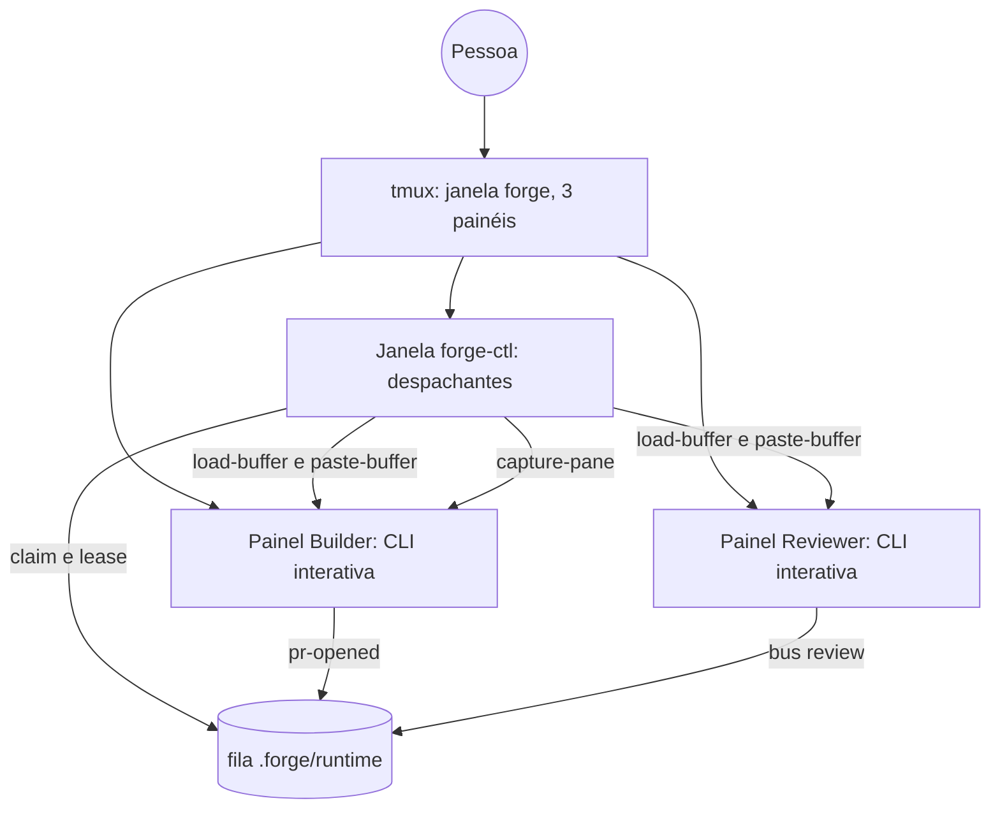
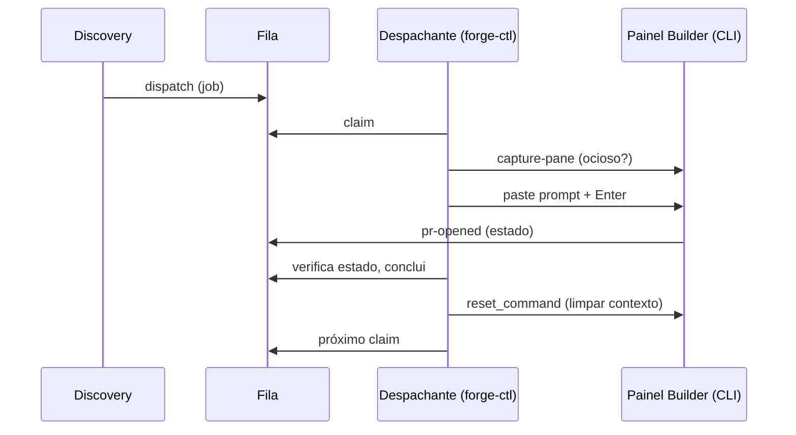

# Critérios Técnicos — Discovery 77 (Sessões com a CLI Aberta)

## Modelo do módulo
- **Modelo:** `completo`.
- **Justificativa:** processo externo (tmux e quatro CLIs interativas), leitura de tela não confiável, entrega de texto a outro processo, relógio, timeouts e estado compartilhado em disco (fila e leases). Contratos, injeção de runner e testes por camada (`ARQ-11`, `COD-01`, `SEG-01`).

## O que já existe

| Procurei | Onde | Achei | Decisão | Justificativa |
|---|---|---|---|---|
| Laço de claim, lease e renovação | `internal/pipeline/worker.go` (`RunWorker`, `bus.Claim`, `bus.Recover`, `RenewEvery`) | Pega job, renova lease, roda o agente headless | reusar | O despachante usa o mesmo claim, a mesma renovação e o mesmo `Recover`; só troca "rodar o agente" por "entregar ao painel". |
| Conclusão por estado | `worker.go` (`verifyHandoff`) | Builder: PR registrado, revisão enfileirada, job concluído; Reviewer: veredito aplicado | reusar | É exatamente o critério de término do modo `live`; extraído para função compartilhada. |
| Prompt do job | `worker.go` (`workerPrompt`) | Texto do job para o agente | reusar | O mesmo texto é colado no painel. |
| Limite de uso e indisponível | `usagelimit.go` (`DetectUsageLimit`), `agentstate.go` (fix-76) | Classificadores sobre linhas de saída | reusar | Recebem as últimas linhas do `capture-pane` em vez da saída do processo. |
| Pausa e retomada | `worker.go` (`deferJob`, `pauseUntil`), `bus.Requeue` | Devolve o job sem gastar tentativa e espera | reusar | Mesmo caminho no modo `live`. |
| Argumentos interativos por CLI | `internal/config/forge_profiles.go` (`InteractiveArgs`, `MarkerPermissions`), `launcher.go` (`interactiveLine`) | Só a Discovery usa (agente `lider`) | estender | Builder e Reviewer passam a usar `interactive_args` com o agente `builder` e `reviewer` e as permissões do perfil. |
| Plano de painéis do tmux | `internal/pipeline/tmux.go` (`BuildTmuxPlan`, `LaunchTmux`, `TmuxRunner`) | 3 painéis com `Inner` por sessão | estender | No modo `live`, os painéis 1 e 2 rodam a CLI interativa e uma janela oculta `forge-ctl` roda os despachantes. |
| Resolução de terminal | `tmux.go` (`ResolveTerminal`) e discovery 75 | `auto`, `tmux`, `native` | reusar | `live` só vale quando o terminal resolvido é tmux; senão volta a `headless` com aviso. |
| Configuração | `internal/config/forge.go` | `terminal`, `cli_profiles`, `builder.job_timeout_minutes` | estender | Campos `session_mode`, `context` e `reset_command` no perfil. |
| Menu e `up` | `cmd/forge-sdd/menu.go`, `up.go` | Escolha de agente, permissões e terminal | estender | Escolha de modo e de contexto. |
| Aviso à pessoa | `internal/notify` | `info` e `escalation` | reusar | Falhas do despachante avisam o inbox. |
| Teste com tmux real | `internal/pipeline/tmux_real_test.go` (`FORGE_TMUX_REAL`) | Servidor isolado `-L` | reusar | E2E com agente falso que lê stdin e escreve estado. |

## Dependências novas
- **Nenhuma.** Stdlib Go e o tmux já exigido pela 72. Entrega por `tmux load-buffer` + `paste-buffer`; leitura por `capture-pane` (`SEG-07`, `ARQ-04`).

## Decisões de arquitetura
- **D-1 Dois processos por sessão em `live`.** O painel mostra a CLI do agente (interativa, com permissões do perfil); o despachante roda na janela oculta `forge-ctl` do mesmo tmux (um por papel). Sem o painel o despachante não entrega; sem o despachante o painel é só uma CLI aberta.
- **D-2 Entrega por colagem.** Para cada job: `tmux load-buffer -b <nome> -` com o prompt no stdin, `paste-buffer -p -d -b <nome> -t <painel>` (colagem entre colchetes, preserva quebras e aspas) e `send-keys -t <painel> Enter`. Nenhum texto do job passa por shell ou `send-keys` literal.
- **D-3 Painel ocioso.** `capture-pane -p -t <painel>` a cada 1 s; ocioso = conteúdo idêntico por `ready_quiet_seconds` (padrão 3) e, na primeira entrega, depois de `startup_wait_seconds` (padrão 8). Ocupado depois da colagem = conteúdo mudou; sem mudança por 30 s após a colagem, nova tentativa de `Enter` uma vez e então falha o job por "o agente não aceitou o prompt".
- **D-4 Término por estado.** Laço de 2 s sobre o job no bus com as mesmas verificações de `verifyHandoff` (função compartilhada, sem cópia); término também por `JobTimeoutMinutes`. Terminou: limpa o contexto, solta o painel, volta ao claim.
- **D-5 Limpeza de contexto.** `context: clear` (padrão) envia o `reset_command` do perfil (`/clear` em claude, gemini e copilot; `/new` em codex; agy a confirmar) por colagem, e espera o painel ficar ocioso. `reset_command` vazio força `continuous` com aviso uma vez.
- **D-6 Falhas lidas da tela.** `DetectUsageLimit` e `DetectAgentUnavailable` rodam sobre as últimas 20 linhas do `capture-pane` quando o job não termina e a tela tem a mensagem; limite → `Requeue` e espera (o painel fica como está); indisponível → `Requeue`, aviso no inbox e o despachante para; painel fechado (`has-session`/`list-panes` sem o painel) → `Requeue`, aviso e para.
- **D-7 Contingência.** `session_mode: live` sem tmux (ou `terminal: native`) vira `headless` com uma linha; o worker headless não muda.
- **D-8 Config antiga.** Sem `session_mode` no `forge.json`, o valor é `headless`; o menu oferece `live` quando há tmux e grava a escolha.

## Contratos

`forge.json` (novos campos):
```json
{ "session_mode": "live", "context": "clear",
  "live": { "startup_wait_seconds": 8, "ready_quiet_seconds": 3 },
  "cli_profiles": { "claude": { "reset_command": "/clear" } } }
```

Janelas do tmux em `live` (`forge-sdd up --dry-run` imprime):
```text
janela forge:      painel 0 Discovery (CLI) | painel 1 Builder (CLI, interativa) / painel 2 Reviewer (CLI, interativa)
janela forge-ctl:  forge-sdd worker --role builder  --deliver =sessao:forge.1
                   forge-sdd worker --role reviewer --deliver =sessao:forge.2
```

Saída do despachante (janela `forge-ctl`):
```text
[forge-builder] aguardando painel pronto (3 s parado) …
▶ job d15b-core-platform · entregue ao painel forge.1 · claude
⏸ limite de uso do claude: retomo às 22:40
■ PR #41 registrado · contexto limpo · painel livre
✗ gemini indisponível: IneligibleTierError … → troque o agente desta sessão
```

## Critérios de Aceitação Executáveis
- **CA-01** `go test ./internal/config -run SessionMode` passa: `session_mode` e `context` com validação e padrão `headless` para `forge.json` antigo; `reset_command` por perfil.
- **CA-02** `go test ./internal/pipeline -run TmuxLivePlan` passa: o plano `live` tem a janela `forge-ctl` com os dois despachantes e os painéis 1 e 2 com a CLI interativa (argv sem shell, permissões do perfil); o plano `headless` fica idêntico ao de hoje.
- **CA-03** `go test ./internal/pipeline -run Deliver` passa (runner de tmux falso): colagem por `load-buffer` + `paste-buffer -p` + `Enter`, prompt com aspas e quebras de linha intacto; nunca entrega em painel ocupado; reenvio único do `Enter`; falha de "não aceitou" vai a `Requeue`.
- **CA-04** `go test ./internal/pipeline -run DeliverEstado` passa: término do Builder e do Reviewer por estado com as verificações de `verifyHandoff` (função compartilhada e testada nos dois modos); timeout do job; lease renovada durante a espera.
- **CA-05** `go test ./internal/pipeline -run DeliverTela` passa: limite de uso na tela vira `Requeue` e pausa; agente indisponível vira `Requeue`, aviso no inbox e parada; painel inexistente vira `Requeue` e parada.
- **CA-06** `go test ./internal/pipeline -run DeliverContexto` passa: `clear` envia o `reset_command` antes de cada job e espera ocioso; `continuous` não envia; `reset_command` vazio avisa uma vez.
- **CA-07** `go test ./internal/pipeline ./cmd/forge-sdd -run LiveFallback` passa: `live` com `terminal: native` ou sem tmux cai para `headless` com a linha de aviso; `up --dry-run` mostra o modo.
- **CA-08** `FORGE_TMUX_REAL=1 go test ./internal/pipeline -run TmuxLiveReal` passa: com agente falso (script que lê o prompt do stdin e atualiza o job) a entrega, o término por estado e a limpeza de contexto funcionam num tmux real de servidor isolado.
- **CA-09** `go build ./... && go vet ./... && go test -race ./...` e `forge-sdd gate` sem falhas; os testes do worker headless seguem verdes sem alteração de comportamento.

## Diagramas C4

Contêineres:


Sequência (um job do Builder):

