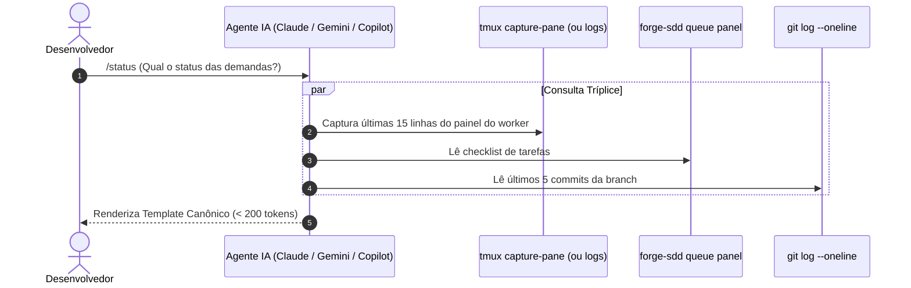

# Critérios Técnicos — Discovery 80 (Status Executivo Tríplice de Baixo Token)

## Modelo do módulo
- **Modelo:** `completo`.
- **Justificativa:** Modifica comandos da CLI Go (`cmd/forge-sdd/status.go`), lógica de inspeção de tmux/logs em `internal/pipeline`, e todo o ecossistema de templates de prompts distribuídos para agentes (`ARQ-01`, `ARQ-11`, `COD-01`).

## Decisões do projeto aplicadas

| Decisão | Origem | Impacto nesta iniciativa |
|---|---|---|
| ADR-0003 | Skills por Estação e Orçamento de Contexto | Reforça a economia de tokens: leituras mínimas e respostas sintetizadas sem desperdício de janela. |
| ADR-0006 | Visibilidade tmux | Reuso do `TmuxSessionName` e endereçamento exato de painéis para leitura em tempo real. |
| D8 | Idioma padrão: pt-BR | Saída e template de status canônico em português padrão. |

## O que já existe (Reuse Check — `DUP-02`)

| Procurei | Onde | Achei | Decisão | Justificativa |
|---|---|---|---|---|
| Leitura de painel tmux | `internal/pipeline/tmux.go` | `TmuxRunner` | reusar | Extrair as últimas linhas do painel 1 (Builder) ou 2 (Reviewer). |
| Painel da fila | `cmd/forge-sdd/queue.go` | `queue panel` | reusar | Formatação de checklist executivo de tasks. |
| Histórico git recente | stdlib `os/exec` | `git log --oneline` | reusar | Listagem rápida dos últimos 5 commits. |
| Subcomando de status | `cmd/forge-sdd/status.go` | `statusCmd` | estender | Adicionar flag `--live` para rodar a tríplice em um único comando CLI. |
| Prompts de agentes | `.gemini/`, `.claude/`, `.github/` | `status.prompt.md` | unificar | Aplicar o mesmo template padronizado canônico em todos os agentes. |

## Dependências novas
- **Nenhuma.** stdlib Go, `git` e `tmux` já instalados (`ARQ-04`, `SEG-07`).

## Rules e IDs da Constituição Aplicáveis
- **ARQ-01 / ARQ-04:** Sem dependências desnecessárias; lógica central desacoplada dos prompts.
- **COD-01 / COD-05:** Idioma padrão e clareza de comunicação.
- **DUP-01 / DUP-02:** Um conceito, uma casa; template canônico único reproduzido em todos os adaptadores de IA.
- **FLX-01 / GOV-01:** Concepção da feature seguindo o fluxo de governança.

---

## Template Canônico Padronizado (Menos de 200 Tokens)

Abaixo, o formato rígido que todos os agentes (Claude, Gemini, Copilot, Codex) deverão obrigatoriamente seguir ao responder ao comando `/status` ou consultas de progresso:

```text
### Status da Esteira — <projeto> (<branch-atual>)

1. Ao Vivo no Painel (<papel-ativo>):
   • <linha 1 do que o agente está fazendo>
   • <linha 2: tempo ativo e arquivos alterados>

2. Commits Recentes no Git:
   • <hash1> <mensagem do commit recente>
   • <hash2> <mensagem do commit anterior>

3. Fila de Tarefas:
   • [x] <task-id>: <titulo da task pronta>
   • [ ] <task-id>: <titulo da task pendente>

Próximo passo: <Acompanhar o Builder / Revisão do Reviewer / /discovery>
```

---

## Critérios de Aceitação Executáveis

- **CA-01 (Flag CLI `status --live`):** `go test -v ./cmd/forge-sdd -run TestStatusLiveFlag` passa: `forge-sdd status --live` executa o status capturando painel tmux (ou fallback de log), fila e git log, retornando saída consolidada em menos de 100ms.
- **CA-02 (Paridade entre Prompts de Agentes):** Todos os arquivos de prompt (`.gemini/prompts/status.prompt.md`, `.claude/commands/status.md`, `.github/prompts/status.prompt.md` e seus templates em `internal/scaffold/templates/`) instruem exatamente a mesma ordem de verificação e o mesmo template canônico de saída.
- **CA-03 (Orçamento de Tokens):** A execução do template de status canônico gera no máximo 250 tokens de saída por chamada.
- **CA-04 (Fallback Suave sem Tmux):** Em ambiente sem tmux ou modo headless, `status --live` lê as últimas linhas de `.forge/runtime/logs/` sem gerar erro de comando.
- **CA-05 (Integridade de Suíte):** `go build ./... && go vet ./... && go test -race ./...` e `forge-sdd gate` passam com 0 falhas.

---

## Diagramas C4


