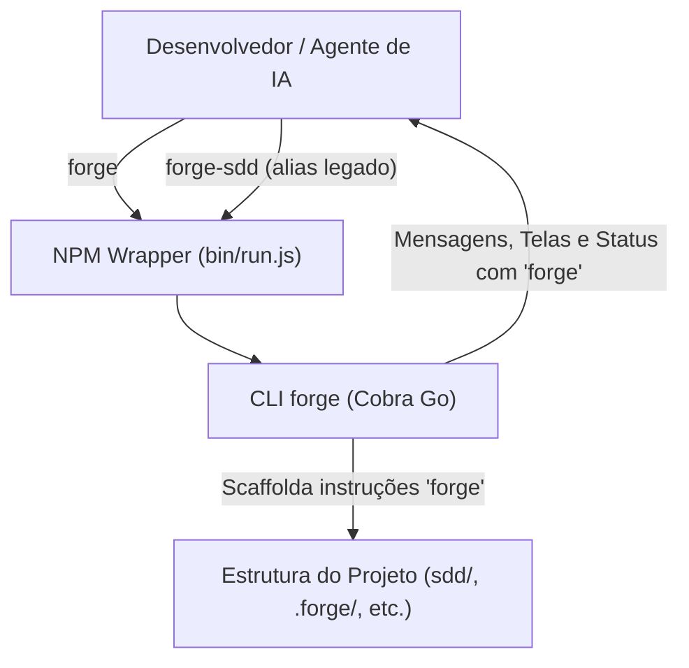
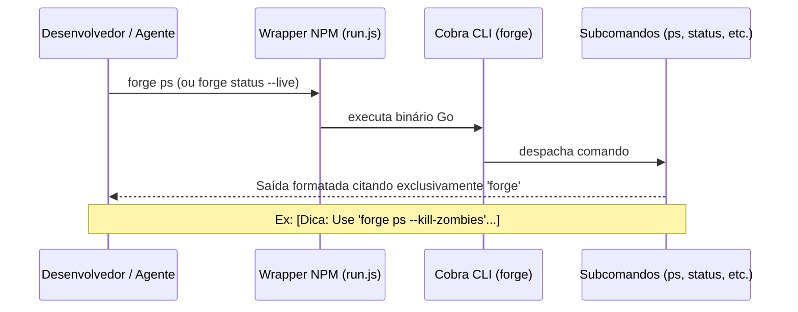

# Critérios de Aceitação — Discovery 82: Unificação e Padronização do Comando `forge`

## Modelo do módulo
- **Classificação:** Módulo completo (CLI e Scaffold).
- **Justificativa (`ARQ-11`):** A mudança impacta a camada de apresentação do CLI (`cmd/forge-sdd`), os templates de scaffold (`internal/scaffold/templates/`), os golden tests e as instruções operacionais de todas as estações.

## Decisões do projeto aplicadas
- **ADR-0005 (Menu Navegável e Agente por Sessão):** `forge` sem argumentos é a porta de entrada única do desenvolvedor.
- **ADR-0006 (Visibilidade, tmux e Entrega ao Builder):** Comandos de visualização e controle (`ps`, `status --live`, `dispatch`, `bus`) devem ser ergonômicos e canônicos via `forge`.
- **D1 / D2 (Go + Cobra):** Configuração nativa de raiz no Cobra via `rootCmd.Use = "forge"`.
- **D7 (Subcomandos de runtime):** Coerência nos subcomandos expostos pelo CLI.

## O que já existe
| Procurei | Onde | Achei | Decisão | Justificativa |
|---|---|---|---|---|
| Comando raiz Cobra | `cmd/forge-sdd/main.go` | `var rootCmd = &cobra.Command{ Use: "forge-sdd", ... }` | Modificar | `Use: "forge"` faz com que todas as mensagens de usage e help nativas do Cobra usem `forge` (`ARQ-01`). |
| Mensagens de Dicas e Help | `cmd/forge-sdd/`, `internal/monitor/ps.go`, `internal/pipeline/` | Strings hardcoded `"forge-sdd "` | Modificar | Padronizar todas as mensagens visuais para citar `"forge "` (`COD-01`, `DUP-01`). |
| Wrapper NPM | `npm/package.json` | `"bin": { "forge-sdd": "bin/run.js", "forge": "bin/run.js" }` | Reutilizar | Mantém `forge-sdd` como alias funcional transparente sem quebrar quem já o tem instalado (`DUP-01`). |
| Templates de Scaffold | `internal/scaffold/templates/` | Diversos arquivos com `forge-sdd` | Modificar | Garantir que o código gerado em novos projetos já venha 100% padronizado com `forge` (`DUP-10`). |
| Prompts e Rules | `GEMINI.md`, `CLAUDE.md`, `.agents/rules/` | Comandos `forge-sdd <cmd>` | Modificar | Eliminar a discrepância de comandos ensinados aos agentes (`COD-05`). |

## Dependências novas
- **Nenhuma (`SEG-07`):** Nenhuma dependência externa ou biblioteca adicional é adicionada. Apenas ajustes de nomenclatura, templates e mensagens de exibição.

## Rules e IDs da Constituição Aplicáveis
- **ARQ-01:** `cmd/` só adapta a CLI; regras e domínio permanecem em `internal/`.
- **ARQ-06:** A CLI expõe comandos coesos e bem estruturados.
- **COD-01:** Responsabilidade única por pacote, arquivo e função.
- **COD-05:** Idioma pt-BR mantido em toda a documentação, mensagens e commits.
- **DUP-01:** Um conceito, uma casa: o comando oficial é `forge`.
- **DUP-10:** Reúso e atualização precisa dos golden files de scaffold.
- **FLX-01 / FLX-05:** Separação entre Concepção e Construção; trabalho em branch isolada `feat/82-unificacao-comando-forge`.
- **GOV-01:** Alinhamento estrito com a Constitution e ausência de regressões no portão de governança.
- **TST-01 / TST-02:** Testes unitários e de scaffold cobrindo as saídas padronizadas.

## Diagramas C4

### Diagrama de Contexto (Nível 1)


### Diagrama de Sequência (Execução e Feedback Visual)


## Critérios de Aceitação Executáveis

### CA-01: Cobra Root Command e Help
- **Critério:** Executar `forge --help` e verificar que o usage informa `Usage: forge [command]`.
- **Comando de validação:**
  ```bash
  go test -v ./cmd/forge-sdd -run TestRootCommandUse
  ```

### CA-02: Varredura de Mensagens no CLI (`cmd/` e `internal/`)
- **Critério:** `forge ps` imprime `[Dica: Use 'forge ps --kill-zombies' para limpar processos orfãos ou presos]`.
- **Comando de validação:**
  ```bash
  go test -v ./internal/monitor -run TestFormatProcessTable
  ```

### CA-03: Templates de Scaffold e Golden Files
- **Critério:** Os templates scaffoldados (`LEIA-ME.md.tmpl`, `forge-up.sh`, etc.) e os golden tests em `internal/scaffold/testdata/golden/` utilizam `forge` e os testes de scaffold passam sem regressões.
- **Comando de validação:**
  ```bash
  go test -v ./internal/scaffold/...
  ```

### CA-04: Prompts, Regras e Documentação
- **Critério:** [GEMINI.md](file:///Users/nathanramorim/git/forge-sdd/GEMINI.md), [CLAUDE.md](file:///Users/nathanramorim/git/forge-sdd/CLAUDE.md), `.agents/rules/` e `docs/comandos.md` utilizam unicamente `forge <cmd>`.
- **Comando de validação:**
  ```bash
  ! grep -rE "forge-sdd (brief|status|gate|ps|up|dispatch|doctor|init)" GEMINI.md CLAUDE.md docs/comandos.md .agents/rules/
  ```

### CA-05: Integridade do Portão
- **Critério:** Suíte completa verde (`go test ./...`, `go vet ./...`).
- **Comando de validação:**
  ```bash
  go vet ./... && go test ./...
  ```
