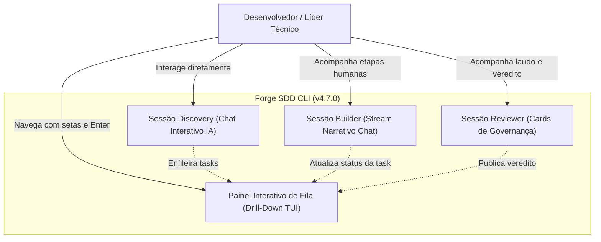
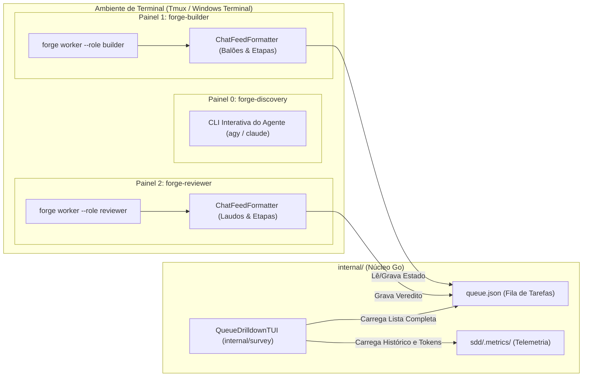
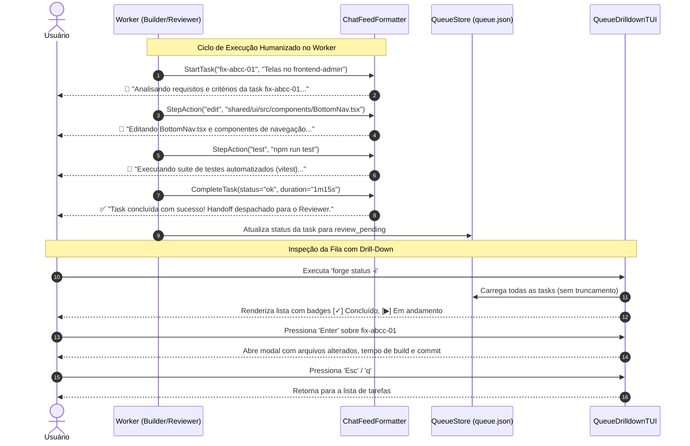

# Critérios de Aceitação e Arquitetura — Iniciativa 84

## Modelo do Módulo (ARQ-11)
- **Modelo:** `enxuto`.
- **Justificativa:** Extensão de apresentação visual e componentes de terminal em pacotes existentes (`internal/monitor`, `internal/survey` e `cmd/forge-sdd`), sem necessidade de novos daemons em background, persistência de banco de dados ou novos subsistemas de rede (`ARQ-11`).

## Decisões do Projeto Aplicadas
- `ADR-0004`: Pipeline Multi-Sessão (Discovery, Builder, Reviewer). A apresentação dos workers respeita a separação física de papéis e estados do pipeline.
- `ADR-0005`: Menu Navegável e Agente por Sessão. Acesso ao painel interativo pelo menu principal do CLI.
- `ADR-0006`: Visibilidade e tmux. Preservação do layout de 3 painéis divididos no tmux (macOS/Linux/WSL) e no Windows Terminal (Windows nativo).
- `ADR-0008`: Sessões interativas e despachante raw. O stream narrativo dos workers consome os marcos de execução sem interferir no buffer raw de entrega de comandos.
- `ARQ-01`, `ARQ-04`, `ARQ-06`, `ARQ-10`: Separação estrita: adaptadores CLI em `cmd/forge-sdd`, lógica de negócio e renderização em `internal/`, sem vazamento de domínio e sem dependências externas adicionais de runtime.
- `DUP-01`: Um conceito, uma casa: o formatador do feed conversacional reside em `internal/monitor/chat_feed.go` e a TUI de drill-down reside em `internal/survey/queue_drilldown.go`.
- `SEG-03`: Manipulação e renderização puramente in-memory, sem injeção de comandos de shell.

## O Que Já Existe (DUP-02)

| Procurei | Onde | Achei | Decisão | Justificativa |
|---|---|---|---|---|
| Painel ao vivo de status | `internal/monitor/status_live.go` | `RenderLiveStatusLoop`, captura de processos e tokens | estender | Adicionar modo interativo com drill-down e suporte ao feed conversacional unificado. |
| Componentes interativos de terminal | `internal/survey/survey.go` | Wrappers de Charm `huh` para seleção e confirmação | estender | Implementar o componente `QueueDrilldownTUI` aproveitando a stack `huh` já integrada ao projeto. |
| Monitoramento de progresso do worker | `cmd/forge-sdd/worker.go` | Loop do worker com heartbeat a cada 5 segundos | estender | Substituir o log periódico monótono por emissão de cards de etapas conversacionais com status humano. |
| Consulta e estado da fila | `internal/queue/queue.go` | `ListTasks`, `LoadQueue` e inspeção de status | reusar | A TUI de drill-down consome diretamente as estruturas existentes de `queue.json` sem alterar formato. |
| Comandos de status e queue na CLI | `cmd/forge-sdd/status.go`, `cmd/forge-sdd/queue.go` | Comandos cobra para exibição estática e live | estender | Adicionar flag `-i/--interactive` para disparar a visualização navegável com drill-down. |

## Dependências Novas (SEG-07)
- **Nenhuma dependência externa nova.**
- Todo o desenvolvimento reutiliza a stdlib do Go (`fmt`, `strings`, `time`, `os`, `sync`) e o framework de formulários interativos `github.com/charmbracelet/huh` v0.3 já presente no `go.mod` (`ARQ-04`).

## Diagramas C4

### Nível 1: Diagrama de Contexto


### Nível 2: Diagrama de Contêineres


### Diagrama de Sequência: Stream Narrativo do Worker e Drill-Down


## Critérios de Aceitação Executáveis

```bash
go test -v -race ./internal/monitor/... ./internal/survey/... ./cmd/forge-sdd/...
```

1. **TestChatFeed_RenderStepCards:**
   - O `ChatFeedFormatter` recebe eventos de início, ação em arquivo, execução de teste e conclusão.
   - A saída gerada contém formatação estruturada com badges, quebras de linha adequadas, horário relativo e texto humanizado (ex: `💭 Analisando...`, `🔨 Editando...`, `🧪 Testando...`, `✅ Concluído...`), sem dumps brutos.
2. **TestChatFeed_ErrorHighlighting:**
   - Em caso de falha de teste ou compilação, o `ChatFeedFormatter` destaca o erro em bloco `❌ Falha na etapa [teste]`, incluindo os últimos 5 logs relevantes de erro sem poluir o buffer.
3. **TestQueueDrilldown_ListAllTasksWithoutTruncation:**
   - Em uma fila com 25 tarefas (como a evidenciada no projeto `barbearia-app`), o componente `QueueDrilldownTUI` carrega e exibe todas as 25 tarefas navegáveis, sem omitir tarefas por reticências.
4. **TestQueueDrilldown_CardDetailInspection:**
   - Ao selecionar uma tarefa concluída ou com falha, o método `InspectTaskDetails(taskID)` retorna a estrutura completa de inspeção (tempo total decorrido, lista de arquivos alterados, commit gerado e parecer do reviewer).
5. **TestCLI_StatusInteractiveFlag:**
   - `forge status --interactive` (ou `-i`) inicializa a visualização navegável interativa em vez do loop de texto puro do modo padrão.
6. **Compilação e Higiene:**
   - `go build ./... && go vet ./...`: 100% verde sem erros, sem warnings e com zero dependências externas novas.
