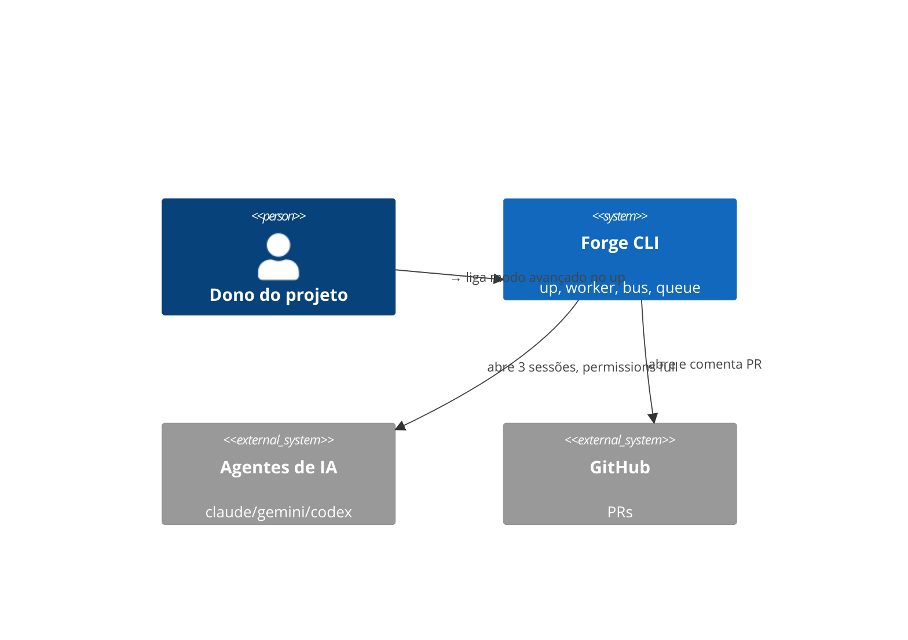
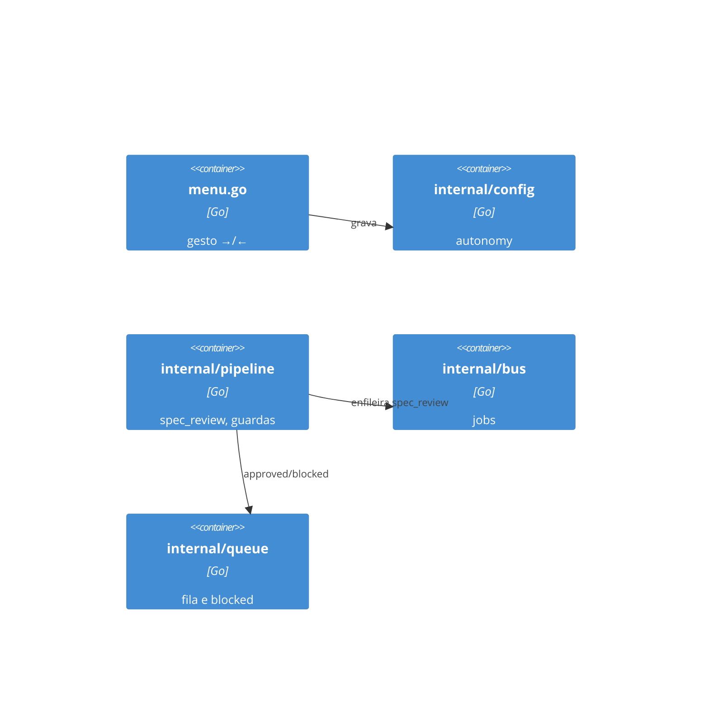
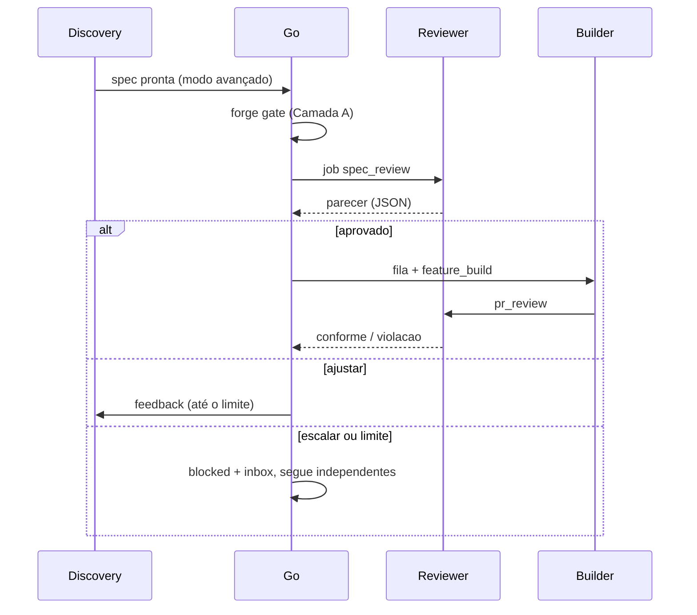

# Critérios — Iniciativa 88

## Restrições (Constitution)
`FLX-01` (revisor da spec muda → ADR), `FLX-05`/`GOV-01` (ADR-0013), `FLX-06` (portão em 3 camadas), `SEG-06` (Reviewer somente leitura), `SEG-01` (validar entradas), `SEG-03`, `ARQ-01`, `ARQ-06` (sem comando novo de nível raiz além de subcomando de `pipeline`), `DUP-01`, `DUP-02`, `COD-01`, `COD-03`, `TST-01`.

## Modelo do módulo
**Enxuto** (ARQ-11): estende `internal/config` (campo), `internal/pipeline` (job e parecer) e `cmd/forge-sdd/menu.go`; sem pacote novo. Justificativa: um conceito (autonomia) com três pontos de contato já existentes.

## Decisões do projeto aplicadas
ADR-0004 (pipeline multi-sessão), ADR-0005 (menu e `permissions`), ADR-0008 (sessões live no tmux), ADR-0009 (reset de contexto, proposto: usado só como salvaguarda), ADR-0012 (Go aplica o veredito e grava cópia). ADR-0013 nova.

## O que já existe
| Procurei | Onde | Achei | Decisão | Justificativa |
|---|---|---|---|---|
| Pular confirmação humana | `cmd/forge-sdd/autopilot.go` (`sdd/.sdd-auto-pilot`) | Flag de arquivo que libera agentes a pular confirmação entre fases, com graduação por ciclos | **Reusar o conceito**: `autonomy: advanced` é o modo do pipeline; o autopilot continua o do fluxo single-session | DUP-01: um conceito, uma casa; avançado não depende de graduação porque exige ambiente isolado |
| Permissão sem aprovação | `config.PermissionArgs` | `full` = bypass por CLI | Reusar; avançado força `full` | Evita tabela nova |
| Tipos de job e roteamento | `bus.RoleForType` | `feature_build`, `pr_rework`, `pr_review` | Estender com `spec_review` → reviewer | Barramento já resolve papel |
| Aplicar veredito | `pipeline.ApplyVerdict`, `queue.Verdict`, `persistVerdict` | Go aplica e grava cópia | Reusar `queue.Verdict`; novo `ApplySpecVerdict` irmão | Reviewer segue somente leitura |
| Limite de tentativas | `reviewer.max_rework_attempts` | Já existe | Reusar também para a spec | Sem chave nova |
| Salvaguarda de contexto | ADR-0009 / `usagelimit.go` | Detecção de limite de uso | Reusar para pausa; tetos novos só de job/dia | Evita duplicar |
| Chave de card | `menu.go` (`configMenu`, caso `card`), `config.PMConfig.RequireExistingCard` | Confirm solto dentro de "reconfigurar pipeline"; default `true` em `DefaultForgeConfig` | **Mover** para o menu Settings e mudar o default para `false`; pergunta no `pipeline init` | DUP-01: uma casa para chaves liga/desliga |
| Seleção no menu | `survey.SelectOne` | Select do `huh` | Estender com tecla →/← | A validar em 88-02 |

## Dependências novas
Nenhuma (stdlib e `huh` já presentes).

## Diagramas (C4)

## Critérios de aceitação executáveis
- **CA-01** `forge.json` aceita `autonomy` = `normal` (padrão) ou `advanced`; outro valor é erro; arquivo antigo sem a chave segue válido. `go test ./internal/config -run TestAutonomy`
- **CA-02** `advanced` exige `permissions: full` e a confirmação de ambiente isolado; sem ela nada é gravado. `go test ./cmd/forge-sdd -run TestMenu_Autonomy`
- **CA-03** No `up` do menu, → liga e ← desliga; o menu não exibe rótulo do modo antes de ligado; a linha de confirmação exibe `avançado`. `go test ./cmd/forge-sdd -run TestMenu_UpGesto`
- **CA-04** `spec_review` roteia para o reviewer e só é criado em modo avançado após `forge gate` sem bloqueio. `go test ./internal/bus ./internal/pipeline -run TestSpecReview`
- **CA-05** Parecer `aprovado` libera a fila e grava `review-spec.md` (Go, não o agente); `ajustar` devolve feedback à Discovery; ao atingir `max_rework_attempts` ou `escalar`, vira `blocked` + inbox. `go test ./internal/pipeline -run TestApplySpecVerdict`
- **CA-06** Task `blocked` não impede o despacho de tasks independentes. `go test ./internal/queue -run TestBlockedNaoBloqueiaIndependentes`
- **CA-07** Salvaguardas: o teto de tokens/tempo por job e o teto diário interrompem o despacho com motivo no inbox; `.forge/runtime/STOP` para a esteira de forma limpa. `go test ./internal/pipeline -run TestSalvaguardas`
- **CA-08** Modo normal: nenhum teste existente muda de resultado. `go test ./...`
- **CA-10** `DefaultForgeConfig().PMMCP.RequireExistingCard` é `false`; `forge pipeline init` interativo pergunta e grava a resposta; não interativo grava `false`; `forge.json` já existente mantém o valor. `go test ./internal/config ./cmd/forge-sdd -run 'TestDefaultCard|TestPipelineInit_PerguntaCard'`
- **CA-11** O menu principal tem "Settings", que lista as chaves como `ativado`/`desativado` e alterna e grava com `SaveForgeConfig`; o item de card sai de `configMenu`. `go test ./cmd/forge-sdd -run TestMenu_Settings`
- **CA-09** `go vet ./...` e `go build ./...` limpos; ADR-0013 existe em `sdd/spec/adr/` e `forge doctor` avisa quando `advanced` está ativo sem ambiente isolado confirmado.
