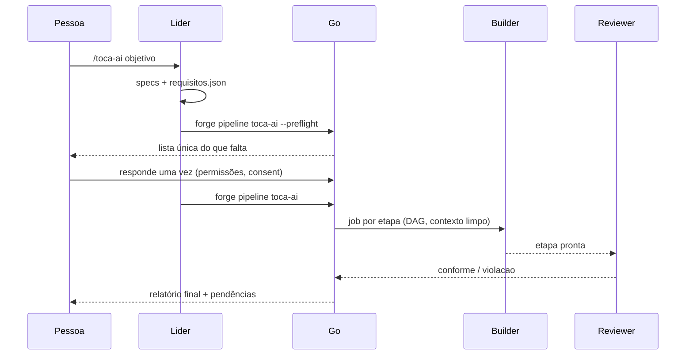

# Critérios — Iniciativa 89

## Restrições (Constitution)
`FLX-01`, `FLX-06`, `ARQ-01`, `ARQ-06` (subcomando de `pipeline`), `DUP-01`, `SEG-01`, `SEG-03`, `SEG-04`, `SEG-05`, `SEG-06`, `COD-01`, `COD-03`, `TST-01`.

## Modelo do módulo
**Enxuto** (ARQ-11): `internal/pipeline/goal.go` reaproveita `bus`, `queue`, `Dispatch` e o archive; instruções de agente na skill `sdd-operacao`.

## Decisões do projeto aplicadas
ADR-0003, ADR-0004, ADR-0009, ADR-0012, ADR-0013.

## O que já existe
| Procurei | Onde | Achei | Decisão | Justificativa |
|---|---|---|---|---|
| Enfileirar jobs | `pipeline.Dispatch` | Um job por iniciativa | estender (`EnqueueGoalSteps`) | Gate próprio para etapas |
| Ordem das etapas | `forge bus plan`, `queue.EligibleTasks` | DAG por `**Depende de:**` | reusar | Sem ordenação nova |
| Revisão da spec | `spec_review` (88-04) | Existe | reusar | Portão sem humano |
| Contexto, archive, parada | `deliverContextReset`, `CheckAndAutoArchive`, `StopFile` | Existem | reusar | O Go faz |
| Padrão de comando | `inbox` (skill, adaptadores, golden, cheatsheet) | Existe | reusar | DUP-01 |

## Dependências novas
Nenhuma.

## Diagrama (sequência)

## Critérios de aceitação
- **CA-01** Plano com 3 etapas vira 3 jobs na ordem do DAG, sem duplicar ao repetir. `go test ./internal/pipeline -run TestGoal`
- **CA-02** Pré-voo lista todas as pendências de uma vez e não enfileira nada. `go test ./internal/pipeline -run 'TestPreflightGoal|TestConsent|TestPendencias'`
- **CA-03** `forge update` instala `/toca-ai` nos três agentes e o golden bate. `go test ./internal/scaffold`
- **CA-04** `go vet ./... && go test ./...` e `forge gate` limpos.
