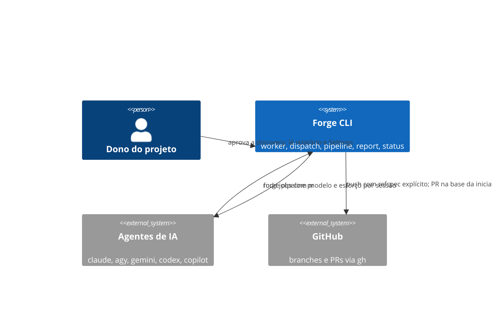
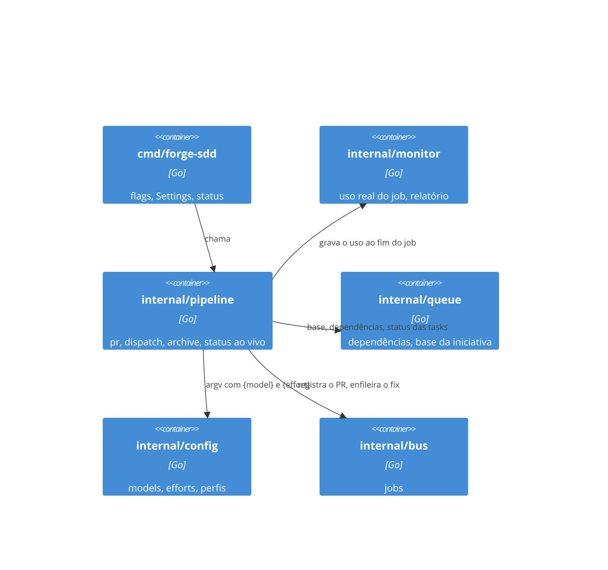

# Critérios — Iniciativa 90

## Restrições (Constitution)
`FLX-05`/`GOV-01` (ADR-0014), `FLX-02` (nunca push em `main`; branch por iniciativa), `FLX-03` (corpo do PR pelo template), `FLX-04` (telemetria em `sdd/.metrics/`), `FLX-07` (Regra 11: PR de beta não vai para `main`), `SEG-01` (validar modelo, esforço, refs e IDs), `SEG-03` (`git` e `gh` com argv explícito), `SEG-05` (telemetria sem dado sensível), `SEG-06` (Reviewer segue somente leitura), `ARQ-01` (tirar estimativa e relatório de `cmd/`), `ARQ-06` (só subcomando novo sob `pipeline` e flags), `DUP-01`/`DUP-04`/`DUP-06` (um leitor de dependência, um resolvedor de branch e base, uma versão), `COD-01`, `COD-03`, `COD-04`, `TST-01` a `TST-05`.

## Modelo do módulo
**Enxuto** (`ARQ-11`): estende donos existentes, sem pacote novo — `internal/monitor` (uso real e relatório), `internal/pipeline` (PR, despacho, archive, status ao vivo), `internal/queue` (leitor de dependências e base da iniciativa), `internal/config` (modelo e esforço) e `cmd/forge-sdd` (flags e menu). Cada mudança corrige ou estende quem já é dono do conceito (`DUP-01`).

## Decisões do projeto aplicadas
- **ADR-0002:** estado de execução fora do git; `internal/layout` é o dono dos caminhos.
- **ADR-0003:** orçamento das skills (`P-24`): a skill troca passos por um comando, sem crescer.
- **ADR-0004:** o Go decide o fluxo e o Builder nunca mescla; o comando novo só abre ou atualiza o PR.
- **ADR-0005:** marcadores de perfil e `CLIFor`; `{model}` e `{effort}` seguem o padrão de `{permissions}` (zero ou mais argumentos).
- **ADR-0009 (proposto):** D-1 (estimativa por bytes) vira só o caminho `estimado`; D-4 (archive ao aprovar) continua automático só em iniciativa do `/toca-ai` (89) e, nas demais, passa a avisar.
- **ADR-0012 (proposto):** o Go grava o parecer, que vai junto no move do archive.
- **ADR-0013 (proposto):** PR pelo Go, fix no `dispatch` e status curto valem nos dois modos.
- **88 RN-9:** o Settings é a casa das chaves; modelo e esforço entram lá.
- **Nova ADR-0014:** medição real, PR pelo Go, base da iniciativa, archive no fechamento, modelo e esforço por sessão.

## O que já existe
| Procurei | Onde | Achei | Decisão | Justificativa |
|---|---|---|---|---|
| Tokens por job | `estimateJobTokens` (`cmd/forge-sdd/worker.go`), `monitor.EstimateTokensFromBytes` | Estimativa por bytes da spec e do log | **Substituir** pela leitura do `result`, em `internal/monitor`; estimativa só sem `result` | Número inventado não valida nada (`ARQ-01`, `COD-04`) |
| Registro de telemetria | `monitor.SessionMetrics`, `RecordSessionMetrics` | `turns`, `duration_seconds` e `model` quase sempre vazios | **Estender** com `tokens_cache_read`, `tokens_cache_creation`, `cost_usd_tabela` e `medicao` | Campos opcionais, esquema compatível |
| Versão | `config.go` (`4.5.0-beta`), `acp/dispatcher.go` | Versão fixa em dois lugares | **Reusar** a versão do binário | `DUP-04` |
| Relatório | `cmd/forge-sdd/report.go` | Por feature, sem cache | **Estender** com `--jobs` e `--initiative`; a soma vai para `internal/monitor` | `ARQ-01` |
| Tokens no painel | `monitor.TokenMetricsPerRole` | Estimativas por papel | **Reusar** com o dado real quando houver | Painel e relatório com o mesmo número |
| Log ao vivo legível | `monitor.ChatFeedFormatter` (feat-84-01) | Usado no worker, não no `status` | **Reusar** em `captureLiveLines` (`status_live.go`) | Tira o JSON cru das duas saídas |
| Status curto | `forge status --compact` (iniciativa 80), `isatty` em `status.go` | Existe, ninguém usa e sai com 6,2 KB | **Estender:** sem terminal, curto por padrão; `--full` para tudo | Não depende de o agente lembrar a flag (RN-2) |
| Branch e base do job | `dispatch.go:220`, `goal.go:387` | Duas cópias de `"feat/"+iniciativa` com `cfg.BaseBranch` | **Extrair** um resolvedor único; `queue.json` ganha `base_branch` | `DUP-01`, `DUP-04` |
| Registro do PR | `forge pipeline pr-opened`, `bus.UpdatePR`, `queue.SetTaskStatuses` | O Builder registra depois do `gh` | **Reusar** dentro do comando novo | Mesmo efeito na fila (ADR-0012 D-2) |
| PR aberto pelo Go | `internal/` | Nenhuma chamada a `gh`; `pipeline/deliver.go` é a entrega ao painel tmux | **Criar** `forge pipeline pr` (`pipeline/pr.go`) | Nome distinto da entrega ao tmux; `SEG-03`; runner injetável (`TST-04`) |
| Despacho de fix | `dispatch.listTasks` | Só `features/feat-*.md` | **Estender** para `fixes/fix-*.md` | Mesmo portão pré-build |
| Leitor de dependências | `queue.parseDependsOnContent`, `pipeline.readDependsOn` (`taskRefRe`) | Dois leitores; o da fila quebra, o das ondas ignora `fix-` e `88-01` | **Unificar** em `queue`; `waves` passa a chamá-lo | `DUP-01`; `pipeline` já importa `queue` |
| Checagem da spec | `dispatch.missingSections` (`requiredSecs`) | Confere as seções da spec | **Estender** por task: dependência existente e critério com comando | O erro sai antes do build, sem tokens |
| Archive | `pipeline.AutoArchiveInitiative` (usado por `forge archive` e por `CheckAndAutoArchive` em `review.go`) | Copia, repete e grava telemetria zerada; o `/toca-ai` conta com ele | **Corrigir** na mesma função; a fila ganha `origem: toca-ai`, gravada pelo motor | Uma implementação; mantém a promessa da 89 |
| Modelo por sessão | discovery 85 (arquivada), `CLIProfile`, `expandArgs`, menu Settings (88) | Marcadores `{agent}`, `{name}`, `{prompt}` e `{permissions}` | **Estender** com `{model}` e `{effort}`; escolha no Settings | ADR-0005 D-1 |

## Dependências novas
Nenhuma. Só stdlib; `git` e `gh` já estão em `allow_commands`. Flags de modelo e esforço do `claude` conferidas no `claude --help` (`--model`, `--effort low|medium|high|xhigh|max`); as de agy, gemini, codex e copilot ficam a confirmar no build.

## Diagramas (C4)


```mermaid
sequenceDiagram
participant W as Worker (Go)
participant B as Builder (agente)
participant G as Go (pipeline)
participant H as GitHub
participant R as Reviewer
W->>B: job (modelo e esforço da sessão)
B->>B: implementa, testa e commita
B->>G: forge pipeline pr --id --body-file
G->>G: forge gate; confere branch e base
G->>H: git push origin branch:branch
G->>H: gh pr create ou edit --base (base da iniciativa)
G->>G: registra o PR; tasks em review_pending
W->>W: lê o result do log e grava o uso real
G->>R: pr_review
R-->>G: parecer
G->>G: approved; na última task, avisa "pronta para arquivar"
Note over G: fechamento: forge archive move a pasta (idempotente)
```

## Critérios de aceitação executáveis
- **CA-01 Uso real:** com um log `stream-json` de exemplo com eventos `result`, o worker grava tokens de entrada, cache lido, cache gravado, saída, turnos, duração, modelo, custo de tabela e `medicao: real`; sem `result`, grava a estimativa com `medicao: estimado`. `go test ./internal/monitor ./internal/pipeline -run 'TestUsoReal|TestUsoEstimado'`
- **CA-02 Versão:** a telemetria grava a versão do binário; não sobra versão fixa fora dos testes. `go test ./internal/config ./internal/monitor -run TestVersaoDoBinario`
- **CA-03 Relatório:** `forge report --initiative <id>` soma os jobs, com reais e estimados separados; `--jobs` lista cada job com turnos e tokens. `go test ./internal/monitor ./cmd/forge-sdd -run TestReport_UsoRealPorJob`
- **CA-04 Status curto:** sem terminal, `forge status` imprime no máximo 1,5 KB num cenário com 17 iniciativas e eventos `stream-json`, sem JSON cru e só com iniciativas ativas; `--full` mantém a saída completa, já com o "Ao Vivo" formatado. `go test ./cmd/forge-sdd ./internal/pipeline -run 'TestStatusCurtoSemTerminal|TestAoVivoSemJSONCru'`
- **CA-05 Base da iniciativa:** `forge queue enqueue --base <branch>` grava `base_branch` na fila; sem a flag, vale a origem da branch registrada pelo git ("Created from") e, por último, o `base_branch` do `forge.json`; `dispatch` e `/toca-ai` usam o mesmo resolvedor, e a saída do `dispatch` e do `pr` diz de qual fonte veio a base. `go test ./internal/queue ./internal/pipeline -run TestBaseDaIniciativa`
- **CA-06 PR pelo Go:** `forge pipeline pr --id <job> --body-file <arq>`, com `git` e `gh` falsos, roda a Camada A, faz `git push origin <branch>:<branch>`, cria o PR com a base da iniciativa ou corrige a base de um PR já aberto, registra o PR e marca as tasks `review_pending`. Recusa quando a branch é `main` ou a própria base, quando o corpo não tem as seções de `.github/pull_request_template.md` e quando não há commit à frente da base. `go test ./internal/pipeline -run TestPipelinePR_`
- **CA-07 Skill e prompt:** o passo de PR do Builder vira `forge pipeline pr` em `worker-job.md` e no `BuildPrompt`, dentro do orçamento (`P-24`), com os goldens atualizados. `go test ./internal/pipeline -run TestBuildPrompt_PassoDoPR && go test ./internal/scaffold/...`
- **CA-08 Fix no despacho:** `forge dispatch <iniciativa> --fix fix-88-01` checa a spec do fix e enfileira um job com `task_ids: ["fix-88-01"]`, branch `fix/88-01-<nome>` e base igual à branch da iniciativa; a fila ganha o item do fix. `go test ./internal/pipeline -run TestDispatchFix`
- **CA-09 Dependências:** `**Depende de:** nenhuma (usa …)` não gera dependência; `feat-89-01 e 88-02` gera duas; `fix-88-01` é aceito; fila e ondas dão o mesmo resultado; uma fila antiga com `"nenhuma"` libera a task em `forge queue next`. `go test ./internal/queue ./internal/pipeline -run 'TestDependeDe|TestPlanWaves_MesmoLeitorDaFila'`
- **CA-10 Checagem antes do build:** task com dependência inexistente ou sem critério com comando bloqueia o `dispatch` e o `/toca-ai`, listando de uma vez tudo o que falta. `go test ./internal/pipeline -run 'TestDispatch_SpecIncompleta|TestGoal_SpecIncompleta'`
- **CA-11 Archive:** na branch da iniciativa e sem task ou fix pendente, move `sdd/discovery/<id>` para `sdd/archive/discovery/<id>` (a origem deixa de existir), grava uma linha no progress-log e uma telemetria com os totais reais; rodar de novo não muda nada; fora da branch ou com pendência, recusa com o motivo. Ao aprovar o último job, iniciativa com `origem: toca-ai` na fila é arquivada sozinha (mesmas guardas); as demais só recebem o aviso "pronta para arquivar" no inbox. `forge archive --concluidas --dry-run` lista as candidatas sem mover. `go test ./internal/pipeline ./cmd/forge-sdd -run 'TestArchive_MoveIdempotente|TestArchive_AoAprovar|TestArchiveCmd_Concluidas'`
- **CA-12 Modelo e esforço:** sem escolha, o argv é idêntico ao atual em todas as CLIs; com `models.builder: sonnet` e `efforts.builder: low`, o `claude` recebe `--model sonnet --effort low`; modelo fora de `^[A-Za-z0-9._:-]{1,80}$` ou esforço fora da lista da CLI é erro; o Settings lista e grava por sessão; perfil gravado sem `{model}` (como o `forge.json` deste repositório) gera aviso no preflight, e o Settings oferece incluir o marcador. `go test ./internal/config ./internal/pipeline ./cmd/forge-sdd -run 'TestModeloPorSessao|TestEsforco|TestMenu_SettingsModelo'`
- **CA-13 Geral:** `go vet ./...`, `go build ./...`, `go test ./...` e `forge gate` verdes; ADR-0014 em `sdd/spec/adr/`; `docs/pipeline.md` e `.forge/LEIA-ME.md` atualizados.
- **Validação no fechamento (RN-1):** o Líder compara `forge report --initiative 90-esteira-economica-e-autonoma` com a linha de base (turnos por job, tokens relidos por turno, jobs com retrabalho) e registra no `status.md`.
