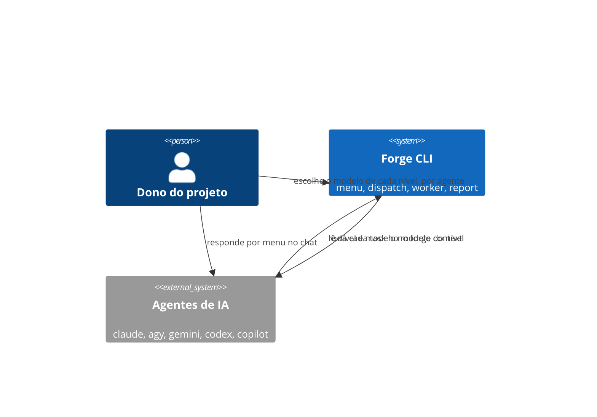
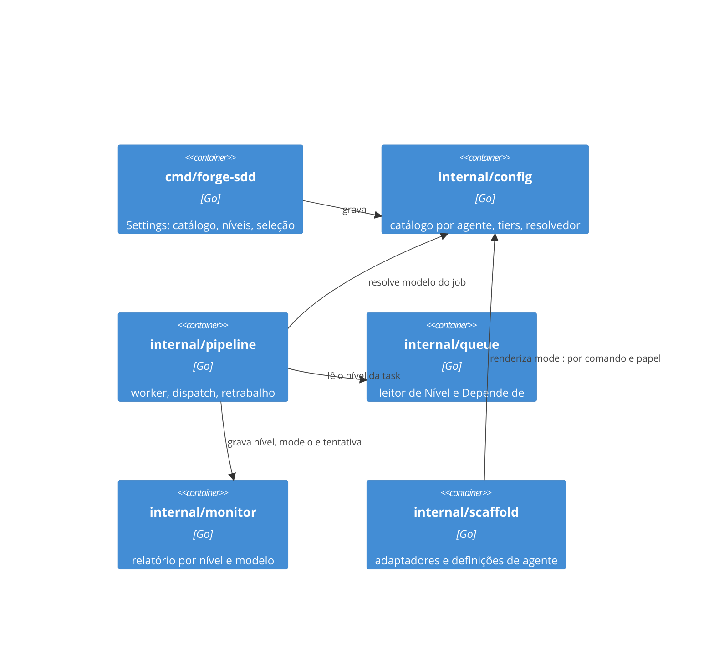
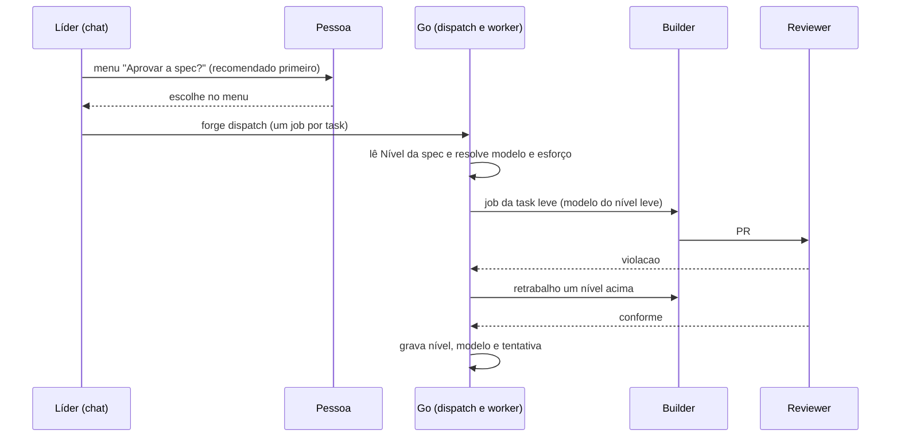

# Critérios — Iniciativa 91

## Restrições (Constitution)
`FLX-05`/`GOV-01` (ADR-0016), `FLX-01` (o nível faz parte da spec revisada), `FLX-02` (Regra 15: uma branch por iniciativa, nunca por task), `FLX-04` (telemetria), `SEG-01` (validar modelo, nível e esforço), `SEG-03` (argv explícito, sem shell), `SEG-05` (telemetria só com contadores e nomes), `SEG-06` (Builder, Reviewer e Governança não ganham ferramenta), `ARQ-01` (regra de escolha em `internal/`, menu só adapta), `ARQ-06` (só flags e chaves novas; nenhum comando de nível raiz), `ARQ-10`, `DUP-01`/`DUP-04`/`DUP-06` (um resolvedor de modelo, um vocabulário de níveis, uma regra de pergunta), `DUP-10` (fonte única em `.agents/`, adaptadores finos), `COD-01`, `COD-03`, `COD-04`, `TST-01` a `TST-05`.

## Modelo do módulo
**Enxuto** (`ARQ-11`): estende donos existentes, sem pacote novo — `internal/config` (catálogo, níveis e resolvedor), `internal/pipeline` (worker, despacho, retrabalho), `internal/queue` (leitor do nível), `internal/gate` (contexto da task), `internal/monitor` (relatório), `internal/scaffold` (templates) e `cmd/forge-sdd` (menu e flags).

## Decisões do projeto aplicadas
- **ADR-0003:** orçamento de instruções (`P-24`): raiz até 1.536 bytes, adaptador de comando até 300, definição de agente até 420. A regra de pergunta mora em um arquivo e os demais só apontam.
- **ADR-0004:** o Go decide o fluxo; o contrato do job ganha campos opcionais.
- **ADR-0005:** `CLIFor`, perfis e marcadores; a escolha do agente por sessão segue no mesmo menu.
- **ADR-0008:** no modo `live` a CLI fica aberta; por isso a troca por job fica só no `headless`.
- **ADR-0013 (proposto):** o Reviewer é o portão; fica fora do roteamento (RN-7).
- **ADR-0014 (proposto):** D-1 (uso real por job) alimenta o relatório; D-5 (`models`, `efforts`, `{model}`, `{effort}`) é a base estendida aqui.
- **88 RN-9:** o Settings é a casa das chaves.
- **89:** o motor do `/toca-ai` já enfileira um job por etapa; o `dispatch` reusa.
- **Nova ADR-0016:** níveis e tabela por agente, roteamento e escalada, um job por task, pergunta por menu e ferramentas dos agentes.

## O que já existe
| Procurei | Onde | Achei | Decisão | Justificativa |
|---|---|---|---|---|
| Quando perguntar | `sdd/memory/clarify.md` (e template) | Regra única de quando esclarecer; não diz como | **Estender** com a seção "Como perguntar" | `DUP-06`: uma regra, um lugar |
| Ferramentas dos agentes | `templates/agents/claude/.claude/agents/*.md.tmpl` (`tools:`), `.github/chatmodes/*.tmpl` | Líder, PM e Planner sem ferramenta de pergunta; Líder sem a de subagente | **Estender** só esses três; os demais não mudam | `SEG-06` |
| Instrução de confirmar | `CLAUDE.md`, `GEMINI.md`, `AGENTS.md`, `copilot-instructions.md` (passo PLAN) | "aguarde confirmação e pergunte" | **Estender** com o ponteiro para a regra | Dentro do `P-24` |
| Lista de modelos | `config.ModelPresets` | Só `claude`: `haiku`, `sonnet`, `opus` | **Substituir** por catálogo por agente | Falta `fable`; `agy` e `gemini` sem lista |
| Modelos do `agy` | `agy models` (18 linhas `id<TAB>nome`, após "Fetching available models...") | Não é usado | **Criar** leitor com limite de tempo e lista de reserva | Pesquisa já feita na discovery 85 (arquivada) |
| Flags de modelo | `config.modelEffortByCommand` | `claude` e `agy` (`--model`, `--effort`), `gemini` (`--model`) | **Reusar**; `codex` e `copilot` entram quando confirmados | Só se emite flag confirmada |
| Escolha por sessão | `ForgeConfig.Models`/`Efforts`, `SessionModelArgs`, `menu.chooseModel`, `chooseAgents` | Texto por sessão; não é limpo ao trocar o agente | **Estender**: lista do agente, "Outro", limpeza na troca | Corrige o problema 7 |
| Texto digitado no menu | `prompter` (`Select`, `SelectGesture`, `Confirm`, `Pause`) | Não há entrada de texto | **Estender** com `Input` (o `huh` já tem) | Sem dependência nova |
| Modelo por job | `worker.go` (`cfg.SessionModelArgs(opts.Role)`), `RunSpec.Model`/`Effort` | Resolve por sessão, não por job | **Estender** com um resolvedor único por job | `DUP-01` |
| Contrato do job | `bus.Job` | Sem nível nem modelo | **Estender** com campos opcionais | Compatível com jobs antigos |
| Cabeçalho da spec | `queue.ParseDependsOn`, `pipeline.taskSpecProblems` (`specheck.go`) | Lê `**Depende de:**` e confere a task | **Estender** com `**Nível:**` no mesmo leitor e na mesma checagem | Um portão antes do build |
| Contexto da task | `gate.BuildContext`, `ContextPack.Render` | Spec, IDs, rules e skills | **Estender** com nível e modelo resolvido | O agente lê em um lugar |
| Um job por etapa | `pipeline.EnqueueGoalSteps`, `goalSteps` (`PlanWaves(feats, 1)`) | Feito para o `/toca-ai`; cada job nasce com branch própria (`goal.go`: branch da iniciativa + `-<etapa>`, fixada em `goal_test.go`) | **Reusar** no `dispatch` e **corrigir** para a branch única | `DUP-03`; Regra 15 |
| Retrabalho | `pipeline.ApplyVerdict` (cria `pr_rework`, tentativa + 1) | Sem mudança de modelo | **Estender** com a subida de nível | Um ponto de decisão |
| Telemetria e relatório | `monitor.SessionMetrics` (`model`, `medicao`), `forge report --jobs` | Sem nível nem tentativa | **Estender** com `nivel`, `tentativa` e `--por-modelo` | Campos opcionais |
| Modelo no chat | `.claude/commands/*.md` (sem frontmatter), `.claude/agents/*.md` (`model: inherit`) | Tudo herda o modelo da conversa | **Estender** os templates, renderizados da tabela | Sem copiar corpo (`DUP-10`) |
| Aviso antes de abrir | `pipeline/preflight.go` | Avisa perfil sem marcador | **Estender**: sessão sem modelo fixo | Problema 3 |
| Skills do Líder | `split-features.md`, `novo-fix.md`, `implementar.md` | Não citam `dispatch --fix` nem `enqueue --base` (pendência no `status.md` da 90) | **Corrigir** junto, nos mesmos arquivos | Evita dois PRs nas mesmas linhas |

## Dependências novas
Nenhuma. Flags conferidas hoje no `--help`: `claude` (`--model` com apelidos como `fable`, `opus` e `sonnet`; `--effort low|medium|high|xhigh|max`), `agy` (`--model`, `--effort`, `agy models`) e `gemini` (`-m, --model`). A confirmar no build, pela documentação oficial: o nome da ferramenta de pergunta e da de subagente do Claude Code, o campo `model:` em comandos, e as flags de `codex` e `copilot`.

## Diagramas (C4)

## Critérios de aceitação executáveis
- **CA-01 Pergunta por menu:** os templates dos agentes `lider`, `pm-architect` e `planner` do Claude trazem a ferramenta de pergunta em `tools:`, e o `lider` também a de subagente; Builder, Reviewer e Governança não mudam. O template de `clarify.md` tem a seção "Como perguntar" com as RN-8 e RN-9, e as instruções raiz apontam para ela. Tudo dentro do `P-24`, com os goldens atualizados. `go test ./internal/scaffold -run 'TestPerguntaPorMenu' && forge gate`
- **CA-02 Skills do Líder:** `split-features` cita `forge queue enqueue --base` e a rubrica do nível; `novo-fix` e `implementar` citam `forge dispatch <iniciativa> --fix <id>`. `go test ./internal/scaffold -run TestSkillsDoLider`
- **CA-03 Catálogo por agente:** o catálogo do `claude` inclui `fable`; o do `agy` vem de `agy models` (com executor falso: ignora a linha "Fetching…", separa id e nome, e usa a lista de reserva se passar do limite de tempo); `gemini` usa a lista de reserva; agente sem flag confirmada devolve lista vazia com o motivo. `go test ./internal/config -run TestCatalogoPorAgente`
- **CA-04 Settings por agente:** a lista do menu é a do agente da sessão; há "Outro (digitar)", validado por `^[A-Za-z0-9._:-]{1,80}$`; trocar o agente de uma sessão remove o modelo que não é dele e oferece escolher outro; o preflight avisa a sessão sem modelo fixo. `go test ./cmd/forge-sdd ./internal/pipeline -run 'TestMenu_ModeloPorAgente|TestPreflight_SessaoSemModeloFixo'`
- **CA-05 Níveis:** `forge.json` aceita `model_selection` (`manual`, padrão, ou `auto`) e `tiers.<agente>.<nivel>` com modelo e esforço; valor inválido é erro; arquivo antigo segue válido. O Settings tem "Seleção de modelo" e o passo a passo dos três níveis por agente. `go test ./internal/config ./cmd/forge-sdd -run 'TestNiveis|TestMenu_SelecaoDeModelo'`
- **CA-06 Nível na spec:** `**Nível:** leve|medio|forte` é lido pelo mesmo leitor do cabeçalho; valor inválido bloqueia o despacho com a lista do que falta; ausente vale `medio` com aviso; `forge context <task>` mostra o nível e o modelo resolvido. `go test ./internal/queue ./internal/pipeline ./internal/gate -run 'TestNivelDaSpec|TestContext_NivelEModelo'`
- **CA-07 Roteamento:** em `manual`, o argv é idêntico ao de hoje. Em `auto`, o job de uma task `leve` com `claude` recebe o modelo e o esforço do nível; job com várias tasks usa o maior nível e o despacho avisa; nível sem modelo cai na escolha da sessão; o job grava nível, modelo e esforço resolvidos; no modo `live`, o despacho avisa que vale o modelo da sessão. `go test ./internal/config ./internal/pipeline -run TestRoteamento`
- **CA-08 Um job por task:** com `builder.job_per_task` ligado, `forge dispatch` enfileira um job por task na ordem das dependências, sem duplicar ao repetir e sem marcar a fila como `toca-ai`; desligado, sai um job só, como hoje. Todos os jobs usam a branch e o PR da iniciativa (Regra 15), e o motor do `/toca-ai` passa a seguir a mesma regra. `go test ./internal/pipeline -run 'TestDispatch_UmJobPorTask|TestGoal_BranchUnicaDaIniciativa'`
- **CA-09 Escalada:** em `auto`, um parecer `violacao` gera o retrabalho um nível acima (teto `forte`) e registra o nível no evento do job; em `manual`, nada muda. `go test ./internal/pipeline -run TestEscaladaNoRetrabalho`
- **CA-10 Relatório:** a telemetria grava `nivel` e `tentativa`; `forge report --por-modelo` agrupa por nível e modelo com jobs, aprovados de primeira, turnos e custo de tabela, separando real de estimado; a sugestão só aparece com pelo menos 5 jobs no grupo. `go test ./internal/monitor ./cmd/forge-sdd -run TestReport_PorModelo`
- **CA-11 Chat:** com `auto` e modelo definido no nível, os adaptadores de comando do Claude saem com o `model:` do nível do comando, e as definições de agente com o `model:` do papel; em `manual` ficam byte a byte como hoje; `forge update` preserva a escolha; tudo dentro do `P-24`. `go test ./internal/scaffold -run 'TestModeloPorComando|TestModeloPorPapel'`
- **CA-12 Geral:** `go vet ./...`, `go build ./...`, `go test ./...` e `forge gate` verdes; ADR-0016 em `sdd/spec/adr/`; `docs/pipeline.md` e `.forge/LEIA-ME.md` atualizados.
- **Validação no fechamento:** abrir uma sessão nova, rodar um `/discovery` curto e conferir que as decisões chegam como menu; comparar `forge report --por-modelo` da própria 91 com a 90 (132 turnos, 21,5 milhões de tokens relidos, US$ 5,75 de tabela) e registrar no `status.md`.

## Níveis padrão (ponto de partida, editável no Settings)
| Trabalho | Nível |
|---|---|
| Task: só documentação, ADR, texto ou configuração; ajuste em um pacote sem contrato novo | `leve` |
| Task: um ou dois pacotes, segue padrão existente, testes novos | `medio` |
| Task: contrato novo, três pacotes ou mais, segurança, concorrência ou migração | `forte` |
| Comandos `/discovery`, `/nova-feature`, `/novo-fix`, `/constitution`, `/c4-architecture` | `forte` |
| Comandos `/split-features`, `/implementar`, `/revisar`, `/toca-ai` | `medio` |
| Comandos `/status`, `/inbox`, `/archive`, `/doctor`, `/tutorial`, `/upgrade-sdd` | `leve` |

A tabela nível → modelo nasce só com o esforço (`leve`: `low`, `medio`: `medium`, `forte`: `high`) e sem modelo; quem escolhe o modelo de cada nível é a pessoa, no Settings.
