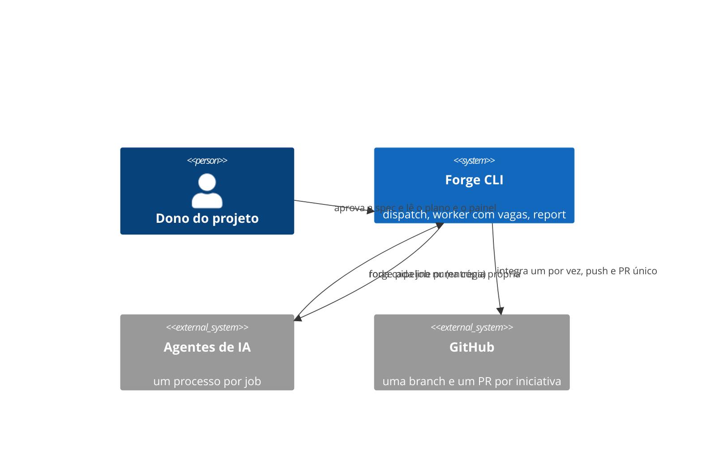
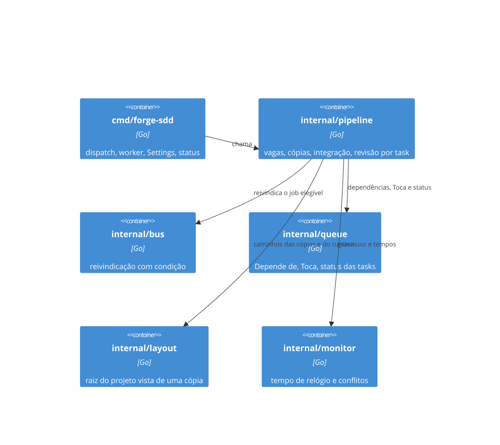
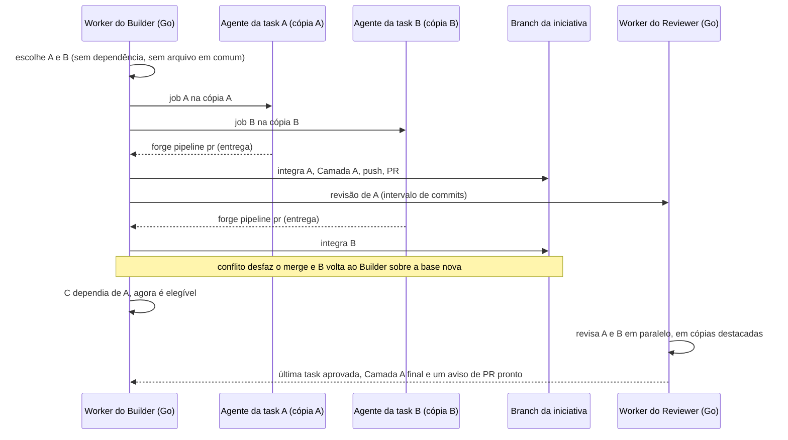

# Critérios — Iniciativa 92

## Restrições (Constitution)
`FLX-05`/`GOV-01` (ADR-0017), `FLX-02` (Regra 15: uma branch e um PR por iniciativa; nunca push em `main`), `FLX-06` (Camada A depois de cada integração; Camada B por task), `SEG-01` (validar caminhos de `**Toca:**` e identificadores das cópias), `SEG-02` (escritas só em `.forge/runtime/worktrees`; nunca perder trabalho), `SEG-03` (`git` e `gh` com argumentos explícitos), `SEG-05`, `SEG-06` (Reviewer somente leitura, em cópia destacada), `ARQ-01`, `ARQ-02`, `ARQ-06` (nenhum comando de raiz; só subcomandos de `pipeline` e flags), `DUP-01`/`DUP-03`/`DUP-04` (um resolvedor de dependências, um dono de caminhos, uma regra de integração), `COD-01`, `COD-03`, `COD-04` (sai o texto que manda o agente paralelizar), `TST-01` a `TST-05` (concorrência com executor falso e `-race`; git real só em `t.TempDir()`).

## Modelo do módulo
**Completo** (`ARQ-11`): muda regra de negócio e máquina de estados da esteira (reivindicação, vagas, integração, revisão por task) em `internal/bus`, `internal/pipeline`, `internal/queue` e `internal/layout`. Sem pacote novo.

## Decisões do projeto aplicadas
- **ADR-0002:** `internal/layout` é o dono dos caminhos; a raiz do projeto vista de uma cópia entra ali.
- **ADR-0004:** worker em Go e barramento com reivindicação atômica (D-1, D-4). A nota "Camada B por task, em paralelo" vira regra. Passa de um job por vez para vagas.
- **ADR-0006:** acompanhamento por git e `LiveView` (D-1, D-2) passam a observar a cópia do job; pausa por limite de uso (D-5) vira freio.
- **ADR-0008:** no modo `live` a CLI fica aberta num painel; por isso segue com uma vaga.
- **ADR-0012 (proposto):** o Go propaga o status por task; continua valendo, agora uma task por vez.
- **ADR-0013 (proposto):** tetos, `STOP` e `blocked` valem por job.
- **ADR-0014 (proposto):** D-2 (`forge pipeline pr`) é estendido: em job com cópia, o comando registra a entrega e a integração fica com o worker.
- **Iniciativa 91 (no Gate 1):** 91-07 (um job por task, na branch e no PR da iniciativa) é pré-requisito.
- **Regra 15:** as branches auxiliares `forge/<job>-<task>` já existem em `CreateWorktree`; são locais e temporárias.
- **Nova ADR-0017:** paralelismo decidido pelo Go, cópia por job, integração só pelo worker e revisão por task.

## Opções consideradas
1. **Liberar subagentes ao Builder e deixar o modelo paralelizar** (o desenho original). Mudança pequena, mas depende de o modelo lembrar, só vale para CLIs com subagente, mistura o uso de várias tasks num registro só e deixa a integração na mão do agente. Recusada (RN-1).
2. **Vários processos `forge worker` por papel.** O barramento já aguenta, mas a integração precisaria de trava entre processos e o tmux de um painel por vaga. Recusada.
3. **Um worker com vagas** (escolhida): um processo decide a ordem, roda os agentes em cópias e integra um por vez.

## O que já existe
| Procurei | Onde | Achei | Decisão | Justificativa |
|---|---|---|---|---|
| Ondas por dependência | `pipeline.PlanWaves`, `forge bus plan` (`cmd/forge-sdd/worker.go`) | Lotes por nível, cortados em `max_parallel_tasks`; só informam o agente | **Estender**: plano com `**Toca:**` e motivo de cada espera | `DUP-03` |
| Dependências da fila | `queue.ParseDependsOn`, `queue.EligibleTasks` | Elegível é `queued` com dependências `approved` (`forge queue next`) | **Estender** com o critério "dependência integrada" | `DUP-01`: um resolvedor |
| Reivindicar job | `bus.Claim` | Prioridade e ordem de chegada, rename atômico com lease; sem filtro | **Estender** com condição de elegibilidade | Mantém a reivindicação atômica |
| Worktree por task | `pipeline.CreateWorktree`, `RemoveWorktree`, `forge pipeline worktree add\|remove` | Cria `forge/<job>-<task>`; remove com `--force` e apaga a branch; nunca usado (0 nos logs) | **Estender**: ciclo de vida pelo Go, remoção segura, `list` e `prune`; sai o uso pelo agente | RN-6, `COD-04` |
| Caminhos de runtime | `layout.Forge`, `ForgeRuntime`, `Worktrees`, `Logs` | Sempre `<pasta atual>/.forge`; ninguém resolve a raiz a partir de uma cópia (testado: na cópia, "modo pipeline não ativo") | **Estender** `layout` com a raiz do projeto principal | Um dono de caminhos |
| Laço do worker | `pipeline.RunWorker`, `processJob`, `VerifyJobHandoff` | Um job por vez; conclui e enfileira a revisão | **Estender** para vagas; a conclusão ganha a integração | ADR-0004 D-1 |
| Execução do agente | `ExecRunner.Run` (`cmd.Dir = spec.Dir`), `RunSpec` | Roda na pasta do projeto | **Reusar**, apontando para a cópia | Sem mudar o executor |
| PR pelo Go | `pipeline.OpenPR` (`forge pipeline pr`) | Camada A, push, PR e registro, na pasta atual | **Estender**: em job com cópia vira entrega; o worker integra | Mesmo comando para o agente |
| Acompanhamento | `NewGitWatcher(opts.Dir, …)`, `LiveView` | Observa a pasta do projeto; linhas sem identificação do job | **Estender**: observar a cópia e prefixar a task | ADR-0006 |
| Limite de uso | `DetectUsageLimit`, `deferJob`, `pauseUntil` | Devolve o job e pausa o worker | **Reusar** como freio das vagas | ADR-0006 D-5 |
| Tetos e parada | `HaltReason`, `JobOverCeiling`, `StopFile` | Por worker e por job | **Reusar** por vaga | 88 |
| Revisão | `VerifyJobHandoff` (cria `pr_review` igual ao job), `ApplyVerdict` | Uma revisão por job, sobre o PR inteiro, na pasta do projeto (o Reviewer chegou a rodar `git stash` e `git checkout` nela); avisa "PR pronto" a cada aprovação | **Estender**: intervalo de commits por task e aviso único | Nota da ADR-0004 |
| Instruções de paralelismo | `pipeline.BuilderHints`, `worker-job.md` (passo 2) | Mandam o agente abrir worktree e subagente | **Substituir** pelo que o Go faz | Texto que nunca funcionou |
| Arquivos citados na spec | `survey.extractFilesFromSpec` | Heurística de exibição (só `internal/`, `cmd/`, `shared/`) | **Não reusar** na agenda; campo declarado `**Toca:**` | Declaração é conferível |
| Chaves | `BuilderConfig.MaxParallelTasks` (1 a 8, padrão 3), `UseGitWorktrees` (padrão `true`), `ReviewerConfig` | Existem e não têm efeito | **Reusar**; nova `reviewer.max_parallel_reviews` | Sem chave duplicada |
| Telemetria | `monitor.ReadJobUsage`, `SumUsage`, `forge report --initiative` | Por job | **Estender** com tempo de relógio e conflitos | 90-02 |

## Dependências novas
Nenhuma. Só stdlib e `git` (conferido: 2.39.5 nesta máquina; `git worktree` e `git merge` bastam).

## Diagramas (C4)

## Critérios de aceitação executáveis
- **CA-01 Raiz do projeto vista de uma cópia:** de dentro de um worktree da esteira, os comandos acham a configuração, a fila e os logs do projeto principal. `go test ./internal/layout ./cmd/forge-sdd -run TestRaizDoProjeto`
- **CA-02 `**Toca:**`:** lido pelo mesmo leitor do cabeçalho; caminho absoluto ou com `..` bloqueia o despacho com a lista do que falta; ausente torna a task exclusiva, com aviso; a skill do split traz a regra. `go test ./internal/queue ./internal/pipeline ./internal/scaffold -run 'TestTocaDaSpec|TestSkillsParalelismo'`
- **CA-03 Plano de execução:** `forge dispatch --dry-run` e `forge bus plan` mostram o que roda junto e o motivo de cada espera (dependência, arquivo em comum ou sem `**Toca:**`), sem gravar nada. `go test ./internal/pipeline -run TestPlanoDeExecucao`
- **CA-04 Reivindicação elegível:** com dois jobs dependentes pendentes, só o primeiro é reivindicado; o segundo fica elegível quando a task da dependência chega a `review_pending`; job com arquivo em comum com outro em execução espera; o retrabalho passa na frente. `go test ./internal/bus ./internal/pipeline -run TestClaimElegivel`
- **CA-05 Cópia do job:** o worker cria a cópia a partir da ponta da branch da iniciativa, roda o agente nela e o acompanhamento por git observa essa cópia; job retomado reaproveita a cópia; cópia com commit não integrado nunca é removida; `forge pipeline worktree list` mostra as cópias e `prune` só remove as já integradas. `go test ./internal/pipeline -run TestWorktreeDoJob`
- **CA-06 Entrega e integração** (git real em pasta temporária): em job com cópia, `forge pipeline pr` recusa arquivo fora do commit e commit que toca `queue.json`, `verdicts/`, `review-spec.md` ou `status.md` da iniciativa. Aceita a entrega, o worker integra um por vez: sucesso roda a Camada A, faz o push, cria ou atualiza o PR único, registra, marca a task `review_pending` e enfileira a revisão com o intervalo de commits; conflito desfaz o merge e devolve a task ao Builder com os arquivos em conflito; checkout principal fora da branch ou com alteração local no caminho adia e avisa no inbox, sem forçar. `go test ./internal/pipeline -run 'TestEntregaDoJob|TestIntegracaoPeloGo'`
- **CA-07 Vagas do Builder:** com `max_parallel_tasks: 3` e quatro jobs independentes, três rodam ao mesmo tempo e o quarto entra quando uma vaga livra (executor falso com barreira); cada vaga renova o próprio lease; tetos e `STOP` valem por job; com `1`, roda em fila; job com `origem: toca-ai` e o modo `live` usam uma vaga, sem cópia. `go test -race ./internal/pipeline -run TestPoolDoBuilder`
- **CA-08 Revisão por task em paralelo:** cada task integrada gera um `pr_review` com o intervalo de commits; o Reviewer roda até `reviewer.max_parallel_reviews` ao mesmo tempo, cada um numa cópia destacada do commit integrado; o veredito vale só para a task e `violacao` devolve só ela. `go test -race ./internal/pipeline -run 'TestRevisaoPorTask|TestPoolDoReviewer'`
- **CA-09 Um aviso:** "PR pronto" sai uma vez, quando a última task é aprovada e a Camada A passa na branch integrada; aprovação intermediária não notifica. `go test ./internal/pipeline -run TestPRProntoUmaVez`
- **CA-10 Freio:** limite de uso ou dois conflitos seguidos na iniciativa reduzem para uma vaga; a contagem volta ao configurado depois de uma integração bem-sucedida ou do horário de reset. `go test ./internal/pipeline -run TestReducaoDeParalelismo`
- **CA-11 Painel e chaves:** `forge status` e o painel mostram cada vaga (task e tempo); as linhas do worker trazem a task na frente; o Settings tem "Vagas do Builder" e "Vagas do Reviewer"; `reviewer.max_parallel_reviews` vale 2 quando ausente, fora de 1 a 8 é erro, e `forge.json` antigo segue válido. `go test ./cmd/forge-sdd ./internal/config ./internal/pipeline -run 'TestMenu_Paralelismo|TestStatus_Vagas'`
- **CA-12 Relatório:** `forge report --initiative` mostra o tempo de relógio, a soma dos jobs, os conflitos de integração e as tasks que tocaram fora do declarado. `go test ./internal/monitor ./cmd/forge-sdd -run TestReport_Paralelismo`
- **CA-13 Instruções:** `worker-job.md` e `BuilderHints` deixam de mandar o agente abrir worktree e subagente; `pr-review.md` passa a revisar o diff da task; tudo dentro do `P-24`, com os goldens atualizados. `go test ./internal/pipeline ./internal/scaffold -run 'TestBuilderHints_SemParalelismoPeloAgente|TestSkillsParalelismo'`
- **CA-14 Geral:** `go vet ./...`, `go build ./...`, `go test -race ./...` e `forge gate` verdes; ADR-0017 em `sdd/spec/adr/`; `docs/pipeline.md` e `.forge/LEIA-ME.md` atualizados.
- **Validação no fechamento:** rodar uma iniciativa real com 3 vagas e registrar no `status.md` o tempo de relógio contra os 28 minutos em fila da 90, os conflitos e o retrabalho.
