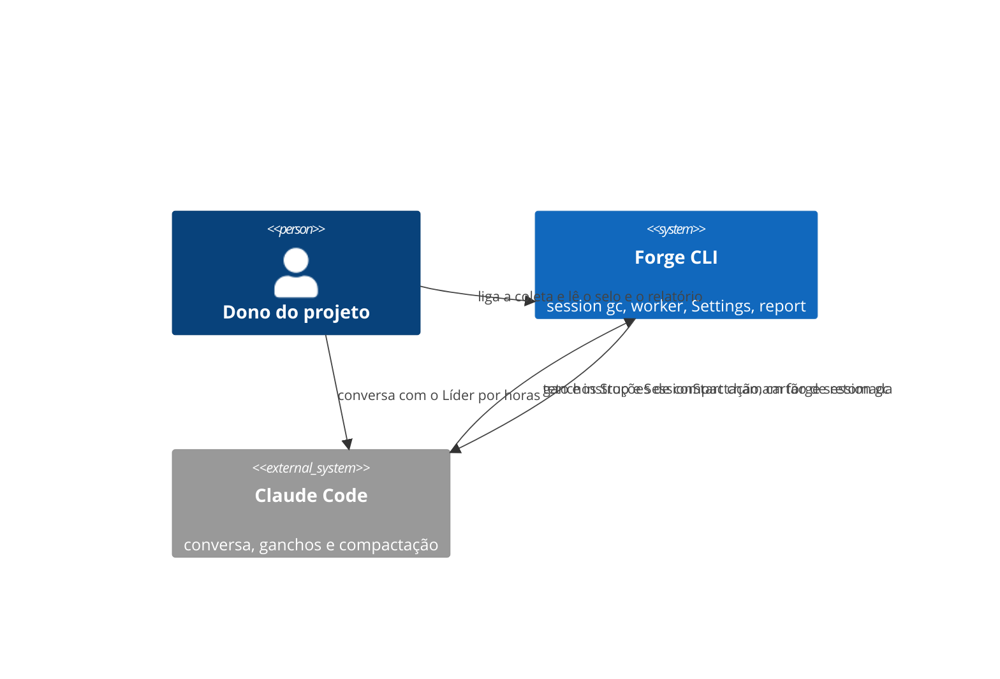
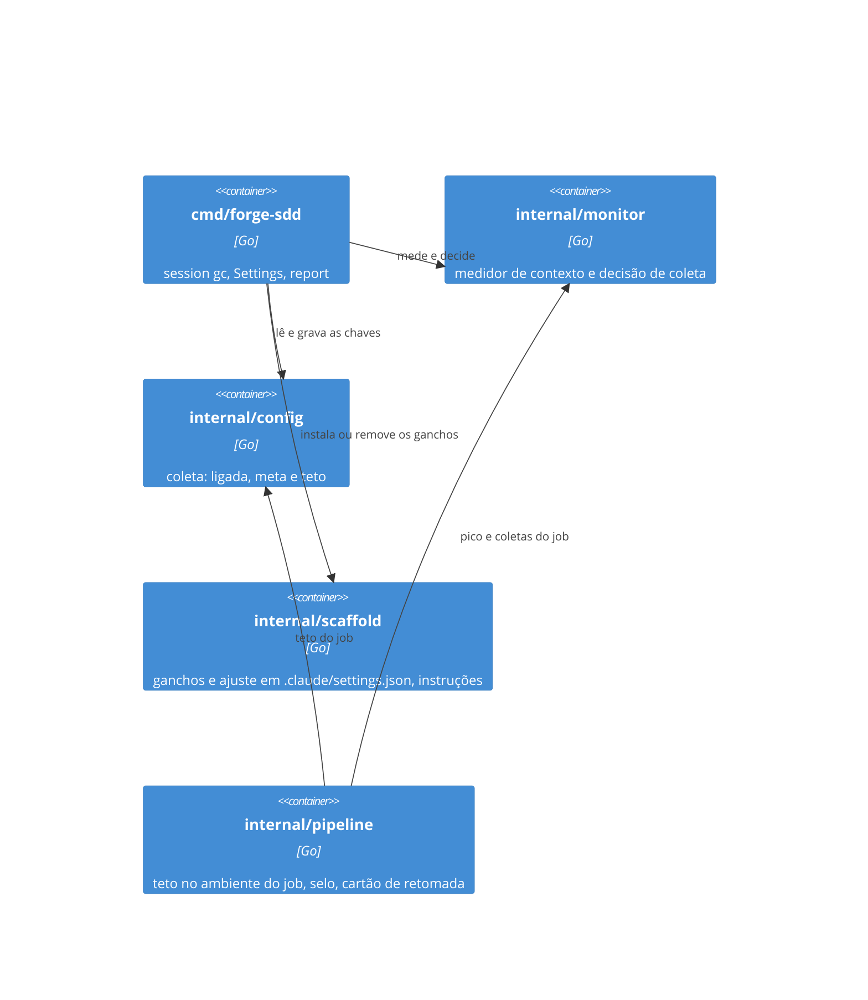
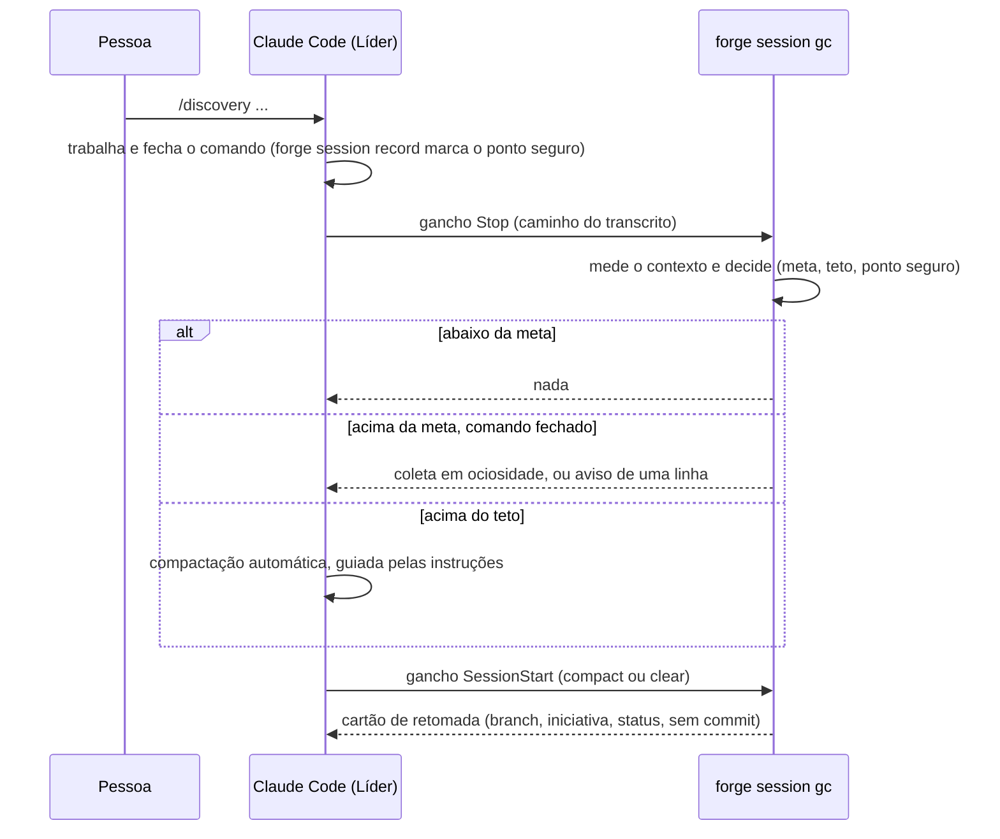

# Critérios — Iniciativa 93

## Restrições (Constitution)
`FLX-05`/`GOV-01` (ADR-0018), `FLX-04` (telemetria em `sdd/.metrics/`), `SEG-01` (validar o caminho do transcrito e os limites), `SEG-02` (mesclar `.claude/settings.json` sem sobrescrever o que é da pessoa), `SEG-03` (sem shell), `SEG-05` (do transcrito, só contadores), `SEG-07` (comportamento externo conferido na documentação oficial), `ARQ-01`, `ARQ-05` (`--dry-run` sem efeito), `ARQ-06` (só subcomando de `session` e chaves novas), `DUP-01`/`DUP-03` (um medidor, uma regra de decisão, reuso do cartão e do brief), `DUP-10` (instrução em um lugar, adaptadores finos), `COD-01`, `COD-03`, `TST-01` a `TST-05`.

## Modelo do módulo
**Completo** (`ARQ-11`): regra de negócio nova (decisão de coleta, com meta, teto e ponto seguro) e estado novo (marca de fechamento do comando e configuração), em `internal/monitor`, `internal/config`, `internal/scaffold`, `internal/pipeline` e `cmd/forge-sdd`. Sem pacote novo.

## Decisões do projeto aplicadas
- **ADR-0003:** orçamento das instruções (`P-24`): a instrução de compactação é curta e fica em um lugar só.
- **ADR-0004:** o Go decide o fluxo; o hook do inbox é o precedente de gancho instalado pelo Forge.
- **ADR-0006:** o log bruto do job fica fora do git; a leitura dele para telemetria já existe.
- **ADR-0009 (proposto):** D-1 (selo de tokens por janela) passa a mostrar o contexto real; D-2 (reset por job no modo `live`) e D-3 (cartão de handoff) são reusados sem mudança.
- **ADR-0014 (proposto):** D-1 (uso real lido do log) é a base do medidor; D-6 (status curto) entra no cartão de retomada.
- **88 RN-9:** o Settings é a casa das chaves.
- **Iniciativa 91 (no Gate 1):** 91-02 (ferramenta de subagente do Líder) é pré-requisito da 93-07.
- **Nova ADR-0018:** coleta de contexto com medida real, meta e teto, ganchos do Claude Code e cartão de retomada.

## Opções consideradas
1. **Uma skill mandando o agente pedir `/compact`.** Depende de o modelo lembrar e de a pessoa digitar. Recusada como mecanismo (RN-1); o texto fica só para dizer o que guardar.
2. **O Forge digitar `/compact` no painel pelo tmux**, como já faz com `/clear` nos painéis dos workers. É automático, mas no painel da pessoa pode colidir com o que ela está escrevendo. Fica fora.
3. **Teto pela compactação automática do Claude Code, mais gancho para medir, avisar e reinjetar** (escolhida).

## O que já existe
| Procurei | Onde | Achei | Decisão | Justificativa |
|---|---|---|---|---|
| Tamanho do contexto da conversa | transcrito do Claude Code (`transcript_path` na entrada dos ganchos; `usage` por chamada) | Ninguém lê | **Criar** leitor em `internal/monitor` | Medida real; só contadores (`SEG-05`) |
| Tamanho do contexto do job | log `stream-json` do job; `monitor.ParseJobUsage` | Lê a soma no evento `result`; não guarda pico nem coletas | **Estender** com pico e coletas (`compact_boundary`) | 90-02 |
| Selo de tokens do painel | `monitor.CalculateTokenMetrics`, `FormatTokenBadge`, `pipeline.BuildTmuxPlan` | Acumulado da telemetria por papel | **Estender**: contexto real quando o gancho já mediu | ADR-0009 D-1 |
| Limpeza entre jobs | `pipeline.deliverContextReset`, `CLIProfile.ResetCommand`, `context: clear` | Só no modo `live`, entre jobs | **Reusar** sem mudança | ADR-0009 D-2 |
| Cartão de retomada | `pipeline.BuildHandoffCard`, `status.md` da iniciativa, `gate.BuildBrief`, `pipeline.FormatShortStatus` | Existem, cada um para um uso | **Reusar** para montar a retomada | `DUP-03` |
| Gancho instalado pelo Forge | `scaffold.MergeClaudeInboxHook` (`UserPromptSubmit`) | Mescla sem sobrescrever e não toca em JSON inválido | **Estender** para os ganchos e o ajuste da coleta | `SEG-02` |
| Comando de sessão | `forge session record` | Grava a telemetria no fechamento do comando | **Estender** com `forge session gc`; o `record` passa a marcar o ponto seguro | `ARQ-06` |
| Ambiente do agente no job | `ExecRunner.Run` (`cmd.Env` com `FORGE_WORKER`) | Um ponto só | **Estender** com o teto | O argv não muda |
| Ganchos e ajustes do Claude Code 2.1.326 | binário instalado | Eventos `Stop`, `PreCompact`, `PostCompact`, `SessionStart` (`compact`, `clear`); ajustes `CLAUDE_AUTOCOMPACT_PCT_OVERRIDE`, `CLAUDE_CODE_AUTO_COMPACT_WINDOW`, `CLAUDE_CODE_IDLE_COMPACT_MIN_TOKENS`, `DISABLE_AUTO_COMPACT` | **Reusar** só o que a documentação oficial confirmar | Nomes achados no binário; o efeito de cada um está a conferir |
| Chaves | `menu.settingsMenu`, `config.ForgeConfig` | Liga/desliga, modelo e esforço | **Estender** com a coleta, a meta e o teto | 88 RN-9 |
| Trabalho em subagente | passo PLAN ("vai para um subagente?"), 91-02 (não construída) | O Líder não tem a ferramenta | **Depender** da 91-02 | RN-8 |

## Dependências novas
Nenhuma biblioteca. Dependência de comportamento externo: ganchos e ajustes do Claude Code, a conferir na documentação oficial (context7 ou site) na versão instalada, no início da 93-04.

## Diagramas (C4)

## Critérios de aceitação executáveis
- **CA-01 Medidor da conversa:** com um transcrito de exemplo, devolve contexto atual, pico, número de chamadas e posição da última coleta, lendo só os contadores; arquivo grande é lido pelo fim em menos de 100 ms; caminho que não é arquivo regular é recusado. `go test ./internal/monitor -run TestContextoDaSessao`
- **CA-02 Medidor do job:** a telemetria do job ganha `contexto_pico` e `coletas`; `forge report --jobs` mostra as duas colunas; job sem o dado fica em branco. `go test ./internal/monitor ./cmd/forge-sdd -run 'TestContextoDoJob|TestReport_Contexto'`
- **CA-03 Decisão de coleta:** função pura, com tabela de casos: abaixo da meta, nada; acima da meta com comando fechado, coleta ou aviso; acima da meta sem comando fechado, nada; acima do teto, coleta; desligada, nada; no máximo um aviso a cada 10 minutos. `go test ./internal/monitor -run 'TestDecisaoDeColeta|TestColetaDesligada'`
- **CA-04 Ponto seguro:** `forge session record` marca o fechamento do comando; `forge session gc --hook`, com a entrada do gancho `Stop` em JSON, só reconhece ponto seguro quando o fechamento veio depois do último pedido da pessoa; entrada inválida não quebra a sessão (sai com 0 e sem saída). `go test ./cmd/forge-sdd ./internal/monitor -run 'TestPontoSeguro|TestSessionCmd_Gc'`
- **CA-05 Ganchos e teto no Claude:** ligar a coleta mescla em `.claude/settings.json` os ganchos (`Stop` e `SessionStart` para `compact` e `clear`) e o ajuste de teto, sem tocar no que é da pessoa; desligar remove só o que o Forge pôs; JSON inválido nunca é alterado; `forge update` preserva. `go test ./internal/scaffold -run TestGanchosDeColeta`
- **CA-06 Retomada:** `forge session gc --resume` devolve o cartão de retomada em até 2 KB: branch, iniciativa ativa e o `status.md` dela, fila resumida e arquivos sem commit. `go test ./cmd/forge-sdd ./internal/pipeline -run TestReinjecaoAposColeta`
- **CA-07 Instruções de compactação:** a instrução raiz diz o que o resumo guarda e o que descarta (RN-4), dentro do `P-24`, com os goldens atualizados. `go test ./internal/scaffold -run TestInstrucoesDeCompactacao`
- **CA-08 Jobs:** com a coleta ligada e a CLI `claude`, o processo do job recebe o teto no ambiente; desligada, ou com outra CLI, o ambiente é idêntico ao de hoje; o argv não muda em nenhum caso. `go test ./internal/pipeline -run TestWorkerEnv_Coleta`
- **CA-09 Settings e selo:** o Settings tem "Coleta de contexto" (desligada ou automática), meta e teto; meta maior que o teto ou valor fora da faixa é erro; `forge.json` antigo segue válido; sessão em CLI sem suporte mostra o aviso; o selo do painel mostra o contexto real quando o gancho já mediu. `go test ./internal/config ./cmd/forge-sdd ./internal/pipeline -run 'TestMenu_Coleta|TestBadge_ContextoReal'`
- **CA-10 Subagente por padrão** (depende da 91-02): com a coleta ligada, as skills de concepção e de planejamento mandam o trabalho pesado para subagente, que devolve o resumo e os arquivos escritos; desligada, o texto é o de hoje; dentro do `P-24`. `go test ./internal/scaffold -run TestColeta_SubagentePorPadrao`
- **CA-11 Geral:** `go vet ./...`, `go build ./...`, `go test ./...` e `forge gate` verdes; ADR-0018 em `sdd/spec/adr/`; `docs/pipeline.md` com a seção "Gancho ou habilidade?" e a coleta; `.forge/LEIA-ME.md` atualizado.
- **Validação no fechamento:** usar a coleta numa sessão real de várias horas e registrar no `status.md` a média de contexto por chamada, contra os 214 mil desta sessão, e o número de coletas.
