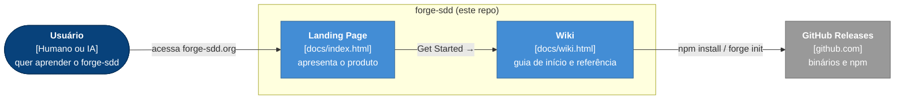

# Critérios de Arquitetura — 99-wiki-get-started

## Modelo do módulo

**Enxuto** (ARQ-11): sem backend. Novos arquivos em `docs/`: `wiki.html` e `wiki.css`. Modifica `docs/index.html` apenas para o CTA. Sem framework JS, sem bundler.

## O que já existe

| Procurei | Onde | Achei | Decisão | Justificativa |
|---|---|---|---|---|
| LP publicada | forge-sdd.org / `nathanramorim/lp-forge-sdd` | LP completa v4.8 (design system, tokens CSS) | Reusar como referência de design e tokens | É a versão canônica; `docs/index.html` está desatualizado |
| Wiki existente | `nathanramorim/lp-forge-sdd/wiki/` | wiki.html + wiki-style.css + estrutura JSON (conteúdo desatualizado) | Ignorar conteúdo; criar wiki nova do zero | Conteúdo não reflete a versão atual; estrutura HTML herdável só se não adicionar complexidade |
| Rota /wiki | `docs/` neste repo | Não existe | Criar `docs/wiki.html` | É o alvo principal desta iniciativa |
| Componente copy | LP publicada | `install-pill` com botão "Copiar" (já existe para o comando de instalação) | Estender padrão: criar `.ai-prompt` para prompts de IA | Consistência com o "Copiar" da LP |
| Hub mode docs | Qualquer repo | Não existe | Criar seção na wiki | Requisito funcional pedido |
| CTA na LP | LP publicada (lp-forge-sdd) | "Como Instalar & Usar" como CTA primário (azul) | Estender: adicionar "Get Started" apontando para `/wiki` | Usuário precisa do caminho discovery → wiki |

## Decisões do projeto aplicadas

- **D1 (Go):** sem impacto — wiki é puro frontend.
- **D8 (pt-BR):** padrão; en-US opcional via atributo `data-locale`.
- **ARQ-11:** enxuto — nenhum pacote Go novo.
- **ARQ-04:** sem runtime externo; assets via CDN só para fontes (já usado na LP).

## Dependências novas

Nenhuma dependência Go. No frontend, reusar CDNs já carregadas em `docs/index.html` (JetBrains Mono, Montserrat). Nenhuma biblioteca JS nova.

## Diagrama de contexto



## Critérios de aceitação executáveis

```bash
# 1. wiki.html existe e tem as seções obrigatórias
grep -c "get-started\|hub-mode" docs/wiki.html
# deve retornar >= 2

# 2. Componente de prompt para IA presente
grep -c "ai-prompt" docs/wiki.html
# deve retornar >= 3

# 3. CTA na LP aponta para /wiki
grep "wiki" docs/index.html | grep -c "href"
# deve retornar >= 1

# 4. i18n: textos em pt-BR e en-US
grep -c "en-US\|pt-BR" docs/wiki.html
# deve retornar >= 2
```
