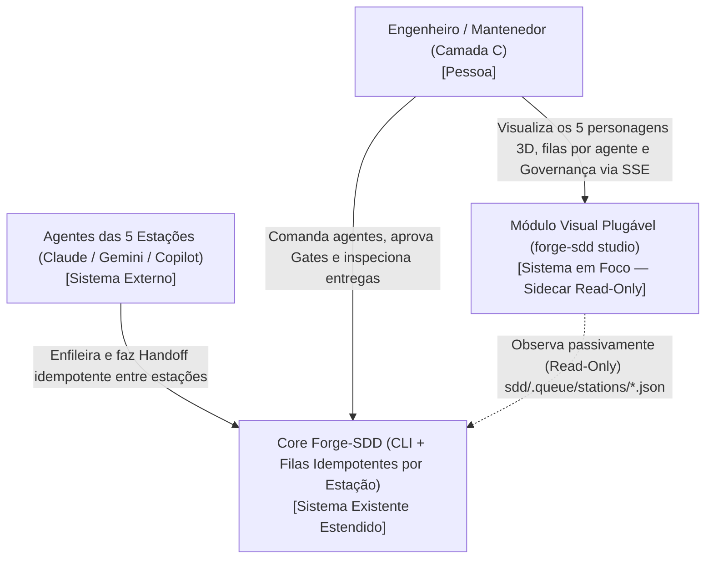
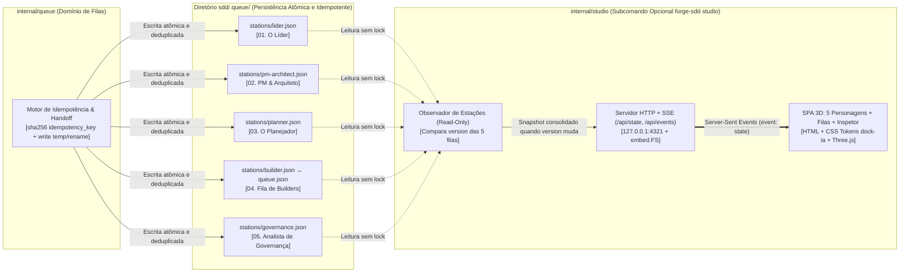
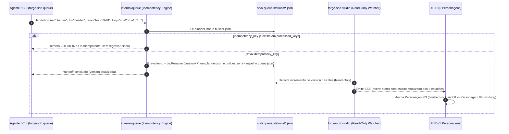

# Critérios Técnicos 59 — Módulo Visual Plugável (`forge-sdd studio`) e Filas Idempotentes por Estação

Especificação técnica e arquitetural do `discovery-59-modulo-visual-estacoes-personagens.md`, incorporando as decisões aprovadas no Portão `FLX-01`: empacotamento via subcomando opcional `forge-sdd studio` (Opção A1) e arquitetura de **Filas Dedicadas por Agente (`sdd/.queue/stations/<station>.json`) com Idempotência Estrita (`IdempotencyKey`)**. Idioma e Nível de Linguagem: `padrão` (`COD-05`).

---

## 1. Governança de Arquitetura (`ARQ-11`, `DUP-02`, `SEG-07`)

### 1.1 Modelo do módulo (`ARQ-11`)
- **Modelo:** `completo` na extensão de `internal/queue` (regras de domínio de filas por estação, validação de transições, controle de idempotência `idempotency_key`, escrita atômica e sincronia com `queue.json`) + `enxuto` em `internal/studio` (observador passivo Read-Only + servidor HTTP/SSE embutido via `embed.FS`).
- **Justificativa:** A coordenação das 5 filas exige invariantes determinísticas de domínio (idempotência contra retries, incremento monotônico de versão e transições de handoff entre estações), enquanto o módulo visual `internal/studio` permanece estritamente desacoplado e somente-leitura, projetando o estado das 5 filas sem jamais mutá-las.

### 1.2 O que já existe (`DUP-02` — Reuse Check Obrigatório)

| Procurei | Onde | Achei | Decisão (`reusar`, `estender`, `criar`) | Justificativa |
| --- | --- | --- | --- | --- |
| Fila Determinística do Builder e Parecer da Governança | `internal/queue/queue.go` e `cmd/forge-sdd/queue.go` (`sdd/.queue/queue.json`) | Structs `Queue`, `QueueItem`, `Verdict`, `Finding`, `CandidateSkill` e operações `Enqueue`, `Next`, `Complete`, `Review` | `estender` | Estender `internal/queue` (dono do conceito de Fila em `sdd/spec/concepts.md` — `DUP-01`) para gerenciar as **5 filas de estação** (`sdd/.queue/stations/<station>.json`) com `idempotency_key`, escrita atômica e espelhamento em `sdd/.queue/queue.json` |
| Procedimento para novo subcomando CLI | `.agents/skills/novo-subcomando-cli-sdd/SKILL.md` | Skill aprovada (`DUP-05`) padronizando criação de pacote em `internal/` + adaptador em `cmd/forge-sdd/` + testes | `reusar` | Aplicar a skill para criar `internal/studio` e `cmd/forge-sdd/studio.go` mantendo fronteira limpa (`ARQ-01`) |
| Diagnóstico e leitura de `.sddrc` / `progress.md` | `internal/config/` e `internal/doctor/` | Leitura de configuração do projeto, branch e estrutura `sdd/` | `reusar` | Evita duplicar leitura de `.sddrc` (`DUP-01`, `DUP-03`) |
| Lista de Auto-Skills propostas e aprovadas | `internal/skills/` (`.agents/skills/*/SKILL.md` e `sdd/skills/index.md`) | `skills.List(dir)` retorna todas as skills e seus status (`proposed`, `approved`) | `reusar` | Alimenta diretamente o painel de Auto-Skills no `forge-sdd studio` |
| Palco 3D dos 5 Personagens + Trilho Processual + Inspetor | `docs/showcase-v3-lp.html` | Renderizador Three.js (`buildCompactBot`), os 5 personagens (`ring`, `diamond`, `bar`, `wave`, `tri`), animações por estado, trilho `01..05` e cards de contrato `Recebe`/`Entrega` | `estender` | Embutir via `embed.FS` em `internal/studio/assets/` adicionando conexão SSE (`EventSource`) com `/api/events` e `/api/state` |
| Tokens visuais e estados de mascote | `/Users/nathanramorim/git/dock-ia/produto/design-system.md` e `app/packages/ui-kit/src/mascot.ts` | Paleta dark mode (`#0d0f14`, `#12151d`, `#1a1e29`), cores semânticas e estados (`idle`, `working`, `thinking`, `searching`, `approval`, `finished`, `error`) | `reusar` | Mantém consistência visual absoluta com o ecossistema `dock-ia` |
| Observador Read-Only + Servidor HTTP/SSE (`forge-sdd studio`) | Repositório `forge-sdd` | Não existe agregador de estado visual nem servidor SSE local | `criar` | Criar `internal/studio` e `cmd/forge-sdd/studio.go` usando apenas a `stdlib` Go (`net/http`, `embed`, `crypto/sha256`) |

### 1.3 Dependências novas (`SEG-07`)
- **Nenhuma.** Toda a implementação de filas por estação, cálculo de `idempotency_key` (`crypto/sha256`), escrita atômica (`os.CreateTemp` + `os.Rename`), servidor HTTP/SSE (`net/http`) e empacotamento dos assets (`embed.FS`) utiliza exclusivamente a biblioteca padrão do Go (`ARQ-03`, `ARQ-04`).

---

## 2. Arquitetura (C4 Model — Mermaid)

### 2.1 Nível 1 — Diagrama de Contexto (C4 Context)



### 2.2 Nível 2 — Diagrama de Contêineres (C4 Container)



### 2.3 Nível 3 — Diagrama de Sequência (Handoff Idempotente + Projeção SSE)



---

## 3. Especificação das Filas por Estação e Idempotência Estrita

### 3.1 Estrutura de Diretórios e As 5 Filas Canônicas

Todas as filas por estação residem em `sdd/.queue/stations/`:
1. `sdd/.queue/stations/lider.json` (`station_id: "lider"`, ordem `1`)
2. `sdd/.queue/stations/pm-architect.json` (`station_id: "pm-architect"`, ordem `2`)
3. `sdd/.queue/stations/planner.json` (`station_id: "planner"`, ordem `3`)
4. `sdd/.queue/stations/builder.json` (`station_id: "builder"`, ordem `4` — mantida em sincronia automática com `sdd/.queue/queue.json`)
5. `sdd/.queue/stations/governance.json` (`station_id: "governance"`, ordem `5`)

### 3.2 Schema JSON de Cada Fila de Estação (`StationQueue`)

```json
{
  "station_id": "builder",
  "station_order": 4,
  "role_name": "Fila de Builders",
  "feature_id": "feat-59-modulo-visual-estacoes-personagens",
  "branch": "feat/59-modulo-visual-estacoes-personagens",
  "version": 12,
  "updated_at": "2026-10-31T15:56:00Z",
  "mascot_state": "working",
  "active_item_id": "feat-59-01",
  "last_handoff": {
    "from_station": "planner",
    "to_station": "builder",
    "item_id": "feat-59-01",
    "artifact": "sdd/features/feat-59-modulo-visual-estacoes-personagens/feat-59-01.md",
    "idempotency_key": "8f3c9d1a2b4e...",
    "timestamp": "2026-10-31T15:55:50Z"
  },
  "processed_keys": [
    "4a1b2c3d4e5f...",
    "8f3c9d1a2b4e..."
  ],
  "items": [
    {
      "item_id": "feat-59-01",
      "title": "Filas dedicadas por estação com idempotência estrita",
      "artifact_path": "sdd/features/feat-59-modulo-visual-estacoes-personagens/feat-59-01.md",
      "status": "building",
      "idempotency_key": "8f3c9d1a2b4e...",
      "claimed_by": "builder-1",
      "rules": ["ARQ-01", "DUP-01", "TST-01"],
      "skills_used": ["novo-subcomando-cli-sdd"],
      "attempts": 1,
      "updated_at": "2026-10-31T15:56:00Z"
    }
  ]
}
```

### 3.3 Regras de Idempotência Estrita e Escrita Atômica (`internal/queue`)

1. **Cálculo Determinístico de `IdempotencyKey`:**
   - Se o chamador não informar uma chave explícita (`--idempotency-key`), `internal/queue` calcula automaticamente:
     `sha256(fmt.Sprintf("%s:%s:%s:%s:%d", stationID, itemID, operation, artifactPath, attempt))`
2. **Deduplicação (`processed_keys` + inspeção de estado):**
   - Antes de aplicar qualquer mutação (`Enqueue`, `Claim`, `Complete`, `Review`, `Handoff`), `internal/queue` verifica se a `idempotency_key` já consta em `processed_keys` (janela circular limitada às últimas 256 chaves para evitar crescimento infinito do JSON) ou se o item já se encontra no estado-alvo.
   - Se já foi processada, a função retorna `IdempotentHit = true` e `err = nil`, **sem regravar o arquivo e sem incrementar `version`**.
3. **Transição de Handoff Atômica entre Estações (`Handoff(from, to, item)`):**
   - Marca o item como concluído/entregue na estação `from` (`mascot_state = "finished"`) e o insere/ativa na estação `to` com a mesma `idempotency_key` de handoff, garantindo que retries de subagentes nunca criem tarefas duplicadas na estação seguinte.
   - Em caso de rejeição pela Governança (`Estação 05 → Estação 04` com `changes_requested`), a chave inclui o número da tentativa (`attempt + 1`), permitindo o loop legítimo de retrabalho (`05 ↺ 04`) enquanto bloqueia disparos duplicados da mesma tentativa.
4. **Escrita Atômica Livre de Race Condition (`writeFileAtomic`):**
   - Serializa o JSON formatado em um arquivo temporário no mesmo diretório (`sdd/.queue/stations/.tmp-<station>-<rand>`) com `fsync`, seguido de `os.Rename` atômico para `sdd/.queue/stations/<station>.json`.
   - O leitor SSE do `forge-sdd studio` jamais enxerga arquivo truncado ou bloqueado.
5. **Sincronia Transparente `builder.json` ↔ `queue.json`:**
   - Toda operação em `sdd/.queue/queue.json` (`forge-sdd queue enqueue|next|complete|review`) atualiza automaticamente `sdd/.queue/stations/builder.json` e `sdd/.queue/stations/governance.json` (e vice-versa), preservando 100% de compatibilidade com todos os testes e fluxos criados na Feature 58.

---

## 4. Contrato do Subcomando `forge-sdd studio` e Endpoint SSE

### 4.1 Superfície CLI (`ARQ-06`)
- `forge-sdd studio [--port 4321] [--host 127.0.0.1] [--dir .]`
  - Inicia o servidor HTTP Read-Only em `127.0.0.1:4321`.
  - `GET /`: serve a aplicação visual embutida via `embed.FS` (HTML + CSS Tokens `dock-ia` + Three.js com os 5 personagens).
  - `GET /api/state`: retorna o snapshot JSON imediato contendo o estado das 5 filas (`stations[]`), o `active_station`, o último `handoff`, o resumo de `queue.json`, o último `governance_verdict` e as `skills[]`.
  - `GET /api/events`: stream `text/event-stream` (SSE) que envia um evento `event: state` sempre que a soma/vetor de `version` das 5 filas (`sdd/.queue/stations/*.json`) ou `sdd/.queue/queue.json` mudar.

### 4.2 Garantias de Segurança e Desacoplamento (`SEG-01..06`, `ARQ-01..05`)
- **Somente-Leitura Estrito (`SEG-02`, `SEG-06`):** `internal/studio` nunca escreve no disco; aceita apenas métodos `GET` e `HEAD` (qualquer `POST`/`PUT`/`DELETE` recebe `405 Method Not Allowed`).
- **Bind Local (`SEG-01`):** Por padrão, faz bind apenas em `127.0.0.1`, impedindo exposição acidental na rede externa.
- **Zero Impacto:** Se `forge-sdd studio` não for chamado, nenhum goroutine, porta ou watcher é iniciado nos demais comandos do `forge-sdd`.

---

## 5. Critérios de Aceitação Executáveis (`CA-01` a `CA-09` — `TST-01..05`)

- **CA-01 (Isolamento e Desacoplamento Total):** Executar `go test ./...` e `go vet ./...` sem o `forge-sdd studio` ativo; todos os comandos do `forge-sdd` operam sem qualquer dependência do servidor visual.
- **CA-02 (5 Filas por Estação em `sdd/.queue/stations/*.json`):** Ao inicializar ou operar o fluxo das estações (`lider`, `pm-architect`, `planner`, `builder`, `governance`), cada estação persiste seu estado próprio em `sdd/.queue/stations/<station>.json` mantendo sincronia entre `builder.json` e `sdd/.queue/queue.json`.
- **CA-03 (Idempotência Estrita — `IdempotencyKey`):** Executar 2 ou mais vezes seguidas a mesma operação de `enqueue`, `handoff`, `claim`, `complete` ou `review` com a mesma `idempotency_key` (ou mesmos parâmetros determinísticos) resulta em **no-op idempotente**: apenas 1 item na fila, mesmo `version` após a 1ª gravação e zero duplicação.
- **CA-04 (Escrita Atômica e Concorrência Segura):** Testes concorrentes (`go test -race ./internal/queue/...`) comprovando que leituras simultâneas durante múltiplas escritas em `sdd/.queue/stations/*.json` nunca leem JSON corrompido ou parcial.
- **CA-05 (Fidelidade dos 5 Personagens 3D e Marcas `dock-ia`):** A interface servida por `forge-sdd studio` renderiza exatamente os 5 personagens (`01. O Líder` `#f2a65a` `ring`, `02. PM & Arquiteto` `#8aa4ff` `diamond`, `03. O Planejador` `#c9a7ff` `bar`, `04. Fila de Builders` `#4fd1b5` `wave`, `05. Analista de Governança` `#ff8a5c` `tri`) refletindo o estado real de cada arquivo `sdd/.queue/stations/<station>.json`.
- **CA-06 (Visão Processual de Handoff, Contratos e Filas Individuais):** Cada card de estação exibe seu personagem 3D, os contratos **`Recebe (Entrada)`** e **`Entrega (Saída)`** e os itens presentes na sua própria fila (`stations/<station>.json`), além do trilho superior destacando o Handoff ativo (`01 → 02 → 03 → 04 → 05` e loop `05 ↺ 04`).
- **CA-07 (Sincronização em Tempo Real via SSE):** Quando qualquer arquivo em `sdd/.queue/stations/*.json` ou `sdd/.queue/queue.json` tem sua `version` incrementada, o endpoint `/api/events` emite o novo snapshot via SSE em `< 500ms`.
- **CA-08 (Inspetor de Governança + Modo Simulação):** Exibe o parecer JSON real do Analista de Governança (`achados[]` com evidência e `candidate_skill`) e oferece botão de **Modo Simulação (`DEMO`)** para demonstrar todas as estações interativamente mesmo quando o repositório estiver em repouso.
- **CA-09 (Segurança Read-Only do Studio — `TST-03`):** Testes de contrato HTTP comprovando que `/api/state` e `/api/events` rejeitam métodos mutáveis (`POST`/`PUT`/`DELETE` → `405`) e não alteram nenhum arquivo em `sdd/`.
