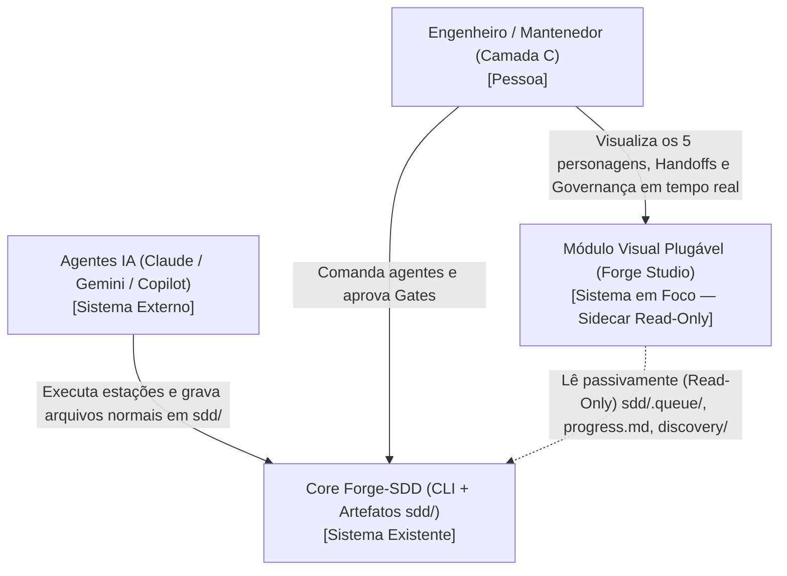
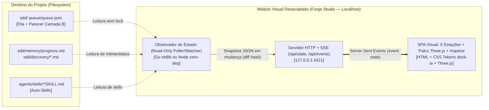
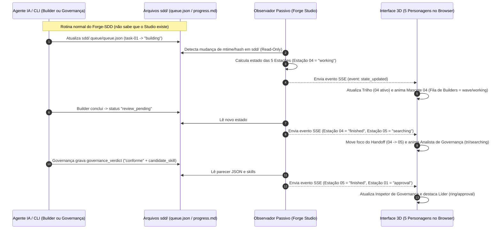

# Critérios Técnicos 59 — Módulo Visual Plugável das 5 Estações e Personagens (`Forge Studio`)

Especificação técnica e arquitetural do `discovery-59-modulo-visual-estacoes-personagens.md`. Idioma e Nível de Linguagem: `padrão` (`COD-05`).

---

## 1. Governança de Arquitetura (`ARQ-11`, `DUP-02`, `SEG-07`)

### 1.1 Modelo do módulo (`ARQ-11`)
- **Modelo:** `enxuto` (Observador Passivo Read-Only + Projeção Visual).
- **Justificativa:** O módulo **não contém regras de negócio mutáveis nem altera o estado do domínio SDD**. Ele apenas lê os artefatos já persistidos em `sdd/` (`queue.json`, `progress.md`, `discovery/*`, `features/*`, `.agents/skills/*`), consolida um DTO de leitura (`StudioSnapshot`) com a derivação determinística do estado de cada uma das 5 estações e o projeta via HTTP/SSE para a interface web Three.js.

### 1.2 O que já existe (`DUP-02` — Reuse Check Obrigatório)

| Procurei | Onde | Achei | Decisão (`reusar`, `estender`, `criar`) | Justificativa |
| --- | --- | --- | --- | --- |
| Estado determinístico da Fila e Parecer da Governança | `internal/queue/queue.go` (`sdd/.queue/queue.json`) | Structs `queue.Queue`, `queue.QueueItem`, `queue.Verdict`, `queue.Finding`, `queue.CandidateSkill` e função `queue.Load(dir)` | `reusar` | Já carrega e valida toda a fila e o veredito semântico da Camada B sem precisar de novo parser JSON |
| Diagnóstico e leitura de `progress.md` / `.sddrc` | `internal/config/` e `internal/doctor/` | Leitura de configuração do projeto, branch e saúde dos arquivos SDD | `reusar` | Evita duplicar leitura de `.sddrc` e caminhos da estrutura `sdd/` (`DUP-01`, `DUP-03`) |
| Lista de Auto-Skills propostas e aprovadas | `internal/skills/` (`.agents/skills/*/SKILL.md` e `sdd/skills/index.md`) | `skills.List(dir)` já retorna todas as skills e seus status (`proposed`, `approved`) | `reusar` | Alimenta diretamente o painel de Auto-Skills da Estação 05 / Estação 01 |
| Palco 3D dos 5 Personagens + Trilho Processual + Inspetor | `docs/showcase-v3-lp.html` | Renderizador Three.js (`buildCompactBot`), os 5 personagens (`ring`, `diamond`, `bar`, `wave`, `tri`), animações por estado, trilho `01..05` e cards de contrato `Recebe`/`Entrega` | `estender` | Reaproveitar integralmente a camada visual validada pelo usuário, adicionando cliente `EventSource` (SSE) conectado ao estado real do repositório |
| Tokens visuais e estados de mascote | `/Users/nathanramorim/git/dock-ia/produto/design-system.md` e `app/packages/ui-kit/src/mascot.ts` | Paleta dark mode (`#0d0f14`, `#12151d`, `#1a1e29`), cores semânticas e estados (`idle`, `working`, `thinking`, `searching`, `approval`, `finished`, `error`) | `reusar` | Mantém consistência visual absoluta com o ecossistema `dock-ia` |
| Provedor de Snapshot Read-Only + Stream SSE | Repositório `forge-sdd` | Não existe agregador de estado para UI nem servidor SSE local | `criar` | Criar módulo isolado (`internal/studio` ou pacote standalone conforme decisão do Gate 1) que observa `sdd/` em modo somente-leitura |

### 1.3 Dependências novas (`SEG-07`)
- **Nenhuma dependência nova no `go.mod` do `forge-sdd`.**
  - Se empacotado como subcomando opcional (`forge-sdd studio` — Opção A1), utiliza exclusivamente `net/http`, `embed.FS`, `os` e `path/filepath` da biblioteca padrão do Go (`ARQ-03`, `ARQ-04`).
  - Se empacotado como utilitário Node externo (Opção A2), utiliza apenas APIs nativas do Node.js (`node:http`, `node:fs`) sem impactar o `go.mod`.
  - No front-end (navegador), utiliza o bundle `Three.js` já referenciado no showcase (`three@0.160.0`), com fallback gracioso para badge/avatar 2D caso o ambiente esteja 100% offline sem cache.

---

## 2. Arquitetura (C4 Model — Mermaid)

### 2.1 Nível 1 — Diagrama de Contexto (C4 Context)



### 2.2 Nível 2 — Diagrama de Contêineres (C4 Container)



### 2.3 Nível 3 — Diagrama de Sequência (Fluxo Temporal Ao Vivo)



---

## 3. Contratos de Entrada/Saída e Regras de Derivação de Estado

### 3.1 Contrato JSON do Endpoint Read-Only (`GET /api/state` e Stream `GET /api/events`)

O servidor local responde apenas em `127.0.0.1` (`SEG-01`) com o seguinte payload determinístico:

```json
{
  "project": "forge-sdd",
  "branch": "feat/59-modulo-visual-estacoes-personagens",
  "updated_at": "2026-10-31T15:50:00Z",
  "active_station": 4,
  "handoff": {
    "from": 3,
    "to": 4,
    "artifact": "sdd/.queue/queue.json (task-01 -> building)",
    "loop_rejection": false
  },
  "stations": [
    {
      "id": 1,
      "role": "O Líder",
      "subtitle": "Orquestrador Executivo",
      "color": "#f2a65a",
      "mark": "ring",
      "state": "idle",
      "badge_label": "MONITORANDO",
      "current_focus": "Acompanhando execução da fila (feat-59)",
      "input_contract": "Demanda do usuário + Parecer JSON da Governança",
      "output_contract": "Aprovação Gate 1 (FLX-01), despacho de fila e release"
    },
    {
      "id": 2,
      "role": "PM & Arquiteto",
      "subtitle": "Concepção & C4 Model",
      "color": "#8aa4ff",
      "mark": "diamond",
      "state": "finished",
      "badge_label": "SPEC APROVADA",
      "current_focus": "discovery-59 + criteria-59 (reviewed)",
      "input_contract": "Problema + constitution.md + concepts.md",
      "output_contract": "discovery-ID.md + criteria-ID.md (DUP-02 + C4)"
    },
    {
      "id": 3,
      "role": "O Planejador",
      "subtitle": "Plan & Mapeamento de Rules",
      "color": "#c9a7ff",
      "mark": "bar",
      "state": "finished",
      "badge_label": "FILA GERADA",
      "current_focus": "3 tasks enfileiradas em sdd/.queue/queue.json",
      "input_contract": "Spec revisada (FLX-01) + .agents/rules/*.md",
      "output_contract": "plan-ID.md + queue.json com rules por task"
    },
    {
      "id": 4,
      "role": "Fila de Builders",
      "subtitle": "Executores Isolados",
      "color": "#4fd1b5",
      "mark": "wave",
      "state": "working",
      "badge_label": "CONSTRUINDO (1/3)",
      "current_focus": "task-01: Implementar snapshot read-only",
      "input_contract": "Task da fila + lessons.md + Rules/Skills da task",
      "output_contract": "Código + go test/vet + status review_pending"
    },
    {
      "id": 5,
      "role": "Analista de Governança",
      "subtitle": "Auditor Read-Only (Camada B)",
      "color": "#ff8a5c",
      "mark": "tri",
      "state": "idle",
      "badge_label": "AGUARDANDO BUILDER",
      "current_focus": "Pronto para auditar S-01..S-07",
      "input_contract": "<spec> + <diff> (FLX-08) + Camada A (P-xx)",
      "output_contract": "Parecer JSON com evidência + Auto-Skill (DUP-05)"
    }
  ],
  "queue": {
    "spec_status": "reviewed",
    "counts": {
      "queued": 2,
      "building": 1,
      "review_pending": 0,
      "approved": 0,
      "changes_requested": 0
    },
    "items": []
  },
  "skills": []
}
```

### 3.2 Regra Determinística de Derivação da Estação Ativa e Estados dos Mascotes

A função pura de derivação avalia o estado de `sdd/` na seguinte ordem de precedência:
1. **Tarefa em Revisão (`any(item.status == "review_pending")`):**
   - `active_station = 5` (Analista de Governança em `searching`); Estação 04 em `finished`; Handoff `04 → 05`.
2. **Tarefa Rejeitada pela Governança (`any(item.status == "changes_requested")`):**
   - `active_station = 4` (Fila de Builders em `error` / retrabalho); Estação 05 em `error` (exibindo a violação no Inspetor); Handoff de retorno `05 ↺ 04` (`loop_rejection = true`).
3. **Tarefa em Construção (`any(item.status == "building")`):**
   - `active_station = 4` (Fila de Builders em `working`); Estações 02 e 03 em `finished`; Handoff `03 → 04`.
4. **Fila Pronta Aguardando Primeiro Claim (`len(items) > 0 && all(item.status == "queued")`):**
   - `active_station = 3` (Planejador em `working`/`finished` entregando a fila); Handoff `03 → 04`.
5. **Todas as Tarefas Aprovadas (`len(items) > 0 && all(item.status == "approved")`):**
   - `active_station = 1` (Líder em `approval`/`finished` para Camada C e fechamento); Estações 02, 03, 04 e 05 em `finished`; Handoff `05 → 01`.
6. **Discovery/Criteria Recente Sem Plano ou `spec_status != "reviewed"`:**
   - Se existe `discovery-ID.md` e `criteria-ID.md` sem `plan-ID.md`: `active_station = 2` (PM & Arquiteto em `thinking`) e Estação 01 em `approval` (Gate 1 `FLX-01`); Handoff `02 → 01`.
7. **Repositório em Repouso (Sem fila ativa):**
   - `active_station = 1` (O Líder em `idle`, pronto para nova demanda); demais estações em `idle`.

---

## 4. Garantias de Desacoplamento, Segurança e Casos de Borda

### 4.1 Garantias de Desacoplamento e Segurança (`ARQ-*` / `SEG-*`)
- **Zero Mutação (`SEG-02` / `SEG-06`):** O servidor do módulo visual não possui endpoints `POST`, `PUT`, `DELETE` ou `PATCH` que escrevam em `sdd/`. Ele apenas lê o disco.
- **Bind Estrito em Loopback (`SEG-01`):** O servidor HTTP escuta por padrão exclusivamente em `127.0.0.1` (localhost), nunca expondo dados do repositório na rede local (`0.0.0.0`), a menos que explicitamente configurado via flag pelo usuário.
- **Zero Vazamento de Segredos (`SEG-04` / `SEG-05`):** O endpoint `/api/state` lê apenas metadados estruturados de `sdd/` (`queue.json`, nomes e títulos de specs, contadores e pareceres da governança), nunca lendo arquivos `.env`, credenciais ou código-fonte arbitrário fora de `sdd/`.
- **Zero Impacto em Falha ou Ausência (`ARQ-01`):** Se o módulo visual for encerrado (`Ctrl+C`) no meio de uma execução do Builder, nada falha no `forge-sdd`.

### 4.2 Casos de Borda Tratados
1. **Arquivo `sdd/.queue/queue.json` ausente (projeto recém-iniciado):** O módulo não retorna erro 500; retorna `queue.items = []`, Estação 01 em `idle` e permite usar o **Modo Simulação (`DEMO`)** normalmente.
2. **Escrita concorrente em `queue.json`:** Se o observador ler `queue.json` no exato milissegundo em que a CLI estiver gravando (JSON truncado temporário), o observador mantém o último snapshot válido em memória e tenta novamente no ciclo seguinte (150ms depois), evitando piscar erro na UI.
3. **Ambiente sem WebGL / GPU desabilitada:** Se o navegador não puder criar contexto WebGL para o `Three.js`, cada card renderiza automaticamente o fallback SVG 2D com a cor e a marca peitoral (`ring`, `diamond`, `bar`, `wave`, `tri`) da respectiva estação.

---

## 5. Critérios de Aceitação Executáveis (`CA-01` a `CA-08` — `TST-01..05`)

- **CA-01 (Isolamento e Desacoplamento Total):** Executar toda a suíte `go test ./...` e `go vet ./...` do `forge-sdd` com o módulo visual desligado; 100% dos comandos existentes (`init`, `update`, `doctor`, `status`, `queue`, `gate`, `skills`, `session`) devem funcionar sem qualquer dependência do módulo visual.
- **CA-02 (Derivação Determinística dos 5 Personagens):** Testes automatizados unitários validando as 7 regras de transição da seção 3.2 (repouso, concepção no Gate 1, fila criada pelo Planejador, Builder em `building`, Governança em `review_pending`, rejeição `changes_requested` com loop `05 ↺ 04` e aprovação total `05 → 01`).
- **CA-03 (Fidelidade dos 5 Personagens e Marcas `dock-ia`):** A interface renderiza exatamente os 5 personagens (`01. O Líder` `#f2a65a` `ring`, `02. PM & Arquiteto` `#8aa4ff` `diamond`, `03. O Planejador` `#c9a7ff` `bar`, `04. Fila de Builders` `#4fd1b5` `wave`, `05. Analista de Governança` `#ff8a5c` `tri`) com os tokens escuros do `dock-ia` e animações correspondentes aos estados (`idle`, `working`, `thinking`, `searching`, `approval`, `finished`, `error`).
- **CA-04 (Visão Processual de Handoff e Contratos):** Cada card de estação exibe explicitamente os blocos **`Recebe (Entrada)`** e **`Entrega (Saída)`**, e o trilho superior destaca a estação ativa e a direção do Handoff (`01 → 02 → 03 → 04 → 05` e loop `05 ↺ 04`).
- **CA-05 (Sincronização em Tempo Real via SSE):** Ao alterar `sdd/.queue/queue.json` no disco (ex.: mudando uma task de `queued` para `building` ou gravando um `governance_verdict`), o stream `/api/events` emite o novo estado em menos de 1 segundo e os personagens mudam de postura sem recarregar a página.
- **CA-06 (Inspetor de Governança Ao Vivo):** Quando `queue.json` contém um `governance_verdict` com `achados[]` ou `candidate_skill`, o Inspetor de Governança na UI exibe a regra violada, arquivo, linha, evidência e a Auto-Skill proposta.
- **CA-07 (Modo Simulação / Demo Integrado):** Mesmo em um diretório sem fila ativa, o usuário pode alternar na UI para o **Modo Simulação** e clicar em qualquer uma das 5 estações (ou no botão de simular fluxo completo) para ver os personagens e contratos em ação.
- **CA-08 (Garantia Read-Only e Resiliência a JSON Parcial):** Testes negativos (`TST-03`) comprovando que o observador nunca modifica arquivos em `sdd/`, ignora leituras de JSON incompleto mantendo o último snapshot válido e responde apenas em loopback por padrão.
