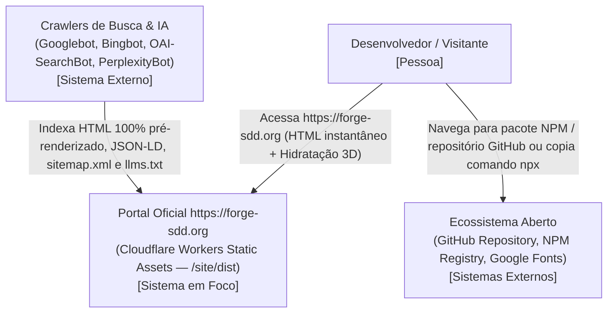
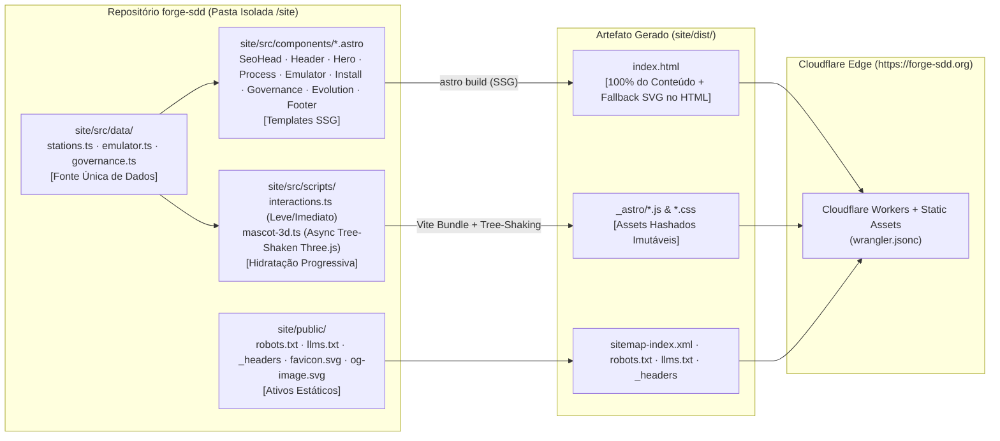
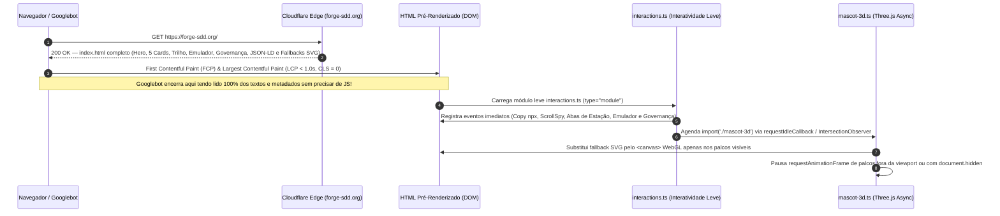

# Critérios Técnicos 60 — Site Estático Oficial (`https://forge-sdd.org`) em Astro com Otimização de SEO e Performance

Especificação técnica, arquitetural e critérios de aceitação executáveis do `discovery-60-site-estatico-seo-performance.md`, consolidando a migração 1:1 ("De-Para" estrito) de `docs/showcase-v3-lp.html` para uma aplicação estática **Astro 5 (`output: 'static'`)** isolada na pasta `/site`, hospedada na **Cloudflare (Cloudflare Workers com Static Assets)** sob o domínio **`https://forge-sdd.org`**. Idioma e Nível de Linguagem: `padrão` (`COD-05`).

---

## 1. Governança de Arquitetura (`ARQ-11`, `DUP-02`, `SEG-07`)

### 1.1 Modelo do módulo (`ARQ-11`)
- **Modelo:** `enxuto` em relação ao binário Go do `forge-sdd` (zero alteração em `cmd/`, `internal/` ou `go.mod`, preservando `ARQ-01` e `ARQ-04`) e `completo` dentro da fronteira isolada `/site` (arquitetura SSG em Astro com separação entre dados tipados em `site/src/data/`, componentes de apresentação pré-renderizados em `site/src/components/`, motor de hidratação progressiva + WebGL em `site/src/scripts/` e configuração de borda em `site/wrangler.jsonc`).
- **Justificativa:** O site público `https://forge-sdd.org` é um artefato de distribuição web estática independente da CLI Go. Isolá-lo em `/site` garante que o binário `forge-sdd` continue com zero dependências externas de runtime (`ARQ-04`), enquanto a aplicação web aproveita o pipeline de compilação estática do Astro/Vite para entregar HTML 100% pré-renderizado aos motores de busca e *bundles* JS com *tree-shaking*.

### 1.2 O que já existe (`DUP-02` — Reuse Check Obrigatório)

| Procurei | Onde | Achei | Decisão (`reusar`, `estender`, `criar`) | Justificativa |
| --- | --- | --- | --- | --- |
| Design System, layout, textos, estilos e lógica interativa da Landing Page v3.0 | `docs/showcase-v3-lp.html` | Arquivo HTML único (2.397 linhas) contendo todos os tokens CSS (`:root`), SVG sprite (`#ico-github`, `#ico-npm`, `#ico-instagram`), Header sticky com ScrollSpy, Hero, Seções `01` a `05`, dados `STATIONS`, `EMU_STEPS`, `GOV_SCENARIOS`, `STATE_DEFS` e função `createForgeMascot3D` | `reusar` e `estender` | Portar 1:1 sem alterar nenhuma regra visual ou textual, decompondo em componentes Astro pré-renderizados no build time (SSG) para eliminar os containers vazios (`#stepperTrack`, `#agentsGrid`, `#emuLog`, `#govTerminal`) que dependiam de JS para existir no DOM |
| Metadados canônicos do pacote NPM e repositório GitHub | `package.json` (raiz), `README.md`, `sdd/memory/constitution.md` | Nome `@nathanramorim/forge-sdd`, versão `3.0.0-beta`, licença `MIT`, URL `https://github.com/nathanramorim/forge-sdd` | `reusar` | Fonte única da verdade para os schemas JSON-LD (`SoftwareApplication`, `WebSite`), tags OpenGraph e manifesto `/llms.txt` (`DUP-04`) |
| Projeto Astro SSG isolado e configuração Cloudflare Workers | `/site` | Não existe diretório `/site` no repositório | `criar` | Criar `/site` (`site/package.json`, `site/astro.config.mjs`, `site/wrangler.jsonc`, `site/src/`, `site/public/`) isolado do módulo Go |

### 1.3 Dependências novas (`SEG-07`)
- **No módulo Go (`go.mod`):** **Nenhuma** (`ARQ-04` integralmente preservado).
- **No workspace isolado `/site/package.json` (exclusivo para build estático da LP):**

| Pacote (`site/package.json`) | Escopo | Licença | Justificativa Técnica (`SEG-07`) |
| --- | --- | --- | --- |
| `astro` (`^5.x`) | `dependencies` (Build SSG) | MIT | Compilador SSG oficial (`output: 'static'`) que gera HTML estático puro com zero JS desnecessário por padrão e suporte nativo a TypeScript e Sitemap |
| `@astrojs/sitemap` (`^3.x`) | `dependencies` (Build SSG) | MIT | Geração determinística de `sitemap-index.xml` e `sitemap-0.xml` apontando para `https://forge-sdd.org` no momento do build |
| `three` (`^0.170.x` ou compatível com API `r128`) | `dependencies` (Client Bundle com Tree-Shaking) | MIT | Substitui o `<script src="https://cdnjs.cloudflare.com/.../three.min.js">` bloqueante do `<head>` por importação modular ESM com *tree-shaking* pelo Vite, carregado de forma assíncrona após o *first paint* |
| `@types/three` (`^0.170.x`) | `devDependencies` | MIT | Tipagem estática para o módulo `mascot-3d.ts` sem impacto no bundle final |

---

## 2. Arquitetura (C4 Model — Mermaid)

### 2.1 Nível 1 — Diagrama de Contexto (C4 Context)



### 2.2 Nível 2 — Diagrama de Contêineres e Pipeline de Build (C4 Container)



### 2.3 Nível 3 — Diagrama de Sequência (Pré-Renderização SSG + Hidratação Não-Bloqueante)



---

## 3. Arquitetura Detalhada da Pasta `/site`

### 3.1 Estrutura de Diretórios de `/site`

```text
site/
├── package.json
├── tsconfig.json
├── astro.config.mjs
├── wrangler.jsonc
├── public/
│   ├── _headers
│   ├── robots.txt
│   ├── llms.txt
│   ├── favicon.svg
│   └── og-image.svg
└── src/
    ├── layouts/
    │   └── BaseLayout.astro
    ├── components/
    │   ├── SeoHead.astro
    │   ├── SvgSprite.astro
    │   ├── Header.astro
    │   ├── Hero.astro
    │   ├── MascotFallbackSvg.astro
    │   ├── ProcessSection.astro
    │   ├── EmulatorSection.astro
    │   ├── InstallSection.astro
    │   ├── GovernanceSection.astro
    │   ├── EvolutionSection.astro
    │   └── Footer.astro
    ├── data/
    │   ├── stations.ts
    │   ├── emulator.ts
    │   └── governance.ts
    ├── scripts/
    │   ├── interactions.ts
    │   └── mascot-3d.ts
    ├── styles/
    │   └── global.css
    └── pages/
        └── index.astro
```

### 3.2 Pré-Renderização Estática (SSG) + Hidratação Leve ("De-Para" Sem Perda Visual)

1. **Fonte Única de Dados (`site/src/data/`):**
   - `stations.ts` exporta `STATE_DEFS` e `STATIONS` (exatamente os 5 agentes com os mesmos textos, cores `#f2a65a`, `#8aa4ff`, `#c9a7ff`, `#4fd1b5`, `#ff8a5c`, marcas `ring`, `diamond`, `bar`, `wave`, `tri`, contratos `inputArtifact`/`outputArtifact` e frases por estado).
   - `emulator.ts` exporta `EMU_STEPS` (os 5 passos: `1. $ forge init`, `2. /discovery`, `3. /split-features`, `4. /proxima-feature`, `5. /revisar`).
   - `governance.ts` exporta `GOV_SCENARIOS` (os 4 cenários: `SEG-01 · P-13`, `DUP-01 · DUP-02`, `ARQ-01 · TST-01`, `FLX-03 · DUP-05`).
2. **HTML Estático Completo no Build (`ProcessSection.astro`, `EmulatorSection.astro`, `GovernanceSection.astro`):**
   - Ao contrário de `docs/showcase-v3-lp.html` (onde `#stepperTrack`, `#agentsGrid`, `#emuLog`, `#emuFileList` e `#govTerminal` vinham vazios no HTML), os componentes `.astro` iteram sobre `STATIONS`, `EMU_STEPS[0]` e `GOV_SCENARIOS[0]` em tempo de compilação e emitem **exatamente a mesma árvore DOM, com os mesmos `id`s, classes e atributos `style="--c:..."`** que o JavaScript gerava.
   - Dentro de cada `.avatar-stage` (`#avatar-0..4`), `#emuAvatarMount` e `#govAvatarMount`, o Astro renderiza o componente `MascotFallbackSvg.astro`, um SVG vetorial leve que desenha a silhueta do robô na cor da estação (`st.color`), marca peitoral e olhos correspondentes ao estado inicial.
3. **Separação entre Interatividade de UI (`interactions.ts`) e Motor WebGL (`mascot-3d.ts`):**
   - `interactions.ts` acopla os `addEventListener` aos elementos já existentes no DOM (`#step-node-0..4`, `.agent-card`, `.state-pill`, `#prevStepBtn`, `#nextStepBtn`, `#toggleCycleBtn`, `.emu-cmd-btn`, `#emuNextStepBtn`, `.gov-tab`, `#govBtnFix`, `#govBtnNext`, `#toggleGovCycleBtn`, `#copyHeroBtn` e o `IntersectionObserver` do ScrollSpy). Todas as trocas de estado funcionam instantaneamente mesmo antes do Three.js terminar de carregar!
   - `mascot-3d.ts` importa de `three` apenas as primitivas utilizadas em `createForgeMascot3D`, inicializa os contextos WebGL de forma não-bloqueante e expõe a interface de controle (`setState`, `triggerHop`, `update`) para `interactions.ts`.
   - Um `IntersectionObserver` monitora cada palco 3D e atualiza `isVisible`: no loop `requestAnimationFrame`, `renderer.render(scene, camera)` só é invocado se `isVisible && !document.hidden`.

---

## 4. Especificação de SEO Técnico e GEO (`https://forge-sdd.org`)

### 4.1 Meta Tags e Links no `<head>` (`SeoHead.astro`)
- `<title>Forge-SDD 3.0 — Orquestração Autônoma em 5 Estações & Governança IA (Open Source · MIT)</title>`
- `<meta name="description" content="Framework Open Source (MIT) de Spec-Driven Development que organiza agentes de IA (Claude Code, Gemini, GitHub Copilot) em 5 estações especializadas com fila determinística e auditoria de Governança Read-Only.">`
- `<link rel="canonical" href="https://forge-sdd.org/">`
- `<meta name="robots" content="index, follow, max-image-preview:large, max-snippet:-1, max-video-preview:-1">`
- `<meta name="theme-color" content="#0d0f14">`
- **OpenGraph:**
  - `og:type`: `"website"`
  - `og:locale`: `"pt_BR"`
  - `og:site_name`: `"Forge-SDD"`
  - `og:url`: `"https://forge-sdd.org/"`
  - `og:title`: `"Forge-SDD 3.0 — De um agente fazendo tudo sozinho para 5 especialistas em esteira"`
  - `og:description`: `"Instale em qualquer repositório com npx @nathanramorim/forge-sdd@latest init. Orquestração em 5 estações, fila paralela e Governança Read-Only em 3 camadas."`
  - `og:image`: `"https://forge-sdd.org/og-image.svg"` (com dimensões `1200x630` e `og:image:alt`)
- **Twitter Cards:**
  - `twitter:card`: `"summary_large_image"`
  - `twitter:title`, `twitter:description`, `twitter:image`

### 4.2 Dados Estruturados JSON-LD (`application/ld+json`)
Injetado estaticamente no `<head>` com `@graph` contendo:
1. **`SoftwareApplication`:**
   - `"name": "Forge-SDD"`
   - `"applicationCategory": "DeveloperApplication"`
   - `"operatingSystem": "macOS, Linux, Windows"`
   - `"softwareVersion": "3.0.0-beta"`
   - `"license": "https://opensource.org/licenses/MIT"`
   - `"url": "https://forge-sdd.org/"`
   - `"codeRepository": "https://github.com/nathanramorim/forge-sdd"`
   - `"downloadUrl": "https://www.npmjs.com/package/@nathanramorim/forge-sdd"`
   - `"offers": { "@type": "Offer", "price": "0", "priceCurrency": "USD" }`
2. **`WebSite`:**
   - `"name": "Forge-SDD"`, `"url": "https://forge-sdd.org/"`, `"inLanguage": "pt-BR"`
3. **`FAQPage`:**
   - Perguntas e respostas estruturadas extraídas fielmente do conteúdo da página (Como instalar o Forge-SDD via NPM/NPX, Como funcionam as 5 estações de agentes, Como funciona a Governança em 3 Camadas e a diferença entre v2.x e v3.0-beta).

### 4.3 Arquivos de Indexação (`robots.txt`, `sitemap-index.xml`, `llms.txt`)
- **`site/public/robots.txt`:**
  ```text
  User-agent: *
  Allow: /

  Sitemap: https://forge-sdd.org/sitemap-index.xml
  ```
- **`site/public/llms.txt`:** Documento Markdown estruturado na raiz (`https://forge-sdd.org/llms.txt`) detalhando missão, instalação (`npm install -g @nathanramorim/forge-sdd` / `npx @nathanramorim/forge-sdd@latest init`), as 5 estações (`01. O Líder`, `02. PM & Arquiteto`, `03. O Planejador`, `04. Fila de Builders`, `05. Analista de Governança`), comandos de chat e CLI, e links canônicos.

---

## 5. Configuração Cloudflare Workers & Static Assets (`https://forge-sdd.org`)

### 5.1 `site/wrangler.jsonc`
Configurado para servir os ativos gerados em `./dist` na borda da Cloudflare com rota customizada para `forge-sdd.org`:
```jsonc
{
  "$schema": "node_modules/wrangler/config-schema.json",
  "name": "forge-sdd-site",
  "compatibility_date": "2026-01-01",
  "assets": {
    "directory": "./dist",
    "not_found_handling": "404-page"
  },
  "routes": [
    { "pattern": "forge-sdd.org", "custom_domain": true },
    { "pattern": "www.forge-sdd.org", "custom_domain": true }
  ]
}
```

### 5.2 Cabeçalhos de Performance e Segurança (`site/public/_headers`)
```text
/*
  X-Content-Type-Options: nosniff
  X-Frame-Options: DENY
  Referrer-Policy: strict-origin-when-cross-origin
  Permissions-Policy: camera=(), microphone=(), geolocation=()

/_astro/*
  Cache-Control: public, max-age=31536000, immutable

/favicon.svg
  Cache-Control: public, max-age=86400

/og-image.svg
  Cache-Control: public, max-age=86400
```

---

## 6. Critérios de Aceitação Executáveis (`CA-01` a `CA-10` — `TST-01..05`)

- **CA-01 (Isolamento Total do Binário Go — `ARQ-01`, `ARQ-04`):** Executar `go test ./...` e `go vet ./...` na raiz do repositório; `go.mod` e `go.sum` não sofrem nenhuma alteração e todos os testes Go passam com Exit 0.
- **CA-02 (Build Estático Limpo em `/site`):** Executar `npm --prefix site run build` gera o diretório `site/dist/` sem erros ou avisos de tipagem, produzindo `site/dist/index.html`, `site/dist/sitemap-index.xml`, `site/dist/robots.txt`, `site/dist/llms.txt` e `site/dist/_headers`.
- **CA-03 (Fidelidade Visual e Estrutural 1:1 — "De-Para" Estrito):** O arquivo `site/dist/index.html` preserva 100% das variáveis CSS (`--bg: #0d0f14`, `--bg2: #12151d`, `--bg3: #1a1e29`, `--accent: #4f8ef7`, `--ok: #3ecf8e`, `--warn: #f5b04a`, `--bad: #f2677a`), fontes (`Montserrat` e `JetBrains Mono`), defs SVG (`#ico-github`, `#ico-npm`, `#ico-instagram`), Header sticky, Hero com comando `npx @nathanramorim/forge-sdd@latest init` e as 5 seções (`#estacoes`, `#emulador`, `#instalacao`, `#governanca`, `#evolucao`) + `<footer>`.
- **CA-04 (Pré-Renderização Estática Integral para Crawlers sem JS):** Inspecionar `site/dist/index.html` diretamente (sem executar JavaScript) comprova que:
  1. `#stepperTrack` já contém os 5 botões `#step-node-0` a `#step-node-4`;
  2. `#agentsGrid` já contém os 5 `<article class="agent-card">` com os títulos `O Líder (Orquestrador)`, `Produto & Arquiteto`, `O Planejador`, `Fila de Builders` e `Analista de Governança`, além de seus contratos `Recebe (Entrada)` e `Entrega (Saída)`;
  3. `#emuLog` e `#emuFileList` já contêm o passo inicial renderizado (`$ forge init . --agent claude,gemini --name checkout-api`);
  4. `#govTerminal` já contém o cenário inicial renderizado (`SEG-01 · P-13`).
- **CA-05 (Remoção de Script Bloqueante e Tree-Shaking do Three.js):** `site/dist/index.html` **não** contém `<script src="https://cdnjs.cloudflare.com/ajax/libs/three.js/...` no `<head>`; o Three.js é empacotado em `site/dist/_astro/` com carregamento assíncrono/deferido e cada palco de avatar exibe um `<svg>` de fallback estático imediato (`CLS = 0`).
- **CA-06 (SEO Técnico Completo para `https://forge-sdd.org`):** `site/dist/index.html` contém `<link rel="canonical" href="https://forge-sdd.org/">`, `<meta name="description">`, `<meta name="robots" content="index, follow...">`, tags OpenGraph completas (`og:url`, `og:title`, `og:description`, `og:image`), Twitter Cards e bloco `<script type="application/ld+json">` válido com `SoftwareApplication`, `WebSite` e `FAQPage`.
- **CA-07 (Arquivos de Indexação e GEO — `robots.txt`, `sitemap`, `llms.txt`):** `site/dist/robots.txt` referencia `https://forge-sdd.org/sitemap-index.xml`, `site/dist/sitemap-index.xml` referencia `https://forge-sdd.org/` e `site/dist/llms.txt` documenta a arquitetura e comandos do Forge-SDD 3.0.
- **CA-08 (Pausa Inteligente de WebGL fora da Viewport):** O script `site/src/scripts/mascot-3d.ts` utiliza `IntersectionObserver` e verificação de `document.hidden` para renderizar no loop `requestAnimationFrame` apenas os mascotes visíveis na tela.
- **CA-09 (Configuração Pronta para Cloudflare Workers `forge-sdd.org`):** Existência e validade de `site/wrangler.jsonc` (apontando para `./dist` e domínio `forge-sdd.org`) e `site/dist/_headers` com `Cache-Control: public, max-age=31536000, immutable` para `/_astro/*` e headers de segurança.
- **CA-10 (Verificação Automatizada Executável de SEO, De-Para e Performance):** Script de verificação determinística (`npm --prefix site test` + teste Go/CLI se aplicável) que valida o HTML compilado em `site/dist/index.html` contra todos os invariantes de `CA-02` a `CA-09`, além de `forge-sdd gate` passando sem bloqueios.
