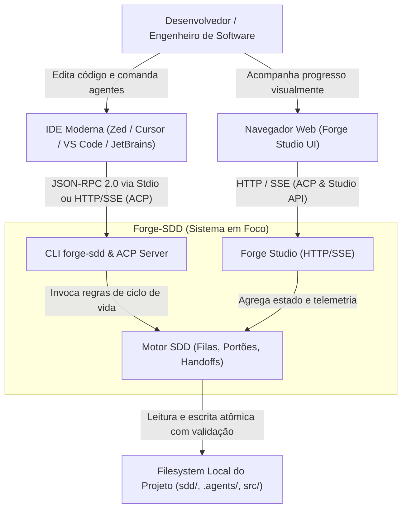
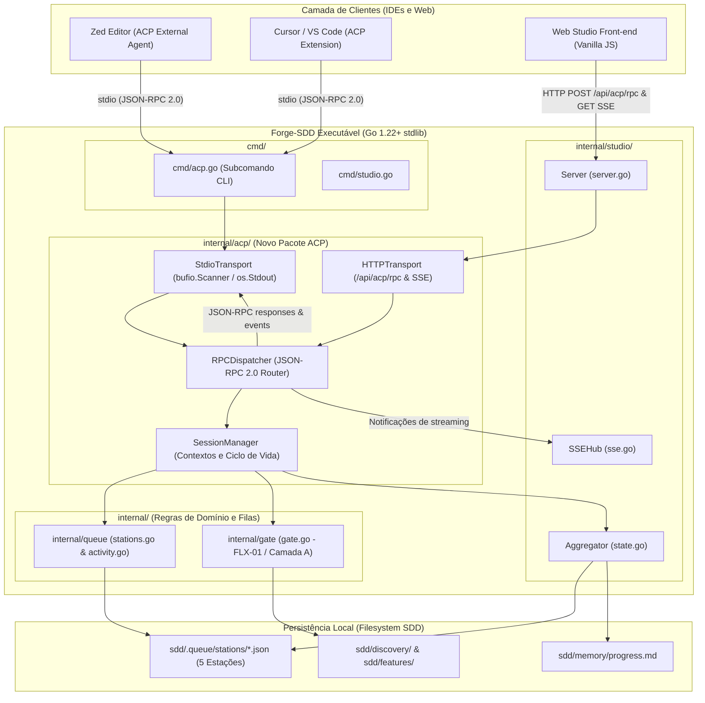
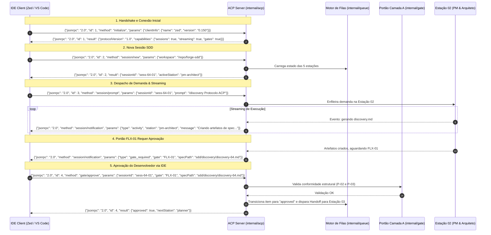

# Critérios Técnicos 64 — Integração do Protocolo ACP no Forge-SDD e Forge Studio

Especificação técnica, decisões de engenharia, arquitetura C4 e critérios de aceitação executáveis da iniciativa `feat-64-protocolo-acp-comunicacao-estacoes-studio`, em conformidade com a Constituição (`sdd/memory/constitution.md`) e os papéis canônicos de agentes (`.agents/roles/`).

---

## 1. Governança de Arquitetura (`ARQ-11`, `DUP-02`, `SEG-07`)

### 1.1 Modelo do módulo (`ARQ-11`)
- **Modelo:** `enxuto`.
- **Justificativa:** A integração do protocolo ACP adiciona um adaptador de comunicação fino e coeso (`internal/acp`), conectando clientes externos ao motor de filas (`internal/queue`), agregador de estado (`internal/studio/state.go`) e portões (`internal/gate`). Não introduz daemons externos, dependências de runtime pesadas ou múltiplos processos em segundo plano (`ARQ-03`, `ARQ-04`). Mantém estrita a separação de fronteiras entre CLI (`cmd/acp.go`) e domínio de negócio (`internal/`) (`ARQ-01`).

---

## O que já existe (Reuse Check — `DUP-02`)

| Procurei | Onde | Achei | Decisão (`reusar`, `estender`, `criar`) | Justificativa |
|---|---|---|---|---|
| Servidor HTTP e SSE Hub | `internal/studio/server.go`, `internal/studio/sse.go` | Servidor HTTP embutido (`127.0.0.1`) com `SSEHub` para broadcast de eventos | `estender` | Adicionar suporte ao transporte ACP via HTTP/SSE (`/api/acp/rpc`, `/api/acp/events`) reutilizando o `SSEHub` e a infraestrutura de rede já testada, sem alocar portas adicionais. |
| Agregador de Estado e Snapshot | `internal/studio/state.go` | `StudioSnapshot`, `StationDTO`, `ActiveTaskDTO` | `reusar` | O snapshot consolidado já agrega o estado das 5 estações, tarefas ativas e atividade recente; será serializado diretamente como payload de notificações ACP. |
| Motor de Filas e Handoffs | `internal/queue/stations.go`, `activity.go` | `EnqueueStationItem`, `Handoff`, `StatusApproved`, `RecordActivity` | `reusar` | Manter `internal/queue` como a única casa (`DUP-01`) para operações nas filas (`sdd/.queue/stations/*.json`). O servidor ACP apenas despacha comandos para esse motor. |
| Portão de Governança Camada A | `internal/gate/gate.go` | Verificações determinísticas `P-01` a `P-05` e validação do Portão FLX-01 | `reusar` | A aprovação de spec via ACP (`gate/approve`) invoca a validação existente do portão antes de transicionar o estado para `approved`. |
| Manipulação JSON e Streams I/O | Biblioteca Padrão Go (`encoding/json`, `bufio`, `io`) | Utilitários de serialização e leitura em streams | `reusar` | Construir o protocolo JSON-RPC 2.0 em Go stdlib puro, garantindo zero dependências de terceiros e binário estático e leve (`ARQ-04`, `SEG-07`). |
| Protocolo ACP e Tipos RPC | Não existia no repositório | Inexistente no forge-sdd | `criar` | Criar o pacote `internal/acp` contendo os tipos JSON-RPC 2.0, manipulador de sessões e os métodos do protocolo ACP (`initialize`, `session/*`, `gate/*`). |

---

## Dependências novas (`SEG-07`)

- **Nenhuma dependência externa.**
- O servidor e cliente ACP são implementados utilizando **100% da biblioteca padrão do Go** (`net/http`, `encoding/json`, `bufio`, `io`, `os`, `sync`, `context`, `time`), preservando o binário estático único e sem dependências em runtime (`ARQ-04`, `SEG-07`).

---

## 2. Visão Técnica & Arquitetura C4 Model

### 2.1 C4 Nível 1 — Diagrama de Contexto de Sistema
Mostra os limites do sistema Forge-SDD e suas interações com as IDEs externas e desenvolvedores.



### 2.2 C4 Nível 2 — Diagrama de Contêineres e Componentes
Detalhamento da arquitetura interna e do fluxo entre o cliente ACP, o servidor ACP em Go stdlib e as 5 estações.



### 2.3 C4 Nível 3 — Diagrama de Sequência (Handshake, Prompt e Aprovação FLX-01)
Demonstra o fluxo temporal de interação entre o cliente IDE, o servidor ACP e a resolução de portão.



---

## 3. Especificação dos Contratos do Protocolo ACP

### 3.1 Envelope JSON-RPC 2.0 Canônico
Todas as mensagens trocadas seguem estritamente o formato JSON-RPC 2.0:
- **Requisição:** `{"jsonrpc": "2.0", "id": "<id>", "method": "<method>", "params": { ... }}`
- **Resposta de Sucesso:** `{"jsonrpc": "2.0", "id": "<id>", "result": { ... }}`
- **Resposta de Erro:** `{"jsonrpc": "2.0", "id": "<id>", "error": {"code": <int>, "message": "<string>", "data": { ... }}}`
- **Notificação (One-Way):** `{"jsonrpc": "2.0", "method": "<method>", "params": { ... }}`

### 3.2 Tabela de Métodos RPC Suportados

| Método | Tipo | Parâmetros Principais | Resposta / Efeito |
|---|---|---|---|
| `initialize` | Request | `clientInfo: { name, version }`, `capabilities` | Devolve versão do protocolo, capacidades (`sessions`, `streaming`, `gates`) e versão do forge-sdd |
| `session/new` | Request | `workspace: string`, `agent?: string` | Cria sessão ACP, lê snapshot inicial e vincula ao diretório do projeto |
| `session/load` | Request | `sessionId: string` | Restaura estado da sessão e devolve histórico de atividades |
| `session/prompt` | Request | `sessionId: string`, `prompt: string` | Envia comando ou mensagem de texto à esteira do forge-sdd |
| `session/cancel` | Request | `sessionId: string` | Cancela ou interrompe a execução corrente na estação ativa |
| `gate/approve` | Request | `sessionId: string`, `gate: string`, `specPath: string` | Valida a spec no motor de portão e registra aprovação humana (`FLX-01`) |
| `session/notification` | Notification | `sessionId`, `type`, `station`, `payload` | Evento emitido pelo servidor informando mudança de mascote, tool executada ou log |

### 3.3 Tratamento de Erros e Códigos Padrão (`COD-03`, `SEG-05`)
- `-32700` (`Parse error`): Payload JSON inválido recebido no stream.
- `-32600` (`Invalid Request`): Estrutura JSON-RPC malformada.
- `-32601` (`Method not found`): Método RPC não implementado pelo servidor.
- `-32602` (`Invalid params`): Parâmetros obrigatórios ausentes ou caminhos inseguros (`SEG-01`).
- `-32603` (`Internal error`): Falha interna de execução tratada explicitamente com `fmt.Errorf`.
- `-32001` (`Gate Rejected`): Erro específico de negócio quando uma spec viola critérios do Portão FLX-01.

---

## 4. Critérios de Aceitação Executáveis (`CA-01` a `CA-06`)

### `CA-01`: Handshake JSON-RPC 2.0 (`initialize`) via Stdio e HTTP
- **Descrição:** O servidor ACP deve aceitar o handshake inicial via `stdio` e via endpoint HTTP `/api/acp/rpc`, respondendo com `protocolVersion`, metadados do forge-sdd e capacidades suportadas.
- **Critério Executável:**
  ```bash
  go test -v -race -run TestACPInitialize ./internal/acp/... && go vet ./...
  ```

### `CA-02`: Criação e Isolamento de Sessão (`session/new`, `session/load`)
- **Descrição:** O servidor cria e restaura sessões ACP determinísticas, isolando o workspace e lendo o estado atual das 5 estações sem colisão ou memory leak. Caminhos inválidos ou tentativas de path traversal são rejeitados com `-32602` (`SEG-01`, `SEG-02`).
- **Critério Executável:**
  ```bash
  go test -v -race -run TestACPSessionLifecycle ./internal/acp/... && go vet ./...
  ```

### `CA-03`: Streaming de Notificações e Atualização das Estações
- **Descrição:** Durante o processamento de uma tarefa, o servidor emite notificações JSON-RPC unidirecionais refletindo mudanças no estado dos mascotes (`thinking`, `working`, `approval`) e execução de ferramentas em tempo real para os clientes conectados.
- **Critério Executável:**
  ```bash
  go test -v -race -run TestACPNotificationsStreaming ./internal/acp/... && go vet ./...
  ```

### `CA-04`: Resolução do Portão FLX-01 via ACP (`gate/approve`)
- **Descrição:** A chamada RPC `gate/approve` valida a existência e integridade dos artefatos da spec (`discovery.md`, `criteria.md`), invoca o validador de portão (`internal/gate`), atualiza a fila atômica da Estação 02 para `approved` e dispara o handoff determinístico.
- **Critério Executável:**
  ```bash
  go test -v -race -run TestACPGateApproval ./internal/acp/... ./internal/queue/... && go vet ./...
  ```

### `CA-05`: Bridge Dual de Transporte (CLI Stdio e Forge Studio HTTP/SSE)
- **Descrição:** O comando CLI `forge-sdd acp` opera corretamente sobre `os.Stdin`/`os.Stdout`, e o Forge Studio (`internal/studio`) expõe as rotas `/api/acp/rpc` e `/api/acp/events` sem regressão nas rotas legadas do Studio (`/api/state`, `/api/events`).
- **Critério Executável:**
  ```bash
  go test -v -race -run TestACPTransports ./internal/acp/... ./internal/studio/... && go vet ./...
  ```

### `CA-06`: Conformidade de Governança, Vet e Zero Deps Externas
- **Descrição:** A compilação do binário final ocorre sem dependências externas (`ARQ-04`, `SEG-07`), todos os pacotes passam em `go vet ./...` (`COD-02`) e o teste completo do repositório executa com sucesso.
- **Critério Executável:**
  ```bash
  go vet ./... && go test -v -race ./internal/acp/... ./internal/studio/... ./internal/queue/...
  ```
