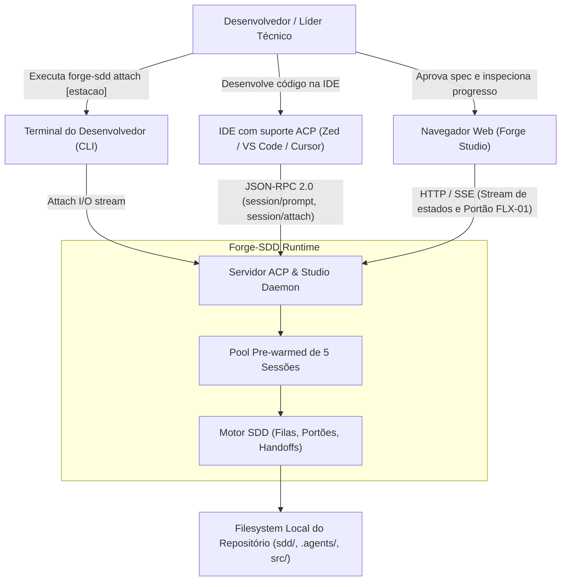
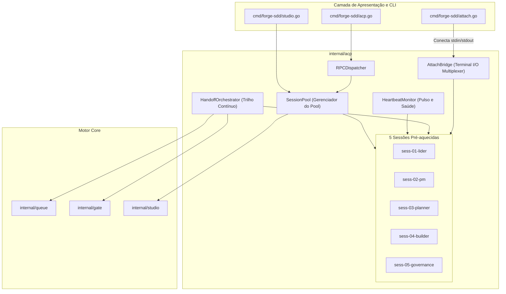

# Critérios Técnicos 65 — Pre-warming do Pool de Sessões ACP e Orquestração Contínua de Estações

Especificação técnica, decisões de engenharia, arquitetura C4 e critérios de aceitação executáveis (Gherkin) da iniciativa `feat-65-prewarming-pool-sessoes-acp-estacoes`, em conformidade com a Constituição (`sdd/memory/constitution.md`) e os papéis canônicos de agentes (`.agents/roles/`).

---

## 1. Governança de Arquitetura (`ARQ-11`, `DUP-02`, `SEG-07`)

### 1.1 Modelo do módulo (`ARQ-11`)
- **Modelo:** `enxuto`.
- **Justificativa:** A orquestração contínua e o pre-warming de sessões ACP expandem de forma coesa o pacote `internal/acp` introduzido na Feat 64. Não introduz daemons externos em background, não requer containers Docker, nem bibliotecas pesadas de terceiros (`ARQ-03`, `ARQ-04`). Reutiliza integralmente o motor de filas determinístico (`internal/queue`), a validação de portões (`internal/gate`) e o hub de eventos do Studio (`internal/studio`). Mantém a separação estrita de fronteiras entre CLI (`cmd/forge-sdd/attach.go`) e domínio (`internal/acp`) (`ARQ-01`).

---

## O que já existe (Reuse Check — `DUP-02`)

| Procurei | Onde | Achei | Decisão (`reusar`, `estender`, `criar`) | Justificativa |
|---|---|---|---|---|
| Protocolo ACP e RPC Dispatcher | `internal/acp/dispatcher.go`, `types.go` | Estruturas JSON-RPC 2.0, registro de handlers e broadcast de notificações | `estender` | Registrar os métodos `pool/warmup`, `pool/status`, `session/attach` e `session/heartbeat` mantendo o padrão unificado da Feat 64. |
| Gerenciador de Sessões e Workspaces | `internal/acp/session.go` | `SessionManager`, `ValidateWorkspace`, `Session` struct com controle de isolamento | `estender` | Adicionar suporte ao `SessionPool` com inicialização persistente e controle de estados operacionais (`standby`, `processing`, `approval_pending`, `error`). |
| 5 Estações Canônicas e Filas | `internal/queue/stations.go` | `CanonicalStations()`, `StationItem`, `EnqueueStationItem`, `Handoff` | `reusar` | O pool opera exclusivamente sobre os identificadores canônicos das 5 estações (`lider`, `pm-architect`, `planner`, `builder`, `governance`) e enfileira itens via `internal/queue`. |
| Portão de Spec e Validação Humana | `internal/gate/gate.go`, `internal/acp/gate.go` | `HandleGateApprove`, checagens determinísticas `P-02` e `P-03` | `reusar` | O orquestrador de handoff invoca a validação existente do portão FLX-01 antes de disparar o handoff contínuo para a próxima estação. |
| Forge Studio e SSEHub | `internal/studio/server.go`, `sse.go` | Servidor HTTP local, agregação de estado e broadcast de eventos SSE | `estender` | Integrar o `SessionPool` ao ciclo de inicialização do Studio (`NewServer`), disparando o pre-warming no boot e transmitindo transições visuais aos mascotes. |
| Subcomandos CLI | `cmd/forge-sdd/` | CLI Cobra com subcomandos `acp`, `studio`, `queue`, `gate` | `estender` | Adicionar o comando `forge-sdd attach [estacao]` para inspeção e controle interativo direto do terminal (`cmd/forge-sdd/attach.go`). |
| Componentes do Pool e Orquestrador | Não existia no repositório | Inexistente no forge-sdd | `criar` | Criar `internal/acp/pool.go`, `internal/acp/orchestrator.go`, `internal/acp/heartbeat.go` e `internal/acp/attach.go`. |

---

## Dependências novas (`SEG-07`)

- **Nenhuma dependência externa.**
- A implementação completa do pool de sessões, monitor de heartbeat, despacho de handoff contínuo e attach CLI utiliza **100% da biblioteca padrão do Go** (`sync`, `context`, `time`, `net/http`, `io`, `bufio`, `os`, `strings`, `fmt`), preservando o binário estático e livre de dependências de runtime (`ARQ-04`, `SEG-07`).

---

## 2. Visão Técnica & Arquitetura C4 Model

### 2.1 C4 Nível 1 — Diagrama de Contexto de Sistema
Descreve os pontos de contato entre desenvolvedor, IDEs, Forge Studio e o sistema Forge-SDD com o pool pre-warmed.



### 2.2 C4 Nível 2 — Diagrama de Contêineres e Componentes
Exibe os componentes internos responsáveis pelo pre-warming, sincronização e despacho contínuo.



---

## 3. Contratos de Dados JSON-RPC 2.0 do Pool

### 3.1 Chamada `pool/warmup`
Inicializa ou recarrega o pool de 5 sessões pre-warmed.
```json
// Request
{
  "jsonrpc": "2.0",
  "id": 1,
  "method": "pool/warmup",
  "params": {
    "workspaceDir": "/path/to/project"
  }
}

// Response
{
  "jsonrpc": "2.0",
  "id": 1,
  "result": {
    "status": "warmed",
    "sessionsCount": 5,
    "sessions": [
      {"sessionId": "sess-01-lider", "station": "lider", "state": "standby"},
      {"sessionId": "sess-02-pm", "station": "pm-architect", "state": "standby"},
      {"sessionId": "sess-03-planner", "station": "planner", "state": "standby"},
      {"sessionId": "sess-04-builder", "station": "builder", "state": "standby"},
      {"sessionId": "sess-05-governance", "station": "governance", "state": "standby"}
    ],
    "warmedAt": "2026-11-01T02:00:00Z"
  }
}
```

### 3.2 Chamada `pool/status`
Retorna o estado detalhado, saúde e telemetria de cada sessão do pool.
```json
// Request
{
  "jsonrpc": "2.0",
  "id": 2,
  "method": "pool/status"
}

// Response
{
  "jsonrpc": "2.0",
  "id": 2,
  "result": {
    "healthy": true,
    "sessions": [
      {
        "sessionId": "sess-01-lider",
        "station": "lider",
        "state": "standby",
        "lastSeenAt": "2026-11-01T02:05:00Z",
        "activeItemId": "",
        "attachedClients": 0
      },
      {
        "sessionId": "sess-02-pm",
        "station": "pm-architect",
        "state": "approval_pending",
        "lastSeenAt": "2026-11-01T02:04:55Z",
        "activeItemId": "feat-65-prewarming-pool-sessoes-acp-estacoes",
        "attachedClients": 1
      }
    ]
  }
}
```

### 3.3 Chamada `session/attach`
Conecta um cliente interativo ao canal da sessão da estação.
```json
// Request
{
  "jsonrpc": "2.0",
  "id": 3,
  "method": "session/attach",
  "params": {
    "station": "builder"
  }
}

// Response
{
  "jsonrpc": "2.0",
  "id": 3,
  "result": {
    "sessionId": "sess-04-builder",
    "station": "builder",
    "state": "processing",
    "currentItem": "feat-64-01-acp-core",
    "history": [
      {"timestamp": "2026-11-01T02:03:10Z", "type": "tool_call", "message": "Executando go test -race"}
    ]
  }
}
```

---

## 4. Critérios de Aceitação Executáveis (Gherkin)

### Cenário 1: Pre-warming automático do pool de 5 sessões no boot do Forge Studio
```gherkin
Cenário: Inicialização e pré-aquecimento automático das 5 sessões no boot
  Dado que o repositório possui uma estrutura Forge-SDD válida com diretório sdd/
  Quando o servidor Forge Studio ou o servidor ACP for inicializado
  Então o SessionPool deve pré-aquecer exatamente 5 sessões persistentes
  E as sessões devem possuir os IDs canônicos:
    | sess-01-lider      | lider        |
    | sess-02-pm         | pm-architect |
    | sess-03-planner    | planner      |
    | sess-04-builder    | builder      |
    | sess-05-governance | governance   |
  E todas as 5 sessões devem estar inicialmente com o estado "standby"
  E uma notificação ACP "pool/warmed" deve ser emitida contendo as 5 sessões
```

### Cenário 2: Heartbeat, monitoramento e detecção de saúde das sessões
```gherkin
Cenário: Monitoramento de heartbeat e atualização de telemetria periódica
  Dado que o SessionPool está ativo com as 5 sessões pré-aquecidas
  Quando o HeartbeatMonitor executar uma rodada de verificação a cada 5 segundos
  Então o timestamp "lastSeenAt" de cada sessão saudável deve ser atualizado
  E se uma sessão permanecer em estado "processing" além do limite de timeout sem emitir eventos
  Então o monitor deve emitir uma notificação ACP "session/stalled" com o ID da sessão e estação
  E o estado global do pool retornado por "pool/status" deve refletir o alerta
```

### Cenário 3: Transição visual de estados (Standby, Processing, ApprovalPending, Error)
```gherkin
Cenário: Transições determinísticas de estado visual de uma sessão
  Dado que a sessão "sess-02-pm" está em estado "standby"
  Quando um comando session/prompt for despachado para a estação "pm-architect"
  Então o estado da sessão deve transicionar imediatamente para "processing"
  E uma notificação de streaming do tipo "station_state" com estado "processing" deve ser enviada
  Quando a estação concluir a elaboração do documento de Discovery e Spec
  Então a sessão deve transicionar para "approval_pending"
  E uma notificação do tipo "gate/approval_required" deve ser emitida
  Quando o portão FLX-01 for aprovado com sucesso
  Então a sessão deve transicionar de volta para "standby"
```

### Cenário 4: Orquestração contínua de handoff via ACP com respeito ao Portão FLX-01
```gherkin
Cenário: Handoff contínuo entre Estação 02 e Estação 03 após Portão FLX-01
  Dado que a Estação 02 (PM & Arquiteto) concluiu a elaboração da Spec da Feature 65
  E a sessão "sess-02-pm" está em estado "approval_pending"
  Quando o desenvolvedor aprovar o portão via RPC "gate/approve" ou clique no Studio
  Então o validador de portão deve verificar a integridade estrutural das regras P-02 e P-03
  E o status do item na fila deve ser atualizado para "approved"
  E o HandoffOrchestrator deve ativar automaticamente a sessão "sess-03-planner"
  E a sessão "sess-03-planner" deve transicionar para "processing" sem intervenção manual
  E nenhuma task deve ser despachada para a Estação 04 (Builder) antes da aprovação do plano
```

### Cenário 5: Conexão interativa do desenvolvedor via CLI `forge-sdd attach [estacao]`
```gherkin
Cenário: Anexação interativa via terminal CLI a uma estação específica
  Dado que o pool de sessões ACP está rodando em segundo plano
  Quando o desenvolvedor executar o comando no terminal:
    """
    forge-sdd attach builder
    """
  Então o CLI deve resolver a estação canônica "builder" para a sessão "sess-04-builder"
  E deve exibir um banner com o estado atual da estação (ex: Standby ou Processing)
  E deve assinar o stream de eventos exibindo em tempo real logs e ferramentas executadas
  E deve permitir que o desenvolvedor envie mensagens ou comandos interativos
  Quando o usuário pressionar Ctrl+C ou digitar "exit"
  Então o cliente deve se desconectar graciosamente sem encerrar a sessão "sess-04-builder"
```

### Cenário 6: Rejeição de estação inválida no comando attach
```gherkin
Cenário: Validação de nome de estação inválido no comando attach
  Dado que o desenvolvedor executa "forge-sdd attach estacao-inexistente"
  Quando o comando validar o parâmetro de entrada
  Então deve retornar erro claro com código de saída não zero
  E deve listar as 5 opções canônicas válidas: lider, pm-architect, planner, builder, governance
```

### Cenário 7: Isolamento estrito de workspace e prevenção de Path Traversal (SEG-01, SEG-02)
```gherkin
Cenário: Tentativa de configurar workspace com path traversal na inicialização do pool
  Dado que uma requisição RPC "pool/warmup" é recebida com o workspaceDir contendo "../../../etc"
  Quando a validação de segurança de borda for executada pelo SessionManager
  Então a requisição deve ser rejeitada com código de erro CodeInvalidParams (-32602)
  E nenhuma sessão deve ser criada ou associada fora da raiz permitida do projeto
```

### Cenário 8: Concorrência e prevenção de Data Races sob carga (TST-01)
```gherkin
Cenário: Despacho concorrente e monitoramento simultâneo com race detector ativo
  Dado que 10 goroutines simultâneas executam operações concorrentes:
    | goroutine 1..3   | session/prompt para estações distintas         |
    | goroutine 4..6   | pool/status e leitura de métricas              |
    | goroutine 7..8   | session/attach e desanexação de canais         |
    | goroutine 9..10  | checagem periódica do HeartbeatMonitor         |
  Quando os testes de integração forem executados com "go test -race"
  Então nenhuma condição de corrida (data race) deve ser detectada
  E todos os locks devem ser liberados sem deadlock
```

---

## 5. Critérios de Validação e Comandos Executáveis

Para que a implementação seja considerada concluída nas fases de desenvolvimento, os seguintes comandos devem passar com sucesso:

```bash
# 1. Testes unitários do SessionPool e HeartbeatMonitor
go test -v -race -run "TestSessionPool" ./internal/acp/...

# 2. Testes de integração do HandoffOrchestrator e Portão FLX-01
go test -v -race -run "TestHandoffOrchestrator" ./internal/acp/... ./internal/queue/...

# 3. Testes do subcomando CLI attach e streaming
go test -v -race -run "TestAttachCommand" ./cmd/forge-sdd/... ./internal/acp/...

# 4. Checagem estática rigorosa de todo o repositório
go vet ./...
```
