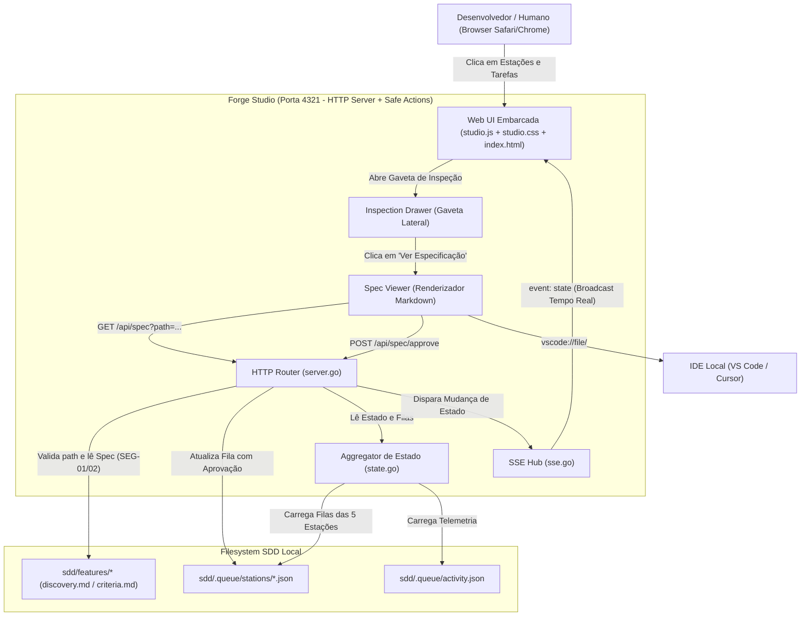
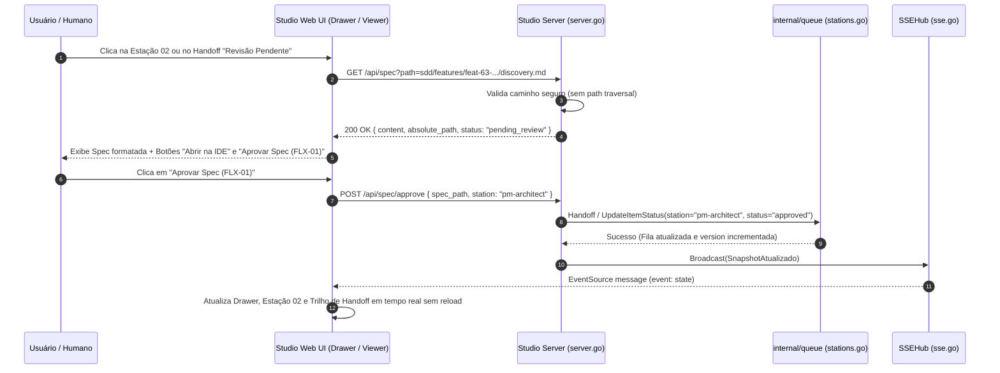

# Discovery — feat-63: Studio Navegável, Visualizador de Spec com Aprovação Humana (FLX-01) e Deep-Link de IDE

## 1. Visão Geral & Problema
No Forge Studio (v3.2.1-beta), os cartões das 5 estações e os registros de telemetria funcionam como exibições somente-leitura e estáticas. O usuário não consegue:
1. **Navegar e inspecionar:** Clicar nos cartões das estações ou tarefas para ver detalhes, regras mapeadas, filas completas e histórico.
2. **Visualizar e aprovar Spec no Studio:** O ciclo SDD exige que toda feature passe pelo **Portão 1 — Revisão Humana de Spec (`FLX-01`)**. Atualmente essa etapa não possui um estágio visual de aprovação destacado na Estação 02 (PM & Arquiteto) ou no Handoff, nem um leitor embutido de Spec.
3. **Deep-Link para a IDE:** Falta um atalho direto e seguro para abrir o arquivo da Spec (`discovery.md` / `criteria.md` / `feat-XX.md`) diretamente no VS Code (`vscode://file/<abs_path>`), Cursor (`cursor://file/<abs_path>`) ou IDE do desenvolvedor.

Esta feature transforma o Forge Studio em um cockpit interativo e navegável com renderizador de Spec, deep-links de IDE e estágio explícito de aprovação humana no Portão FLX-01 refletido em tempo real via SSE.

---

## 2. Jornada do Usuário & Escopo Funcional

### 2.1 Navegabilidade por Gaveta (Inspection Drawer)
- Ao clicar em qualquer uma das 5 estações na tela, abre-se uma gaveta lateral animada (`.station-drawer`).
- A gaveta exibe abas e seções estruturadas:
  - **Tarefas da Fila:** Lista detalhada de itens com status, tentativa, id, artefatos associados e regras aplicáveis da Constituição (`ARQ-*`, `SEG-*`, `DUP-*`, `COD-*`, `TST-*`, `FLX-*`, `GOV-*`).
  - **Contratos:** Contrato de entrada recebido e contrato de saída entregue em conformidade com `.agents/roles/`.
  - **Tools & Telemetria:** Histórico das últimas ferramentas executadas e comandos disparados pela estação (`run_command`, `read_file`, `write_file`, `gate`, etc.).
- Ao clicar em uma tarefa específica dentro da fila, a gaveta foca nos detalhes da task e exibe o botão **"Ver Especificação"**.

### 2.2 Visualizador de Spec & Deep-Link de IDE
- Endpoint seguro `GET /api/spec?path=<path>`:
  - Sanitiza o caminho impedindo *path traversal* (`..`) e limitando a leitura estrita a arquivos sob o diretório do projeto (`sdd/features/`, `sdd/discovery/`, etc.) em conformidade com `SEG-01` e `SEG-02`.
  - Retorna o conteúdo Markdown da Spec, caminho absoluto no sistema de arquivos, status de aprovação e metadados.
- Componente modal/drawer no Studio renderiza a Spec com títulos formatados, tabelas, blocos de código e checklist executável.
- Botão **"Abrir no VS Code / IDE"**:
  - Deep-link `vscode://file/<caminho_absoluto>` para abertura imediata no editor do usuário.
  - Suporte a fallback/alternativas (ex: link `cursor://file/<caminho_absoluto>` ou botão de cópia rápida do comando `code <path>`).

### 2.3 Fase e Painel de Aprovação Humana da Spec (`Portão FLX-01`)
- Na **Estação 02 (PM & Arquiteto)** e no **Trilho de Handoff**:
  - Quando houver uma Spec com status `pending_review` ou em elaboração, a Estação 02 exibe o estado visual `approval` com badge pulsante **"Aguardando Revisão Humana (FLX-01)"**.
  - No Trilho de Handoff superior, a transição `02 (PM & Arquiteto) → 03 (Planejador)` ganha destaque visual com indicação de bloqueio do portão até que haja a aprovação humana.
  - O visualizador de Spec exibe os botões de ação:
    - **"Revisar na IDE"** (abre no editor).
    - **"Aprovar Spec (FLX-01)"** (dispara ação segura para marcar a spec/tarefa como aprovada e liberar a fila para o Planejador/Builder).
- Endpoint `POST /api/spec/approve`:
  - Recebe `{ "spec_path": "...", "station": "pm-architect" }`.
  - Transiciona o estado do item na fila da estação 02 para `approved` e dispara o Handoff ou avanço de fase.
  - Notifica o `SSEHub` para propagar broadcast imediato a todos os clientes conectados.

### 2.4 Tempo Real via SSE (Sem Reload)
- Todas as atualizações (novos itens na fila, alteração de status de mascote, comandos executados, aprovação da Spec no Portão FLX-01) emitem eventos `event: state` pelo SSE Hub.
- A interface web atualiza os componentes em tempo real sem qualquer recarregamento de página (`F5`).

---

## 3. Arquitetura e Diagramas C4

### 3.1 Modelo do Módulo (`ARQ-11`)
- **Tipo:** `enxuto`.
- **Justificativa:** A funcionalidade estende diretamente o pacote existente [`internal/studio`](file:///Users/nathanramorim/git/forge-sdd/internal/studio) e seus assets embarcados (`embed.FS`), sem criação de novos binários, daemons externos ou bibliotecas de terceiros no Go (`ARQ-03`, `ARQ-04`). Mantém fronteiras estritas entre `cmd/` e `internal/` (`ARQ-01`).

### 3.2 Diagrama C4 (Nível 2 — Contêineres e Interações)

### 3.3 Diagrama de Sequência (Aprovação de Spec no Portão FLX-01)

---

## 4. O que já existe (Reuse Check — `DUP-02`)

| Procurei | Onde | Achei | Decisão | Justificativa |
|---|---|---|---|---|
| Servidor HTTP e Router | `internal/studio/server.go` | `Server` com `ServeMux` e assets embutidos `embed.FS` | Estender | Adicionar endpoint `GET /api/spec` seguro com validação de path traversal e endpoint seguro de aprovação `POST /api/spec/approve` |
| Agregador de Estado | `internal/studio/state.go` | `StudioSnapshot`, `StationDTO`, `ActiveTaskDTO` | Estender | Enriquecer snapshot com detalhes das tarefas, regras aplicáveis e identificação de spec pendente de aprovação |
| Fila e Portão FLX-01 | `internal/gate/gate.go` e `internal/queue/stations.go` | Verificação `P-02` (spec existe) e `Handoff` | Reusar | Utilizar regras de transição canônica sem duplicar lógica de filas (`DUP-01`, `DUP-03`) |
| Componentes Web e CSS | `internal/studio/assets/studio.css` | Design system dark theme, chips, cards, animações | Estender | Criar classes da Gaveta Lateral (`.station-drawer`), do visualizador de Markdown (`.spec-viewer-modal`) e botões de ação |
| Conexão SSE e Renderização | `internal/studio/assets/studio.js` | `initSSE`, `applySnapshot` | Estender | Implementar handlers de clique nos cards e itens de fila, controle do Drawer, renderizador Markdown e chamada de aprovação via `fetch` |

---

## 5. Dependências Novas (`SEG-07`)
**Nenhuma nova dependência externa.** Toda a implementação continuará 100% em Go padrão (`net/http`, `os`, `path/filepath`, `strings`, `embed.FS`) e JavaScript vanilla no navegador, sem frameworks externos (`ARQ-03`, `ARQ-04`).

---

## 6. Rules e IDs da Constituição Aplicáveis
- **ARQ-01:** Fronteiras estritas entre `cmd/` e `internal/`.
- **ARQ-03:** Templates e assets web embutidos no binário via `embed.FS`.
- **ARQ-04:** Zero dependências Go desnecessárias (Go stdlib puro).
- **FLX-01:** Portão de Revisão Humana de Spec explícito e auditável antes da implementação.
- **FLX-02:** Isolamento de branch única `feat/63-studio-navegavel-aprovacao-spec`.
- **SEG-01 / SEG-02:** Validação na borda de toda entrada externa (caminhos de arquivo sanitizados, prevenção estrita contra *Path Traversal* via `filepath.Clean` e restrição ao diretório do projeto).
- **SEG-04:** Segredos, chaves e caminhos sensíveis protegidos; nada exposto no Studio.
- **DUP-02:** Reuso estrito dos componentes de estado, filas e estilos já existentes.
- **COD-01 / COD-05:** Responsabilidade única por função/arquivo, idioma padrão pt-BR, código limpo e idiomático.
- **TST-01 / TST-04:** Testes unitários determinísticos cobrindo o novo endpoint `/api/spec`, endpoints de aprovação, sanitização de paths e visualização.
