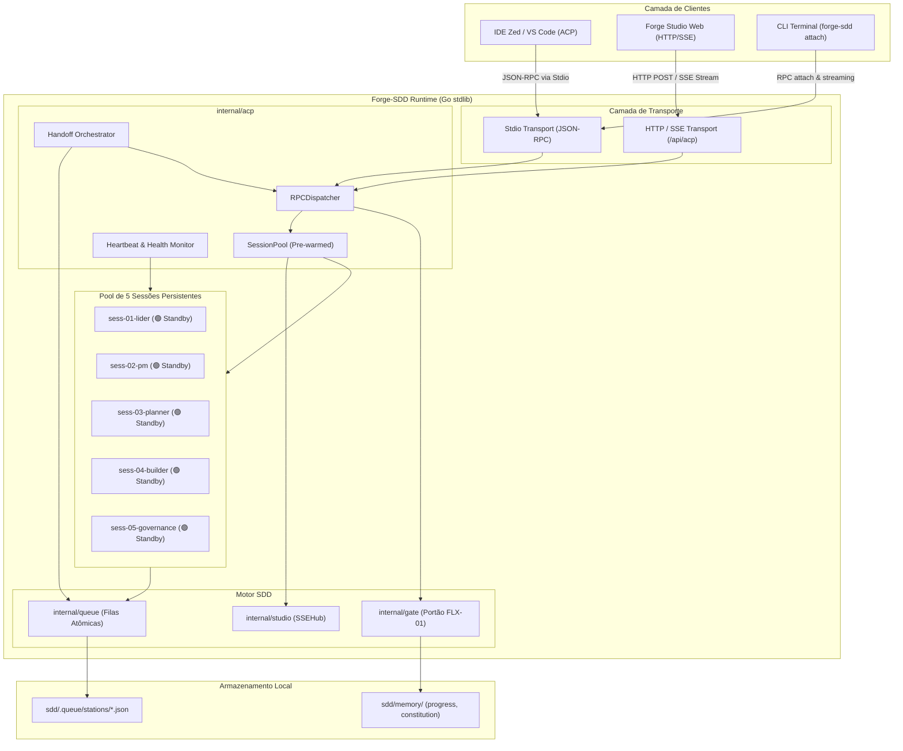
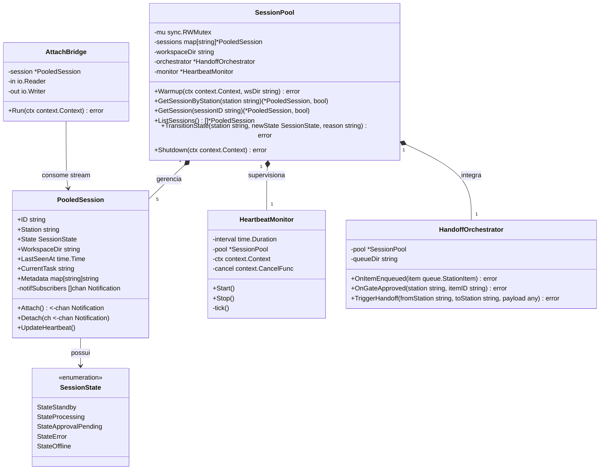
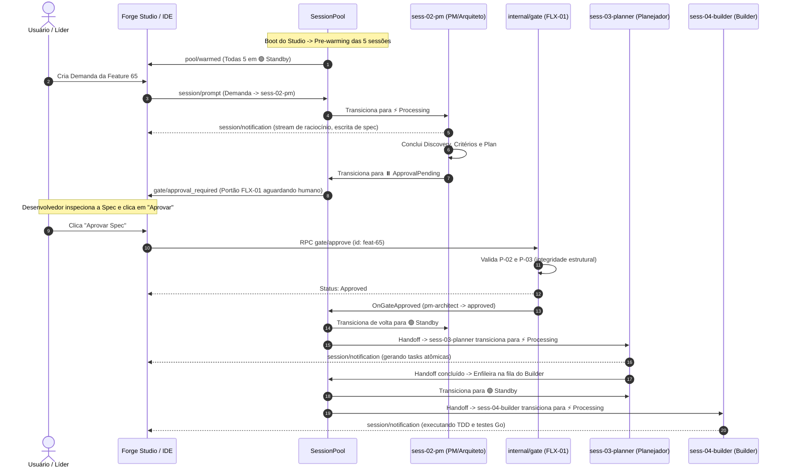

# Discovery — feat-65: Pre-warming do Pool de Sessões ACP e Orquestração Contínua de Estações

## 1. Visão Geral & Problema

### 1.1 Contexto Histórico: A Fricção dos 5 Terminais Manuais
Antes da consolidação do protocolo **Agent Client Protocol (ACP)** no Forge-SDD (introduzido na Feature 64), a operação de uma esteira completa de engenharia orientada a especificações exigia uma rotina manual e dispersa por parte do desenvolvedor:
1. O desenvolvedor precisava abrir manualmente **5 abas ou janelas de terminal** simultaneamente, uma para cada estação canônica da esteira:
   - **Terminal 1:** Líder (Orquestrador)
   - **Terminal 2:** Concepção (PM + Arquiteto Lead)
   - **Terminal 3:** Planejador (`Plan` / Tarefas atômicas)
   - **Terminal 4:** Fila do Builder (Implementação e testes Go)
   - **Terminal 5:** Analista de Governança (Auditoria Camada B Read-Only)
2. Em cada janela, o operador iniciava o agente de IA correspondente (via CLI ou chatmode de ferramenta como Copilot, Claude CLI ou Gemini CLI), instruindo-o a ficar aguardando novidades na fila (`sdd/.queue/stations/`).
3. **Problemas decorrentes desse modelo manual:**
   - **Carga Cognitiva Excessiva:** O desenvolvedor precisava gerenciar o ciclo de vida dos 5 processos no sistema operacional, lembrando qual janela executava qual papel.
   - **Latência de "Cold Start":** Quando uma demanda chegava, o agente precisava carregar o contexto da esteira (`sdd/memory/progress.md`, `sdd/memory/constitution.md`, filas locais) a cada nova invocação.
   - **Risco de Erro Humano:** Comandos de implementação eram frequentemente digitados na janela de Governança ou vice-versa, violando o princípio de responsabilidade única e a segregação de papéis canônicos (`.agents/roles/`).
   - **Falta de Visibilidade Centralizada:** Não havia um indicador unificado dizendo: *"a Estação 02 está ociosa pronta para concepção, enquanto a Estação 04 está compilando código"*.

### 1.2 A Solução: Pool de Sessões ACP Pre-Warmed no Boot
Com o servidor ACP nativo em Go stdlib implementado em `internal/acp`, o Forge-SDD agora possui infraestrutura para eliminar completamente essa fricção:
- Ao inicializar o **Forge Studio** (`forge-sdd studio`) ou o subcomando do servidor ACP (`forge-sdd acp`), o sistema realiza o **pre-warming automático de um pool de 5 sessões ACP persistentes**:
  - `sess-01-lider` (Estação: `lider`)
  - `sess-02-pm` (Estação: `pm-architect`)
  - `sess-03-planner` (Estação: `planner`)
  - `sess-04-builder` (Estação: `builder`)
  - `sess-05-governance` (Estação: `governance`)
- Cada sessão do pool nasce com workspace validado (`SEG-01`, `SEG-02`), regras da Constituição (`sdd/memory/constitution.md`) pré-carregadas e canais de streaming prontos.
- As sessões permanecem em estado **🟢 Standby** (ociosas e alertas), aguardando despachos de fila ou comandos interativos sem consumir CPU com polling agressivo.

### 1.3 Estado Visual e Telemetria em Tempo Real
Tanto o painel web do **Forge Studio** (via SSE) quanto clientes de IDE compatíveis com ACP (Zed, VS Code, Cursor) exibem em tempo real o estado operacional de cada uma das 5 estações:
- 🟢 **`standby` (Standby / Aguardando Fila):** Sessão viva, saudável e pronta para receber demandas instantaneamente.
- ⚡ **`processing` (Processando):** Sessão ocupada executando raciocínio, escrita de código, execução de testes ou geração de documentação.
- ⏸️ **`approval_pending` (Aguardando Portão):** Sessão pausada aguardando decisão humana obrigatória (Portão `FLX-01`) ou veredito de governança.
- 🔴 **`error` (Erro / Falha):** Sessão com falha de execução ou violação estrutural que requer atenção.
- ⚪ **`offline` (Desconectado):** Sessão não inicializada ou finalizada pelo usuário.

### 1.4 Orquestração Contínua de Handoff via ACP
A transição entre as estações passa a ser orquestrada de ponta a ponta sem necessidade de troca manual de terminal:
- Quando a Estação 02 (Concepção) conclui o Discovery e a Spec e o Portão `FLX-01` é aprovado pelo humano (via botão no Studio ou comando ACP `gate/approve`), o despachante ACP aciona automaticamente a sessão pre-warmed da Estação 03 (Planejador) via `session/prompt`.
- O Planejador quebra o trabalho em tasks atômicas e realiza o handoff para a Estação 04 (Builder), que executa a implementação e testes.
- Ao finalizar, o item avança para a Estação 05 (Governança) para veredito automatizado.
- Toda essa progressão emite eventos `session/notification` que alimentam o Studio e a IDE em tempo real.

### 1.5 Ergonomia de Acesso: O Comando `forge-sdd attach [estacao]`
A automação não retira o controle do engenheiro:
- A qualquer momento, o desenvolvedor pode "plugar" seu terminal ou IDE diretamente na sessão de qualquer estação:
  ```bash
  forge-sdd attach builder
  # ou
  forge-sdd attach pm-architect
  ```
- O comando `attach` conecta um leitor e escritor interativo ao fluxo da sessão ACP em tempo real, exibindo os logs de raciocínio, ferramentas invocadas e permitindo intervir com prompts pontuais ou comandos de pausa/cancelamento.

---

## 2. Personas

### Persona 1: Desenvolvedor Solo / Líder Técnico
- **Perfil:** Engenheiro de software full-cycle ou líder técnico responsável por guiar a arquitetura e acompanhar a implementação das features.
- **Dores:**
  - Perda de tempo abrindo 5 terminais e digitando prompts de bootstrap em cada um.
  - Ansiedade de não saber se uma estação está travada, rodando testes pesados ou esperando revisão.
- **Objetivo com o Pool ACP:** Iniciar o ambiente com um comando único (`forge-sdd studio`), ver as 5 estações instantaneamente prontas (verde 🟢), acompanhar o fluxo autônomo e intervir via `forge-sdd attach [estacao]` apenas quando julgar necessário.

### Persona 2: Operador do Forge Studio Web / Cockpit Local
- **Perfil:** Desenvolvedor que prefere trabalhar com uma visão visual rica, acompanhando os mascotes 3D e o kanban de handoffs.
- **Dores:**
  - A interface web anteriormente dependia de recarregar páginas ou de pooling manual para saber quando um agente terminou sua etapa.
- **Objetivo com o Pool ACP:** Visualizar os indicadores de pulso de cada estação (Standby, Processing, Approval), receber atualizações via SSE instantâneas geradas pelo pool ACP e aprovar o Portão FLX-01 diretamente no card da Estação 02.

### Persona 3: Agente Autônomo e Runtime de Execução (LLM Runner)
- **Perfil:** Processos LLM que executam tarefas especializadas (Geração de Spec, Decomposição de Tarefas, TDD Builder, Auditoria de Governança).
- **Dores:**
  - "Cold starts" repetitivos onde o agente precisa ler repetidamente 10 arquivos de regras e memória antes de entender qual é o seu papel.
- **Objetivo com o Pool ACP:** Manter sua sessão persistente (`session/load`), recebendo seu papel canônico (`.agents/roles/*.md`) injetado no pre-warming e recebendo demandas pontuais via `session/prompt` com payload enxuto e determinístico.

---

## 3. Casos de Uso Principais

### UC-01: Inicialização e Pre-warming Automático do Pool no Boot (`pool/init`)
- **Ator:** Forge Studio (`forge-sdd studio`) ou Servidor ACP (`forge-sdd acp --pool`).
- **Pré-condições:** Workspace Forge-SDD válido com diretório `sdd/` inicializado.
- **Fluxo Principal:**
  1. O servidor instancia o `SessionPool` durante o bootstrap da aplicação.
  2. O pool valida a integridade do workspace local (`SEG-01`, `SEG-02`).
  3. O pool itera sobre as 5 estações canônicas (`lider`, `pm-architect`, `planner`, `builder`, `governance`).
  4. Para cada estação, cria uma sessão persistente com ID canônico:
     - `sess-01-lider`
     - `sess-02-pm`
     - `sess-03-planner`
     - `sess-04-builder`
     - `sess-05-governance`
  5. Cada sessão carrega os metadados do papel canônico (`.agents/roles/<station>.md`), workspace raiz e configura o estado inicial como `standby`.
  6. O pool emite notificação broadcast `pool/warmed` informando que todas as 5 estações estão prontas para despacho.

### UC-02: Monitoramento Contínuo, Heartbeat e Detecção de Falhas (`session/heartbeat`)
- **Ator:** `HeartbeatMonitor` (Go routine interna leve).
- **Fluxo Principal:**
  1. A cada intervalo configurado (ex: 5 segundos), o monitor verifica o pulso de cada sessão no pool.
  2. Registra o timestamp da última atividade (`last_seen_at`) e métricas de execução.
  3. Caso uma sessão entre em estado de stall (excesso de tempo sem resposta durante `processing`), emite evento de alerta `session/stalled`.
  4. Caso o processo finalize inesperadamente, o pool restaura a sessão automaticamente para `standby` com workspace limpo.

### UC-03: Despacho Automático de Demandas da Fila para Sessão em Standby
- **Ator:** Motor de Filas (`internal/queue`) e Despachante ACP.
- **Fluxo Principal:**
  1. Um novo item é enfileirado na fila de uma estação (ex: `sdd/.queue/stations/builder.json`).
  2. O despachante do pool detecta o item pendente e verifica se a sessão correspondente (`sess-04-builder`) está em `standby`.
  3. A sessão transiciona seu estado visual para `⚡ processing`.
  4. Uma notificação ACP `session/notification` de tipo `station_state` é emitida para o Studio e IDEs conectadas.
  5. O despachante executa o ciclo de trabalho da estação de forma assíncrona.

### UC-04: Orquestração de Handoff Sequencial e Bloqueio em Portão Humano FLX-01
- **Ator:** Estação 02 (PM & Arquiteto), Desenvolvedor Humano e Estação 03 (Planejador).
- **Fluxo Principal:**
  1. A sessão `sess-02-pm` conclui a elaboração de Discovery, Critérios e Plano.
  2. A sessão transiciona para `⏸️ approval_pending` e registra o item como `pending_review` na fila.
  3. O despachante **bloqueia** qualquer avanço automático e emite notificação `gate/approval_required`.
  4. O Studio exibe o card da Estação 02 em amarelo pulsante com botão de aprovação e modal de visualização de spec.
  5. O desenvolvedor clica em "Aprovar" (ou executa `forge-sdd gate approve`).
  6. O método ACP `gate/approve` valida a integridade dos artefatos (`internal/gate`), atualiza o status para `approved` e devolve a sessão `sess-02-pm` para `🟢 standby`.
  7. O despachante ativa imediatamente a sessão `sess-03-planner`, transicionando-a para `⚡ processing` para gerar a quebra de tarefas.

### UC-05: Conexão Interativa do Usuário via CLI (`forge-sdd attach [estacao]`)
- **Ator:** Desenvolvedor no Terminal.
- **Fluxo Principal:**
  1. O usuário digita no terminal:
     ```bash
     forge-sdd attach builder
     ```
  2. O CLI valida o argumento de estação contra a lista canônica (`queue.CanonicalStations()`).
  3. O comando descobre o servidor ACP local (via socket stdio ou endpoint HTTP `/api/acp` do Studio).
  4. O CLI assina o canal de streaming da sessão `sess-04-builder`.
  5. A saída do terminal exibe um banner com o estado atual da estação (ex: `🟢 Standby`, `⚡ Compilando testes...`).
  6. O usuário pode digitar comandos ou prompts adicionais diretamente para a estação, ou digitar `exit` / `Ctrl+C` para se desacoplar sem derrubar a sessão em segundo plano.

### UC-06: Conexão e Inspecção Remota via IDE/Studio (`session/attach`)
- **Ator:** IDE Client (Zed / VS Code) ou Forge Studio Web.
- **Fluxo Principal:**
  1. O cliente envia a chamada JSON-RPC 2.0:
     ```json
     {"jsonrpc": "2.0", "id": 10, "method": "session/attach", "params": {"station": "pm-architect"}}
     ```
  2. O servidor valida a sessão `sess-02-pm` e devolve os metadados ativos, histórico recente de notificações e o canal de streaming vinculado.
  3. O cliente exibe os logs e o terminal embutido daquela estação específica.

---

## 4. Arquitetura Técnica & C4 Model

### 4.1 C4 Nível 2 — Diagrama de Contêineres e Comunicação
Visualiza como os clientes (IDEs, Forge Studio Web e CLI) comunicam-se com o executável `forge-sdd` e como o novo subsistema `SessionPool` orquestra as 5 sessões persistentes.



### 4.2 C4 Nível 3 — Diagrama de Componentes do Pacote `internal/acp`
Detalhamento estrutural das novas entidades e interfaces em `internal/acp`.



### 4.3 Diagrama de Sequência Mermaid: Orquestração Contínua de Handoff com Portão FLX-01



---

## 5. Análise de Riscos e Mitigações

| ID | Risco Técnico / Operacional | Severidade | Probabilidade | Mitigação Arquitetural |
|---|---|---|---|---|
| **RSK-01** | Race conditions no acesso concorrente aos estados das 5 sessões durante múltiplos despachos | Alta | Média | Uso estrito de `sync.RWMutex` em `SessionPool` e cópia por valor (`defensive copy`) nos métodos de leitura (`GetSession`, `ListSessions`). Testes com `go test -race` obrigatórios (`TST-01`). |
| **RSK-02** | Sessão em processamento entra em loop infinito ou bloqueio em I/O ("deadlock de agente") | Alta | Baixa | Toda execução de prompt é vinculada a um `context.Context` com timeout cancelável. O `HeartbeatMonitor` detecta ausência de telemetria e permite cancelamento gracioso via `session/cancel`. |
| **RSK-03** | Path traversal na inicialização do workspace ou durante o comando `attach` | Crítica | Baixa | Validação rígida com `filepath.Clean` e confinamento ao `allowedRoot` através de `sm.ValidateWorkspace` (`SEG-01`, `SEG-02`). Rejeição imediata de `..` e caracteres nulos. |
| **RSK-04** | Consumo excessivo de recursos (CPU/Memória) por manter 5 sessões ativas simultâneas | Média | Média | As sessões em `standby` são puramente reativas em memória: não executam polling ativo em loop; são acordadas via canais Go (`chan`) acionados por eventos atômicos de arquivo e RPC (`ARQ-03`, `ARQ-04`). |
| **RSK-05** | Tentativa de bypass do Portão FLX-01 na orquestração contínua | Alta | Baixa | O `HandoffOrchestrator` verifica programaticamente o status `approved` chancelado por `internal/gate` antes de despachar a demanda para o Planejador ou Builder. Tentativa de avanço sem aprovação retorna erro canônico `CodeServerError`. |
| **RSK-06** | Encerramento abrupto de terminal conectado via `forge-sdd attach` derrubar o servidor ou a sessão | Média | Alta | A abstração de `AttachBridge` trata o encerramento do cliente como simples desassociação (`Detach`), sem propagar encerramento para o processo do pool ou alterar o estado da sessão. |

---

## 6. Próximos Passos
1. Submeter o presente Discovery, juntamente com `criteria-65-prewarming-pool-sessoes-acp-estacoes.md` e `plan-65-prewarming-pool-sessoes-acp-estacoes.md`, à revisão humana formal via **Portão FLX-01**.
2. Atualizar a fila da Estação 02 em `sdd/.queue/stations/pm-architect.json` com status `pending_review`.
3. Aguardar aprovação do Líder/Humano no Forge Studio antes de iniciar o planejamento e fatiamento pelo Planejador (Estação 03).
