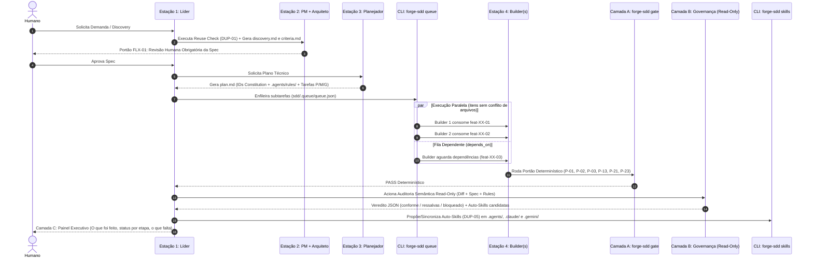
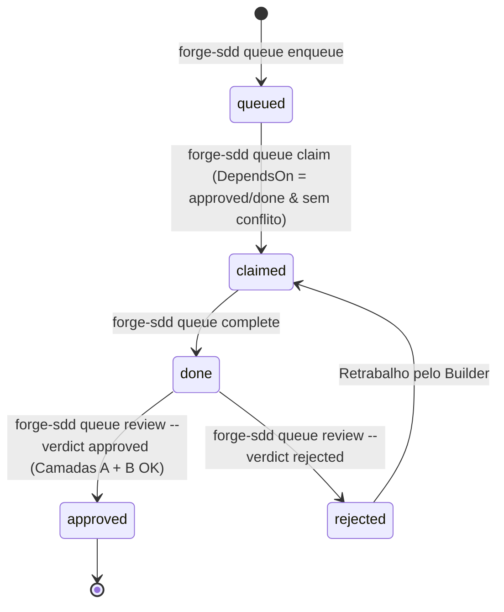
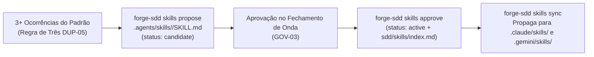

# Fluxos Operacionais — forge-sdd (v3.0.0-beta)

## 1. Esteira Completa das 5 Estações + Portão em 3 Camadas (A / B / C)

---

## 2. Máquina de Estados da Fila do Builder (`sdd/.queue/queue.json`)

---

## 3. Ciclo de Vida de Auto-Skills (`DUP-05` / `GOV-03`)

