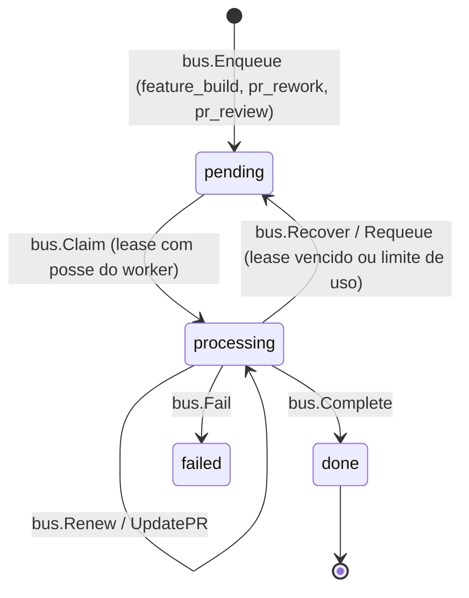
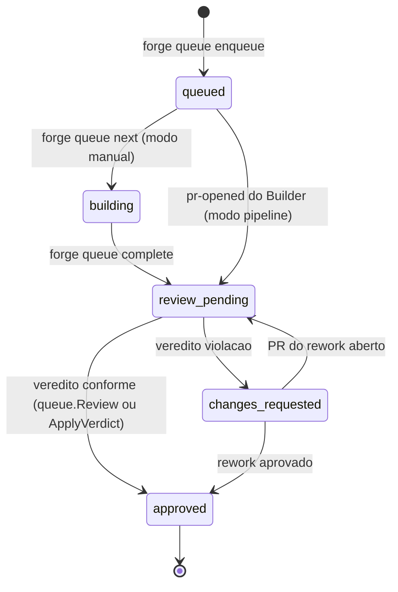
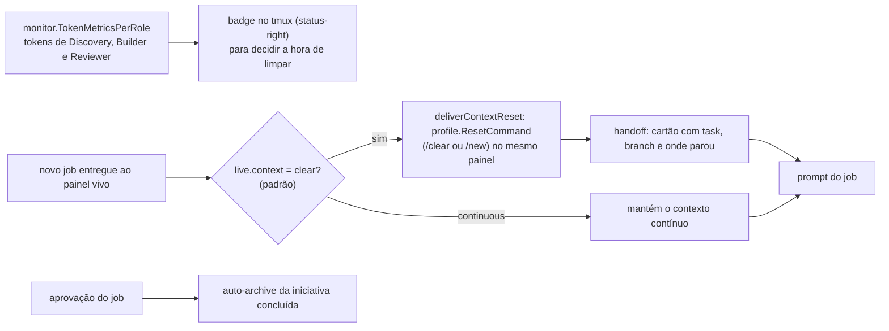
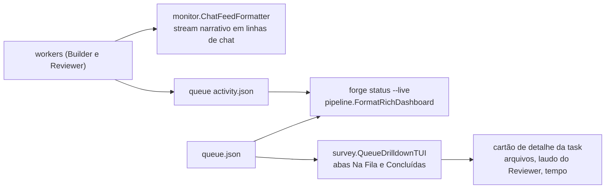
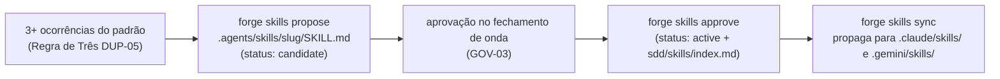
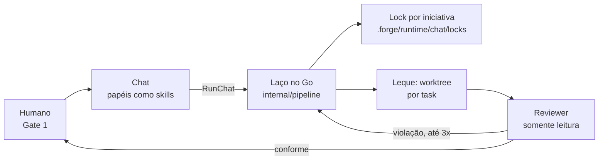

# Fluxos Operacionais — forge-sdd (v5.0.0)

## 1. Pipeline Multi-Sessão: da ideia ao PR aprovado (ADR-0004)

```mermaid
sequenceDiagram
    autonumber
    actor H as Humano
    participant D as Sessão Discovery
    participant BUS as Barramento (.forge/runtime)
    participant B as Sessão Builder (worker)
    participant GA as Camada A (forge gate)
    participant R as Sessão Reviewer (worker, só leitura)
    participant Q as queue.json da iniciativa

    H->>D: /discovery e /split-features (aprova a spec, FLX-01)
    D->>BUS: forge dispatch: gate pré-build + job feature_build (Initiative + TaskIDs)
    B->>BUS: claim do job; constrói em ondas paralelas (depends_on)
    B->>B: abre o PR e registra: forge pipeline pr-opened
    B->>Q: tasks do job -> review_pending
    B->>BUS: complete + enfileira job pr_review
    R->>GA: Camada A determinística (P-xx)
    R->>R: Camada B semântica: diff x spec x ADRs x rules
    R->>BUS: forge bus review --verdict-file (veredito JSON)
    alt conforme
        BUS->>Q: tasks do job -> approved (ADR-0012)
        BUS->>D: notificação "PR pronto" (inbox, toast, e-mail, webhook)
        BUS->>BUS: auto-archive se todas as tasks estão approved
        H->>D: aprovação final do PR
    else violação (tentativas restantes)
        BUS->>B: job pr_rework com feedback e tentativa + 1
    else violação no limite ou dúvida
        BUS->>D: escalação para a pessoa
    end
```

O Reviewer não escreve no repositório (`SEG-06`). Quem guarda o veredito em `sdd/discovery/<id>/verdicts/<job>.json` e atualiza a fila é o Go, dentro de `ApplyVerdict`.

---

## 2. Estados do job no barramento (`.forge/runtime/<papel>/<estado>/`)



A Discovery usa os estados `inbox` e `archive` para as notificações.

---

## 3. Estados das tasks da fila (`sdd/discovery/<id>/queue.json`)



No modo pipeline o job trata um bloco de tasks: `SetTaskStatuses` aplica a transição a todas as tasks de `job.TaskIDs`, na iniciativa `job.Initiative`. Uma task `approved` nunca regride.

---

## 4. Tokens por janela e reset suave de contexto (ADR-0009)



O reset acontece **por job**, na entrega, e nunca fecha o painel do tmux. O modo é `clear` (padrão) ou `continuous` (feat 77). Perfis sem `reset_command` mantêm o contexto contínuo e avisam no terminal.

---

## 5. Acompanhamento: painel vivo e fila com drill-down (ADR-0011)



---

## 6. Ciclo de Vida de Auto-Skills (`DUP-05` / `GOV-03`)



---

## 7. Modo `chat`: pipeline em subagentes (ADR-0015)



O Go grava o estado do laço e valida contratos (`internal/harness`); o modelo só devolve conteúdo. `Retomar` continua um laço interrompido. O modo `sessions` (seções 1 a 5) segue válido.
