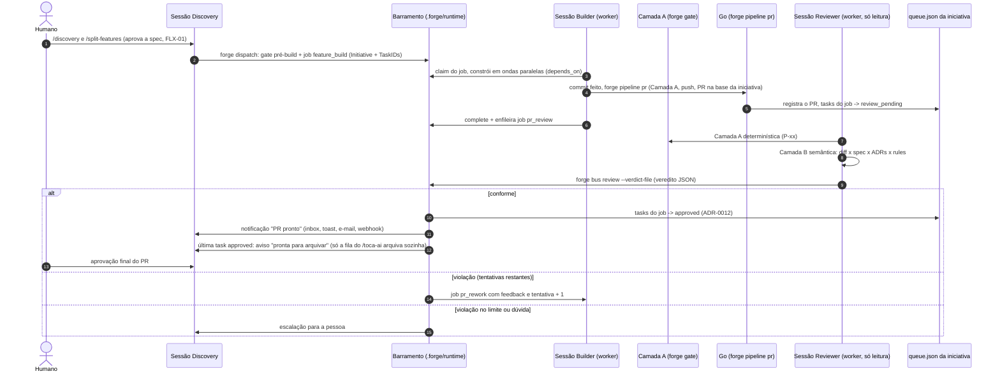
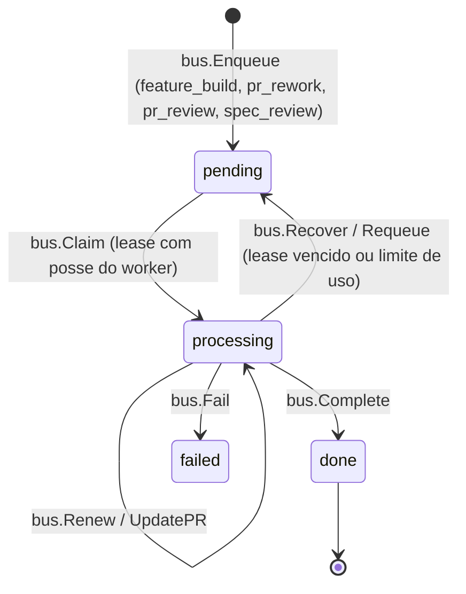
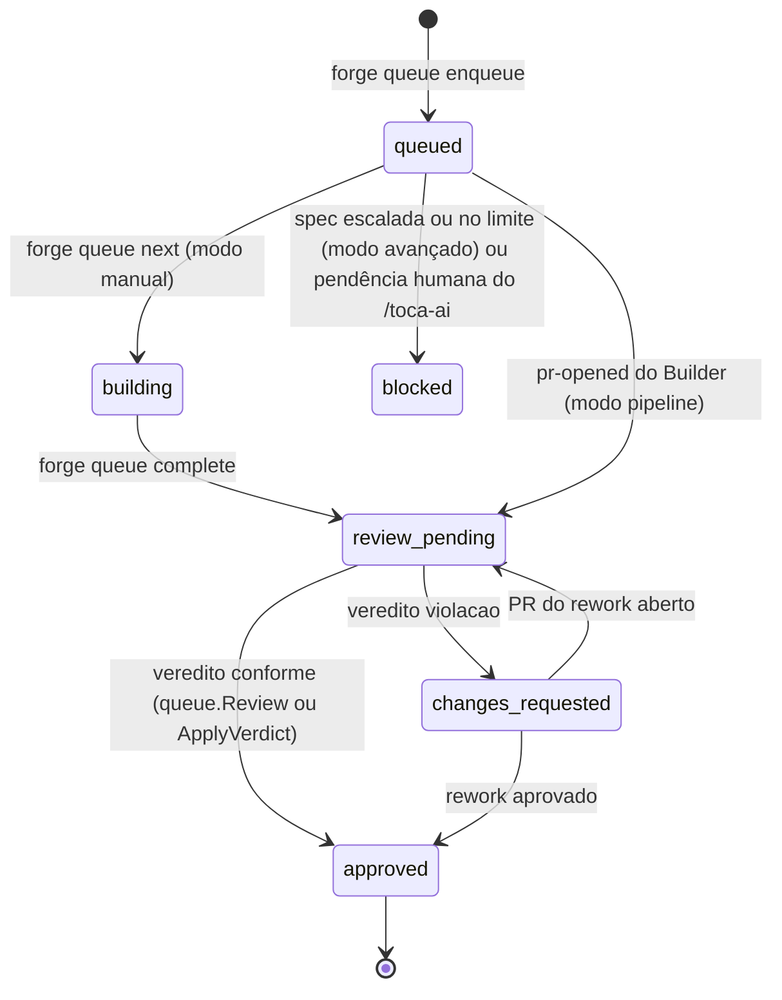
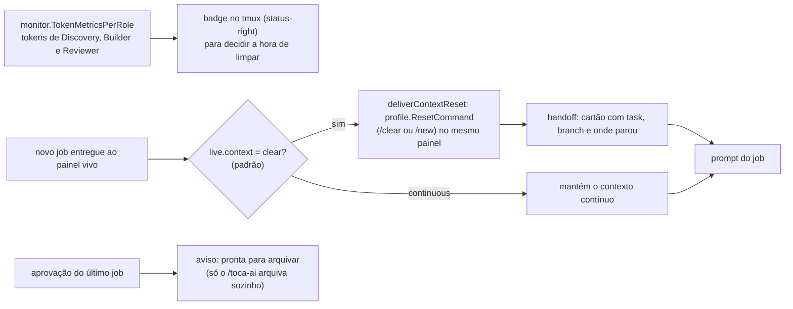
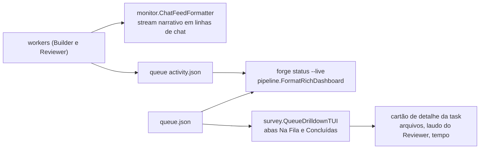
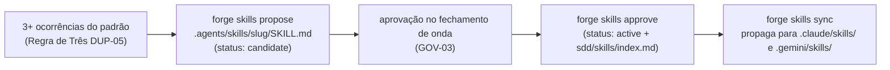
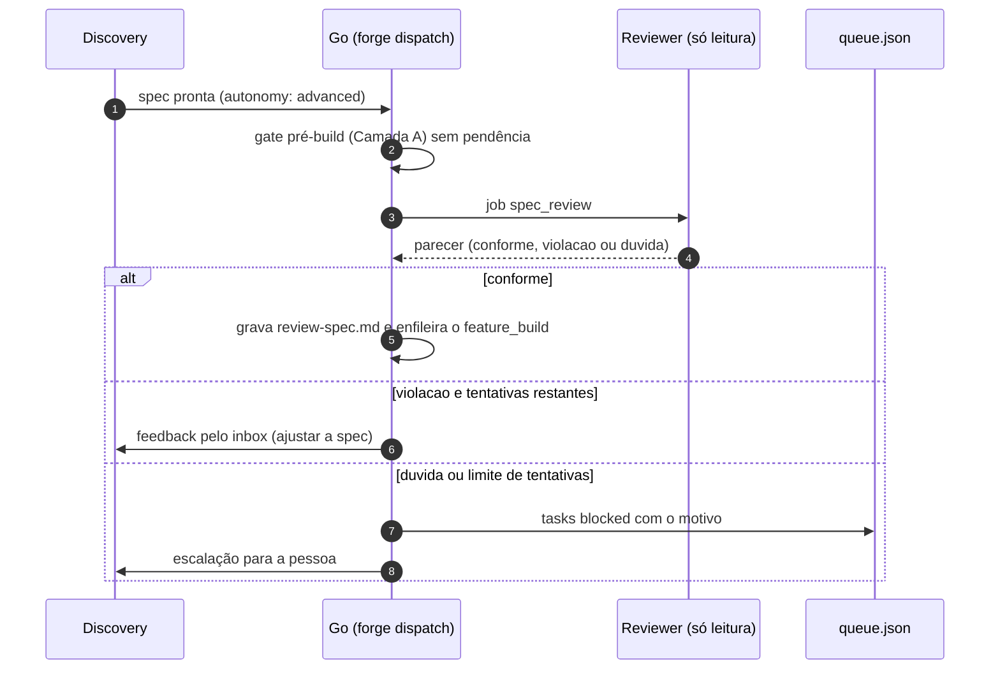
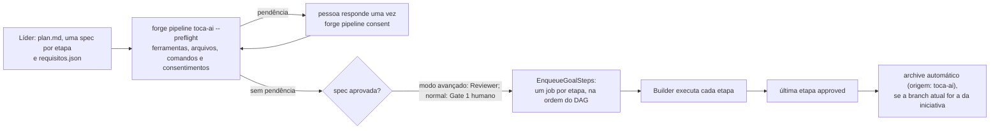
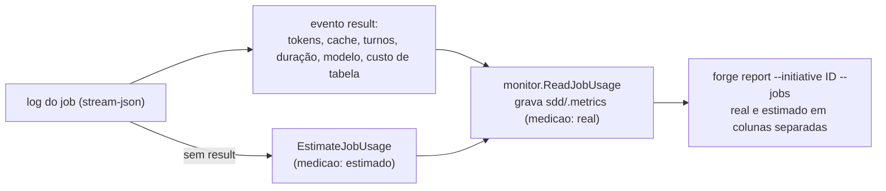

# Fluxos Operacionais — forge-sdd (v4.9.1-beta + iniciativas 89 e 90, na feat/88)

## 1. Pipeline Multi-Sessão: da ideia ao PR aprovado (ADR-0004)

O Reviewer não escreve no repositório (`SEG-06`). Quem guarda o veredito em `sdd/discovery/<id>/verdicts/<job>.json` e atualiza a fila é o Go, dentro de `ApplyVerdict`. O push e o PR também são do Go (`forge pipeline pr`, ADR-0014): o Builder só faz o commit. Quem abre o PR à mão usa `forge pipeline pr-opened`.

A base do PR é a da iniciativa: `queue.ResolveBase` usa, nesta ordem, a flag `--base`, o `base_branch` da fila, a origem da branch no git e o `base_branch` do `forge.json`. `forge dispatch <iniciativa> --fix fix-NN-NN` leva um fix pelo mesmo caminho, com a base na branch da iniciativa.

---

## 2. Estados do job no barramento (`.forge/runtime/<papel>/<estado>/`)

A Discovery usa os estados `inbox` e `archive` para as notificações.

---

## 3. Estados das tasks da fila (`sdd/discovery/<id>/queue.json`)

No modo pipeline o job trata um bloco de tasks: `SetTaskStatuses` aplica a transição a todas as tasks de `job.TaskIDs`, na iniciativa `job.Initiative`. Uma task `approved` nunca regride. Uma task `blocked` guarda o motivo e só sai dela por decisão da pessoa; as tasks independentes seguem (`BlockTasks`).

---

## 4. Tokens por janela e reset suave de contexto (ADR-0009)

O reset acontece **por job**, na entrega, e nunca fecha o painel do tmux. O modo é `clear` (padrão) ou `continuous` (feat 77). Perfis sem `reset_command` mantêm o contexto contínuo e avisam no terminal.

---

## 5. Acompanhamento: painel vivo e fila com drill-down (ADR-0011)

---

## 6. Ciclo de Vida de Auto-Skills (`DUP-05` / `GOV-03`)

---

## 7. Modo avançado: o Reviewer revisa a spec (ADR-0013)

O modo exige `permissions: full` e `isolated_confirmed`. Os tetos de tokens, tempo e jobs por dia (`safeguards`) são opcionais e nascem desligados; `.forge/runtime/STOP` para a esteira de forma limpa.

---

## 8. `/toca-ai`: pré-voo e uma etapa por job (iniciativa 89)

O consentimento só é gravado em terminal interativo (`.forge/runtime/consents.json`): o agente nunca o concede. Reenviar o comando não duplica jobs. Cada etapa sai com a branch `feat/<iniciativa>-<etapa>`. O archive automático só ocorre com a branch da iniciativa em uso (`branchGuard`) e `layout.FromBranch` não reconhece a branch de etapa como a da iniciativa. Limitação conhecida: `ApplyVerdict` descarta o resultado de `CheckAndAutoArchive`, então a recusa é silenciosa, sem aviso no inbox.

---

## 9. Uso real por job e relatório (ADR-0014)

Só o `claude` informa o uso real; nas outras CLIs o registro segue estimado. O custo é preço de tabela da API, útil para comparar jobs.
